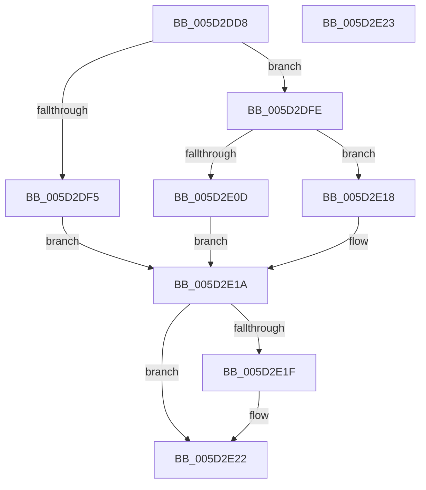

# PopFxIsDirectedPowerTransitionSupported

- RVA: `0x005D2DD8`–`0x005D2E24` (길이 `76` bytes)
- VA: `0x00000001405D2DD8`
- 실행 섹션: `.text`
- PDB 이름 있음: `예`; PDB Function 태그: `아니요`
- unwind 정보 RVA: `0x000DB714`
- 디코드: `23`개 명령, `76/76` bytes 표시
- 미해석 바이트: `0` (있으면 어셈블리에 `.byte`로 보존)

> 이 문서는 커널 이미지의 기계어와 PDB 기호를 분석해 생성했습니다. 4번과 5번은 함수 원형과 자료형을 바이너리 사용 방식에서 추정한 C 해석이며 원본 소스 복구 결과는 아닙니다.

## 1. Dependencies

- 직접 호출 지점: **0**; 고유 호출 대상: **0**
- 직접 호출자로 확인된 함수: **2**
- RIP 상대 이미지 참조: **0**

### Outgoing calls
- 직접 디코드된 call 명령이 없습니다.

### Direct callers
- [PopDripsWatchdogCallbackHandler](../../page/76/PopDripsWatchdogCallbackHandler_function_0076C1C0.md) at `0x0076C2D3`
- [PopDirectedDripsBuildBroadcastTreeFull](../../page/77/PopDirectedDripsBuildBroadcastTreeFull_function_00771970.md) at `0x00771A54`

### Static image references
- 디코드된 RIP-relative 메모리 참조가 없습니다.

## 2. Other-region calls and transfers

- 다른 실행 섹션으로 향하는 call: **0**
- 별도 외부 분기/꼬리 이동을 확인하지 못했습니다.

## 3. Assembly (complete function range)

```asm
005D2DD8  45 33 C9                        xor r9d, r9d
005D2DDB  45 8B C1                        mov r8d, r9d
005D2DDE  33 C0                           xor eax, eax
005D2DE0  F0 44 0F B1 89 60 03 00 00      lock cmpxchg dword ptr [rcx + 0x360], r9d
005D2DE9  25 00 09 00 00                  and eax, 0x900
005D2DEE  3D 00 01 00 00                  cmp eax, 0x100
005D2DF3  75 09                           jne 0x1405d2dfe
005D2DF5  41 8A C1                        mov al, r9b
005D2DF8  45 8D 41 02                     lea r8d, [r9 + 2]
005D2DFC  EB 1C                           jmp 0x1405d2e1a
005D2DFE  33 C0                           xor eax, eax
005D2E00  F0 44 0F B1 89 60 03 00 00      lock cmpxchg dword ptr [rcx + 0x360], r9d
005D2E09  A8 20                           test al, 0x20
005D2E0B  75 0B                           jne 0x1405d2e18
005D2E0D  41 8A C1                        mov al, r9b
005D2E10  41 B8 01 00 00 00               mov r8d, 1
005D2E16  EB 02                           jmp 0x1405d2e1a
005D2E18  B0 01                           mov al, 1
005D2E1A  48 85 D2                        test rdx, rdx
005D2E1D  74 03                           je 0x1405d2e22
005D2E1F  44 89 02                        mov dword ptr [rdx], r8d
005D2E22  C3                              ret
005D2E23  CC                              int3
```

## 4. C-style interpretation (structured pseudocode)

```c
__int64 __fastcall PopFxIsDirectedPowerTransitionSupported(__int64 a1, __int64 a2, __int64 a3, int a4)
{
    __int64 result;

    a4 = 0;
    result = 0;
    result = (unsigned int)((result) & (0x900ULL));
    if (((unsigned int)(result)) != 256) goto loc_005D2DFE;
    goto loc_005D2E1A;
loc_005D2DFE:
    result = 0;
    if (((0) & (32)) != 0) goto loc_005D2E18;
    goto loc_005D2E1A;
loc_005D2E18:
loc_005D2E1A:
    if (a2 != 0) {
        *(unsigned int *)(a2) = 1;
    }
    return 1;
}
```

## 5. (Beta) C Style

```c
int64_t PopFxIsDirectedPowerTransitionSupported(void *Arg1, int64_t Arg2, int64_t Arg3, int32_t Arg4)
{
    uint8_t *arg1 = (uint8_t *)Arg1;

    int64_t result;

    Arg4 = 0;
    result = 0;
    result = (uint32_t)((result) & (0x900ULL));
    if (((uint32_t)(result)) != 256) goto loc_005D2DFE;
    goto loc_005D2E1A;
loc_005D2DFE:
    result = 0;
    if (((0) & (32)) != 0) goto loc_005D2E18;
    goto loc_005D2E1A;
loc_005D2E18:
loc_005D2E1A:
    if (Arg2 != 0) {
        *(uint32_t *)(Arg2) = 1;
    }
    return 1;
}
```

### 관측된 메모리 오프셋

구조체 형식이 확인되지 않은 접근은 인자 기준의 오프셋으로만 기록했습니다.

| 기준 인자 | 오프셋 표현 | 폭 (bit) | 접근 |
|---|---:|---:|---|
| `Arg1` | `+ 0x360` | `32` | `R` |

## 6. Execution-region graph

[열기: 2D/3D 그래프와 함수 탐색 컨트롤 패널](../../../control-panel.html?section=text&rva=0x005D2DD8&view=graph)

- 2D 그래프는 위에서 아래로 흐르고, 3D 그래프는 빈 공간을 드래그해 회전합니다. Shift+드래그는 이동, 휠은 확대·축소, 함수 노드 선택은 대상 보고서 이동입니다.

### Static fallback


