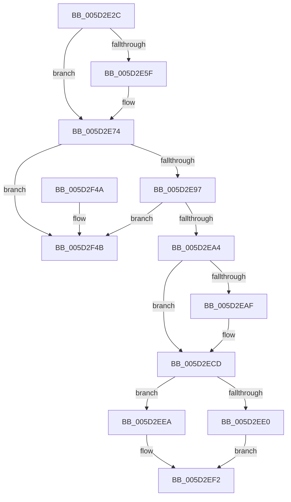

# PopFxIssueDirectedPowerTransition

- RVA: `0x005D2E2C`–`0x005D2F60` (길이 `308` bytes)
- VA: `0x00000001405D2E2C`
- 실행 섹션: `.text`
- PDB 이름 있음: `예`; PDB Function 태그: `아니요`
- unwind 정보 RVA: `0x000849C0`
- 디코드: `79`개 명령, `308/308` bytes 표시
- 미해석 바이트: `0` (있으면 어셈블리에 `.byte`로 보존)

> 이 문서는 커널 이미지의 기계어와 PDB 기호를 분석해 생성했습니다. 4번과 5번은 함수 원형과 자료형을 바이너리 사용 방식에서 추정한 C 해석이며 원본 소스 복구 결과는 아닙니다.

## 1. Dependencies

- 직접 호출 지점: **7**; 고유 호출 대상: **5**
- 직접 호출자로 확인된 함수: **1**
- RIP 상대 이미지 참조: **0**

### Outgoing calls
- `0x005D2E6E` → [PopFxBugCheck](../2B/PopFxBugCheck_function_002BFC6C.md) (function, `0x002BFC6C`)
- `0x005D2E7E` → [KeAcquireSpinLockRaiseToDpc](../20/KeAcquireSpinLockRaiseToDpc_function_00208470.md) (function, `0x00208470`)
- `0x005D2EC7` → [PopFxBugCheck](../2B/PopFxBugCheck_function_002BFC6C.md) (function, `0x002BFC6C`)
- `0x005D2EFA` → [PopFxReferenceDevice](../2B/PopFxReferenceDevice_function_002BFD9C.md) (function, `0x002BFD9C`)
- `0x005D2F21` → [PopFxQueueWorkOrder](../2B/PopFxQueueWorkOrder_function_002BFD34.md) (function, `0x002BFD34`)
- `0x005D2F2C` → [KeReleaseSpinLock](../39/KeReleaseSpinLock_function_00392BA0.md) (function, `0x00392BA0`)
- `0x005D2F5A` → [PopFxBugCheck](../2B/PopFxBugCheck_function_002BFC6C.md) (function, `0x002BFC6C`)

### Direct callers
- [PopIssueDirectedPowerTransition](../../page/AD/PopIssueDirectedPowerTransition_function_00AD158C.md) at `0x00AD15D9`

### Static image references
- 디코드된 RIP-relative 메모리 참조가 없습니다.

## 2. Other-region calls and transfers

- 다른 실행 섹션으로 향하는 call: **0**
- 별도 외부 분기/꼬리 이동을 확인하지 못했습니다.

## 3. Assembly (complete function range)

```asm
005D2E2C  48 89 5C 24 08                  mov qword ptr [rsp + 8], rbx
005D2E31  48 89 6C 24 10                  mov qword ptr [rsp + 0x10], rbp
005D2E36  48 89 74 24 18                  mov qword ptr [rsp + 0x18], rsi
005D2E3B  57                              push rdi
005D2E3C  41 56                           push r14
005D2E3E  41 57                           push r15
005D2E40  48 83 EC 20                     sub rsp, 0x20
005D2E44  45 33 FF                        xor r15d, r15d
005D2E47  49 8B E8                        mov rbp, r8
005D2E4A  33 C0                           xor eax, eax
005D2E4C  40 8A FA                        mov dil, dl
005D2E4F  48 8B D9                        mov rbx, rcx
005D2E52  F0 44 0F B1 B9 60 03 00 00      lock cmpxchg dword ptr [rcx + 0x360], r15d
005D2E5B  A8 20                           test al, 0x20
005D2E5D  75 15                           jne 0x1405d2e74
005D2E5F  4C 8B C1                        mov r8, rcx
005D2E62  41 8D 57 01                     lea edx, [r15 + 1]
005D2E66  B9 10 09 00 00                  mov ecx, 0x910
005D2E6B  45 33 C9                        xor r9d, r9d
005D2E6E  E8 F9 CD CE FF                  call 0x1402bfc6c
005D2E73  CC                              int3
005D2E74  48 8D B1 A8 04 00 00            lea rsi, [rcx + 0x4a8]
005D2E7B  48 8B CE                        mov rcx, rsi
005D2E7E  E8 ED 55 C3 FF                  call 0x140208470
005D2E83  8B 4B 20                        mov ecx, dword ptr [rbx + 0x20]
005D2E86  44 8A F0                        mov r14b, al
005D2E89  8B 93 B0 04 00 00               mov edx, dword ptr [rbx + 0x4b0]
005D2E8F  85 D2                           test edx, edx
005D2E91  0F 85 B4 00 00 00               jne 0x1405d2f4b
005D2E97  BA 00 20 00 00                  mov edx, 0x2000
005D2E9C  85 CA                           test edx, ecx
005D2E9E  0F 85 A7 00 00 00               jne 0x1405d2f4b
005D2EA4  C1 E9 0C                        shr ecx, 0xc
005D2EA7  83 E1 01                        and ecx, 1
005D2EAA  40 3A CF                        cmp cl, dil
005D2EAD  75 1E                           jne 0x1405d2ecd
005D2EAF  40 F6 DF                        neg dil
005D2EB2  4C 8B C3                        mov r8, rbx
005D2EB5  B9 10 09 00 00                  mov ecx, 0x910
005D2EBA  48 1B D2                        sbb rdx, rdx
005D2EBD  45 33 C9                        xor r9d, r9d
005D2EC0  48 F7 DA                        neg rdx
005D2EC3  48 83 C2 04                     add rdx, 4
005D2EC7  E8 A0 CD CE FF                  call 0x1402bfc6c
005D2ECC  CC                              int3
005D2ECD  C7 83 B0 04 00 00 02 00 00 00   mov dword ptr [rbx + 0x4b0], 2
005D2ED7  F0 09 53 20                     lock or dword ptr [rbx + 0x20], edx
005D2EDB  40 84 FF                        test dil, dil
005D2EDE  74 0A                           je 0x1405d2eea
005D2EE0  F0 81 4B 20 00 10 00 00         lock or dword ptr [rbx + 0x20], 0x1000
005D2EE8  EB 08                           jmp 0x1405d2ef2
005D2EEA  F0 81 63 20 FF EF FF FF         lock and dword ptr [rbx + 0x20], 0xffffefff
005D2EF2  BA 05 00 00 00                  mov edx, 5
005D2EF7  48 8B CB                        mov rcx, rbx
005D2EFA  E8 9D CE CE FF                  call 0x1402bfd9c
005D2EFF  83 A3 C4 04 00 00 FC            and dword ptr [rbx + 0x4c4], 0xfffffffc
005D2F06  48 8D 8B C0 03 00 00            lea rcx, [rbx + 0x3c0]
005D2F0D  48 8B D3                        mov rdx, rbx
005D2F10  48 89 AB B8 04 00 00            mov qword ptr [rbx + 0x4b8], rbp
005D2F17  C7 83 C0 04 00 00 84 01 00 C0   mov dword ptr [rbx + 0x4c0], 0xc0000184
005D2F21  E8 0E CE CE FF                  call 0x1402bfd34
005D2F26  41 8A D6                        mov dl, r14b
005D2F29  48 8B CE                        mov rcx, rsi
005D2F2C  E8 6F FC DB FF                  call 0x140392ba0
005D2F31  48 8B 5C 24 40                  mov rbx, qword ptr [rsp + 0x40]
005D2F36  48 8B 6C 24 48                  mov rbp, qword ptr [rsp + 0x48]
005D2F3B  48 8B 74 24 50                  mov rsi, qword ptr [rsp + 0x50]
005D2F40  48 83 C4 20                     add rsp, 0x20
005D2F44  41 5F                           pop r15
005D2F46  41 5E                           pop r14
005D2F48  5F                              pop rdi
005D2F49  C3                              ret
005D2F4A  CC                              int3
005D2F4B  45 33 C9                        xor r9d, r9d
005D2F4E  4C 8B C3                        mov r8, rbx
005D2F51  B9 10 09 00 00                  mov ecx, 0x910
005D2F56  41 8D 51 03                     lea edx, [r9 + 3]
005D2F5A  E8 0D CD CE FF                  call 0x1402bfc6c
005D2F5F  CC                              int3
```

## 4. C-style interpretation (structured pseudocode)

```c
__int64 __fastcall PopFxIssueDirectedPowerTransition(__int64 a1, unsigned __int8 a2, __int64 a3, int a4)
{
    __int64 result;
    __int64 v_r15;
    __int64 v_rdi;
    __int64 v_rsp;
    unsigned __int64 v_stack_p10;
    unsigned __int64 v_stack_p18;
    unsigned __int64 v_stack_p8;

    v_stack_p8 = v_rbx;
    v_stack_p10 = v_rbp;
    v_stack_p18 = v_rsi;
    v_rsp = (v_rsp) - (32);
    v_r15 = 0;
    result = 0;
    if (((0) & (32)) == 0) {
        a3 = a1;
        a2 = v_r15 + 1;
        a1 = 0x910ULL;
        a4 = 0;
        result = PopFxBugCheck(a1, a2, a3, a4);
    }
    result = KeAcquireSpinLockRaiseToDpc(a1 + 1192, a2, a3, a4);
    if ((unsigned int)((unsigned int)(*(unsigned int *)(a1 + 1200))) != 0) goto loc_005D2F4B;
    if ((((unsigned int)((unsigned int)(0x2000ULL))) & ((unsigned int)((unsigned int)(*(unsigned int *)(a1 + 32))))) != 0) goto loc_005D2F4B;
    a1 = (unsigned int)(((unsigned int)(*(unsigned int *)(a1 + 32))) >> (12));
    a1 = (unsigned int)((a1) & (1));
    v_rdi = a2;
    if (((unsigned __int8)(a1)) == a2) {
        v_rdi = (unsigned __int8)(-(a2));
        a3 = a1;
        a1 = 0x910ULL;
        a4 = 0;
        a2 = -((unsigned int)(0x2000ULL));
        a2 = (a2) + (4);
        result = PopFxBugCheck(a1, a2, a3, a4);
    }
    *(unsigned int *)(a1 + 1200) = 2;
    if ((unsigned __int8)(v_rdi) == 0) goto loc_005D2EEA;
    goto loc_005D2EF2;
loc_005D2EEA:
loc_005D2EF2:
    result = PopFxReferenceDevice(a1, 5, a3, a4);
    *(unsigned __int64 *)(a1 + 1208) = a3;
    *(unsigned int *)(a1 + 1216) = 0xC0000184ULL;
    result = PopFxQueueWorkOrder(a1 + 960, a1, a3, a4);
    result = KeReleaseSpinLock(a1 + 1192, (unsigned __int8)((unsigned __int8)(result)), a3, a4);
    v_rsp = (v_rsp) + (32);
    return result;
loc_005D2F4B:
    a4 = 0;
    result = PopFxBugCheck((unsigned int)(0x910ULL), a4 + 3, v_stack_p8, a4);
    return result;
}
```

## 5. (Beta) C Style

```c
int64_t PopFxIssueDirectedPowerTransition(void *Arg1, uint8_t Arg2, int64_t Arg3, int32_t Arg4)
{
    uint8_t *arg1 = (uint8_t *)Arg1;

    int64_t result;
    int64_t local_r15;
    int64_t local_rdi;
    int64_t local_rsp;
    uint64_t v_stack_p10;
    uint64_t v_stack_p18;
    uint64_t v_stack_p8;

    v_stack_p8 = local_rbx;
    v_stack_p10 = local_rbp;
    v_stack_p18 = local_rsi;
    local_rsp = (local_rsp) - (32);
    local_r15 = 0;
    result = 0;
    if (((0) & (32)) == 0) {
        Arg3 = Arg1;
        Arg2 = local_r15 + 1;
        Arg1 = 0x910ULL;
        Arg4 = 0;
        result = PopFxBugCheck(Arg1, Arg2, Arg3, Arg4);
    }
    result = KeAcquireSpinLockRaiseToDpc(Arg1 + 1192, Arg2, Arg3, Arg4);
    if ((uint32_t)((uint32_t)(*(uint32_t *)(arg1 + 0x4B0))) != 0) goto loc_005D2F4B;
    if ((((uint32_t)((uint32_t)(0x2000ULL))) & ((uint32_t)((uint32_t)(*(uint32_t *)(arg1 + 0x20))))) != 0) goto loc_005D2F4B;
    Arg1 = (uint32_t)(((uint32_t)(*(uint32_t *)(arg1 + 0x20))) >> (12));
    Arg1 = (uint32_t)((Arg1) & (1));
    local_rdi = Arg2;
    if (((uint8_t)(Arg1)) == Arg2) {
        local_rdi = (uint8_t)(-(Arg2));
        Arg3 = Arg1;
        Arg1 = 0x910ULL;
        Arg4 = 0;
        Arg2 = -((uint32_t)(0x2000ULL));
        Arg2 = (Arg2) + (4);
        result = PopFxBugCheck(Arg1, Arg2, Arg3, Arg4);
    }
    *(uint32_t *)(arg1 + 0x4B0) = 2;
    if ((uint8_t)(local_rdi) == 0) goto loc_005D2EEA;
    goto loc_005D2EF2;
loc_005D2EEA:
loc_005D2EF2:
    result = PopFxReferenceDevice(Arg1, 5, Arg3, Arg4);
    *(uint64_t *)(arg1 + 0x4B8) = Arg3;
    *(uint32_t *)(arg1 + 0x4C0) = 0xC0000184ULL;
    result = PopFxQueueWorkOrder(Arg1 + 960, Arg1, Arg3, Arg4);
    result = KeReleaseSpinLock(Arg1 + 1192, (uint8_t)((uint8_t)(result)), Arg3, Arg4);
    local_rsp = (local_rsp) + (32);
    return result;
loc_005D2F4B:
    Arg4 = 0;
    result = PopFxBugCheck((uint32_t)(0x910ULL), Arg4 + 3, v_stack_p8, Arg4);
    return result;
}
```

### 관측된 메모리 오프셋

구조체 형식이 확인되지 않은 접근은 인자 기준의 오프셋으로만 기록했습니다.

| 기준 인자 | 오프셋 표현 | 폭 (bit) | 접근 |
|---|---:|---:|---|
| `Arg1` | `+ 0x20` | `32` | `R` |
| `Arg1` | `+ 0x20` | `32` | `R/W` |
| `Arg1` | `+ 0x360` | `32` | `R` |
| `Arg1` | `+ 0x3C0` | `64` | `R` |
| `Arg1` | `+ 0x4B0` | `32` | `R` |
| `Arg1` | `+ 0x4B0` | `32` | `W` |
| `Arg1` | `+ 0x4B8` | `64` | `W` |
| `Arg1` | `+ 0x4C0` | `32` | `W` |
| `Arg1` | `+ 0x4C4` | `32` | `R/W` |

## 6. Execution-region graph

[열기: 2D/3D 그래프와 함수 탐색 컨트롤 패널](../../../control-panel.html?section=text&rva=0x005D2E2C&view=graph)

- 2D 그래프는 위에서 아래로 흐르고, 3D 그래프는 빈 공간을 드래그해 회전합니다. Shift+드래그는 이동, 휠은 확대·축소, 함수 노드 선택은 대상 보고서 이동입니다.

### Static fallback


