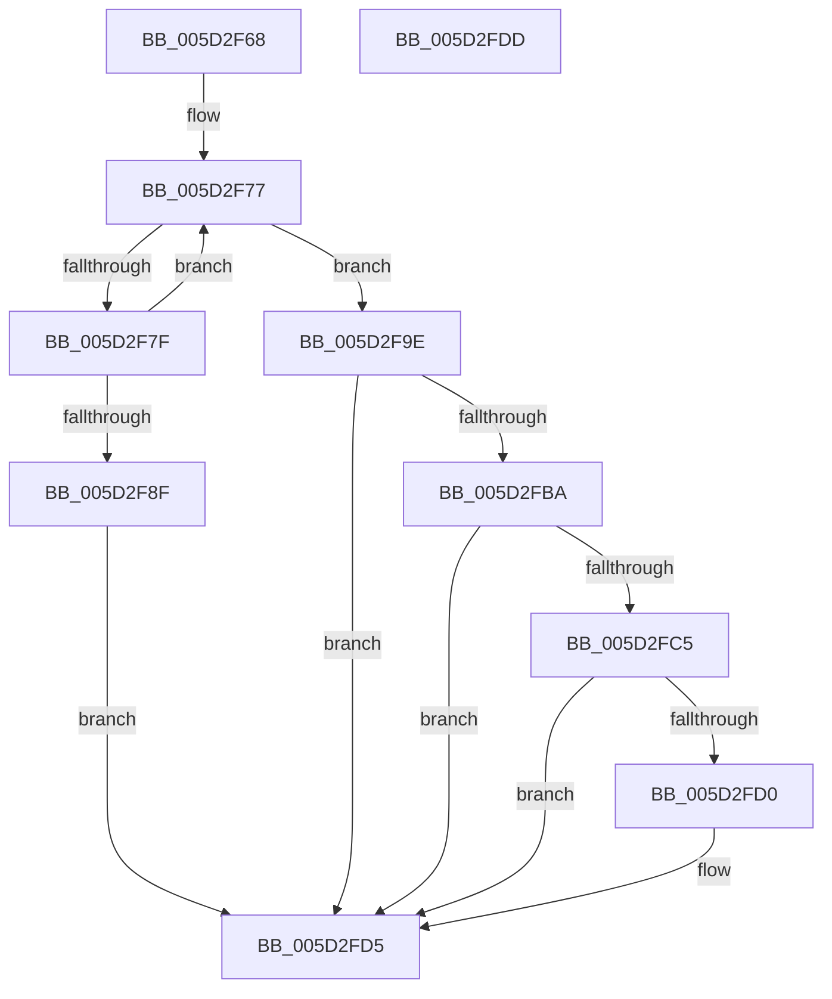

# PopFxNotifyPostSIrpCompletion

- RVA: `0x005D2F68`–`0x005D2FDE` (길이 `118` bytes)
- VA: `0x00000001405D2F68`
- 실행 섹션: `.text`
- PDB 이름 있음: `예`; PDB Function 태그: `아니요`
- unwind 정보 RVA: `0x0005CF00`
- 디코드: `33`개 명령, `118/118` bytes 표시
- 미해석 바이트: `0` (있으면 어셈블리에 `.byte`로 보존)

> 이 문서는 커널 이미지의 기계어와 PDB 기호를 분석해 생성했습니다. 4번과 5번은 함수 원형과 자료형을 바이너리 사용 방식에서 추정한 C 해석이며 원본 소스 복구 결과는 아닙니다.

## 1. Dependencies

- 직접 호출 지점: **1**; 고유 호출 대상: **1**
- 직접 호출자로 확인된 함수: **1**
- RIP 상대 이미지 참조: **0**

### Outgoing calls
- `0x005D2F97` → [PopDiagTraceIrpPended](../4D/PopDiagTraceIrpPended_function_004DF56C.md) (function, `0x004DF56C`)

### Direct callers
- [PopSystemIrpCompletion](../../pagelk/B7/PopSystemIrpCompletion_function_00B70CC0.md) at `0x00B70D92`

### Static image references
- 디코드된 RIP-relative 메모리 참조가 없습니다.

## 2. Other-region calls and transfers

- 다른 실행 섹션으로 향하는 call: **0**
- 별도 외부 분기/꼬리 이동을 확인하지 못했습니다.

## 3. Assembly (complete function range)

```asm
005D2F68  40 53                           push rbx
005D2F6A  48 83 EC 20                     sub rsp, 0x20
005D2F6E  4C 8B C9                        mov r9, rcx
005D2F71  41 BA 00 08 00 00               mov r10d, 0x800
005D2F77  8B 41 20                        mov eax, dword ptr [rcx + 0x20]
005D2F7A  41 85 C2                        test r10d, eax
005D2F7D  74 1F                           je 0x1405d2f9e
005D2F7F  44 8B C0                        mov r8d, eax
005D2F82  41 0F BA E8 0A                  bts r8d, 0xa
005D2F87  F0 44 0F B1 41 20               lock cmpxchg dword ptr [rcx + 0x20], r8d
005D2F8D  75 E8                           jne 0x1405d2f77
005D2F8F  48 8B CA                        mov rcx, rdx
005D2F92  BB 03 01 00 00                  mov ebx, 0x103
005D2F97  E8 D0 C5 F0 FF                  call 0x1404df56c
005D2F9C  EB 37                           jmp 0x1405d2fd5
005D2F9E  48 0F BE 42 42                  movsx rax, byte ptr [rdx + 0x42]
005D2FA3  33 DB                           xor ebx, ebx
005D2FA5  48 8D 0C C0                     lea rcx, [rax + rax*8]
005D2FA9  48 8B 84 CA C8 00 00 00         mov rax, qword ptr [rdx + rcx*8 + 0xc8]
005D2FB1  83 B8 C0 00 00 00 01            cmp dword ptr [rax + 0xc0], 1
005D2FB8  7E 1B                           jle 0x1405d2fd5
005D2FBA  41 8B 81 60 03 00 00            mov eax, dword ptr [r9 + 0x360]
005D2FC1  84 C0                           test al, al
005D2FC3  79 10                           jns 0x1405d2fd5
005D2FC5  41 8B 81 60 03 00 00            mov eax, dword ptr [r9 + 0x360]
005D2FCC  A8 01                           test al, 1
005D2FCE  75 05                           jne 0x1405d2fd5
005D2FD0  F0 45 09 51 20                  lock or dword ptr [r9 + 0x20], r10d
005D2FD5  8B C3                           mov eax, ebx
005D2FD7  48 83 C4 20                     add rsp, 0x20
005D2FDB  5B                              pop rbx
005D2FDC  C3                              ret
005D2FDD  CC                              int3
```

## 4. C-style interpretation (structured pseudocode)

```c
__int64 __fastcall PopFxNotifyPostSIrpCompletion(__int64 a1, __int64 a2)
{
    __int64 result;
    __int64 v_rbx;
    __int64 v_rsp;

    v_rsp = (v_rsp) - (32);
loc_005D2F77:
    if ((((unsigned int)((unsigned int)(0x800ULL))) & ((unsigned int)((unsigned int)(*(unsigned int *)(a1 + 32))))) == 0) goto loc_005D2F9E;
    if ((((unsigned int)((unsigned int)(0x800ULL))) & ((unsigned int)((unsigned int)(*(unsigned int *)(a1 + 32))))) != 0) goto loc_005D2F77;
    result = PopDiagTraceIrpPended(a2, a2, (unsigned int)((unsigned int)((unsigned int)(*(unsigned int *)(a1 + 32)))), a1);
    goto loc_005D2FD5;
loc_005D2F9E:
    v_rbx = 0;
    if ((*(unsigned int *)(*(unsigned __int64 *)(a2 + (__int8)(*(unsigned __int8 *)(a2 + 66)) + (__int8)(*(unsigned __int8 *)(a2 + 66)) * 8 * 8 + 200) + 192)) <= 1) goto loc_005D2FD5;
    if (!sign_flag) goto loc_005D2FD5;
    if ((((unsigned __int8)((unsigned int)(*(unsigned int *)(a1 + 864)))) & (1)) == 0) {
    }
    v_rsp = (v_rsp) + (32);
    return 0;
}
```

## 5. (Beta) C Style

```c
int64_t PopFxNotifyPostSIrpCompletion(void *Arg1, void *Arg2)
{
    uint8_t *arg1 = (uint8_t *)Arg1;
    uint8_t *arg2 = (uint8_t *)Arg2;

    int64_t result;
    int64_t local_rbx;
    int64_t local_rsp;

    local_rsp = (local_rsp) - (32);
loc_005D2F77:
    if ((((uint32_t)((uint32_t)(0x800ULL))) & ((uint32_t)((uint32_t)(*(uint32_t *)(arg1 + 0x20))))) == 0) goto loc_005D2F9E;
    if ((((uint32_t)((uint32_t)(0x800ULL))) & ((uint32_t)((uint32_t)(*(uint32_t *)(arg1 + 0x20))))) != 0) goto loc_005D2F77;
    result = PopDiagTraceIrpPended(Arg2, Arg2, (uint32_t)((uint32_t)((uint32_t)(*(uint32_t *)(arg1 + 0x20)))), Arg1);
    goto loc_005D2FD5;
loc_005D2F9E:
    local_rbx = 0;
    if ((*(uint32_t *)(*(uint64_t *)(arg2 + (int8_t)(*(uint8_t *)(arg2 + 0x42)) + (int8_t)(*(uint8_t *)(arg2 + 0x42)) * 8 * 8 + 0xC8) + 0xC0)) <= 1) goto loc_005D2FD5;
    if (!sign_flag) goto loc_005D2FD5;
    if ((((uint8_t)((uint32_t)(*(uint32_t *)(arg1 + 0x360)))) & (1)) == 0) {
    }
    local_rsp = (local_rsp) + (32);
    return 0;
}
```

### 관측된 메모리 오프셋

구조체 형식이 확인되지 않은 접근은 인자 기준의 오프셋으로만 기록했습니다.

| 기준 인자 | 오프셋 표현 | 폭 (bit) | 접근 |
|---|---:|---:|---|
| `Arg1` | `+ 0x20` | `32` | `R` |
| `Arg1` | `+ 0x20` | `32` | `R/W` |
| `Arg1` | `+ 0x360` | `32` | `R` |
| `Arg2` | `+ 0x42` | `8` | `R` |
| `Arg2` | `+ 0xC8 + rcx*8` | `64` | `R` |

## 6. Execution-region graph

[열기: 2D/3D 그래프와 함수 탐색 컨트롤 패널](../../../control-panel.html?section=text&rva=0x005D2F68&view=graph)

- 2D 그래프는 위에서 아래로 흐르고, 3D 그래프는 빈 공간을 드래그해 회전합니다. Shift+드래그는 이동, 휠은 확대·축소, 함수 노드 선택은 대상 보고서 이동입니다.

### Static fallback


