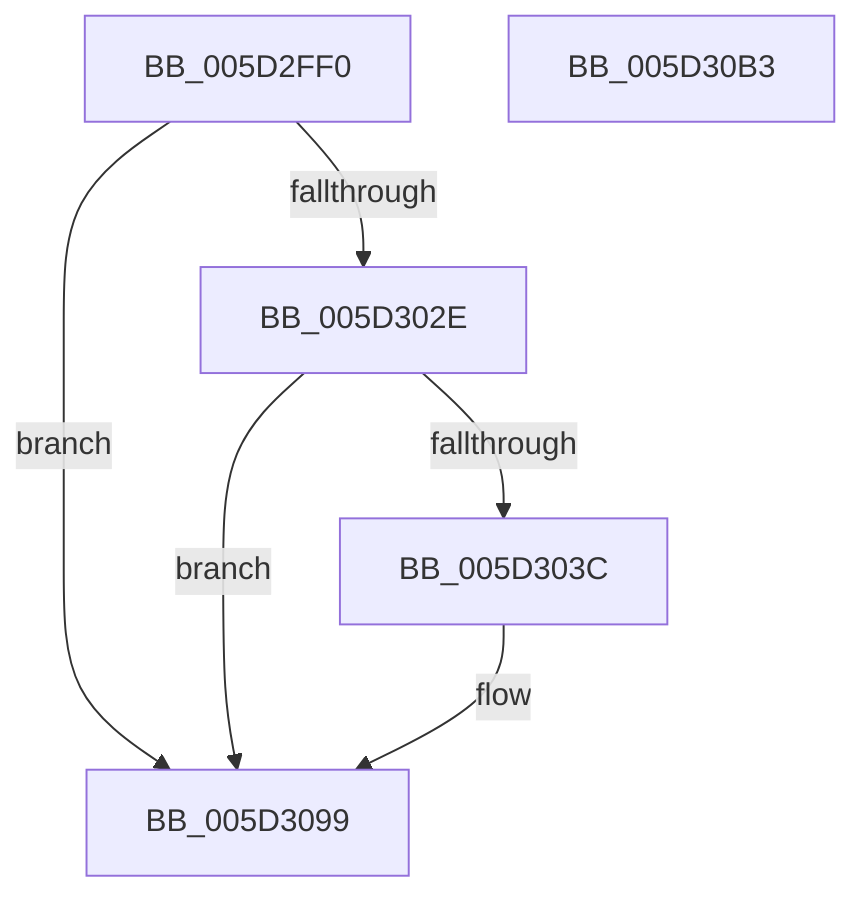

# PopFxProcessorIdleVeto

- RVA: `0x005D2FF0`–`0x005D30B4` (길이 `196` bytes)
- VA: `0x00000001405D2FF0`
- 실행 섹션: `.text`
- PDB 이름 있음: `예`; PDB Function 태그: `아니요`
- unwind 정보 RVA: `0x000B7D04`
- 디코드: `54`개 명령, `196/196` bytes 표시
- 미해석 바이트: `0` (있으면 어셈블리에 `.byte`로 보존)

> 이 문서는 커널 이미지의 기계어와 PDB 기호를 분석해 생성했습니다. 4번과 5번은 함수 원형과 자료형을 바이너리 사용 방식에서 추정한 C 해석이며 원본 소스 복구 결과는 아닙니다.

## 1. Dependencies

- 직접 호출 지점: **4**; 고유 호출 대상: **4**
- 직접 호출자로 확인된 함수: **0**
- RIP 상대 이미지 참조: **2**

### Outgoing calls
- `0x005D3031` → [PopFxTryReferenceDevice](../2C/PopFxTryReferenceDevice_function_002C0628.md) (function, `0x002C0628`)
- `0x005D3085` → [guard_dispatch_icall](../6B/guard_dispatch_icall_function_006BAAD0.md) (function, `0x006BAAD0`)
- `0x005D3094` → [PopFxDereferenceDevice](../27/PopFxDereferenceDevice_function_0027038C.md) (function, `0x0027038C`)
- `0x005D30A3` → [_security_check_cookie](../6A/_security_check_cookie_function_006AC640.md) (function, `0x006AC640`)

### Direct callers
- 이 함수 시작 RVA로 연결되는 직접 call은 확인되지 않았습니다. 간접 호출은 완전히 역산할 수 없습니다.

### Static image references
- `0x005D2FFB` → RVA `0x00E0A740` (`.data`; read)
- `0x005D3058` → RVA `0x0002AF70` (`.rdata`; read)

## 2. Other-region calls and transfers

- 다른 실행 섹션으로 향하는 call: **0**
- 별도 외부 분기/꼬리 이동을 확인하지 못했습니다.

## 3. Assembly (complete function range)

```asm
005D2FF0  40 53                           push rbx
005D2FF2  55                              push rbp
005D2FF3  56                              push rsi
005D2FF4  57                              push rdi
005D2FF5  41 56                           push r14
005D2FF7  48 83 EC 60                     sub rsp, 0x60
005D2FFB  48 8B 05 3E 77 83 00            mov rax, qword ptr [rip + 0x83773e]
005D3002  48 33 C4                        xor rax, rsp
005D3005  48 89 44 24 58                  mov qword ptr [rsp + 0x58], rax
005D300A  33 C0                           xor eax, eax
005D300C  45 8A F1                        mov r14b, r9b
005D300F  41 8B E8                        mov ebp, r8d
005D3012  8B F2                           mov esi, edx
005D3014  48 8B F9                        mov rdi, rcx
005D3017  48 89 44 24 48                  mov qword ptr [rsp + 0x48], rax
005D301C  BB 02 00 00 C0                  mov ebx, 0xc0000002
005D3021  89 44 24 50                     mov dword ptr [rsp + 0x50], eax
005D3025  48 39 81 98 00 00 00            cmp qword ptr [rcx + 0x98], rax
005D302C  74 6B                           je 0x1405d3099
005D302E  8D 50 01                        lea edx, [rax + 1]
005D3031  E8 F2 D5 CE FF                  call 0x1402c0628
005D3036  8B D8                           mov ebx, eax
005D3038  85 C0                           test eax, eax
005D303A  78 5D                           js 0x1405d3099
005D303C  48 8B 87 98 00 00 00            mov rax, qword ptr [rdi + 0x98]
005D3043  48 8D 4C 24 40                  lea rcx, [rsp + 0x40]
005D3048  48 83 64 24 40 00               and qword ptr [rsp + 0x40], 0
005D304E  4C 8D 44 24 48                  lea r8, [rsp + 0x48]
005D3053  48 89 4C 24 30                  mov qword ptr [rsp + 0x30], rcx
005D3058  48 8D 15 11 7F A5 FF            lea rdx, [rip - 0x5a80ef]
005D305F  48 83 64 24 28 00               and qword ptr [rsp + 0x28], 0
005D3065  41 B9 0C 00 00 00               mov r9d, 0xc
005D306B  48 8B 8F C0 00 00 00            mov rcx, qword ptr [rdi + 0xc0]
005D3072  48 83 64 24 20 00               and qword ptr [rsp + 0x20], 0
005D3078  89 74 24 48                     mov dword ptr [rsp + 0x48], esi
005D307C  89 6C 24 4C                     mov dword ptr [rsp + 0x4c], ebp
005D3080  44 88 74 24 50                  mov byte ptr [rsp + 0x50], r14b
005D3085  E8 46 7A 0E 00                  call 0x1406baad0
005D308A  BA 01 00 00 00                  mov edx, 1
005D308F  48 8B CF                        mov rcx, rdi
005D3092  8B D8                           mov ebx, eax
005D3094  E8 F3 D2 C9 FF                  call 0x14027038c
005D3099  8B C3                           mov eax, ebx
005D309B  48 8B 4C 24 58                  mov rcx, qword ptr [rsp + 0x58]
005D30A0  48 33 CC                        xor rcx, rsp
005D30A3  E8 98 95 0D 00                  call 0x1406ac640
005D30A8  48 83 C4 60                     add rsp, 0x60
005D30AC  41 5E                           pop r14
005D30AE  5F                              pop rdi
005D30AF  5E                              pop rsi
005D30B0  5D                              pop rbp
005D30B1  5B                              pop rbx
005D30B2  C3                              ret
005D30B3  CC                              int3
```

## 4. C-style interpretation (structured pseudocode)

```c
__int64 __fastcall PopFxProcessorIdleVeto(__int64 a1, int a2, int a3, unsigned __int8 a4)
{
    __int64 result;
    __int64 v_rbx;
    __int64 v_rsp;
    unsigned __int64 v_stack_m30;
    unsigned int v_stack_m38;
    unsigned int v_stack_m3C;
    unsigned __int64 v_stack_m40;
    unsigned __int64 v_stack_m48;
    unsigned __int64 v_stack_m58;
    unsigned __int64 v_stack_m60;
    unsigned __int64 v_stack_m68;

    v_rsp = (v_rsp) - (96);
    result = (*(unsigned __int64 *)(v_rip + 8615742)) ^ (v_rsp);
    v_stack_m30 = result;
    result = 0;
    v_stack_m40 = 0;
    v_stack_m38 = 0;
    if ((*(unsigned __int64 *)(a1 + 152)) == 0) goto loc_005D3099;
    result = PopFxTryReferenceDevice(a1, result + 1, a3, a4);
    v_rbx = (unsigned int)((unsigned int)(result));
    if (!(sign_flag)) {
        result = *(unsigned __int64 *)(a1 + 152);
        a1 = v_stack_m48;
        a3 = v_stack_m40;
        v_stack_m58 = a1;
        a2 = v_rip - 5931247;
        a4 = 12;
        a1 = *(unsigned __int64 *)(a1 + 192);
        v_stack_m40 = (unsigned int)((unsigned int)(a2));
        v_stack_m3C = (unsigned int)((unsigned int)(a3));
        v_stack_m38 = a4;
        result = guard_dispatch_icall(a1, a2, a3, a4);
        a2 = 1;
        a1 = a1;
        v_rbx = (unsigned int)(result);
        result = PopFxDereferenceDevice(a1, a2, a3, a4);
    }
    a1 = (v_stack_m30) ^ (v_rsp);
    result = _security_check_cookie(a1, a2, a3, a4);
    v_rsp = (v_rsp) + (96);
    return result;
}
```

## 5. (Beta) C Style

```c
int64_t PopFxProcessorIdleVeto(void *Arg1, int32_t Arg2, int32_t Arg3, uint8_t Arg4)
{
    uint8_t *arg1 = (uint8_t *)Arg1;

    int64_t result;
    int64_t local_rbx;
    int64_t local_rsp;
    uint64_t v_stack_m30;
    uint32_t v_stack_m38;
    uint32_t v_stack_m3C;
    uint64_t v_stack_m40;
    uint64_t v_stack_m48;
    uint64_t v_stack_m58;
    uint64_t v_stack_m60;
    uint64_t v_stack_m68;

    local_rsp = (local_rsp) - (96);
    result = (*(uint64_t *)(v_rip + 0x83773E)) ^ (local_rsp);
    v_stack_m30 = result;
    result = 0;
    v_stack_m40 = 0;
    v_stack_m38 = 0;
    if ((*(uint64_t *)(arg1 + 0x98)) == 0) goto loc_005D3099;
    result = PopFxTryReferenceDevice(Arg1, result + 1, Arg3, Arg4);
    local_rbx = (uint32_t)((uint32_t)(result));
    if (!(sign_flag)) {
        result = *(uint64_t *)(arg1 + 0x98);
        Arg1 = v_stack_m48;
        Arg3 = v_stack_m40;
        v_stack_m58 = Arg1;
        Arg2 = v_rip - 5931247;
        Arg4 = 12;
        Arg1 = *(uint64_t *)(arg1 + 0xC0);
        v_stack_m40 = (uint32_t)((uint32_t)(Arg2));
        v_stack_m3C = (uint32_t)((uint32_t)(Arg3));
        v_stack_m38 = Arg4;
        result = guard_dispatch_icall(Arg1, Arg2, Arg3, Arg4);
        Arg2 = 1;
        Arg1 = Arg1;
        local_rbx = (uint32_t)(result);
        result = PopFxDereferenceDevice(Arg1, Arg2, Arg3, Arg4);
    }
    Arg1 = (v_stack_m30) ^ (local_rsp);
    result = _security_check_cookie(Arg1, Arg2, Arg3, Arg4);
    local_rsp = (local_rsp) + (96);
    return result;
}
```

### 관측된 메모리 오프셋

구조체 형식이 확인되지 않은 접근은 인자 기준의 오프셋으로만 기록했습니다.

| 기준 인자 | 오프셋 표현 | 폭 (bit) | 접근 |
|---|---:|---:|---|
| `Arg1` | `+ 0x98` | `64` | `R` |
| `Arg1` | `+ 0xC0` | `64` | `R` |

## 6. Execution-region graph

[열기: 2D/3D 그래프와 함수 탐색 컨트롤 패널](../../../control-panel.html?section=text&rva=0x005D2FF0&view=graph)

- 2D 그래프는 위에서 아래로 흐르고, 3D 그래프는 빈 공간을 드래그해 회전합니다. Shift+드래그는 이동, 휠은 확대·축소, 함수 노드 선택은 대상 보고서 이동입니다.

### Static fallback


