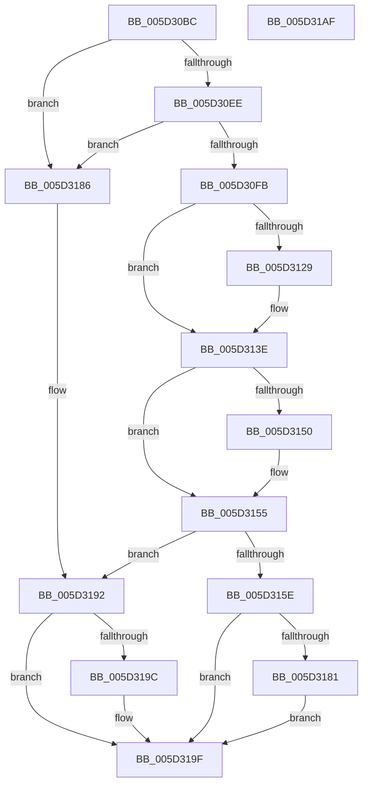

# PopFxQueryCurrentComponentPerfState

- RVA: `0x005D30BC`–`0x005D31B0` (길이 `244` bytes)
- VA: `0x00000001405D30BC`
- 실행 섹션: `.text`
- PDB 이름 있음: `예`; PDB Function 태그: `아니요`
- unwind 정보 RVA: `0x000718AC`
- 디코드: `65`개 명령, `244/244` bytes 표시
- 미해석 바이트: `0` (있으면 어셈블리에 `.byte`로 보존)

> 이 문서는 커널 이미지의 기계어와 PDB 기호를 분석해 생성했습니다. 4번과 5번은 함수 원형과 자료형을 바이너리 사용 방식에서 추정한 C 해석이며 원본 소스 복구 결과는 아닙니다.

## 1. Dependencies

- 직접 호출 지점: **2**; 고유 호출 대상: **2**
- 직접 호출자로 확인된 함수: **2**
- RIP 상대 이미지 참조: **0**

### Outgoing calls
- `0x005D3120` → [guard_dispatch_icall](../6B/guard_dispatch_icall_function_006BAAD0.md) (function, `0x006BAAD0`)
- `0x005D3138` → [PopFxBugCheck](../2B/PopFxBugCheck_function_002BFC6C.md) (function, `0x002BFC6C`)

### Direct callers
- [PoFxQueryCurrentComponentPerfState](PoFxQueryCurrentComponentPerfState_function_005D1B70.md) at `0x005D1BB5`
- [PopFxUpdateComponentPerfStateNominalChange](PopFxUpdateComponentPerfStateNominalChange_function_005D3790.md) at `0x005D37FC`

### Static image references
- 디코드된 RIP-relative 메모리 참조가 없습니다.

## 2. Other-region calls and transfers

- 다른 실행 섹션으로 향하는 call: **0**
- 별도 외부 분기/꼬리 이동을 확인하지 못했습니다.

## 3. Assembly (complete function range)

```asm
005D30BC  4C 8B DC                        mov r11, rsp
005D30BF  49 89 5B 08                     mov qword ptr [r11 + 8], rbx
005D30C3  49 89 73 10                     mov qword ptr [r11 + 0x10], rsi
005D30C7  57                              push rdi
005D30C8  48 83 EC 40                     sub rsp, 0x40
005D30CC  48 8B 82 A8 01 00 00            mov rax, qword ptr [rdx + 0x1a8]
005D30D3  41 8A F1                        mov sil, r9b
005D30D6  41 8B D8                        mov ebx, r8d
005D30D9  48 C1 E3 05                     shl rbx, 5
005D30DD  48 03 98 98 00 00 00            add rbx, qword ptr [rax + 0x98]
005D30E4  80 78 49 00                     cmp byte ptr [rax + 0x49], 0
005D30E8  0F 84 98 00 00 00               je 0x1405d3186
005D30EE  48 8B 79 40                     mov rdi, qword ptr [rcx + 0x40]
005D30F2  48 85 FF                        test rdi, rdi
005D30F5  0F 84 8B 00 00 00               je 0x1405d3186
005D30FB  48 8B 41 48                     mov rax, qword ptr [rcx + 0x48]
005D30FF  B9 22 00 00 00                  mov ecx, 0x22
005D3104  49 83 63 E8 00                  and qword ptr [r11 - 0x18], 0
005D3109  49 89 43 D8                     mov qword ptr [r11 - 0x28], rax
005D310D  8B 42 10                        mov eax, dword ptr [rdx + 0x10]
005D3110  49 8D 53 D8                     lea rdx, [r11 - 0x28]
005D3114  89 44 24 28                     mov dword ptr [rsp + 0x28], eax
005D3118  45 89 43 E4                     mov dword ptr [r11 - 0x1c], r8d
005D311C  48 8B 47 60                     mov rax, qword ptr [rdi + 0x60]
005D3120  E8 AB 79 0E 00                  call 0x1406baad0
005D3125  84 C0                           test al, al
005D3127  75 15                           jne 0x1405d313e
005D3129  45 33 C9                        xor r9d, r9d
005D312C  4C 8B C7                        mov r8, rdi
005D312F  B9 05 06 00 00                  mov ecx, 0x605
005D3134  41 8D 51 22                     lea edx, [r9 + 0x22]
005D3138  E8 2F CB CE FF                  call 0x1402bfc6c
005D313D  CC                              int3
005D313E  48 8B 03                        mov rax, qword ptr [rbx]
005D3141  48 8B 4C 24 70                  mov rcx, qword ptr [rsp + 0x70]
005D3146  83 78 1C 00                     cmp dword ptr [rax + 0x1c], 0
005D314A  8B 44 24 30                     mov eax, dword ptr [rsp + 0x30]
005D314E  74 05                           je 0x1405d3155
005D3150  48 8B 44 24 30                  mov rax, qword ptr [rsp + 0x30]
005D3155  48 89 01                        mov qword ptr [rcx], rax
005D3158  48 3B 43 08                     cmp rax, qword ptr [rbx + 8]
005D315C  74 34                           je 0x1405d3192
005D315E  48 A1 08 00 00 00 80 F7 FF FF   movabs rax, qword ptr [0xfffff78000000008]
005D3168  48 89 43 10                     mov qword ptr [rbx + 0x10], rax
005D316C  40 88 73 18                     mov byte ptr [rbx + 0x18], sil
005D3170  48 8B 01                        mov rax, qword ptr [rcx]
005D3173  48 89 43 08                     mov qword ptr [rbx + 8], rax
005D3177  48 8B 44 24 78                  mov rax, qword ptr [rsp + 0x78]
005D317C  48 85 C0                        test rax, rax
005D317F  74 1E                           je 0x1405d319f
005D3181  C6 00 01                        mov byte ptr [rax], 1
005D3184  EB 19                           jmp 0x1405d319f
005D3186  48 8B 44 24 70                  mov rax, qword ptr [rsp + 0x70]
005D318B  48 8B 4B 08                     mov rcx, qword ptr [rbx + 8]
005D318F  48 89 08                        mov qword ptr [rax], rcx
005D3192  48 8B 44 24 78                  mov rax, qword ptr [rsp + 0x78]
005D3197  48 85 C0                        test rax, rax
005D319A  74 03                           je 0x1405d319f
005D319C  C6 00 00                        mov byte ptr [rax], 0
005D319F  48 8B 5C 24 50                  mov rbx, qword ptr [rsp + 0x50]
005D31A4  48 8B 74 24 58                  mov rsi, qword ptr [rsp + 0x58]
005D31A9  48 83 C4 40                     add rsp, 0x40
005D31AD  5F                              pop rdi
005D31AE  C3                              ret
005D31AF  CC                              int3
```

## 4. C-style interpretation (structured pseudocode)

```c
__int64 __fastcall PopFxQueryCurrentComponentPerfState(__int64 a1, __int64 a2, int a3, int a4, __int64 a5, __int64 a6)
{
    __int64 result;
    __int64 v_rbx;
    __int64 v_rsp;
    unsigned int v_stack_m18;
    unsigned int v_stack_m20;
    unsigned __int64 v_stack_p10;
    unsigned __int64 v_stack_p8;

    *(unsigned __int64 *)(v_rsp + 8) = v_rbx;
    *(unsigned __int64 *)(v_rsp + 16) = v_rsi;
    v_rsp = (v_rsp) - (64);
    v_rbx = ((unsigned int)(a3)) << (5);
    v_rbx = (v_rbx) + (*(unsigned __int64 *)(*(unsigned __int64 *)(a2 + 424) + 152));
    if ((*(unsigned __int8 *)(*(unsigned __int64 *)(a2 + 424) + 73)) == 0) goto loc_005D3186;
    if (*(unsigned __int64 *)(a1 + 64) == 0) goto loc_005D3186;
    *(unsigned __int64 *)(v_rsp - 40) = *(unsigned __int64 *)(a1 + 72);
    v_stack_m20 = (unsigned int)((unsigned int)(*(unsigned int *)(a2 + 16)));
    *(unsigned int *)(v_rsp - 28) = a3;
    result = guard_dispatch_icall(34, v_rsp - 40, a3, a4);
    if ((unsigned __int8)(result) == 0) {
        a4 = 0;
        a3 = *(unsigned __int64 *)(a1 + 64);
        a1 = 0x605ULL;
        a2 = a4 + 34;
        result = PopFxBugCheck(a1, a2, a3, a4);
    }
    result = (unsigned int)(v_stack_m18);
    if ((*(unsigned int *)(*(unsigned __int64 *)(v_rbx) + 28)) != 0) {
        result = v_stack_m18;
    }
    *(unsigned __int64 *)(a5) = result;
    if (result == (*(unsigned __int64 *)(v_rbx + 8))) goto loc_005D3192;
    *(unsigned __int64 *)(v_rbx + 16) = result;
    *(unsigned __int8 *)(v_rbx + 24) = (unsigned __int8)((unsigned __int8)(a4));
    *(unsigned __int64 *)(v_rbx + 8) = *(unsigned __int64 *)(a5);
    if (a6 == 0) goto loc_005D319F;
    *(unsigned __int8 *)(a6) = 1;
    goto loc_005D319F;
loc_005D3186:
    *(unsigned __int64 *)(a5) = *(unsigned __int64 *)(v_rbx + 8);
loc_005D3192:
    if (a6 != 0) {
        *(unsigned __int8 *)(a6) = 0;
    }
    v_rsp = (v_rsp) + (64);
    return a6;
}
```

## 5. (Beta) C Style

```c
int64_t PopFxQueryCurrentComponentPerfState(void *Arg1, void *Arg2, int32_t Arg3, int32_t Arg4, void *Arg5, int64_t Arg6)
{
    uint8_t *arg1 = (uint8_t *)Arg1;
    uint8_t *arg2 = (uint8_t *)Arg2;
    uint8_t *arg5 = (uint8_t *)Arg5;

    int64_t result;
    int64_t local_rbx;
    int64_t local_rsp;
    uint32_t v_stack_m18;
    uint32_t v_stack_m20;
    uint64_t v_stack_p10;
    uint64_t v_stack_p8;

    *(uint64_t *)(local_rsp + 0x8) = local_rbx;
    *(uint64_t *)(local_rsp + 0x10) = local_rsi;
    local_rsp = (local_rsp) - (64);
    local_rbx = ((uint32_t)(Arg3)) << (5);
    local_rbx = (local_rbx) + (*(uint64_t *)(*(uint64_t *)(arg2 + 0x1A8) + 0x98));
    if ((*(uint8_t *)(*(uint64_t *)(arg2 + 0x1A8) + 0x49)) == 0) goto loc_005D3186;
    if (*(uint64_t *)(arg1 + 0x40) == 0) goto loc_005D3186;
    *(uint64_t *)(local_rsp - 0x28) = *(uint64_t *)(arg1 + 0x48);
    v_stack_m20 = (uint32_t)((uint32_t)(*(uint32_t *)(arg2 + 0x10)));
    *(uint32_t *)(local_rsp - 0x1C) = Arg3;
    result = guard_dispatch_icall(34, local_rsp - 40, Arg3, Arg4);
    if ((uint8_t)(result) == 0) {
        Arg4 = 0;
        Arg3 = *(uint64_t *)(arg1 + 0x40);
        Arg1 = 0x605ULL;
        Arg2 = Arg4 + 34;
        result = PopFxBugCheck(Arg1, Arg2, Arg3, Arg4);
    }
    result = (uint32_t)(v_stack_m18);
    if ((*(uint32_t *)(*(uint64_t *)(local_rbx) + 0x1C)) != 0) {
        result = v_stack_m18;
    }
    *(uint64_t *)(arg5) = result;
    if (result == (*(uint64_t *)(local_rbx + 0x8))) goto loc_005D3192;
    *(uint64_t *)(local_rbx + 0x10) = result;
    *(uint8_t *)(local_rbx + 0x18) = (uint8_t)((uint8_t)(Arg4));
    *(uint64_t *)(local_rbx + 0x8) = *(uint64_t *)(arg5);
    if (Arg6 == 0) goto loc_005D319F;
    *(uint8_t *)(Arg6) = 1;
    goto loc_005D319F;
loc_005D3186:
    *(uint64_t *)(arg5) = *(uint64_t *)(local_rbx + 0x8);
loc_005D3192:
    if (Arg6 != 0) {
        *(uint8_t *)(Arg6) = 0;
    }
    local_rsp = (local_rsp) + (64);
    return Arg6;
}
```

### 관측된 메모리 오프셋

구조체 형식이 확인되지 않은 접근은 인자 기준의 오프셋으로만 기록했습니다.

| 기준 인자 | 오프셋 표현 | 폭 (bit) | 접근 |
|---|---:|---:|---|
| `Arg1` | `+ 0x40` | `64` | `R` |
| `Arg1` | `+ 0x48` | `64` | `R` |
| `Arg2` | `+ 0x10` | `32` | `R` |
| `Arg2` | `+ 0x1A8` | `64` | `R` |
| `Arg5` | `+ 0x0` | `64` | `R` |
| `Arg5` | `+ 0x0` | `64` | `W` |

## 6. Execution-region graph

[열기: 2D/3D 그래프와 함수 탐색 컨트롤 패널](../../../control-panel.html?section=text&rva=0x005D30BC&view=graph)

- 2D 그래프는 위에서 아래로 흐르고, 3D 그래프는 빈 공간을 드래그해 회전합니다. Shift+드래그는 이동, 휠은 확대·축소, 함수 노드 선택은 대상 보고서 이동입니다.

### Static fallback


