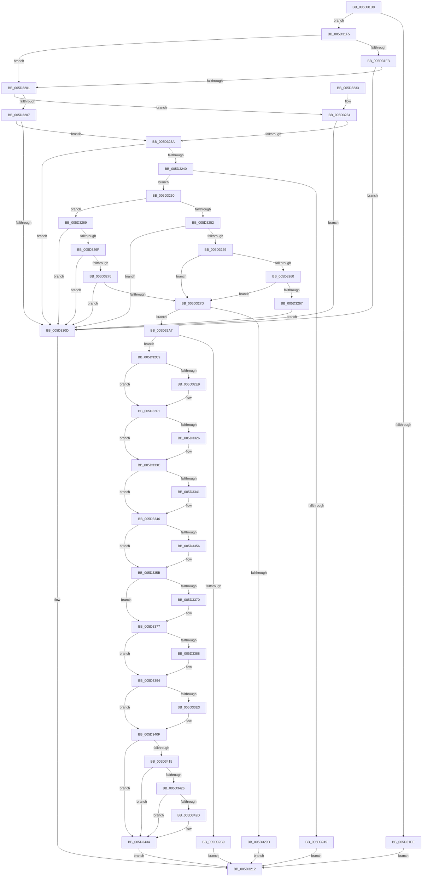

# PopFxRegisterPluginEx

- RVA: `0x005D31B8`–`0x005D343B` (길이 `643` bytes)
- VA: `0x00000001405D31B8`
- 실행 섹션: `.text`
- PDB 이름 있음: `예`; PDB Function 태그: `아니요`
- unwind 정보 RVA: `0x000CC240`
- 디코드: `165`개 명령, `643/643` bytes 표시
- 미해석 바이트: `0` (있으면 어셈블리에 `.byte`로 보존)

> 이 문서는 커널 이미지의 기계어와 PDB 기호를 분석해 생성했습니다. 4번과 5번은 함수 원형과 자료형을 바이너리 사용 방식에서 추정한 C 해석이며 원본 소스 복구 결과는 아닙니다.

## 1. Dependencies

- 직접 호출 지점: **9**; 고유 호출 대상: **9**
- 직접 호출자로 확인된 함수: **2**
- RIP 상대 이미지 참조: **12**

### Outgoing calls
- `0x005D3290` → [ExAllocatePool2](../../poolcode/B8/ExAllocatePool2_function_00B820F0.md) (function, `0x00B820F0`)
- `0x005D32AE` → [PopFxInitializeWorkPool](../../page/75/PopFxInitializeWorkPool_function_00759290.md) (function, `0x00759290`)
- `0x005D32BF` → [ExFreePoolWithTag](../../poolcode/B8/ExFreePoolWithTag_function_00B82870.md) (function, `0x00B82870`)
- `0x005D3312` → [KeAbPreAcquire](../21/KeAbPreAcquire_function_00210230.md) (function, `0x00210230`)
- `0x005D3337` → [ExfAcquirePushLockExclusiveEx](../20/ExfAcquirePushLockExclusiveEx_function_0020FC90.md) (function, `0x0020FC90`)
- `0x005D338F` → [ExfTryToWakePushLock](../26/ExfTryToWakePushLock_function_00265DD0.md) (function, `0x00265DD0`)
- `0x005D339B` → [KeAbPostRelease](../2E/KeAbPostRelease_function_002E1600.md) (function, `0x002E1600`)
- `0x005D33A0` → [KeLeaveCriticalRegion](../25/KeLeaveCriticalRegion_function_0025D8B0.md) (function, `0x0025D8B0`)
- `0x005D33AE` → [PopDiagTraceFxPluginRegistration](../../page/AA/PopDiagTraceFxPluginRegistration_function_00AAE10C.md) (function, `0x00AAE10C`)

### Direct callers
- [PoFxRegisterPluginEx](PoFxRegisterPluginEx_function_005D1C70.md) at `0x005D1C74`
- [PoFxRegisterPlugin](../../page/75/PoFxRegisterPlugin_function_00758C00.md) at `0x00758C09`

### Static image references
- `0x005D32FA` → RVA `0x00F0E428` (`.data`; read)
- `0x005D3317` → RVA `0x00F0E428` (`.data`; read/write)
- `0x005D3346` → RVA `0x00F0E400` (`.data`; read)
- `0x005D3370` → RVA `0x00F0E400` (`.data`; write)
- `0x005D33B8` → RVA `0x005D3670` (`PopFxRequestWorker`; read)
- `0x005D33D2` → RVA `0x005D36F0` (`PopFxTransitionCriticalResource`; read)
- `0x005D33E3` → RVA `0x005D2FF0` (`PopFxProcessorIdleVeto`; read)
- `0x005D33EE` → RVA `0x004AABC0` (`PopFxPlatformIdleVeto`; read)
- `0x005D33F9` → RVA `0x005D3960` (`PopFxUpdateProcessorIdleState`; read)
- `0x005D3404` → RVA `0x005D3880` (`PopFxUpdatePlatformIdleState`; read)
- `0x005D3415` → RVA `0x005D3600` (`PopFxRequestCommon`; read)
- `0x005D342D` → RVA `0x00F070C8` (`.data`; write)

## 2. Other-region calls and transfers

- 다른 실행 섹션으로 향하는 call: **4**
  - `0x005D3290` → [ExAllocatePool2](../../poolcode/B8/ExAllocatePool2_function_00B820F0.md) (`.text` → `POOLCODE`)
  - `0x005D32AE` → [PopFxInitializeWorkPool](../../page/75/PopFxInitializeWorkPool_function_00759290.md) (`.text` → `PAGE`)
  - `0x005D32BF` → [ExFreePoolWithTag](../../poolcode/B8/ExFreePoolWithTag_function_00B82870.md) (`.text` → `POOLCODE`)
  - `0x005D33AE` → [PopDiagTraceFxPluginRegistration](../../page/AA/PopDiagTraceFxPluginRegistration_function_00AAE10C.md) (`.text` → `PAGE`)
- 별도 외부 분기/꼬리 이동을 확인하지 못했습니다.

## 3. Assembly (complete function range)

```asm
005D31B8  48 8B C4                        mov rax, rsp
005D31BB  48 89 58 08                     mov qword ptr [rax + 8], rbx
005D31BF  48 89 70 10                     mov qword ptr [rax + 0x10], rsi
005D31C3  48 89 78 18                     mov qword ptr [rax + 0x18], rdi
005D31C7  4C 89 60 20                     mov qword ptr [rax + 0x20], r12
005D31CB  41 55                           push r13
005D31CD  41 56                           push r14
005D31CF  41 57                           push r15
005D31D1  48 83 EC 20                     sub rsp, 0x20
005D31D5  48 8B F9                        mov rdi, rcx
005D31D8  41 BD 03 00 00 00               mov r13d, 3
005D31DE  41 0F B7 08                     movzx ecx, word ptr [r8]
005D31E2  4D 8B F0                        mov r14, r8
005D31E5  4C 8B E2                        mov r12, rdx
005D31E8  66 41 3B CD                     cmp cx, r13w
005D31EC  76 07                           jbe 0x1405d31f5
005D31EE  BB 04 A0 00 C0                  mov ebx, 0xc000a004
005D31F3  EB 1D                           jmp 0x1405d3212
005D31F5  49 8D 40 02                     lea rax, [r8 + 2]
005D31F9  75 06                           jne 0x1405d3201
005D31FB  66 83 38 60                     cmp word ptr [rax], 0x60
005D31FF  72 0C                           jb 0x1405d320d
005D3201  66 83 F9 02                     cmp cx, 2
005D3205  75 2D                           jne 0x1405d3234
005D3207  66 83 38 58                     cmp word ptr [rax], 0x58
005D320B  73 2D                           jae 0x1405d323a
005D320D  BB 0D 00 00 C0                  mov ebx, 0xc000000d
005D3212  48 8B 74 24 48                  mov rsi, qword ptr [rsp + 0x48]
005D3217  8B C3                           mov eax, ebx
005D3219  48 8B 5C 24 40                  mov rbx, qword ptr [rsp + 0x40]
005D321E  48 8B 7C 24 50                  mov rdi, qword ptr [rsp + 0x50]
005D3223  4C 8B 64 24 58                  mov r12, qword ptr [rsp + 0x58]
005D3228  48 83 C4 20                     add rsp, 0x20
005D322C  41 5F                           pop r15
005D322E  41 5E                           pop r14
005D3230  41 5D                           pop r13
005D3232  C3                              ret
005D3233  CC                              int3
005D3234  66 83 F9 01                     cmp cx, 1
005D3238  72 D3                           jb 0x1405d320d
005D323A  66 83 38 38                     cmp word ptr [rax], 0x38
005D323E  72 CD                           jb 0x1405d320d
005D3240  0F B7 07                        movzx eax, word ptr [rdi]
005D3243  66 41 3B C5                     cmp ax, r13w
005D3247  76 07                           jbe 0x1405d3250
005D3249  BB 05 A0 00 C0                  mov ebx, 0xc000a005
005D324E  EB C2                           jmp 0x1405d3212
005D3250  75 17                           jne 0x1405d3269
005D3252  66 83 7F 02 20                  cmp word ptr [rdi + 2], 0x20
005D3257  72 B4                           jb 0x1405d320d
005D3259  48 83 7F 08 00                  cmp qword ptr [rdi + 8], 0
005D325E  75 1D                           jne 0x1405d327d
005D3260  48 83 7F 18 00                  cmp qword ptr [rdi + 0x18], 0
005D3265  75 16                           jne 0x1405d327d
005D3267  EB A4                           jmp 0x1405d320d
005D3269  66 83 F8 02                     cmp ax, 2
005D326D  75 9E                           jne 0x1405d320d
005D326F  66 83 7F 02 18                  cmp word ptr [rdi + 2], 0x18
005D3274  72 97                           jb 0x1405d320d
005D3276  48 83 7F 08 00                  cmp qword ptr [rdi + 8], 0
005D327B  74 90                           je 0x1405d320d
005D327D  41 BF 50 46 58 4D               mov r15d, 0x4d584650
005D3283  BA A8 01 00 00                  mov edx, 0x1a8
005D3288  45 8B C7                        mov r8d, r15d
005D328B  B9 40 00 00 00                  mov ecx, 0x40
005D3290  E8 5B EE 5A 00                  call 0x140b820f0
005D3295  48 8B F0                        mov rsi, rax
005D3298  48 85 C0                        test rax, rax
005D329B  75 0A                           jne 0x1405d32a7
005D329D  BB 9A 00 00 C0                  mov ebx, 0xc000009a
005D32A2  E9 6B FF FF FF                  jmp 0x1405d3212
005D32A7  48 8D 48 78                     lea rcx, [rax + 0x78]
005D32AB  48 8B D6                        mov rdx, rsi
005D32AE  E8 DD 5F 18 00                  call 0x140759290
005D32B3  8B D8                           mov ebx, eax
005D32B5  85 C0                           test eax, eax
005D32B7  79 10                           jns 0x1405d32c9
005D32B9  41 8B D7                        mov edx, r15d
005D32BC  48 8B CE                        mov rcx, rsi
005D32BF  E8 AC F5 5A 00                  call 0x140b82870
005D32C4  E9 49 FF FF FF                  jmp 0x1405d3212
005D32C9  0F B7 07                        movzx eax, word ptr [rdi]
005D32CC  89 46 10                        mov dword ptr [rsi + 0x10], eax
005D32CF  4C 89 66 18                     mov qword ptr [rsi + 0x18], r12
005D32D3  48 8B 47 08                     mov rax, qword ptr [rdi + 8]
005D32D7  48 89 46 60                     mov qword ptr [rsi + 0x60], rax
005D32DB  48 8B 47 10                     mov rax, qword ptr [rdi + 0x10]
005D32DF  48 89 46 68                     mov qword ptr [rsi + 0x68], rax
005D32E3  66 44 39 2F                     cmp word ptr [rdi], r13w
005D32E7  72 08                           jb 0x1405d32f1
005D32E9  48 8B 47 18                     mov rax, qword ptr [rdi + 0x18]
005D32ED  48 89 46 70                     mov qword ptr [rsi + 0x70], rax
005D32F1  65 48 8B 04 25 88 01 00 00      mov rax, qword ptr gs:[0x188]
005D32FA  48 8D 0D 27 B1 93 00            lea rcx, [rip + 0x93b127]
005D3301  48 83 CB FF                     or rbx, 0xffffffffffffffff
005D3305  45 33 C0                        xor r8d, r8d
005D3308  33 D2                           xor edx, edx
005D330A  66 01 98 E4 01 00 00            add word ptr [rax + 0x1e4], bx
005D3311  90                              nop
005D3312  E8 19 CF C3 FF                  call 0x140210230
005D3317  F0 48 0F BA 2D 07 B1 93 00 00   lock bts qword ptr [rip + 0x93b107], 0
005D3321  4C 8B F8                        mov r15, rax
005D3324  73 16                           jae 0x1405d333c
005D3326  4C 8D 05 FB B0 93 00            lea r8, [rip + 0x93b0fb]
005D332D  48 8B D0                        mov rdx, rax
005D3330  48 8D 0D F1 B0 93 00            lea rcx, [rip + 0x93b0f1]
005D3337  E8 54 C9 C3 FF                  call 0x14020fc90
005D333C  4D 85 FF                        test r15, r15
005D333F  74 05                           je 0x1405d3346
005D3341  41 C6 47 0A 01                  mov byte ptr [r15 + 0xa], 1
005D3346  48 8B 05 B3 B0 93 00            mov rax, qword ptr [rip + 0x93b0b3]
005D334D  48 8B 10                        mov rdx, qword ptr [rax]
005D3350  48 39 42 08                     cmp qword ptr [rdx + 8], rax
005D3354  74 05                           je 0x1405d335b
005D3356  49 8B CD                        mov rcx, r13
005D3359  CD 29                           int 0x29
005D335B  49 0F BA E4 1F                  bt r12, 0x1f
005D3360  48 89 16                        mov qword ptr [rsi], rdx
005D3363  48 89 46 08                     mov qword ptr [rsi + 8], rax
005D3367  48 89 72 08                     mov qword ptr [rdx + 8], rsi
005D336B  48 89 30                        mov qword ptr [rax], rsi
005D336E  73 07                           jae 0x1405d3377
005D3370  48 89 35 89 B0 93 00            mov qword ptr [rip + 0x93b089], rsi
005D3377  F0 48 0F C1 1D A8 B0 93 00      lock xadd qword ptr [rip + 0x93b0a8], rbx
005D3380  80 E3 06                        and bl, 6
005D3383  80 FB 02                        cmp bl, 2
005D3386  75 0C                           jne 0x1405d3394
005D3388  48 8D 0D 99 B0 93 00            lea rcx, [rip + 0x93b099]
005D338F  E8 3C 2A C9 FF                  call 0x140265dd0
005D3394  48 8D 0D 8D B0 93 00            lea rcx, [rip + 0x93b08d]
005D339B  E8 60 E2 D0 FF                  call 0x1402e1600
005D33A0  E8 0B A5 C8 FF                  call 0x14025d8b0
005D33A5  45 33 C0                        xor r8d, r8d
005D33A8  49 8B D4                        mov rdx, r12
005D33AB  48 8B CE                        mov rcx, rsi
005D33AE  E8 59 AD 4D 00                  call 0x140aae10c
005D33B3  49 83 66 20 00                  and qword ptr [r14 + 0x20], 0
005D33B8  48 8D 05 B1 02 00 00            lea rax, [rip + 0x2b1]
005D33BF  49 83 66 28 00                  and qword ptr [r14 + 0x28], 0
005D33C4  49 83 66 18 00                  and qword ptr [r14 + 0x18], 0
005D33C9  66 41 83 3E 02                  cmp word ptr [r14], 2
005D33CE  49 89 46 10                     mov qword ptr [r14 + 0x10], rax
005D33D2  48 8D 05 17 03 00 00            lea rax, [rip + 0x317]
005D33D9  49 89 46 30                     mov qword ptr [r14 + 0x30], rax
005D33DD  49 89 76 08                     mov qword ptr [r14 + 8], rsi
005D33E1  72 2C                           jb 0x1405d340f
005D33E3  48 8D 05 06 FC FF FF            lea rax, [rip - 0x3fa]
005D33EA  49 89 46 38                     mov qword ptr [r14 + 0x38], rax
005D33EE  48 8D 05 CB 77 ED FF            lea rax, [rip - 0x128835]
005D33F5  49 89 46 40                     mov qword ptr [r14 + 0x40], rax
005D33F9  48 8D 05 60 05 00 00            lea rax, [rip + 0x560]
005D3400  49 89 46 48                     mov qword ptr [r14 + 0x48], rax
005D3404  48 8D 05 75 04 00 00            lea rax, [rip + 0x475]
005D340B  49 89 46 50                     mov qword ptr [r14 + 0x50], rax
005D340F  66 44 39 2F                     cmp word ptr [rdi], r13w
005D3413  72 1F                           jb 0x1405d3434
005D3415  48 8D 05 E4 01 00 00            lea rax, [rip + 0x1e4]
005D341C  49 89 46 58                     mov qword ptr [r14 + 0x58], rax
005D3420  66 44 39 2F                     cmp word ptr [rdi], r13w
005D3424  75 0E                           jne 0x1405d3434
005D3426  48 83 7F 18 00                  cmp qword ptr [rdi + 0x18], 0
005D342B  74 07                           je 0x1405d3434
005D342D  C6 05 94 3C 93 00 01            mov byte ptr [rip + 0x933c94], 1
005D3434  33 DB                           xor ebx, ebx
005D3436  E9 D7 FD FF FF                  jmp 0x1405d3212
```

## 4. C-style interpretation (structured pseudocode)

```c
__int64 __fastcall PopFxRegisterPluginEx(__int64 a1, __int64 a2, __int64 a3)
{
    __int64 result;
    __int64 v_rbx;
    __int64 v_rsp;
    unsigned __int64 v_stack_p10;
    unsigned __int64 v_stack_p18;
    unsigned __int64 v_stack_p20;
    unsigned __int64 v_stack_p8;

    *(unsigned __int64 *)(v_rsp + 8) = v_rbx;
    *(unsigned __int64 *)(v_rsp + 16) = v_rsi;
    *(unsigned __int64 *)(v_rsp + 24) = v_rdi;
    *(unsigned __int64 *)(v_rsp + 32) = v_r12;
    v_rsp = (v_rsp) - (32);
    if (((unsigned __int16)(*(unsigned __int16 *)(a3))) <= 3) goto loc_005D31F5;
    goto loc_005D3212;
loc_005D31F5:
    if (((unsigned __int16)(*(unsigned __int16 *)(a3))) != 3) goto loc_005D3201;
    if ((*(unsigned __int16 *)(a3 + 2)) < 96) goto loc_005D320D;
loc_005D3201:
    if (((unsigned __int16)(*(unsigned __int16 *)(a3))) != 2) goto loc_005D3234;
    if ((*(unsigned __int16 *)(a3 + 2)) >= 88) goto loc_005D323A;
loc_005D320D:
loc_005D3212:
    v_rsp = (v_rsp) + (32);
    return (unsigned int)((unsigned int)((unsigned int)(0xC000000DULL)));
loc_005D3234:
    if (((unsigned __int16)(*(unsigned __int16 *)(a3))) < 1) goto loc_005D320D;
loc_005D323A:
    if ((*(unsigned __int16 *)((unsigned int)((unsigned int)((unsigned int)(0xC000000DULL))))) < 56) goto loc_005D320D;
    if (((unsigned __int16)(*(unsigned __int16 *)(v_stack_p18))) <= 3) goto loc_005D3250;
    goto loc_005D3212;
loc_005D3250:
    if (((unsigned __int16)(*(unsigned __int16 *)(v_stack_p18))) != 3) goto loc_005D3269;
    if ((*(unsigned __int16 *)(v_stack_p18 + 2)) < 32) goto loc_005D320D;
    if ((*(unsigned __int64 *)(v_stack_p18 + 8)) != 0) goto loc_005D327D;
    if ((*(unsigned __int64 *)(v_stack_p18 + 24)) != 0) goto loc_005D327D;
    goto loc_005D320D;
loc_005D3269:
    if (((unsigned __int16)(*(unsigned __int16 *)(v_stack_p18))) != 2) goto loc_005D320D;
    if ((*(unsigned __int16 *)(v_stack_p18 + 2)) < 24) goto loc_005D320D;
    if ((*(unsigned __int64 *)(v_stack_p18 + 8)) == 0) goto loc_005D320D;
loc_005D327D:
    result = ExAllocatePool2(64, 424, (unsigned int)((unsigned int)((unsigned int)(0x4D584650ULL))), a4);
    if (result != 0) goto loc_005D32A7;
    goto loc_005D3212;
loc_005D32A7:
    result = PopFxInitializeWorkPool(result + 120, result, (unsigned int)((unsigned int)((unsigned int)(0x4D584650ULL))), a4);
    if (!sign_flag) goto loc_005D32C9;
    result = ExFreePoolWithTag(result, (unsigned int)((unsigned int)((unsigned int)(0x4D584650ULL))), (unsigned int)((unsigned int)((unsigned int)(0x4D584650ULL))), a4);
    goto loc_005D3212;
loc_005D32C9:
    *(unsigned int *)(result + 16) = (unsigned int)(*(unsigned __int16 *)(v_stack_p18));
    *(unsigned __int64 *)(result + 24) = v_stack_p20;
    *(unsigned __int64 *)(result + 96) = *(unsigned __int64 *)(v_stack_p18 + 8);
    *(unsigned __int64 *)(result + 104) = *(unsigned __int64 *)(v_stack_p18 + 16);
    result = *(unsigned __int64 *)(v_stack_p18 + 16);
    if ((*(unsigned __int16 *)(v_stack_p18)) >= 3) {
        result = *(unsigned __int64 *)(v_stack_p18 + 24);
        *(unsigned __int64 *)(result + 112) = result;
    }
    v_rbx = ((unsigned int)((unsigned int)(result))) | (-1);
    a3 = 0;
    a2 = 0;
    result = KeAbPreAcquire(v_rip + 9679143, a2, a3, a4);
    if (!(condition_is_above_or_equal)) {
        a3 = v_rip + 9679099;
        a2 = result;
        a1 = v_rip + 9679089;
        result = ExfAcquirePushLockExclusiveEx(a1, a2, a3, a4);
    }
    if (result != 0) {
        *(unsigned __int8 *)(result + 10) = 1;
    }
    if ((*(unsigned __int64 *)(*(unsigned __int64 *)(*(unsigned __int64 *)(v_rip + 9679027)) + 8)) != (*(unsigned __int64 *)(v_rip + 9679027))) {
        a1 = 3;
    }
    *(unsigned __int64 *)(result) = *(unsigned __int64 *)(*(unsigned __int64 *)(v_rip + 9679027));
    *(unsigned __int64 *)(result + 8) = *(unsigned __int64 *)(v_rip + 9679027);
    *(unsigned __int64 *)(*(unsigned __int64 *)(*(unsigned __int64 *)(v_rip + 9679027)) + 8) = result;
    *(unsigned __int64 *)(*(unsigned __int64 *)(v_rip + 9679027)) = result;
    if ((*(unsigned __int64 *)(*(unsigned __int64 *)(*(unsigned __int64 *)(v_rip + 9679027)) + 8)) < (*(unsigned __int64 *)(v_rip + 9679027))) {
        *(unsigned __int64 *)(v_rip + 9678985) = result;
    }
    v_rbx = (unsigned __int8)((v_rbx) & (6));
    result = *(unsigned __int64 *)(v_rip + 9679027);
    if (((unsigned __int8)(v_rbx)) == 2) {
        a1 = v_rip + 9679001;
        result = ExfTryToWakePushLock(a1, *(unsigned __int64 *)(*(unsigned __int64 *)(v_rip + 9679027)), a3, a4);
    }
    result = KeAbPostRelease(v_rip + 9678989, *(unsigned __int64 *)(*(unsigned __int64 *)(v_rip + 9679027)), a3, a4);
    result = KeLeaveCriticalRegion(v_rip + 9678989, *(unsigned __int64 *)(*(unsigned __int64 *)(v_rip + 9679027)), a3, a4);
    a3 = 0;
    result = PopDiagTraceFxPluginRegistration(result, v_stack_p20, a3, a4);
    *(unsigned __int64 *)(a3 + 16) = v_rip + 689;
    *(unsigned __int64 *)(a3 + 48) = v_rip + 791;
    *(unsigned __int64 *)(a3 + 8) = result;
    result = v_rip + 791;
    if ((*(unsigned __int16 *)(a3)) >= 2) {
        result = v_rip - 1018;
        *(unsigned __int64 *)(a3 + 56) = result;
        result = v_rip - 1214517;
        *(unsigned __int64 *)(a3 + 64) = result;
        result = v_rip + 1376;
        *(unsigned __int64 *)(a3 + 72) = result;
        result = v_rip + 1141;
        *(unsigned __int64 *)(a3 + 80) = result;
    }
    if ((*(unsigned __int16 *)(v_stack_p18)) < 3) goto loc_005D3434;
    *(unsigned __int64 *)(a3 + 88) = v_rip + 484;
    if ((*(unsigned __int16 *)(v_stack_p18)) != 3) goto loc_005D3434;
    if ((*(unsigned __int64 *)(v_stack_p18 + 24)) != 0) {
        *(unsigned __int8 *)(v_rip + 9649300) = 1;
    }
    v_rbx = 0;
    goto loc_005D3212;
}
```

## 5. (Beta) C Style

```c
int64_t PopFxRegisterPluginEx(void *Arg1, int64_t Arg2, void *Arg3)
{
    uint8_t *arg1 = (uint8_t *)Arg1;
    uint8_t *arg3 = (uint8_t *)Arg3;

    int64_t result;
    int64_t local_rbx;
    int64_t local_rsp;
    uint64_t v_stack_p10;
    uint64_t v_stack_p18;
    uint64_t v_stack_p20;
    uint64_t v_stack_p8;

    *(uint64_t *)(local_rsp + 0x8) = local_rbx;
    *(uint64_t *)(local_rsp + 0x10) = local_rsi;
    *(uint64_t *)(local_rsp + 0x18) = local_rdi;
    *(uint64_t *)(local_rsp + 0x20) = local_r12;
    local_rsp = (local_rsp) - (32);
    if (((uint16_t)(*(uint16_t *)(arg3))) <= 3) goto loc_005D31F5;
    goto loc_005D3212;
loc_005D31F5:
    if (((uint16_t)(*(uint16_t *)(arg3))) != 3) goto loc_005D3201;
    if ((*(uint16_t *)(arg3 + 0x2)) < 96) goto loc_005D320D;
loc_005D3201:
    if (((uint16_t)(*(uint16_t *)(arg3))) != 2) goto loc_005D3234;
    if ((*(uint16_t *)(arg3 + 0x2)) >= 88) goto loc_005D323A;
loc_005D320D:
loc_005D3212:
    local_rsp = (local_rsp) + (32);
    return (uint32_t)((uint32_t)((uint32_t)(0xC000000DULL)));
loc_005D3234:
    if (((uint16_t)(*(uint16_t *)(arg3))) < 1) goto loc_005D320D;
loc_005D323A:
    if ((*(uint16_t *)((uint32_t)((uint32_t)((uint32_t)(0xC000000DULL))))) < 56) goto loc_005D320D;
    if (((uint16_t)(*(uint16_t *)(v_stack_p18))) <= 3) goto loc_005D3250;
    goto loc_005D3212;
loc_005D3250:
    if (((uint16_t)(*(uint16_t *)(v_stack_p18))) != 3) goto loc_005D3269;
    if ((*(uint16_t *)(v_stack_p18 + 0x2)) < 32) goto loc_005D320D;
    if ((*(uint64_t *)(v_stack_p18 + 0x8)) != 0) goto loc_005D327D;
    if ((*(uint64_t *)(v_stack_p18 + 0x18)) != 0) goto loc_005D327D;
    goto loc_005D320D;
loc_005D3269:
    if (((uint16_t)(*(uint16_t *)(v_stack_p18))) != 2) goto loc_005D320D;
    if ((*(uint16_t *)(v_stack_p18 + 0x2)) < 24) goto loc_005D320D;
    if ((*(uint64_t *)(v_stack_p18 + 0x8)) == 0) goto loc_005D320D;
loc_005D327D:
    result = ExAllocatePool2(64, 424, (uint32_t)((uint32_t)((uint32_t)(0x4D584650ULL))), a4);
    if (result != 0) goto loc_005D32A7;
    goto loc_005D3212;
loc_005D32A7:
    result = PopFxInitializeWorkPool(result + 120, result, (uint32_t)((uint32_t)((uint32_t)(0x4D584650ULL))), a4);
    if (!sign_flag) goto loc_005D32C9;
    result = ExFreePoolWithTag(result, (uint32_t)((uint32_t)((uint32_t)(0x4D584650ULL))), (uint32_t)((uint32_t)((uint32_t)(0x4D584650ULL))), a4);
    goto loc_005D3212;
loc_005D32C9:
    *(uint32_t *)(result + 0x10) = (uint32_t)(*(uint16_t *)(v_stack_p18));
    *(uint64_t *)(result + 0x18) = v_stack_p20;
    *(uint64_t *)(result + 0x60) = *(uint64_t *)(v_stack_p18 + 0x8);
    *(uint64_t *)(result + 0x68) = *(uint64_t *)(v_stack_p18 + 0x10);
    result = *(uint64_t *)(v_stack_p18 + 0x10);
    if ((*(uint16_t *)(v_stack_p18)) >= 3) {
        result = *(uint64_t *)(v_stack_p18 + 0x18);
        *(uint64_t *)(result + 0x70) = result;
    }
    local_rbx = ((uint32_t)((uint32_t)(result))) | (-1);
    Arg3 = 0;
    Arg2 = 0;
    result = KeAbPreAcquire(v_rip + 9679143, Arg2, Arg3, a4);
    if (!(condition_is_above_or_equal)) {
        Arg3 = v_rip + 9679099;
        Arg2 = result;
        Arg1 = v_rip + 9679089;
        result = ExfAcquirePushLockExclusiveEx(Arg1, Arg2, Arg3, a4);
    }
    if (result != 0) {
        *(uint8_t *)(result + 0xA) = 1;
    }
    if ((*(uint64_t *)(*(uint64_t *)(*(uint64_t *)(v_rip + 0x93B0B3)) + 0x8)) != (*(uint64_t *)(v_rip + 0x93B0B3))) {
        Arg1 = 3;
    }
    *(uint64_t *)(result) = *(uint64_t *)(*(uint64_t *)(v_rip + 0x93B0B3));
    *(uint64_t *)(result + 0x8) = *(uint64_t *)(v_rip + 0x93B0B3);
    *(uint64_t *)(*(uint64_t *)(*(uint64_t *)(v_rip + 0x93B0B3)) + 0x8) = result;
    *(uint64_t *)(*(uint64_t *)(v_rip + 0x93B0B3)) = result;
    if ((*(uint64_t *)(*(uint64_t *)(*(uint64_t *)(v_rip + 0x93B0B3)) + 0x8)) < (*(uint64_t *)(v_rip + 0x93B0B3))) {
        *(uint64_t *)(v_rip + 0x93B089) = result;
    }
    local_rbx = (uint8_t)((local_rbx) & (6));
    result = *(uint64_t *)(v_rip + 0x93B0B3);
    if (((uint8_t)(local_rbx)) == 2) {
        Arg1 = v_rip + 9679001;
        result = ExfTryToWakePushLock(Arg1, *(uint64_t *)(*(uint64_t *)(v_rip + 0x93B0B3)), Arg3, a4);
    }
    result = KeAbPostRelease(v_rip + 9678989, *(uint64_t *)(*(uint64_t *)(v_rip + 0x93B0B3)), Arg3, a4);
    result = KeLeaveCriticalRegion(v_rip + 9678989, *(uint64_t *)(*(uint64_t *)(v_rip + 0x93B0B3)), Arg3, a4);
    Arg3 = 0;
    result = PopDiagTraceFxPluginRegistration(result, v_stack_p20, Arg3, a4);
    *(uint64_t *)(arg3 + 0x10) = v_rip + 689;
    *(uint64_t *)(arg3 + 0x30) = v_rip + 791;
    *(uint64_t *)(arg3 + 0x8) = result;
    result = v_rip + 791;
    if ((*(uint16_t *)(arg3)) >= 2) {
        result = v_rip - 1018;
        *(uint64_t *)(arg3 + 0x38) = result;
        result = v_rip - 1214517;
        *(uint64_t *)(arg3 + 0x40) = result;
        result = v_rip + 1376;
        *(uint64_t *)(arg3 + 0x48) = result;
        result = v_rip + 1141;
        *(uint64_t *)(arg3 + 0x50) = result;
    }
    if ((*(uint16_t *)(v_stack_p18)) < 3) goto loc_005D3434;
    *(uint64_t *)(arg3 + 0x58) = v_rip + 484;
    if ((*(uint16_t *)(v_stack_p18)) != 3) goto loc_005D3434;
    if ((*(uint64_t *)(v_stack_p18 + 0x18)) != 0) {
        *(uint8_t *)(v_rip + 0x933C94) = 1;
    }
    local_rbx = 0;
    goto loc_005D3212;
}
```

### 관측된 메모리 오프셋

구조체 형식이 확인되지 않은 접근은 인자 기준의 오프셋으로만 기록했습니다.

| 기준 인자 | 오프셋 표현 | 폭 (bit) | 접근 |
|---|---:|---:|---|
| `Arg1` | `+ 0x0` | `16` | `R` |
| `Arg1` | `+ 0x2` | `16` | `R` |
| `Arg1` | `+ 0x8` | `64` | `R` |
| `Arg1` | `+ 0x10` | `64` | `R` |
| `Arg1` | `+ 0x18` | `64` | `R` |
| `Arg3` | `+ 0x0` | `16` | `R` |
| `Arg3` | `+ 0x2` | `64` | `R` |
| `Arg3` | `+ 0x8` | `64` | `W` |
| `Arg3` | `+ 0x10` | `64` | `W` |
| `Arg3` | `+ 0x18` | `64` | `R/W` |
| `Arg3` | `+ 0x20` | `64` | `R/W` |
| `Arg3` | `+ 0x28` | `64` | `R/W` |
| `Arg3` | `+ 0x30` | `64` | `W` |
| `Arg3` | `+ 0x38` | `64` | `W` |
| `Arg3` | `+ 0x40` | `64` | `W` |
| `Arg3` | `+ 0x48` | `64` | `W` |
| `Arg3` | `+ 0x50` | `64` | `W` |
| `Arg3` | `+ 0x58` | `64` | `W` |

## 6. Execution-region graph

[열기: 2D/3D 그래프와 함수 탐색 컨트롤 패널](../../../control-panel.html?section=text&rva=0x005D31B8&view=graph)

- 2D 그래프는 위에서 아래로 흐르고, 3D 그래프는 빈 공간을 드래그해 회전합니다. Shift+드래그는 이동, 휠은 확대·축소, 함수 노드 선택은 대상 보고서 이동입니다.

### Static fallback


