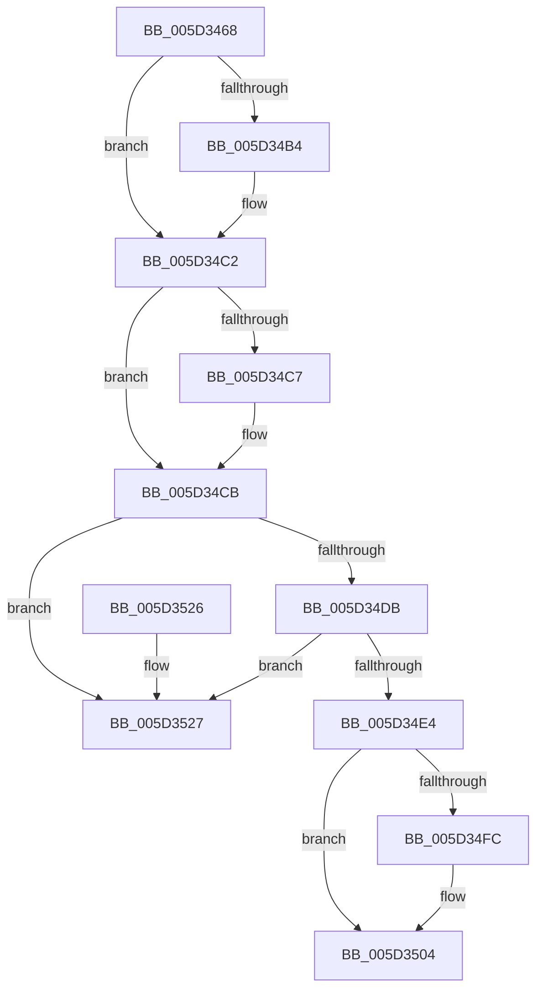

# PopFxRemoveAcpiDevice

- RVA: `0x005D3468`–`0x005D352E` (길이 `198` bytes)
- VA: `0x00000001405D3468`
- 실행 섹션: `.text`
- PDB 이름 있음: `예`; PDB Function 태그: `아니요`
- unwind 정보 RVA: `0x00069AD0`
- 디코드: `52`개 명령, `198/198` bytes 표시
- 미해석 바이트: `0` (있으면 어셈블리에 `.byte`로 보존)

> 이 문서는 커널 이미지의 기계어와 PDB 기호를 분석해 생성했습니다. 4번과 5번은 함수 원형과 자료형을 바이너리 사용 방식에서 추정한 C 해석이며 원본 소스 복구 결과는 아닙니다.

## 1. Dependencies

- 직접 호출 지점: **5**; 고유 호출 대상: **5**
- 직접 호출자로 확인된 함수: **1**
- RIP 상대 이미지 참조: **2**

### Outgoing calls
- `0x005D34A3` → [KeAbPreAcquire](../21/KeAbPreAcquire_function_00210230.md) (function, `0x00210230`)
- `0x005D34BD` → [ExfAcquirePushLockExclusiveEx](../20/ExfAcquirePushLockExclusiveEx_function_0020FC90.md) (function, `0x0020FC90`)
- `0x005D34FF` → [ExfTryToWakePushLock](../26/ExfTryToWakePushLock_function_00265DD0.md) (function, `0x00265DD0`)
- `0x005D3507` → [KeAbPostRelease](../2E/KeAbPostRelease_function_002E1600.md) (function, `0x002E1600`)
- `0x005D350C` → [KeLeaveCriticalRegion](../25/KeLeaveCriticalRegion_function_0025D8B0.md) (function, `0x0025D8B0`)

### Direct callers
- [PopFxAcpiUnregisterDevice](PopFxAcpiUnregisterDevice_function_005DD830.md) at `0x005DD883`

### Static image references
- `0x005D3485` → RVA `0x00F0E408` (`.data`; read)
- `0x005D34EB` → RVA `0x00F0E408` (`.data`; read/write)

## 2. Other-region calls and transfers

- 다른 실행 섹션으로 향하는 call: **0**
- 별도 외부 분기/꼬리 이동을 확인하지 못했습니다.

## 3. Assembly (complete function range)

```asm
005D3468  48 89 5C 24 08                  mov qword ptr [rsp + 8], rbx
005D346D  48 89 6C 24 10                  mov qword ptr [rsp + 0x10], rbp
005D3472  48 89 74 24 18                  mov qword ptr [rsp + 0x18], rsi
005D3477  57                              push rdi
005D3478  48 83 EC 20                     sub rsp, 0x20
005D347C  65 48 8B 04 25 88 01 00 00      mov rax, qword ptr gs:[0x188]
005D3485  48 8D 2D 7C AF 93 00            lea rbp, [rip + 0x93af7c]
005D348C  48 8B F2                        mov rsi, rdx
005D348F  48 83 CB FF                     or rbx, 0xffffffffffffffff
005D3493  45 33 C0                        xor r8d, r8d
005D3496  33 D2                           xor edx, edx
005D3498  48 8B CD                        mov rcx, rbp
005D349B  66 01 98 E4 01 00 00            add word ptr [rax + 0x1e4], bx
005D34A2  90                              nop
005D34A3  E8 88 CD C3 FF                  call 0x140210230
005D34A8  F0 48 0F BA 6D 00 00            lock bts qword ptr [rbp], 0
005D34AF  48 8B F8                        mov rdi, rax
005D34B2  73 0E                           jae 0x1405d34c2
005D34B4  4C 8B C5                        mov r8, rbp
005D34B7  48 8B D0                        mov rdx, rax
005D34BA  48 8B CD                        mov rcx, rbp
005D34BD  E8 CE C7 C3 FF                  call 0x14020fc90
005D34C2  48 85 FF                        test rdi, rdi
005D34C5  74 04                           je 0x1405d34cb
005D34C7  C6 47 0A 01                     mov byte ptr [rdi + 0xa], 1
005D34CB  48 8D 86 C8 00 00 00            lea rax, [rsi + 0xc8]
005D34D2  4C 8B 00                        mov r8, qword ptr [rax]
005D34D5  49 39 40 08                     cmp qword ptr [r8 + 8], rax
005D34D9  75 4C                           jne 0x1405d3527
005D34DB  48 8B 50 08                     mov rdx, qword ptr [rax + 8]
005D34DF  48 39 02                        cmp qword ptr [rdx], rax
005D34E2  75 43                           jne 0x1405d3527
005D34E4  4C 89 02                        mov qword ptr [rdx], r8
005D34E7  49 89 50 08                     mov qword ptr [r8 + 8], rdx
005D34EB  F0 48 0F C1 1D 14 AF 93 00      lock xadd qword ptr [rip + 0x93af14], rbx
005D34F4  80 E3 06                        and bl, 6
005D34F7  80 FB 02                        cmp bl, 2
005D34FA  75 08                           jne 0x1405d3504
005D34FC  48 8B CD                        mov rcx, rbp
005D34FF  E8 CC 28 C9 FF                  call 0x140265dd0
005D3504  48 8B CD                        mov rcx, rbp
005D3507  E8 F4 E0 D0 FF                  call 0x1402e1600
005D350C  E8 9F A3 C8 FF                  call 0x14025d8b0
005D3511  48 8B 5C 24 30                  mov rbx, qword ptr [rsp + 0x30]
005D3516  48 8B 6C 24 38                  mov rbp, qword ptr [rsp + 0x38]
005D351B  48 8B 74 24 40                  mov rsi, qword ptr [rsp + 0x40]
005D3520  48 83 C4 20                     add rsp, 0x20
005D3524  5F                              pop rdi
005D3525  C3                              ret
005D3526  CC                              int3
005D3527  B9 03 00 00 00                  mov ecx, 3
005D352C  CD 29                           int 0x29
```

## 4. C-style interpretation (structured pseudocode)

```c
__int64 __fastcall PopFxRemoveAcpiDevice(__int64 a1, __int64 a2, int a3)
{
    __int64 result;
    __int64 v_rbx;
    __int64 v_rsp;
    unsigned __int64 v_stack_p10;
    unsigned __int64 v_stack_p18;
    unsigned __int64 v_stack_p8;

    v_stack_p8 = v_rbx;
    v_stack_p10 = v_rbp;
    v_stack_p18 = v_rsi;
    v_rsp = (v_rsp) - (32);
    v_rbx = (v_rbx) | (-1);
    a3 = 0;
    a2 = 0;
    result = KeAbPreAcquire(v_rip + 9678716, a2, a3, a4);
    if (!(condition_is_above_or_equal)) {
        a3 = v_rip + 9678716;
        a2 = result;
        a1 = v_rip + 9678716;
        result = ExfAcquirePushLockExclusiveEx(a1, a2, a3, a4);
    }
    if (result != 0) {
        *(unsigned __int8 *)(result + 10) = 1;
    }
    if ((*(unsigned __int64 *)(*(unsigned __int64 *)(a2 + 200) + 8)) != (a2 + 200)) goto loc_005D3527;
    if ((*(unsigned __int64 *)(*(unsigned __int64 *)(a2 + 200 + 8))) != (a2 + 200)) goto loc_005D3527;
    *(unsigned __int64 *)(*(unsigned __int64 *)(a2 + 200 + 8)) = *(unsigned __int64 *)(a2 + 200);
    *(unsigned __int64 *)(*(unsigned __int64 *)(a2 + 200) + 8) = *(unsigned __int64 *)(a2 + 200 + 8);
    v_rbx = (unsigned __int8)((v_rbx) & (6));
    result = a2 + 200;
    if (((unsigned __int8)(v_rbx)) == 2) {
        a1 = v_rip + 9678716;
        result = ExfTryToWakePushLock(a1, *(unsigned __int64 *)(a2 + 200 + 8), *(unsigned __int64 *)(a2 + 200), a4);
    }
    result = KeAbPostRelease(v_rip + 9678716, *(unsigned __int64 *)(a2 + 200 + 8), *(unsigned __int64 *)(a2 + 200), a4);
    result = KeLeaveCriticalRegion(v_rip + 9678716, *(unsigned __int64 *)(a2 + 200 + 8), *(unsigned __int64 *)(a2 + 200), a4);
    v_rsp = (v_rsp) + (32);
    return result;
loc_005D3527:
    return result;
}
```

## 5. (Beta) C Style

```c
int64_t PopFxRemoveAcpiDevice(int64_t Arg1, void *Arg2, int32_t Arg3)
{
    uint8_t *arg2 = (uint8_t *)Arg2;

    int64_t result;
    int64_t local_rbx;
    int64_t local_rsp;
    uint64_t v_stack_p10;
    uint64_t v_stack_p18;
    uint64_t v_stack_p8;

    v_stack_p8 = local_rbx;
    v_stack_p10 = local_rbp;
    v_stack_p18 = local_rsi;
    local_rsp = (local_rsp) - (32);
    local_rbx = (local_rbx) | (-1);
    Arg3 = 0;
    Arg2 = 0;
    result = KeAbPreAcquire(v_rip + 9678716, Arg2, Arg3, a4);
    if (!(condition_is_above_or_equal)) {
        Arg3 = v_rip + 9678716;
        Arg2 = result;
        Arg1 = v_rip + 9678716;
        result = ExfAcquirePushLockExclusiveEx(Arg1, Arg2, Arg3, a4);
    }
    if (result != 0) {
        *(uint8_t *)(result + 0xA) = 1;
    }
    if ((*(uint64_t *)(*(uint64_t *)(arg2 + 0xC8) + 0x8)) != (Arg2 + 200)) goto loc_005D3527;
    if ((*(uint64_t *)(*(uint64_t *)(arg2 + 0xC8 + 0x8))) != (Arg2 + 200)) goto loc_005D3527;
    *(uint64_t *)(*(uint64_t *)(arg2 + 0xC8 + 0x8)) = *(uint64_t *)(arg2 + 0xC8);
    *(uint64_t *)(*(uint64_t *)(arg2 + 0xC8) + 0x8) = *(uint64_t *)(arg2 + 0xC8 + 0x8);
    local_rbx = (uint8_t)((local_rbx) & (6));
    result = Arg2 + 200;
    if (((uint8_t)(local_rbx)) == 2) {
        Arg1 = v_rip + 9678716;
        result = ExfTryToWakePushLock(Arg1, *(uint64_t *)(arg2 + 0xC8 + 0x8), *(uint64_t *)(arg2 + 0xC8), a4);
    }
    result = KeAbPostRelease(v_rip + 9678716, *(uint64_t *)(arg2 + 0xC8 + 0x8), *(uint64_t *)(arg2 + 0xC8), a4);
    result = KeLeaveCriticalRegion(v_rip + 9678716, *(uint64_t *)(arg2 + 0xC8 + 0x8), *(uint64_t *)(arg2 + 0xC8), a4);
    local_rsp = (local_rsp) + (32);
    return result;
loc_005D3527:
    return result;
}
```

### 관측된 메모리 오프셋

구조체 형식이 확인되지 않은 접근은 인자 기준의 오프셋으로만 기록했습니다.

| 기준 인자 | 오프셋 표현 | 폭 (bit) | 접근 |
|---|---:|---:|---|
| `Arg2` | `+ 0x0` | `64` | `R` |
| `Arg2` | `+ 0x8` | `64` | `R` |
| `Arg2` | `+ 0xC8` | `64` | `R` |

## 6. Execution-region graph

[열기: 2D/3D 그래프와 함수 탐색 컨트롤 패널](../../../control-panel.html?section=text&rva=0x005D3468&view=graph)

- 2D 그래프는 위에서 아래로 흐르고, 3D 그래프는 빈 공간을 드래그해 회전합니다. Shift+드래그는 이동, 휠은 확대·축소, 함수 노드 선택은 대상 보고서 이동입니다.

### Static fallback


