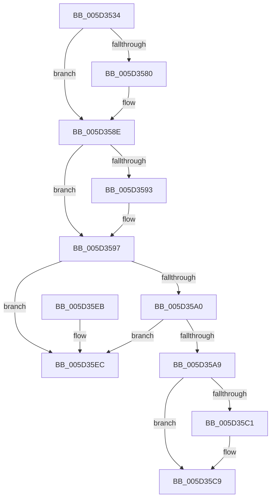

# PopFxRemoveDevice

- RVA: `0x005D3534`–`0x005D35F3` (길이 `191` bytes)
- VA: `0x00000001405D3534`
- 실행 섹션: `.text`
- PDB 이름 있음: `예`; PDB Function 태그: `아니요`
- unwind 정보 RVA: `0x00069AD0`
- 디코드: `51`개 명령, `191/191` bytes 표시
- 미해석 바이트: `0` (있으면 어셈블리에 `.byte`로 보존)

> 이 문서는 커널 이미지의 기계어와 PDB 기호를 분석해 생성했습니다. 4번과 5번은 함수 원형과 자료형을 바이너리 사용 방식에서 추정한 C 해석이며 원본 소스 복구 결과는 아닙니다.

## 1. Dependencies

- 직접 호출 지점: **5**; 고유 호출 대상: **5**
- 직접 호출자로 확인된 함수: **1**
- RIP 상대 이미지 참조: **2**

### Outgoing calls
- `0x005D356F` → [KeAbPreAcquire](../21/KeAbPreAcquire_function_00210230.md) (function, `0x00210230`)
- `0x005D3589` → [ExfAcquirePushLockExclusiveEx](../20/ExfAcquirePushLockExclusiveEx_function_0020FC90.md) (function, `0x0020FC90`)
- `0x005D35C4` → [ExfTryToWakePushLock](../26/ExfTryToWakePushLock_function_00265DD0.md) (function, `0x00265DD0`)
- `0x005D35CC` → [KeAbPostRelease](../2E/KeAbPostRelease_function_002E1600.md) (function, `0x002E1600`)
- `0x005D35D1` → [KeLeaveCriticalRegion](../25/KeLeaveCriticalRegion_function_0025D8B0.md) (function, `0x0025D8B0`)

### Direct callers
- [PopFxUnregisterDevice](../../page/A8/PopFxUnregisterDevice_function_00A8AE84.md) at `0x00A8AF0E`

### Static image references
- `0x005D3551` → RVA `0x00F0E408` (`.data`; read)
- `0x005D35B0` → RVA `0x00F0E408` (`.data`; read/write)

## 2. Other-region calls and transfers

- 다른 실행 섹션으로 향하는 call: **0**
- 별도 외부 분기/꼬리 이동을 확인하지 못했습니다.

## 3. Assembly (complete function range)

```asm
005D3534  48 89 5C 24 08                  mov qword ptr [rsp + 8], rbx
005D3539  48 89 6C 24 10                  mov qword ptr [rsp + 0x10], rbp
005D353E  48 89 74 24 18                  mov qword ptr [rsp + 0x18], rsi
005D3543  57                              push rdi
005D3544  48 83 EC 20                     sub rsp, 0x20
005D3548  65 48 8B 04 25 88 01 00 00      mov rax, qword ptr gs:[0x188]
005D3551  48 8D 2D B0 AE 93 00            lea rbp, [rip + 0x93aeb0]
005D3558  48 8B FA                        mov rdi, rdx
005D355B  48 83 CB FF                     or rbx, 0xffffffffffffffff
005D355F  45 33 C0                        xor r8d, r8d
005D3562  33 D2                           xor edx, edx
005D3564  48 8B CD                        mov rcx, rbp
005D3567  66 01 98 E4 01 00 00            add word ptr [rax + 0x1e4], bx
005D356E  90                              nop
005D356F  E8 BC CC C3 FF                  call 0x140210230
005D3574  F0 48 0F BA 6D 00 00            lock bts qword ptr [rbp], 0
005D357B  48 8B F0                        mov rsi, rax
005D357E  73 0E                           jae 0x1405d358e
005D3580  4C 8B C5                        mov r8, rbp
005D3583  48 8B D0                        mov rdx, rax
005D3586  48 8B CD                        mov rcx, rbp
005D3589  E8 02 C7 C3 FF                  call 0x14020fc90
005D358E  48 85 F6                        test rsi, rsi
005D3591  74 04                           je 0x1405d3597
005D3593  C6 46 0A 01                     mov byte ptr [rsi + 0xa], 1
005D3597  48 8B 17                        mov rdx, qword ptr [rdi]
005D359A  48 39 7A 08                     cmp qword ptr [rdx + 8], rdi
005D359E  75 4C                           jne 0x1405d35ec
005D35A0  48 8B 47 08                     mov rax, qword ptr [rdi + 8]
005D35A4  48 39 38                        cmp qword ptr [rax], rdi
005D35A7  75 43                           jne 0x1405d35ec
005D35A9  48 89 10                        mov qword ptr [rax], rdx
005D35AC  48 89 42 08                     mov qword ptr [rdx + 8], rax
005D35B0  F0 48 0F C1 1D 4F AE 93 00      lock xadd qword ptr [rip + 0x93ae4f], rbx
005D35B9  80 E3 06                        and bl, 6
005D35BC  80 FB 02                        cmp bl, 2
005D35BF  75 08                           jne 0x1405d35c9
005D35C1  48 8B CD                        mov rcx, rbp
005D35C4  E8 07 28 C9 FF                  call 0x140265dd0
005D35C9  48 8B CD                        mov rcx, rbp
005D35CC  E8 2F E0 D0 FF                  call 0x1402e1600
005D35D1  E8 DA A2 C8 FF                  call 0x14025d8b0
005D35D6  48 8B 5C 24 30                  mov rbx, qword ptr [rsp + 0x30]
005D35DB  48 8B 6C 24 38                  mov rbp, qword ptr [rsp + 0x38]
005D35E0  48 8B 74 24 40                  mov rsi, qword ptr [rsp + 0x40]
005D35E5  48 83 C4 20                     add rsp, 0x20
005D35E9  5F                              pop rdi
005D35EA  C3                              ret
005D35EB  CC                              int3
005D35EC  B9 03 00 00 00                  mov ecx, 3
005D35F1  CD 29                           int 0x29
```

## 4. C-style interpretation (structured pseudocode)

```c
__int64 __fastcall PopFxRemoveDevice(__int64 a1, __int64 a2, int a3)
{
    __int64 result;
    __int64 v_rbx;
    __int64 v_rsp;
    unsigned __int64 v_stack_p10;
    unsigned __int64 v_stack_p18;
    unsigned __int64 v_stack_p8;

    v_stack_p8 = v_rbx;
    v_stack_p10 = v_rbp;
    v_stack_p18 = v_rsi;
    v_rsp = (v_rsp) - (32);
    v_rbx = (v_rbx) | (-1);
    a3 = 0;
    a2 = 0;
    result = KeAbPreAcquire(v_rip + 9678512, a2, a3, a4);
    if (!(condition_is_above_or_equal)) {
        a3 = v_rip + 9678512;
        a2 = result;
        a1 = v_rip + 9678512;
        result = ExfAcquirePushLockExclusiveEx(a1, a2, a3, a4);
    }
    if (result != 0) {
        *(unsigned __int8 *)(result + 10) = 1;
    }
    if ((*(unsigned __int64 *)(*(unsigned __int64 *)(a2) + 8)) != a2) goto loc_005D35EC;
    if ((*(unsigned __int64 *)(*(unsigned __int64 *)(a2 + 8))) != a2) goto loc_005D35EC;
    *(unsigned __int64 *)(*(unsigned __int64 *)(a2 + 8)) = *(unsigned __int64 *)(a2);
    *(unsigned __int64 *)(*(unsigned __int64 *)(a2) + 8) = *(unsigned __int64 *)(a2 + 8);
    v_rbx = (unsigned __int8)((v_rbx) & (6));
    result = *(unsigned __int64 *)(a2 + 8);
    if (((unsigned __int8)(v_rbx)) == 2) {
        a1 = v_rip + 9678512;
        result = ExfTryToWakePushLock(a1, *(unsigned __int64 *)(a2), a3, a4);
    }
    result = KeAbPostRelease(v_rip + 9678512, *(unsigned __int64 *)(a2), a3, a4);
    result = KeLeaveCriticalRegion(v_rip + 9678512, *(unsigned __int64 *)(a2), a3, a4);
    v_rsp = (v_rsp) + (32);
    return result;
loc_005D35EC:
    return result;
}
```

## 5. (Beta) C Style

```c
int64_t PopFxRemoveDevice(int64_t Arg1, void *Arg2, int32_t Arg3)
{
    uint8_t *arg2 = (uint8_t *)Arg2;

    int64_t result;
    int64_t local_rbx;
    int64_t local_rsp;
    uint64_t v_stack_p10;
    uint64_t v_stack_p18;
    uint64_t v_stack_p8;

    v_stack_p8 = local_rbx;
    v_stack_p10 = local_rbp;
    v_stack_p18 = local_rsi;
    local_rsp = (local_rsp) - (32);
    local_rbx = (local_rbx) | (-1);
    Arg3 = 0;
    Arg2 = 0;
    result = KeAbPreAcquire(v_rip + 9678512, Arg2, Arg3, a4);
    if (!(condition_is_above_or_equal)) {
        Arg3 = v_rip + 9678512;
        Arg2 = result;
        Arg1 = v_rip + 9678512;
        result = ExfAcquirePushLockExclusiveEx(Arg1, Arg2, Arg3, a4);
    }
    if (result != 0) {
        *(uint8_t *)(result + 0xA) = 1;
    }
    if ((*(uint64_t *)(*(uint64_t *)(arg2) + 0x8)) != Arg2) goto loc_005D35EC;
    if ((*(uint64_t *)(*(uint64_t *)(arg2 + 0x8))) != Arg2) goto loc_005D35EC;
    *(uint64_t *)(*(uint64_t *)(arg2 + 0x8)) = *(uint64_t *)(arg2);
    *(uint64_t *)(*(uint64_t *)(arg2) + 0x8) = *(uint64_t *)(arg2 + 0x8);
    local_rbx = (uint8_t)((local_rbx) & (6));
    result = *(uint64_t *)(arg2 + 0x8);
    if (((uint8_t)(local_rbx)) == 2) {
        Arg1 = v_rip + 9678512;
        result = ExfTryToWakePushLock(Arg1, *(uint64_t *)(arg2), Arg3, a4);
    }
    result = KeAbPostRelease(v_rip + 9678512, *(uint64_t *)(arg2), Arg3, a4);
    result = KeLeaveCriticalRegion(v_rip + 9678512, *(uint64_t *)(arg2), Arg3, a4);
    local_rsp = (local_rsp) + (32);
    return result;
loc_005D35EC:
    return result;
}
```

### 관측된 메모리 오프셋

구조체 형식이 확인되지 않은 접근은 인자 기준의 오프셋으로만 기록했습니다.

| 기준 인자 | 오프셋 표현 | 폭 (bit) | 접근 |
|---|---:|---:|---|
| `Arg2` | `+ 0x0` | `64` | `R` |
| `Arg2` | `+ 0x8` | `64` | `R` |

## 6. Execution-region graph

[열기: 2D/3D 그래프와 함수 탐색 컨트롤 패널](../../../control-panel.html?section=text&rva=0x005D3534&view=graph)

- 2D 그래프는 위에서 아래로 흐르고, 3D 그래프는 빈 공간을 드래그해 회전합니다. Shift+드래그는 이동, 휠은 확대·축소, 함수 노드 선택은 대상 보고서 이동입니다.

### Static fallback


