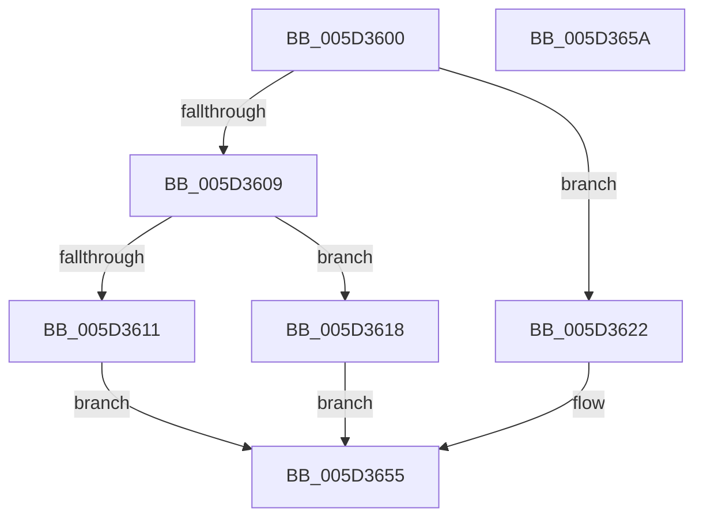

# PopFxRequestCommon

- RVA: `0x005D3600`–`0x005D365B` (길이 `91` bytes)
- VA: `0x00000001405D3600`
- 실행 섹션: `.text`
- PDB 이름 있음: `예`; PDB Function 태그: `아니요`
- unwind 정보 RVA: `0x00063458`
- 디코드: `23`개 명령, `91/91` bytes 표시
- 미해석 바이트: `0` (있으면 어셈블리에 `.byte`로 보존)

> 이 문서는 커널 이미지의 기계어와 PDB 기호를 분석해 생성했습니다. 4번과 5번은 함수 원형과 자료형을 바이너리 사용 방식에서 추정한 C 해석이며 원본 소스 복구 결과는 아닙니다.

## 1. Dependencies

- 직접 호출 지점: **2**; 고유 호출 대상: **2**
- 직접 호출자로 확인된 함수: **0**
- RIP 상대 이미지 참조: **1**

### Outgoing calls
- `0x005D361B` → [PpmIdleAllocateVetoReasons](../../page/75/PpmIdleAllocateVetoReasons_function_00754D08.md) (function, `0x00754D08`)
- `0x005D3650` → [guard_dispatch_icall](../6B/guard_dispatch_icall_function_006BAAD0.md) (function, `0x006BAAD0`)

### Direct callers
- 이 함수 시작 RVA로 연결되는 직접 call은 확인되지 않았습니다. 간접 호출은 완전히 역산할 수 없습니다.

### Static image references
- `0x005D3644` → RVA `0x00F070E0` (`.data`; read)

## 2. Other-region calls and transfers

- 다른 실행 섹션으로 향하는 call: **1**
  - `0x005D361B` → [PpmIdleAllocateVetoReasons](../../page/75/PpmIdleAllocateVetoReasons_function_00754D08.md) (`.text` → `PAGE`)
- 별도 외부 분기/꼬리 이동을 확인하지 못했습니다.

## 3. Assembly (complete function range)

```asm
005D3600  48 83 EC 48                     sub rsp, 0x48
005D3604  83 E9 01                        sub ecx, 1
005D3607  74 19                           je 0x1405d3622
005D3609  81 F9 00 00 00 10               cmp ecx, 0x10000000
005D360F  74 07                           je 0x1405d3618
005D3611  B8 BB 00 00 C0                  mov eax, 0xc00000bb
005D3616  EB 3D                           jmp 0x1405d3655
005D3618  48 8B CA                        mov rcx, rdx
005D361B  E8 E8 16 18 00                  call 0x140754d08
005D3620  EB 33                           jmp 0x1405d3655
005D3622  33 C0                           xor eax, eax
005D3624  48 C7 44 24 30 01 00 00 00      mov qword ptr [rsp + 0x30], 1
005D362D  48 89 44 24 24                  mov qword ptr [rsp + 0x24], rax
005D3632  48 8D 4C 24 20                  lea rcx, [rsp + 0x20]
005D3637  89 44 24 2C                     mov dword ptr [rsp + 0x2c], eax
005D363B  B8 01 00 00 00                  mov eax, 1
005D3640  89 44 24 20                     mov dword ptr [rsp + 0x20], eax
005D3644  48 8B 05 95 3A 93 00            mov rax, qword ptr [rip + 0x933a95]
005D364B  48 89 54 24 38                  mov qword ptr [rsp + 0x38], rdx
005D3650  E8 7B 74 0E 00                  call 0x1406baad0
005D3655  48 83 C4 48                     add rsp, 0x48
005D3659  C3                              ret
005D365A  CC                              int3
```

## 4. C-style interpretation (structured pseudocode)

```c
__int64 __fastcall PopFxRequestCommon(int a1, __int64 a2)
{
    __int64 result;
    __int64 v_rsp;
    unsigned __int64 v_stack_m10;
    unsigned __int64 v_stack_m18;
    unsigned int v_stack_m1C;
    unsigned __int64 v_stack_m24;
    unsigned __int64 v_stack_m28;

    v_rsp = (v_rsp) - (72);
    a1 = (unsigned int)((a1) - (1));
    if (condition_is_equal) goto loc_005D3622;
    if (a1 == 0x10000000ULL) goto loc_005D3618;
    goto loc_005D3655;
loc_005D3618:
    result = PpmIdleAllocateVetoReasons(a2, a2, a3, a4);
    goto loc_005D3655;
loc_005D3622:
    result = 0;
    v_stack_m18 = 1;
    v_stack_m24 = 0;
    v_stack_m1C = 0;
    v_stack_m28 = 1;
    v_stack_m10 = a2;
    result = guard_dispatch_icall(v_stack_m28, a2, a3, a4);
loc_005D3655:
    v_rsp = (v_rsp) + (72);
    return result;
}
```

## 5. (Beta) C Style

```c
int64_t PopFxRequestCommon(int32_t Arg1, int64_t Arg2)
{
    int64_t result;
    int64_t local_rsp;
    uint64_t v_stack_m10;
    uint64_t v_stack_m18;
    uint32_t v_stack_m1C;
    uint64_t v_stack_m24;
    uint64_t v_stack_m28;

    local_rsp = (local_rsp) - (72);
    Arg1 = (uint32_t)((Arg1) - (1));
    if (condition_is_equal) goto loc_005D3622;
    if (Arg1 == 0x10000000ULL) goto loc_005D3618;
    goto loc_005D3655;
loc_005D3618:
    result = PpmIdleAllocateVetoReasons(Arg2, Arg2, a3, a4);
    goto loc_005D3655;
loc_005D3622:
    result = 0;
    v_stack_m18 = 1;
    v_stack_m24 = 0;
    v_stack_m1C = 0;
    v_stack_m28 = 1;
    v_stack_m10 = Arg2;
    result = guard_dispatch_icall(v_stack_m28, Arg2, a3, a4);
loc_005D3655:
    local_rsp = (local_rsp) + (72);
    return result;
}
```

## 6. Execution-region graph

[열기: 2D/3D 그래프와 함수 탐색 컨트롤 패널](../../../control-panel.html?section=text&rva=0x005D3600&view=graph)

- 2D 그래프는 위에서 아래로 흐르고, 3D 그래프는 빈 공간을 드래그해 회전합니다. Shift+드래그는 이동, 휠은 확대·축소, 함수 노드 선택은 대상 보고서 이동입니다.

### Static fallback


