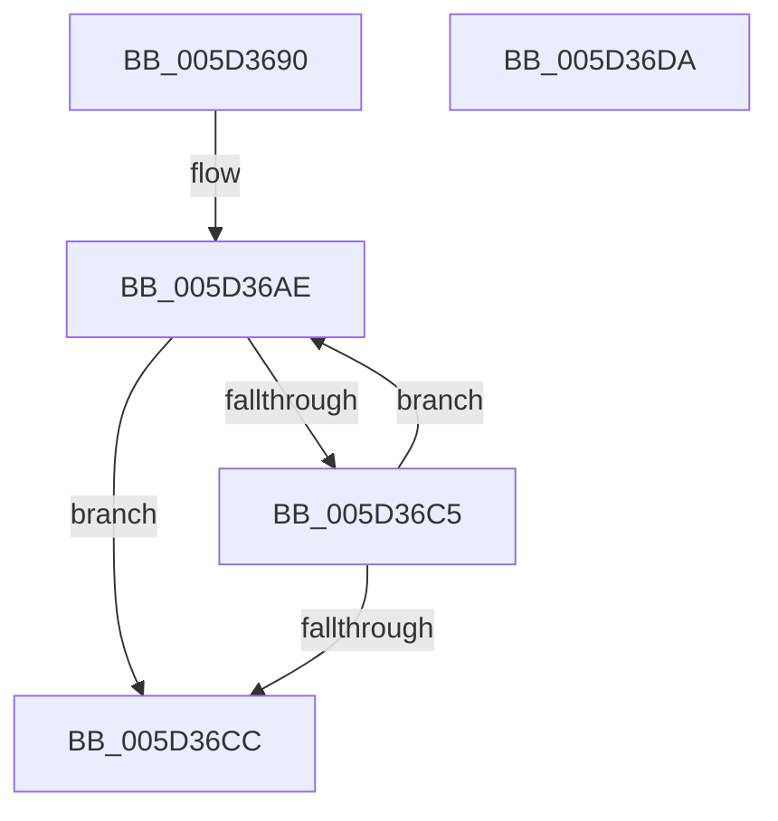

# PopFxStaticWorkPoolThread

- RVA: `0x005D3690`–`0x005D36DB` (길이 `75` bytes)
- VA: `0x00000001405D3690`
- 실행 섹션: `.text`
- PDB 이름 있음: `예`; PDB Function 태그: `아니요`
- unwind 정보 RVA: `0x0005CF00`
- 디코드: `20`개 명령, `75/75` bytes 표시
- 미해석 바이트: `0` (있으면 어셈블리에 `.byte`로 보존)

> 이 문서는 커널 이미지의 기계어와 PDB 기호를 분석해 생성했습니다. 4번과 5번은 함수 원형과 자료형을 바이너리 사용 방식에서 추정한 C 해석이며 원본 소스 복구 결과는 아닙니다.

## 1. Dependencies

- 직접 호출 지점: **2**; 고유 호출 대상: **2**
- 직접 호출자로 확인된 함수: **0**
- RIP 상대 이미지 참조: **0**

### Outgoing calls
- `0x005D36A7` → [KeSetActualBasePriorityThread](../3C/KeSetActualBasePriorityThread_function_003C4370.md) (function, `0x003C4370`)
- `0x005D36CF` → [PopFxProcessWorkPool](../49/PopFxProcessWorkPool_function_0049E8A0.md) (function, `0x0049E8A0`)

### Direct callers
- 이 함수 시작 RVA로 연결되는 직접 call은 확인되지 않았습니다. 간접 호출은 완전히 역산할 수 없습니다.

### Static image references
- 디코드된 RIP-relative 메모리 참조가 없습니다.

## 2. Other-region calls and transfers

- 다른 실행 섹션으로 향하는 call: **0**
- 별도 외부 분기/꼬리 이동을 확인하지 못했습니다.

## 3. Assembly (complete function range)

```asm
005D3690  40 53                           push rbx
005D3692  48 83 EC 20                     sub rsp, 0x20
005D3696  48 8B D9                        mov rbx, rcx
005D3699  BA 10 00 00 00                  mov edx, 0x10
005D369E  65 48 8B 0C 25 88 01 00 00      mov rcx, qword ptr gs:[0x188]
005D36A7  E8 C4 0C DF FF                  call 0x1403c4370
005D36AC  33 D2                           xor edx, edx
005D36AE  65 4C 8B 0C 25 88 01 00 00      mov r9, qword ptr gs:[0x188]
005D36B7  33 C0                           xor eax, eax
005D36B9  F0 4C 0F B1 8C D3 08 01 00 00   lock cmpxchg qword ptr [rbx + rdx*8 + 0x108], r9
005D36C3  74 07                           je 0x1405d36cc
005D36C5  FF C2                           inc edx
005D36C7  83 FA 01                        cmp edx, 1
005D36CA  72 E2                           jb 0x1405d36ae
005D36CC  48 8B CB                        mov rcx, rbx
005D36CF  E8 CC B1 EC FF                  call 0x14049e8a0
005D36D4  48 83 C4 20                     add rsp, 0x20
005D36D8  5B                              pop rbx
005D36D9  C3                              ret
005D36DA  CC                              int3
```

## 4. C-style interpretation (structured pseudocode)

```c
__int64 __fastcall PopFxStaticWorkPoolThread(__int64 a1)
{
    __int64 result;
    __int64 v_rsp;

    v_rsp = (v_rsp) - (32);
    result = KeSetActualBasePriorityThread(*(unsigned __int64 *)(gs_base + (0 + 392)), 16, a3, a4);
    a2 = 0;
loc_005D36AE:
    result = 0;
    if (condition_is_equal) goto loc_005D36CC;
    a2 = (unsigned int)((a2) + 1);
    if (((unsigned int)(a2)) < 1) goto loc_005D36AE;
loc_005D36CC:
    result = PopFxProcessWorkPool(a1, a2, a3, *(unsigned __int64 *)(gs_base + (0 + 392)));
    v_rsp = (v_rsp) + (32);
    return result;
}
```

## 5. (Beta) C Style

```c
int64_t PopFxStaticWorkPoolThread(void *Arg1)
{
    uint8_t *arg1 = (uint8_t *)Arg1;

    int64_t result;
    int64_t local_rsp;

    local_rsp = (local_rsp) - (32);
    result = KeSetActualBasePriorityThread(*(uint64_t *)(gs_base + (0 + 0x188)), 16, a3, a4);
    a2 = 0;
loc_005D36AE:
    result = 0;
    if (condition_is_equal) goto loc_005D36CC;
    a2 = (uint32_t)((a2) + 1);
    if (((uint32_t)(a2)) < 1) goto loc_005D36AE;
loc_005D36CC:
    result = PopFxProcessWorkPool(Arg1, a2, a3, *(uint64_t *)(gs_base + (0 + 0x188)));
    local_rsp = (local_rsp) + (32);
    return result;
}
```

### 관측된 메모리 오프셋

구조체 형식이 확인되지 않은 접근은 인자 기준의 오프셋으로만 기록했습니다.

| 기준 인자 | 오프셋 표현 | 폭 (bit) | 접근 |
|---|---:|---:|---|
| `Arg1` | `+ 0x108 + rdx*8` | `64` | `R` |

## 6. Execution-region graph

[열기: 2D/3D 그래프와 함수 탐색 컨트롤 패널](../../../control-panel.html?section=text&rva=0x005D3690&view=graph)

- 2D 그래프는 위에서 아래로 흐르고, 3D 그래프는 빈 공간을 드래그해 회전합니다. Shift+드래그는 이동, 휠은 확대·축소, 함수 노드 선택은 대상 보고서 이동입니다.

### Static fallback


