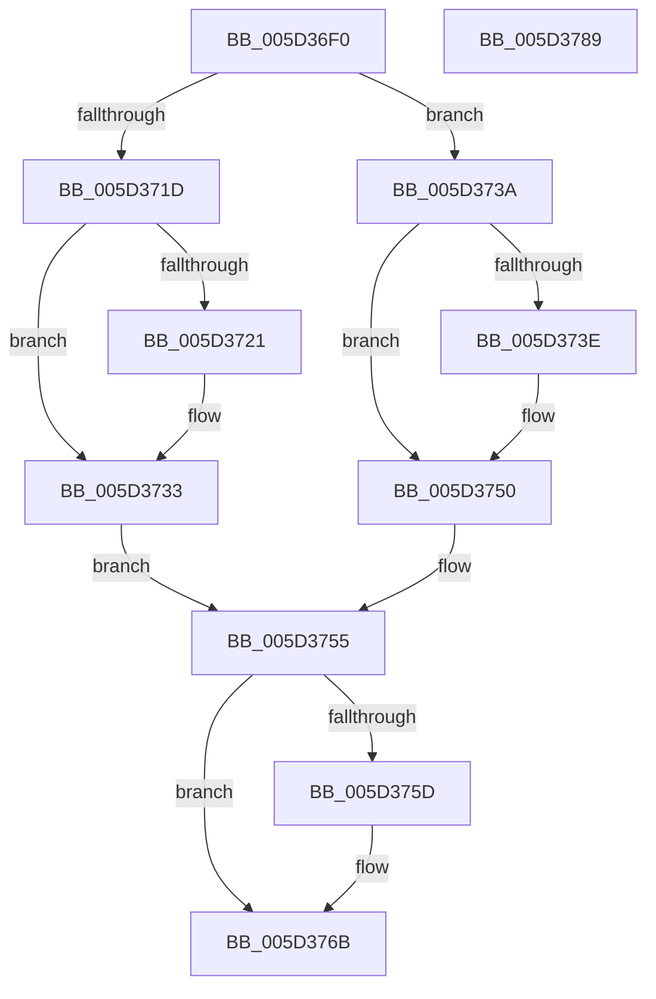

# PopFxTransitionCriticalResource

- RVA: `0x005D36F0`–`0x005D378A` (길이 `154` bytes)
- VA: `0x00000001405D36F0`
- 실행 섹션: `.text`
- PDB 이름 있음: `예`; PDB Function 태그: `아니요`
- unwind 정보 RVA: `0x0005CF00`
- 디코드: `47`개 명령, `154/154` bytes 표시
- 미해석 바이트: `0` (있으면 어셈블리에 `.byte`로 보존)

> 이 문서는 커널 이미지의 기계어와 PDB 기호를 분석해 생성했습니다. 4번과 5번은 함수 원형과 자료형을 바이너리 사용 방식에서 추정한 C 해석이며 원본 소스 복구 결과는 아닙니다.

## 1. Dependencies

- 직접 호출 지점: **4**; 고유 호출 대상: **2**
- 직접 호출자로 확인된 함수: **0**
- RIP 상대 이미지 참조: **0**

### Outgoing calls
- `0x005D372D` → [PopFxBugCheck](../2B/PopFxBugCheck_function_002BFC6C.md) (function, `0x002BFC6C`)
- `0x005D374A` → [PopFxBugCheck](../2B/PopFxBugCheck_function_002BFC6C.md) (function, `0x002BFC6C`)
- `0x005D3765` → [PopFxBugCheck](../2B/PopFxBugCheck_function_002BFC6C.md) (function, `0x002BFC6C`)
- `0x005D377E` → [guard_dispatch_icall](../6B/guard_dispatch_icall_function_006BAAD0.md) (function, `0x006BAAD0`)

### Direct callers
- 이 함수 시작 RVA로 연결되는 직접 call은 확인되지 않았습니다. 간접 호출은 완전히 역산할 수 없습니다.

### Static image references
- 디코드된 RIP-relative 메모리 참조가 없습니다.

## 2. Other-region calls and transfers

- 다른 실행 섹션으로 향하는 call: **0**
- 별도 외부 분기/꼬리 이동을 확인하지 못했습니다.

## 3. Assembly (complete function range)

```asm
005D36F0  40 53                           push rbx
005D36F2  48 83 EC 20                     sub rsp, 0x20
005D36F6  48 8B 81 68 03 00 00            mov rax, qword ptr [rcx + 0x368]
005D36FD  4C 8B D1                        mov r10, rcx
005D3700  8B DA                           mov ebx, edx
005D3702  33 C9                           xor ecx, ecx
005D3704  45 0F B6 D8                     movzx r11d, r8b
005D3708  48 8B 14 D8                     mov rdx, qword ptr [rax + rbx*8]
005D370C  33 C0                           xor eax, eax
005D370E  4C 8D 42 58                     lea r8, [rdx + 0x58]
005D3712  F0 41 0F B1 48 04               lock cmpxchg dword ptr [r8 + 4], ecx
005D3718  45 84 DB                        test r11b, r11b
005D371B  74 1D                           je 0x1405d373a
005D371D  A8 01                           test al, 1
005D371F  75 12                           jne 0x1405d3733
005D3721  4D 63 40 04                     movsxd r8, dword ptr [r8 + 4]
005D3725  45 8B CB                        mov r9d, r11d
005D3728  B9 06 06 00 00                  mov ecx, 0x606
005D372D  E8 3A C5 CE FF                  call 0x1402bfc6c
005D3732  CC                              int3
005D3733  8B C8                           mov ecx, eax
005D3735  83 E1 FE                        and ecx, 0xfffffffe
005D3738  EB 1B                           jmp 0x1405d3755
005D373A  A8 01                           test al, 1
005D373C  74 12                           je 0x1405d3750
005D373E  4D 63 40 04                     movsxd r8, dword ptr [r8 + 4]
005D3742  45 33 C9                        xor r9d, r9d
005D3745  B9 06 06 00 00                  mov ecx, 0x606
005D374A  E8 1D C5 CE FF                  call 0x1402bfc6c
005D374F  CC                              int3
005D3750  8B C8                           mov ecx, eax
005D3752  83 C9 01                        or ecx, 1
005D3755  F0 41 0F B1 48 04               lock cmpxchg dword ptr [r8 + 4], ecx
005D375B  74 0E                           je 0x1405d376b
005D375D  4C 63 C9                        movsxd r9, ecx
005D3760  B9 06 06 00 00                  mov ecx, 0x606
005D3765  E8 02 C5 CE FF                  call 0x1402bfc6c
005D376A  CC                              int3
005D376B  49 8B 82 A0 00 00 00            mov rax, qword ptr [r10 + 0xa0]
005D3772  45 8A C3                        mov r8b, r11b
005D3775  49 8B 8A C0 00 00 00            mov rcx, qword ptr [r10 + 0xc0]
005D377C  8B D3                           mov edx, ebx
005D377E  E8 4D 73 0E 00                  call 0x1406baad0
005D3783  48 83 C4 20                     add rsp, 0x20
005D3787  5B                              pop rbx
005D3788  C3                              ret
005D3789  CC                              int3
```

## 4. C-style interpretation (structured pseudocode)

```c
__int64 __fastcall PopFxTransitionCriticalResource(__int64 a1, int a2, unsigned __int8 a3)
{
    __int64 result;
    __int64 v_rsp;

    v_rsp = (v_rsp) - (32);
    a1 = 0;
    result = 0;
    if (a3 == 0) goto loc_005D373A;
    if (((0) & (1)) == 0) {
        a3 = (int)(*(unsigned int *)(*(unsigned __int64 *)(*(unsigned __int64 *)(a1 + 872) + (unsigned int)(a2) * 8) + 88 + 4));
        a4 = a3;
        a1 = 0x606ULL;
        result = PopFxBugCheck(a1, *(unsigned __int64 *)(*(unsigned __int64 *)(a1 + 872) + (unsigned int)(a2) * 8), a3, a4);
    }
    a1 = (unsigned int)(((unsigned int)((unsigned int)(result))) & (0xFFFFFFFEULL));
    goto loc_005D3755;
loc_005D373A:
    if ((((unsigned __int8)(result)) & (1)) != 0) {
        a3 = (int)(*(unsigned int *)(a3 + 4));
        a4 = 0;
        a1 = 0x606ULL;
        result = PopFxBugCheck(a1, *(unsigned __int64 *)(*(unsigned __int64 *)(a1 + 872) + (unsigned int)(a2) * 8), a3, a4);
    }
    a1 = (unsigned int)(((unsigned int)((unsigned int)(result))) | (1));
loc_005D3755:
    if (!(condition_is_equal)) {
        a4 = (int)((unsigned int)(a1));
        a1 = 0x606ULL;
        result = PopFxBugCheck(a1, *(unsigned __int64 *)(*(unsigned __int64 *)(a1 + 872) + (unsigned int)(a2) * 8), a3, a4);
    }
    result = guard_dispatch_icall(*(unsigned __int64 *)(a1 + 192), (unsigned int)((unsigned int)((unsigned int)(a2))), a3, a4);
    v_rsp = (v_rsp) + (32);
    return result;
}
```

## 5. (Beta) C Style

```c
int64_t PopFxTransitionCriticalResource(void *Arg1, int32_t Arg2, uint8_t Arg3)
{
    uint8_t *arg1 = (uint8_t *)Arg1;

    int64_t result;
    int64_t local_rsp;

    local_rsp = (local_rsp) - (32);
    Arg1 = 0;
    result = 0;
    if (Arg3 == 0) goto loc_005D373A;
    if (((0) & (1)) == 0) {
        Arg3 = (int32_t)(*(uint32_t *)(*(uint64_t *)(*(uint64_t *)(arg1 + 0x368) + (uint32_t)(Arg2) * 8) + 0x58 + 0x4));
        a4 = Arg3;
        Arg1 = 0x606ULL;
        result = PopFxBugCheck(Arg1, *(uint64_t *)(*(uint64_t *)(arg1 + 0x368) + (uint32_t)(Arg2) * 8), Arg3, a4);
    }
    Arg1 = (uint32_t)(((uint32_t)((uint32_t)(result))) & (0xFFFFFFFEULL));
    goto loc_005D3755;
loc_005D373A:
    if ((((uint8_t)(result)) & (1)) != 0) {
        Arg3 = (int32_t)(*(uint32_t *)(Arg3 + 0x4));
        a4 = 0;
        Arg1 = 0x606ULL;
        result = PopFxBugCheck(Arg1, *(uint64_t *)(*(uint64_t *)(arg1 + 0x368) + (uint32_t)(Arg2) * 8), Arg3, a4);
    }
    Arg1 = (uint32_t)(((uint32_t)((uint32_t)(result))) | (1));
loc_005D3755:
    if (!(condition_is_equal)) {
        a4 = (int32_t)((uint32_t)(Arg1));
        Arg1 = 0x606ULL;
        result = PopFxBugCheck(Arg1, *(uint64_t *)(*(uint64_t *)(arg1 + 0x368) + (uint32_t)(Arg2) * 8), Arg3, a4);
    }
    result = guard_dispatch_icall(*(uint64_t *)(arg1 + 0xC0), (uint32_t)((uint32_t)((uint32_t)(Arg2))), Arg3, a4);
    local_rsp = (local_rsp) + (32);
    return result;
}
```

### 관측된 메모리 오프셋

구조체 형식이 확인되지 않은 접근은 인자 기준의 오프셋으로만 기록했습니다.

| 기준 인자 | 오프셋 표현 | 폭 (bit) | 접근 |
|---|---:|---:|---|
| `Arg1` | `+ 0x368` | `64` | `R` |

## 6. Execution-region graph

[열기: 2D/3D 그래프와 함수 탐색 컨트롤 패널](../../../control-panel.html?section=text&rva=0x005D36F0&view=graph)

- 2D 그래프는 위에서 아래로 흐르고, 3D 그래프는 빈 공간을 드래그해 회전합니다. Shift+드래그는 이동, 휠은 확대·축소, 함수 노드 선택은 대상 보고서 이동입니다.

### Static fallback


