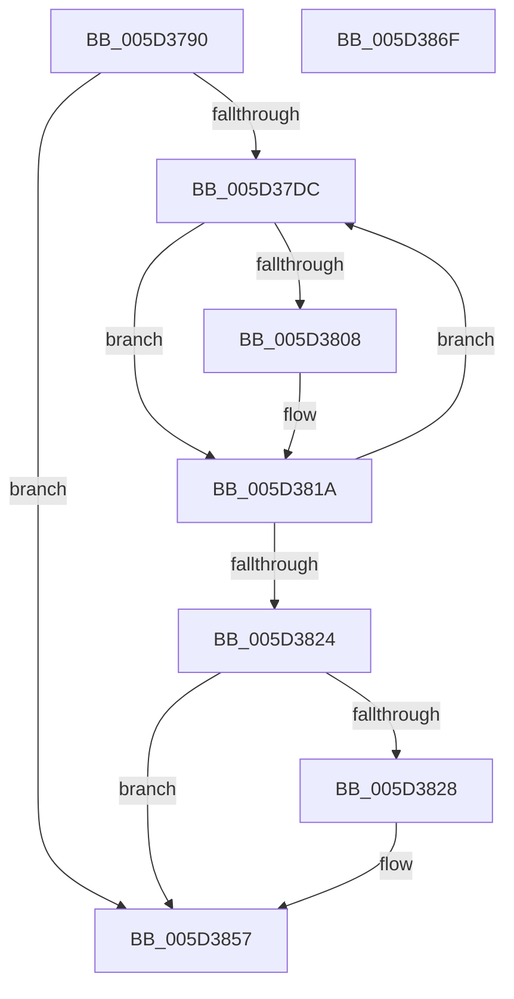

# PopFxUpdateComponentPerfStateNominalChange

- RVA: `0x005D3790`–`0x005D3870` (길이 `224` bytes)
- VA: `0x00000001405D3790`
- 실행 섹션: `.text`
- PDB 이름 있음: `예`; PDB Function 태그: `아니요`
- unwind 정보 RVA: `0x00060284`
- 디코드: `67`개 명령, `224/224` bytes 표시
- 미해석 바이트: `0` (있으면 어셈블리에 `.byte`로 보존)

> 이 문서는 커널 이미지의 기계어와 PDB 기호를 분석해 생성했습니다. 4번과 5번은 함수 원형과 자료형을 바이너리 사용 방식에서 추정한 C 해석이며 원본 소스 복구 결과는 아닙니다.

## 1. Dependencies

- 직접 호출 지점: **2**; 고유 호출 대상: **2**
- 직접 호출자로 확인된 함수: **2**
- RIP 상대 이미지 참조: **0**

### Outgoing calls
- `0x005D37FC` → [PopFxQueryCurrentComponentPerfState](PopFxQueryCurrentComponentPerfState_function_005D30BC.md) (function, `0x005D30BC`)
- `0x005D3852` → [PopDiagTraceFxPerfNominalChange](PopDiagTraceFxPerfNominalChange_function_005D6A34.md) (function, `0x005D6A34`)

### Direct callers
- [PopPepCompleteComponentIdleStateChangeActivity](../2B/PopPepCompleteComponentIdleStateChangeActivity_function_002BF1B0.md) at `0x002BF33C`
- [sub_006DC134](../6D/Unknown_function_006DC134.md) at `0x006DC166`

### Static image references
- 디코드된 RIP-relative 메모리 참조가 없습니다.

## 2. Other-region calls and transfers

- 다른 실행 섹션으로 향하는 call: **0**
- 별도 외부 분기/꼬리 이동을 확인하지 못했습니다.

## 3. Assembly (complete function range)

```asm
005D3790  48 89 5C 24 18                  mov qword ptr [rsp + 0x18], rbx
005D3795  55                              push rbp
005D3796  56                              push rsi
005D3797  57                              push rdi
005D3798  41 54                           push r12
005D379A  41 55                           push r13
005D379C  41 56                           push r14
005D379E  41 57                           push r15
005D37A0  48 83 EC 30                     sub rsp, 0x30
005D37A4  48 8B E9                        mov rbp, rcx
005D37A7  8B D2                           mov edx, edx
005D37A9  33 C9                           xor ecx, ecx
005D37AB  45 8B E1                        mov r12d, r9d
005D37AE  45 8A E8                        mov r13b, r8b
005D37B1  48 89 4C 24 70                  mov qword ptr [rsp + 0x70], rcx
005D37B6  88 4C 24 78                     mov byte ptr [rsp + 0x78], cl
005D37BA  8B F9                           mov edi, ecx
005D37BC  48 8B 85 68 03 00 00            mov rax, qword ptr [rbp + 0x368]
005D37C3  8B F1                           mov esi, ecx
005D37C5  4C 8B 3C D0                     mov r15, qword ptr [rax + rdx*8]
005D37C9  49 8B 9F A8 01 00 00            mov rbx, qword ptr [r15 + 0x1a8]
005D37D0  4C 8B 73 30                     mov r14, qword ptr [rbx + 0x30]
005D37D4  39 8B 90 00 00 00               cmp dword ptr [rbx + 0x90], ecx
005D37DA  76 7B                           jbe 0x1405d3857
005D37DC  48 8D 44 24 78                  lea rax, [rsp + 0x78]
005D37E1  41 B1 01                        mov r9b, 1
005D37E4  48 89 44 24 28                  mov qword ptr [rsp + 0x28], rax
005D37E9  44 8B C6                        mov r8d, esi
005D37EC  48 8D 44 24 70                  lea rax, [rsp + 0x70]
005D37F1  49 8B D7                        mov rdx, r15
005D37F4  48 8B CD                        mov rcx, rbp
005D37F7  48 89 44 24 20                  mov qword ptr [rsp + 0x20], rax
005D37FC  E8 BB F8 FF FF                  call 0x1405d30bc
005D3801  80 7C 24 78 00                  cmp byte ptr [rsp + 0x78], 0
005D3806  74 12                           je 0x1405d381a
005D3808  48 8B 44 24 70                  mov rax, qword ptr [rsp + 0x70]
005D380D  FF C7                           inc edi
005D380F  49 89 46 08                     mov qword ptr [r14 + 8], rax
005D3813  41 89 36                        mov dword ptr [r14], esi
005D3816  49 83 C6 10                     add r14, 0x10
005D381A  FF C6                           inc esi
005D381C  3B B3 90 00 00 00               cmp esi, dword ptr [rbx + 0x90]
005D3822  72 B8                           jb 0x1405d37dc
005D3824  85 FF                           test edi, edi
005D3826  74 2F                           je 0x1405d3857
005D3828  89 7B 38                        mov dword ptr [rbx + 0x38], edi
005D382B  44 8B CF                        mov r9d, edi
005D382E  48 A1 08 00 00 00 80 F7 FF FF   movabs rax, qword ptr [0xfffff78000000008]
005D3838  45 8B C4                        mov r8d, r12d
005D383B  48 89 43 40                     mov qword ptr [rbx + 0x40], rax
005D383F  41 8A D5                        mov dl, r13b
005D3842  48 8B 43 30                     mov rax, qword ptr [rbx + 0x30]
005D3846  48 8B CB                        mov rcx, rbx
005D3849  48 89 44 24 20                  mov qword ptr [rsp + 0x20], rax
005D384E  C6 43 48 01                     mov byte ptr [rbx + 0x48], 1
005D3852  E8 DD 31 00 00                  call 0x1405d6a34
005D3857  48 8B 9C 24 80 00 00 00         mov rbx, qword ptr [rsp + 0x80]
005D385F  48 83 C4 30                     add rsp, 0x30
005D3863  41 5F                           pop r15
005D3865  41 5E                           pop r14
005D3867  41 5D                           pop r13
005D3869  41 5C                           pop r12
005D386B  5F                              pop rdi
005D386C  5E                              pop rsi
005D386D  5D                              pop rbp
005D386E  C3                              ret
005D386F  CC                              int3
```

## 4. C-style interpretation (structured pseudocode)

```c
__int64 __fastcall PopFxUpdateComponentPerfStateNominalChange(__int64 a1, int a2, unsigned __int8 a3, int a4)
{
    __int64 result;
    __int64 v_r14;
    __int64 v_rdi;
    __int64 v_rsi;
    __int64 v_rsp;
    unsigned __int64 v_stack_m40;
    unsigned __int64 v_stack_m48;
    unsigned __int8 v_stack_p10;
    unsigned __int64 v_stack_p18;
    unsigned __int64 v_stack_p8;

    v_stack_p18 = v_rbx;
    v_rsp = (v_rsp) - (48);
    a1 = 0;
    v_stack_p8 = 0;
    v_stack_p10 = 0;
    if ((*(unsigned int *)(*(unsigned __int64 *)(*(unsigned __int64 *)(*(unsigned __int64 *)(a1 + 872) + (unsigned int)(a2) * 8) + 424) + 144)) <= 0) goto loc_005D3857;
loc_005D37DC:
    v_stack_m40 = v_stack_p10;
    v_stack_m48 = v_stack_p8;
    result = PopFxQueryCurrentComponentPerfState(0, *(unsigned __int64 *)(*(unsigned __int64 *)(a1 + 872) + (unsigned int)(a2) * 8), 0, 1);
    v_rdi = 0;
    v_r14 = *(unsigned __int64 *)(*(unsigned __int64 *)(*(unsigned __int64 *)(*(unsigned __int64 *)(a1 + 872) + (unsigned int)(a2) * 8) + 424) + 48);
    if (v_stack_p10 != 0) {
        result = v_stack_p8;
        v_rdi = (unsigned int)((0) + 1);
        *(unsigned __int64 *)(*(unsigned __int64 *)(*(unsigned __int64 *)(*(unsigned __int64 *)(*(unsigned __int64 *)(a1 + 872) + (unsigned int)(a2) * 8) + 424) + 48) + 8) = result;
        *(unsigned int *)(*(unsigned __int64 *)(*(unsigned __int64 *)(*(unsigned __int64 *)(*(unsigned __int64 *)(a1 + 872) + (unsigned int)(a2) * 8) + 424) + 48)) = 0;
        v_r14 = (*(unsigned __int64 *)(*(unsigned __int64 *)(*(unsigned __int64 *)(*(unsigned __int64 *)(a1 + 872) + (unsigned int)(a2) * 8) + 424) + 48)) + (16);
    }
    v_rsi = (unsigned int)((0) + 1);
    if (((unsigned int)(v_rsi)) < (*(unsigned int *)(*(unsigned __int64 *)(*(unsigned __int64 *)(*(unsigned __int64 *)(a1 + 872) + (unsigned int)(a2) * 8) + 424) + 144))) goto loc_005D37DC;
    if ((unsigned int)(v_rdi) != 0) {
        *(unsigned int *)(*(unsigned __int64 *)(*(unsigned __int64 *)(*(unsigned __int64 *)(a1 + 872) + (unsigned int)(a2) * 8) + 424) + 56) = (unsigned int)(v_rdi);
        a4 = (unsigned int)(v_rdi);
        a3 = (unsigned int)((unsigned int)(a4));
        *(unsigned __int64 *)(*(unsigned __int64 *)(*(unsigned __int64 *)(*(unsigned __int64 *)(a1 + 872) + (unsigned int)(a2) * 8) + 424) + 64) = result;
        a2 = a3;
        result = *(unsigned __int64 *)(*(unsigned __int64 *)(*(unsigned __int64 *)(*(unsigned __int64 *)(a1 + 872) + (unsigned int)(a2) * 8) + 424) + 48);
        a1 = *(unsigned __int64 *)(*(unsigned __int64 *)(*(unsigned __int64 *)(a1 + 872) + (unsigned int)(a2) * 8) + 424);
        v_stack_m48 = result;
        *(unsigned __int8 *)(*(unsigned __int64 *)(*(unsigned __int64 *)(*(unsigned __int64 *)(a1 + 872) + (unsigned int)(a2) * 8) + 424) + 72) = 1;
        result = PopDiagTraceFxPerfNominalChange(a1, a2, a3, a4);
    }
    v_rsp = (v_rsp) + (48);
    return result;
}
```

## 5. (Beta) C Style

```c
int64_t PopFxUpdateComponentPerfStateNominalChange(void *Arg1, int32_t Arg2, uint8_t Arg3, int32_t Arg4)
{
    uint8_t *arg1 = (uint8_t *)Arg1;

    int64_t result;
    int64_t local_r14;
    int64_t local_rdi;
    int64_t local_rsi;
    int64_t local_rsp;
    uint64_t v_stack_m40;
    uint64_t v_stack_m48;
    uint8_t v_stack_p10;
    uint64_t v_stack_p18;
    uint64_t v_stack_p8;

    v_stack_p18 = local_rbx;
    local_rsp = (local_rsp) - (48);
    Arg1 = 0;
    v_stack_p8 = 0;
    v_stack_p10 = 0;
    if ((*(uint32_t *)(*(uint64_t *)(*(uint64_t *)(*(uint64_t *)(arg1 + 0x368) + (uint32_t)(Arg2) * 8) + 0x1A8) + 0x90)) <= 0) goto loc_005D3857;
loc_005D37DC:
    v_stack_m40 = v_stack_p10;
    v_stack_m48 = v_stack_p8;
    result = PopFxQueryCurrentComponentPerfState(0, *(uint64_t *)(*(uint64_t *)(arg1 + 0x368) + (uint32_t)(Arg2) * 8), 0, 1);
    local_rdi = 0;
    local_r14 = *(uint64_t *)(*(uint64_t *)(*(uint64_t *)(*(uint64_t *)(arg1 + 0x368) + (uint32_t)(Arg2) * 8) + 0x1A8) + 0x30);
    if (v_stack_p10 != 0) {
        result = v_stack_p8;
        local_rdi = (uint32_t)((0) + 1);
        *(uint64_t *)(*(uint64_t *)(*(uint64_t *)(*(uint64_t *)(*(uint64_t *)(arg1 + 0x368) + (uint32_t)(Arg2) * 8) + 0x1A8) + 0x30) + 0x8) = result;
        *(uint32_t *)(*(uint64_t *)(*(uint64_t *)(*(uint64_t *)(*(uint64_t *)(arg1 + 0x368) + (uint32_t)(Arg2) * 8) + 0x1A8) + 0x30)) = 0;
        local_r14 = (*(uint64_t *)(*(uint64_t *)(*(uint64_t *)(*(uint64_t *)(arg1 + 0x368) + (uint32_t)(Arg2) * 8) + 0x1A8) + 0x30)) + (16);
    }
    local_rsi = (uint32_t)((0) + 1);
    if (((uint32_t)(local_rsi)) < (*(uint32_t *)(*(uint64_t *)(*(uint64_t *)(*(uint64_t *)(arg1 + 0x368) + (uint32_t)(Arg2) * 8) + 0x1A8) + 0x90))) goto loc_005D37DC;
    if ((uint32_t)(local_rdi) != 0) {
        *(uint32_t *)(*(uint64_t *)(*(uint64_t *)(*(uint64_t *)(arg1 + 0x368) + (uint32_t)(Arg2) * 8) + 0x1A8) + 0x38) = (uint32_t)(local_rdi);
        Arg4 = (uint32_t)(local_rdi);
        Arg3 = (uint32_t)((uint32_t)(Arg4));
        *(uint64_t *)(*(uint64_t *)(*(uint64_t *)(*(uint64_t *)(arg1 + 0x368) + (uint32_t)(Arg2) * 8) + 0x1A8) + 0x40) = result;
        Arg2 = Arg3;
        result = *(uint64_t *)(*(uint64_t *)(*(uint64_t *)(*(uint64_t *)(arg1 + 0x368) + (uint32_t)(Arg2) * 8) + 0x1A8) + 0x30);
        Arg1 = *(uint64_t *)(*(uint64_t *)(*(uint64_t *)(arg1 + 0x368) + (uint32_t)(Arg2) * 8) + 0x1A8);
        v_stack_m48 = result;
        *(uint8_t *)(*(uint64_t *)(*(uint64_t *)(*(uint64_t *)(arg1 + 0x368) + (uint32_t)(Arg2) * 8) + 0x1A8) + 0x48) = 1;
        result = PopDiagTraceFxPerfNominalChange(Arg1, Arg2, Arg3, Arg4);
    }
    local_rsp = (local_rsp) + (48);
    return result;
}
```

### 관측된 메모리 오프셋

구조체 형식이 확인되지 않은 접근은 인자 기준의 오프셋으로만 기록했습니다.

| 기준 인자 | 오프셋 표현 | 폭 (bit) | 접근 |
|---|---:|---:|---|
| `Arg1` | `+ 0x368` | `64` | `R` |

## 6. Execution-region graph

[열기: 2D/3D 그래프와 함수 탐색 컨트롤 패널](../../../control-panel.html?section=text&rva=0x005D3790&view=graph)

- 2D 그래프는 위에서 아래로 흐르고, 3D 그래프는 빈 공간을 드래그해 회전합니다. Shift+드래그는 이동, 휠은 확대·축소, 함수 노드 선택은 대상 보고서 이동입니다.

### Static fallback


