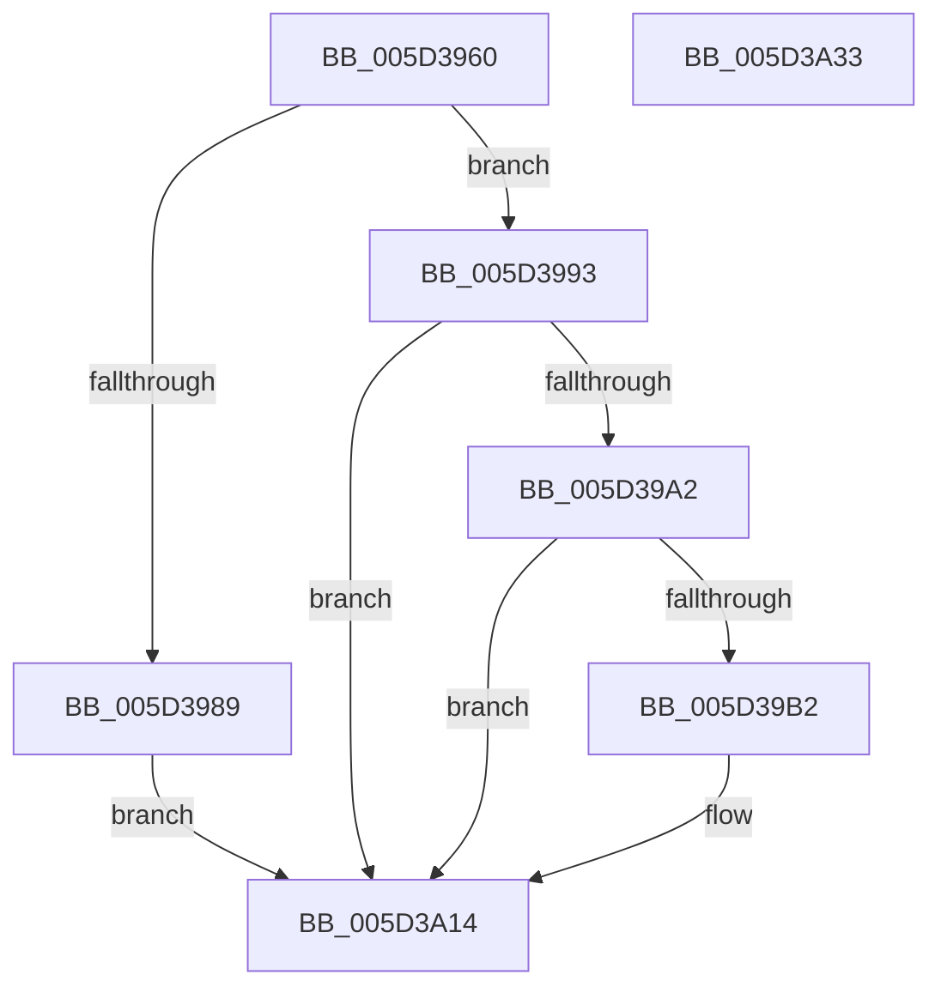

# PopFxUpdateProcessorIdleState

- RVA: `0x005D3960`–`0x005D3A34` (길이 `212` bytes)
- VA: `0x00000001405D3960`
- 실행 섹션: `.text`
- PDB 이름 있음: `예`; PDB Function 태그: `아니요`
- unwind 정보 RVA: `0x000CC100`
- 디코드: `54`개 명령, `212/212` bytes 표시
- 미해석 바이트: `0` (있으면 어셈블리에 `.byte`로 보존)

> 이 문서는 커널 이미지의 기계어와 PDB 기호를 분석해 생성했습니다. 4번과 5번은 함수 원형과 자료형을 바이너리 사용 방식에서 추정한 C 해석이며 원본 소스 복구 결과는 아닙니다.

## 1. Dependencies

- 직접 호출 지점: **4**; 고유 호출 대상: **4**
- 직접 호출자로 확인된 함수: **0**
- RIP 상대 이미지 참조: **2**

### Outgoing calls
- `0x005D39A7` → [PopFxTryReferenceDevice](../2C/PopFxTryReferenceDevice_function_002C0628.md) (function, `0x002C0628`)
- `0x005D3A00` → [guard_dispatch_icall](../6B/guard_dispatch_icall_function_006BAAD0.md) (function, `0x006BAAD0`)
- `0x005D3A0F` → [PopFxDereferenceDevice](../27/PopFxDereferenceDevice_function_0027038C.md) (function, `0x0027038C`)
- `0x005D3A1E` → [_security_check_cookie](../6A/_security_check_cookie_function_006AC640.md) (function, `0x006AC640`)

### Direct callers
- 이 함수 시작 RVA로 연결되는 직접 call은 확인되지 않았습니다. 간접 호출은 완전히 역산할 수 없습니다.

### Static image references
- `0x005D396C` → RVA `0x00E0A740` (`.data`; read)
- `0x005D39CA` → RVA `0x0002AF50` (`.rdata`; read)

## 2. Other-region calls and transfers

- 다른 실행 섹션으로 향하는 call: **0**
- 별도 외부 분기/꼬리 이동을 확인하지 못했습니다.

## 3. Assembly (complete function range)

```asm
005D3960  48 89 5C 24 20                  mov qword ptr [rsp + 0x20], rbx
005D3965  55                              push rbp
005D3966  56                              push rsi
005D3967  57                              push rdi
005D3968  48 83 EC 60                     sub rsp, 0x60
005D396C  48 8B 05 CD 6D 83 00            mov rax, qword ptr [rip + 0x836dcd]
005D3973  48 33 C4                        xor rax, rsp
005D3976  48 89 44 24 58                  mov qword ptr [rsp + 0x58], rax
005D397B  41 83 38 01                     cmp dword ptr [r8], 1
005D397F  49 8B F0                        mov rsi, r8
005D3982  8B EA                           mov ebp, edx
005D3984  48 8B F9                        mov rdi, rcx
005D3987  73 0A                           jae 0x1405d3993
005D3989  BB BB 00 00 C0                  mov ebx, 0xc00000bb
005D398E  E9 81 00 00 00                  jmp 0x1405d3a14
005D3993  48 83 B9 98 00 00 00 00         cmp qword ptr [rcx + 0x98], 0
005D399B  BB 02 00 00 C0                  mov ebx, 0xc0000002
005D39A0  74 72                           je 0x1405d3a14
005D39A2  BA 01 00 00 00                  mov edx, 1
005D39A7  E8 7C CC CE FF                  call 0x1402c0628
005D39AC  8B D8                           mov ebx, eax
005D39AE  85 C0                           test eax, eax
005D39B0  78 62                           js 0x1405d3a14
005D39B2  8B 46 04                        mov eax, dword ptr [rsi + 4]
005D39B5  48 8D 4C 24 40                  lea rcx, [rsp + 0x40]
005D39BA  48 83 64 24 40 00               and qword ptr [rsp + 0x40], 0
005D39C0  4C 8D 44 24 48                  lea r8, [rsp + 0x48]
005D39C5  48 89 4C 24 30                  mov qword ptr [rsp + 0x30], rcx
005D39CA  48 8D 15 7F 75 A5 FF            lea rdx, [rip - 0x5a8a81]
005D39D1  48 83 64 24 28 00               and qword ptr [rsp + 0x28], 0
005D39D7  41 B9 0C 00 00 00               mov r9d, 0xc
005D39DD  48 8B 8F C0 00 00 00            mov rcx, qword ptr [rdi + 0xc0]
005D39E4  48 83 64 24 20 00               and qword ptr [rsp + 0x20], 0
005D39EA  89 44 24 4C                     mov dword ptr [rsp + 0x4c], eax
005D39EE  8B 46 08                        mov eax, dword ptr [rsi + 8]
005D39F1  89 44 24 50                     mov dword ptr [rsp + 0x50], eax
005D39F5  48 8B 87 98 00 00 00            mov rax, qword ptr [rdi + 0x98]
005D39FC  89 6C 24 48                     mov dword ptr [rsp + 0x48], ebp
005D3A00  E8 CB 70 0E 00                  call 0x1406baad0
005D3A05  BA 01 00 00 00                  mov edx, 1
005D3A0A  48 8B CF                        mov rcx, rdi
005D3A0D  8B D8                           mov ebx, eax
005D3A0F  E8 78 C9 C9 FF                  call 0x14027038c
005D3A14  8B C3                           mov eax, ebx
005D3A16  48 8B 4C 24 58                  mov rcx, qword ptr [rsp + 0x58]
005D3A1B  48 33 CC                        xor rcx, rsp
005D3A1E  E8 1D 8C 0D 00                  call 0x1406ac640
005D3A23  48 8B 9C 24 98 00 00 00         mov rbx, qword ptr [rsp + 0x98]
005D3A2B  48 83 C4 60                     add rsp, 0x60
005D3A2F  5F                              pop rdi
005D3A30  5E                              pop rsi
005D3A31  5D                              pop rbp
005D3A32  C3                              ret
005D3A33  CC                              int3
```

## 4. C-style interpretation (structured pseudocode)

```c
__int64 __fastcall PopFxUpdateProcessorIdleState(__int64 a1, int a2, __int64 a3)
{
    __int64 result;
    __int64 v_rbx;
    __int64 v_rsp;
    unsigned __int64 v_stack_m20;
    unsigned int v_stack_m28;
    unsigned int v_stack_m2C;
    unsigned __int64 v_stack_m30;
    unsigned __int64 v_stack_m38;
    unsigned __int64 v_stack_m48;
    unsigned __int64 v_stack_m50;
    unsigned __int64 v_stack_m58;
    unsigned __int64 v_stack_p20;

    v_stack_p20 = v_rbx;
    v_rsp = (v_rsp) - (96);
    result = (*(unsigned __int64 *)(v_rip + 8613325)) ^ (v_rsp);
    v_stack_m20 = result;
    if ((*(unsigned int *)(a3)) >= 1) goto loc_005D3993;
    goto loc_005D3A14;
loc_005D3993:
    if ((*(unsigned __int64 *)(a1 + 152)) == 0) goto loc_005D3A14;
    result = PopFxTryReferenceDevice(a1, 1, a3, a4);
    v_rbx = (unsigned int)((unsigned int)(result));
    if (!(sign_flag)) {
        result = *(unsigned int *)(a3 + 4);
        a1 = v_stack_m38;
        a3 = v_stack_m30;
        v_stack_m48 = a1;
        a2 = v_rip - 5933697;
        a4 = 12;
        a1 = *(unsigned __int64 *)(a1 + 192);
        v_stack_m2C = (unsigned int)(result);
        result = *(unsigned int *)(a3 + 8);
        v_stack_m28 = (unsigned int)(result);
        result = *(unsigned __int64 *)(a1 + 152);
        v_stack_m30 = (unsigned int)((unsigned int)(a2));
        result = guard_dispatch_icall(a1, a2, a3, a4);
        a2 = 1;
        a1 = a1;
        v_rbx = (unsigned int)(result);
        result = PopFxDereferenceDevice(a1, a2, a3, a4);
    }
    a1 = (v_stack_m20) ^ (v_rsp);
    result = _security_check_cookie(a1, a2, a3, a4);
    v_rsp = (v_rsp) + (96);
    return result;
}
```

## 5. (Beta) C Style

```c
int64_t PopFxUpdateProcessorIdleState(void *Arg1, int32_t Arg2, void *Arg3)
{
    uint8_t *arg1 = (uint8_t *)Arg1;
    uint8_t *arg3 = (uint8_t *)Arg3;

    int64_t result;
    int64_t local_rbx;
    int64_t local_rsp;
    uint64_t v_stack_m20;
    uint32_t v_stack_m28;
    uint32_t v_stack_m2C;
    uint64_t v_stack_m30;
    uint64_t v_stack_m38;
    uint64_t v_stack_m48;
    uint64_t v_stack_m50;
    uint64_t v_stack_m58;
    uint64_t v_stack_p20;

    v_stack_p20 = local_rbx;
    local_rsp = (local_rsp) - (96);
    result = (*(uint64_t *)(v_rip + 0x836DCD)) ^ (local_rsp);
    v_stack_m20 = result;
    if ((*(uint32_t *)(arg3)) >= 1) goto loc_005D3993;
    goto loc_005D3A14;
loc_005D3993:
    if ((*(uint64_t *)(arg1 + 0x98)) == 0) goto loc_005D3A14;
    result = PopFxTryReferenceDevice(Arg1, 1, Arg3, a4);
    local_rbx = (uint32_t)((uint32_t)(result));
    if (!(sign_flag)) {
        result = *(uint32_t *)(arg3 + 0x4);
        Arg1 = v_stack_m38;
        Arg3 = v_stack_m30;
        v_stack_m48 = Arg1;
        Arg2 = v_rip - 5933697;
        a4 = 12;
        Arg1 = *(uint64_t *)(arg1 + 0xC0);
        v_stack_m2C = (uint32_t)(result);
        result = *(uint32_t *)(arg3 + 0x8);
        v_stack_m28 = (uint32_t)(result);
        result = *(uint64_t *)(arg1 + 0x98);
        v_stack_m30 = (uint32_t)((uint32_t)(Arg2));
        result = guard_dispatch_icall(Arg1, Arg2, Arg3, a4);
        Arg2 = 1;
        Arg1 = Arg1;
        local_rbx = (uint32_t)(result);
        result = PopFxDereferenceDevice(Arg1, Arg2, Arg3, a4);
    }
    Arg1 = (v_stack_m20) ^ (local_rsp);
    result = _security_check_cookie(Arg1, Arg2, Arg3, a4);
    local_rsp = (local_rsp) + (96);
    return result;
}
```

### 관측된 메모리 오프셋

구조체 형식이 확인되지 않은 접근은 인자 기준의 오프셋으로만 기록했습니다.

| 기준 인자 | 오프셋 표현 | 폭 (bit) | 접근 |
|---|---:|---:|---|
| `Arg1` | `+ 0x98` | `64` | `R` |
| `Arg1` | `+ 0xC0` | `64` | `R` |
| `Arg3` | `+ 0x0` | `32` | `R` |
| `Arg3` | `+ 0x4` | `32` | `R` |
| `Arg3` | `+ 0x8` | `32` | `R` |

## 6. Execution-region graph

[열기: 2D/3D 그래프와 함수 탐색 컨트롤 패널](../../../control-panel.html?section=text&rva=0x005D3960&view=graph)

- 2D 그래프는 위에서 아래로 흐르고, 3D 그래프는 빈 공간을 드래그해 회전합니다. Shift+드래그는 이동, 휠은 확대·축소, 함수 노드 선택은 대상 보고서 이동입니다.

### Static fallback


