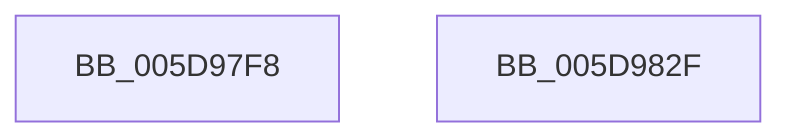

# PopGetDozeTimerSource

- RVA: `0x005D97F8`–`0x005D9830` (길이 `56` bytes)
- VA: `0x00000001405D97F8`
- 실행 섹션: `.text`
- PDB 이름 있음: `예`; PDB Function 태그: `아니요`
- unwind 정보 RVA: `0x0005CF00`
- 디코드: `15`개 명령, `56/56` bytes 표시
- 미해석 바이트: `0` (있으면 어셈블리에 `.byte`로 보존)

> 이 문서는 커널 이미지의 기계어와 PDB 기호를 분석해 생성했습니다. 4번과 5번은 함수 원형과 자료형을 바이너리 사용 방식에서 추정한 C 해석이며 원본 소스 복구 결과는 아닙니다.

## 1. Dependencies

- 직접 호출 지점: **2**; 고유 호출 대상: **2**
- 직접 호출자로 확인된 함수: **1**
- RIP 상대 이미지 참조: **3**

### Outgoing calls
- `0x005D9807` → [KeAcquireSpinLockRaiseToDpc](../20/KeAcquireSpinLockRaiseToDpc_function_00208470.md) (function, `0x00208470`)
- `0x005D9822` → [KeReleaseSpinLock](../39/KeReleaseSpinLock_function_00392BA0.md) (function, `0x00392BA0`)

### Direct callers
- [PopWnfAudioCallback](../../page/A4/PopWnfAudioCallback_function_00A4A0E0.md) at `0x00A4A200`

### Static image references
- `0x005D97FE` → RVA `0x00F08EA8` (`.data`; read)
- `0x005D980C` → RVA `0x00F0BC94` (`.data`; read)
- `0x005D981B` → RVA `0x00F0BC98` (`.data`; read)

## 2. Other-region calls and transfers

- 다른 실행 섹션으로 향하는 call: **0**
- 별도 외부 분기/꼬리 이동을 확인하지 못했습니다.

## 3. Assembly (complete function range)

```asm
005D97F8  40 53                           push rbx
005D97FA  48 83 EC 20                     sub rsp, 0x20
005D97FE  48 8D 0D A3 F6 92 00            lea rcx, [rip + 0x92f6a3]
005D9805  33 DB                           xor ebx, ebx
005D9807  E8 64 EC C2 FF                  call 0x140208470
005D980C  38 1D 82 24 93 00               cmp byte ptr [rip + 0x932482], bl
005D9812  48 8D 0D 8F F6 92 00            lea rcx, [rip + 0x92f68f]
005D9819  8A D0                           mov dl, al
005D981B  0F 45 1D 76 24 93 00            cmovne ebx, dword ptr [rip + 0x932476]
005D9822  E8 79 93 DB FF                  call 0x140392ba0
005D9827  8B C3                           mov eax, ebx
005D9829  48 83 C4 20                     add rsp, 0x20
005D982D  5B                              pop rbx
005D982E  C3                              ret
005D982F  CC                              int3
```

## 4. C-style interpretation (structured pseudocode)

```c
__int64 __fastcall PopGetDozeTimerSource(void)
{
    __int64 result;
    __int64 v_rbx;
    __int64 v_rsp;

    v_rsp = (v_rsp) - (32);
    v_rbx = 0;
    result = KeAcquireSpinLockRaiseToDpc(v_rip + 9631395, a2, a3, a4);
    if ((*(unsigned __int8 *)(v_rip + 9643138)) != 0) { v_rbx = *(unsigned int *)(v_rip + 9643126); }
    result = KeReleaseSpinLock(v_rip + 9631375, (unsigned __int8)(result), a3, a4);
    v_rsp = (v_rsp) + (32);
    return (unsigned int)((unsigned int)(v_rbx));
}
```

## 5. (Beta) C Style

```c
void PopGetDozeTimerSource(void)
{
    int64_t result;
    int64_t local_rbx;
    int64_t local_rsp;

    local_rsp = (local_rsp) - (32);
    local_rbx = 0;
    result = KeAcquireSpinLockRaiseToDpc(v_rip + 9631395, a2, a3, a4);
    if ((*(uint8_t *)(v_rip + 0x932482)) != 0) { local_rbx = *(uint32_t *)(v_rip + 0x932476); }
    result = KeReleaseSpinLock(v_rip + 9631375, (uint8_t)(result), a3, a4);
    local_rsp = (local_rsp) + (32);
    return (uint32_t)((uint32_t)(local_rbx));
}
```

## 6. Execution-region graph

[열기: 2D/3D 그래프와 함수 탐색 컨트롤 패널](../../../control-panel.html?section=text&rva=0x005D97F8&view=graph)

- 2D 그래프는 위에서 아래로 흐르고, 3D 그래프는 빈 공간을 드래그해 회전합니다. Shift+드래그는 이동, 휠은 확대·축소, 함수 노드 선택은 대상 보고서 이동입니다.

### Static fallback


