# PopGetNextTable

- RVA: `0x005D4C54`–`0x005D4F76` (길이 `802` bytes)
- VA: `0x00000001405D4C54`
- 실행 섹션: `.text`
- PDB 이름 있음: `예`; PDB Function 태그: `아니요`
- unwind 정보 RVA: `0x000C5520`
- 디코드: `228`개 명령, `802/802` bytes 표시
- 미해석 바이트: `0` (있으면 어셈블리에 `.byte`로 보존)

> 이 문서는 커널 이미지의 기계어와 PDB 기호를 분석해 생성했습니다. 4번과 5번은 함수 원형과 자료형을 바이너리 사용 방식에서 추정한 C 해석이며 원본 소스 복구 결과는 아닙니다.

## 1. Dependencies

- 직접 호출 지점: **2**; 고유 호출 대상: **2**
- 직접 호출자로 확인된 함수: **2**
- RIP 상대 이미지 참조: **0**

### Outgoing calls
- `0x005D4D61` → [MmGetPhysicalAddress](../23/MmGetPhysicalAddress_function_0023A500.md) (function, `0x0023A500`)
- `0x005D4F5D` → [MmMapMemoryDumpMdlEx2](../4F/MmMapMemoryDumpMdlEx2_function_004F98D4.md) (function, `0x004F98D4`)

### Direct callers
- [PopCompressHiberBlocks](../../pagelk/B6/PopCompressHiberBlocks_function_00B6CD74.md) at `0x00B6CDD8`
- [PopWriteHiberImage](../../pagelk/B6/PopWriteHiberImage_function_00B6FE30.md) at `0x00B6FECD`

### Static image references
- 디코드된 RIP-relative 메모리 참조가 없습니다.

## 2. Other-region calls and transfers

- 다른 실행 섹션으로 향하는 call: **0**
- 별도 외부 분기/꼬리 이동을 확인하지 못했습니다.

## 3. Assembly (complete function range)

```asm
005D4C54  4C 89 4C 24 20                  mov qword ptr [rsp + 0x20], r9
005D4C59  4C 89 44 24 18                  mov qword ptr [rsp + 0x18], r8
005D4C5E  48 89 54 24 10                  mov qword ptr [rsp + 0x10], rdx
005D4C63  53                              push rbx
005D4C64  55                              push rbp
005D4C65  56                              push rsi
005D4C66  57                              push rdi
005D4C67  41 54                           push r12
005D4C69  41 55                           push r13
005D4C6B  41 56                           push r14
005D4C6D  41 57                           push r15
005D4C6F  48 83 EC 38                     sub rsp, 0x38
005D4C73  33 ED                           xor ebp, ebp
005D4C75  4D 8D 69 30                     lea r13, [r9 + 0x30]
005D4C79  48 8B D9                        mov rbx, rcx
005D4C7C  66 89 AC 24 80 00 00 00         mov word ptr [rsp + 0x80], bp
005D4C84  33 C9                           xor ecx, ecx
005D4C86  8B C5                           mov eax, ebp
005D4C88  40 38 AC 24 A0 00 00 00         cmp byte ptr [rsp + 0xa0], bpl
005D4C90  4D 8B F1                        mov r14, r9
005D4C93  89 0A                           mov dword ptr [rdx], ecx
005D4C95  4D 8B D8                        mov r11, r8
005D4C98  0F 94 C0                        sete al
005D4C9B  8D 4D 01                        lea ecx, [rbp + 1]
005D4C9E  89 44 24 20                     mov dword ptr [rsp + 0x20], eax
005D4CA2  44 0F B7 D5                     movzx r10d, bp
005D4CA6  8B F5                           mov esi, ebp
005D4CA8  EB 09                           jmp 0x1405d4cb3
005D4CAA  F3 90                           pause
005D4CAC  8B 43 04                        mov eax, dword ptr [rbx + 4]
005D4CAF  85 C0                           test eax, eax
005D4CB1  75 F7                           jne 0x1405d4caa
005D4CB3  33 C0                           xor eax, eax
005D4CB5  F0 0F B1 4B 04                  lock cmpxchg dword ptr [rbx + 4], ecx
005D4CBA  75 EE                           jne 0x1405d4caa
005D4CBC  4C 8D 63 50                     lea r12, [rbx + 0x50]
005D4CC0  4C 39 63 78                     cmp qword ptr [rbx + 0x78], r12
005D4CC4  0F 84 E4 00 00 00               je 0x1405d4dae
005D4CCA  8B 8B 3C 01 00 00               mov ecx, dword ptr [rbx + 0x13c]
005D4CD0  85 C9                           test ecx, ecx
005D4CD2  0F 84 D6 00 00 00               je 0x1405d4dae
005D4CD8  41 BE 01 00 00 00               mov r14d, 1
005D4CDE  48 8B 53 78                     mov rdx, qword ptr [rbx + 0x78]
005D4CE2  49 3B D4                        cmp rdx, r12
005D4CE5  0F 84 BB 00 00 00               je 0x1405d4da6
005D4CEB  4C 8B 8B 80 00 00 00            mov r9, qword ptr [rbx + 0x80]
005D4CF2  2B CE                           sub ecx, esi
005D4CF4  4C 8B 42 18                     mov r8, qword ptr [rdx + 0x18]
005D4CF8  4D 8B F9                        mov r15, r9
005D4CFB  8B 7A 20                        mov edi, dword ptr [rdx + 0x20]
005D4CFE  4D 03 C1                        add r8, r9
005D4D01  49 C1 E7 0C                     shl r15, 0xc
005D4D05  41 2B F8                        sub edi, r8d
005D4D08  4C 03 7A 28                     add r15, qword ptr [rdx + 0x28]
005D4D0C  3B F9                           cmp edi, ecx
005D4D0E  76 09                           jbe 0x1405d4d19
005D4D10  8B C1                           mov eax, ecx
005D4D12  49 03 C1                        add rax, r9
005D4D15  8B F9                           mov edi, ecx
005D4D17  EB 0A                           jmp 0x1405d4d23
005D4D19  48 8B 02                        mov rax, qword ptr [rdx]
005D4D1C  48 89 43 78                     mov qword ptr [rbx + 0x78], rax
005D4D20  48 8B C5                        mov rax, rbp
005D4D23  8D 4F FF                        lea ecx, [rdi - 1]
005D4D26  48 89 83 80 00 00 00            mov qword ptr [rbx + 0x80], rax
005D4D2D  83 E1 0F                        and ecx, 0xf
005D4D30  49 C1 E0 04                     shl r8, 4
005D4D34  41 0F B7 C2                     movzx eax, r10w
005D4D38  49 0B C8                        or rcx, r8
005D4D3B  66 45 03 D6                     add r10w, r14w
005D4D3F  66 44 89 94 24 80 00 00 00      mov word ptr [rsp + 0x80], r10w
005D4D48  49 89 0C C3                     mov qword ptr [r11 + rax*8], rcx
005D4D4C  85 FF                           test edi, edi
005D4D4E  74 43                           je 0x1405d4d93
005D4D50  03 F7                           add esi, edi
005D4D52  41 BC 01 00 00 00               mov r12d, 1
005D4D58  8B CD                           mov ecx, ebp
005D4D5A  48 C1 E1 0C                     shl rcx, 0xc
005D4D5E  49 03 CF                        add rcx, r15
005D4D61  E8 9A 57 C6 FF                  call 0x14023a500
005D4D66  48 C1 E8 0C                     shr rax, 0xc
005D4D6A  41 03 EC                        add ebp, r12d
005D4D6D  49 89 45 00                     mov qword ptr [r13], rax
005D4D71  49 83 C5 08                     add r13, 8
005D4D75  83 C7 FF                        add edi, -1
005D4D78  75 DE                           jne 0x1405d4d58
005D4D7A  44 0F B7 94 24 80 00 00 00      movzx r10d, word ptr [rsp + 0x80]
005D4D83  4C 8D 63 50                     lea r12, [rbx + 0x50]
005D4D87  4C 8B 9C 24 90 00 00 00         mov r11, qword ptr [rsp + 0x90]
005D4D8F  44 8D 77 01                     lea r14d, [rdi + 1]
005D4D93  8B 8B 3C 01 00 00               mov ecx, dword ptr [rbx + 0x13c]
005D4D99  BD 00 00 00 00                  mov ebp, 0
005D4D9E  3B F1                           cmp esi, ecx
005D4DA0  0F 82 38 FF FF FF               jb 0x1405d4cde
005D4DA6  4C 8B B4 24 98 00 00 00         mov r14, qword ptr [rsp + 0x98]
005D4DAE  44 0F B7 BC 24 80 00 00 00      movzx r15d, word ptr [rsp + 0x80]
005D4DB7  8B BB 3C 01 00 00               mov edi, dword ptr [rbx + 0x13c]
005D4DBD  3B F7                           cmp esi, edi
005D4DBF  0F 83 50 01 00 00               jae 0x1405d4f15
005D4DC5  48 8B 43 70                     mov rax, qword ptr [rbx + 0x70]
005D4DC9  2B FE                           sub edi, esi
005D4DCB  8B 8B 80 00 00 00               mov ecx, dword ptr [rbx + 0x80]
005D4DD1  89 AC 24 A0 00 00 00            mov dword ptr [rsp + 0xa0], ebp
005D4DD8  44 8B 10                        mov r10d, dword ptr [rax]
005D4DDB  44 3B D1                        cmp r10d, ecx
005D4DDE  0F 86 2A 01 00 00               jbe 0x1405d4f0e
005D4DE4  4C 8B 60 08                     mov r12, qword ptr [rax + 8]
005D4DE8  41 8D 52 FF                     lea edx, [r10 - 1]
005D4DEC  48 C1 EA 05                     shr rdx, 5
005D4DF0  8B C1                           mov eax, ecx
005D4DF2  48 C1 E8 05                     shr rax, 5
005D4DF6  83 E1 1F                        and ecx, 0x1f
005D4DF9  44 8B C5                        mov r8d, ebp
005D4DFC  49 8D 2C 94                     lea rbp, [r12 + rdx*4]
005D4E00  BA 01 00 00 00                  mov edx, 1
005D4E05  4D 8D 0C 84                     lea r9, [r12 + rax*4]
005D4E09  8B C2                           mov eax, edx
005D4E0B  45 8B 19                        mov r11d, dword ptr [r9]
005D4E0E  D3 E0                           shl eax, cl
005D4E10  2B C2                           sub eax, edx
005D4E12  44 0B D8                        or r11d, eax
005D4E15  49 8D 41 04                     lea rax, [r9 + 4]
005D4E19  41 F7 D3                        not r11d
005D4E1C  45 85 DB                        test r11d, r11d
005D4E1F  75 12                           jne 0x1405d4e33
005D4E21  48 3B C5                        cmp rax, rbp
005D4E24  77 2F                           ja 0x1405d4e55
005D4E26  49 83 C1 04                     add r9, 4
005D4E2A  48 83 C0 04                     add rax, 4
005D4E2E  45 8B 19                        mov r11d, dword ptr [r9]
005D4E31  EB E6                           jmp 0x1405d4e19
005D4E33  41 8B C3                        mov eax, r11d
005D4E36  49 8B D1                        mov rdx, r9
005D4E39  49 2B D4                        sub rdx, r12
005D4E3C  48 0F BC C8                     bsf rcx, rax
005D4E40  48 C1 FA 02                     sar rdx, 2
005D4E44  C1 E2 05                        shl edx, 5
005D4E47  03 D1                           add edx, ecx
005D4E49  89 8C 24 A0 00 00 00            mov dword ptr [rsp + 0xa0], ecx
005D4E50  41 3B D2                        cmp edx, r10d
005D4E53  76 05                           jbe 0x1405d4e5a
005D4E55  41 8B D2                        mov edx, r10d
005D4E58  EB 5F                           jmp 0x1405d4eb9
005D4E5A  B8 01 00 00 00                  mov eax, 1
005D4E5F  D3 E0                           shl eax, cl
005D4E61  FF C8                           dec eax
005D4E63  41 0B C3                        or eax, r11d
005D4E66  F7 D0                           not eax
005D4E68  85 C0                           test eax, eax
005D4E6A  75 20                           jne 0x1405d4e8c
005D4E6C  44 3B C7                        cmp r8d, edi
005D4E6F  77 14                           ja 0x1405d4e85
005D4E71  41 83 C0 20                     add r8d, 0x20
005D4E75  49 8D 41 04                     lea rax, [r9 + 4]
005D4E79  48 3B C5                        cmp rax, rbp
005D4E7C  77 07                           ja 0x1405d4e85
005D4E7E  4C 8B C8                        mov r9, rax
005D4E81  8B 00                           mov eax, dword ptr [rax]
005D4E83  EB E3                           jmp 0x1405d4e68
005D4E85  B8 20 00 00 00                  mov eax, 0x20
005D4E8A  EB 04                           jmp 0x1405d4e90
005D4E8C  48 0F BC C0                     bsf rax, rax
005D4E90  4D 2B CC                        sub r9, r12
005D4E93  89 84 24 A0 00 00 00            mov dword ptr [rsp + 0xa0], eax
005D4E9A  4D 8B C1                        mov r8, r9
005D4E9D  49 C1 F8 02                     sar r8, 2
005D4EA1  41 C1 E0 05                     shl r8d, 5
005D4EA5  44 03 C0                        add r8d, eax
005D4EA8  45 3B C2                        cmp r8d, r10d
005D4EAB  45 0F 47 C2                     cmova r8d, r10d
005D4EAF  44 2B C2                        sub r8d, edx
005D4EB2  44 3B C7                        cmp r8d, edi
005D4EB5  44 0F 47 C7                     cmova r8d, edi
005D4EB9  33 ED                           xor ebp, ebp
005D4EBB  45 85 C0                        test r8d, r8d
005D4EBE  74 4E                           je 0x1405d4f0e
005D4EC0  42 8D 0C 02                     lea ecx, [rdx + r8]
005D4EC4  8B C2                           mov eax, edx
005D4EC6  48 89 8B 80 00 00 00            mov qword ptr [rbx + 0x80], rcx
005D4ECD  41 03 F0                        add esi, r8d
005D4ED0  48 C1 E0 04                     shl rax, 4
005D4ED4  41 8D 48 FF                     lea ecx, [r8 - 1]
005D4ED8  83 E1 0F                        and ecx, 0xf
005D4EDB  44 8B CA                        mov r9d, edx
005D4EDE  48 8B 94 24 90 00 00 00         mov rdx, qword ptr [rsp + 0x90]
005D4EE6  48 0B C8                        or rcx, rax
005D4EE9  41 0F B7 C7                     movzx eax, r15w
005D4EED  48 89 0C C2                     mov qword ptr [rdx + rax*8], rcx
005D4EF1  8D 4D 01                        lea ecx, [rbp + 1]
005D4EF4  66 44 03 F9                     add r15w, cx
005D4EF8  4D 89 4D 00                     mov qword ptr [r13], r9
005D4EFC  49 83 C5 08                     add r13, 8
005D4F00  4C 03 C9                        add r9, rcx
005D4F03  41 83 C0 FF                     add r8d, -1
005D4F07  75 EF                           jne 0x1405d4ef8
005D4F09  E9 A9 FE FF FF                  jmp 0x1405d4db7
005D4F0E  4C 89 93 80 00 00 00            mov qword ptr [rbx + 0x80], r10
005D4F15  89 6B 04                        mov dword ptr [rbx + 4], ebp
005D4F18  85 F6                           test esi, esi
005D4F1A  74 46                           je 0x1405d4f62
005D4F1C  48 8B 84 24 88 00 00 00         mov rax, qword ptr [rsp + 0x88]
005D4F24  4D 8B C6                        mov r8, r14
005D4F27  44 8B 4C 24 20                  mov r9d, dword ptr [rsp + 0x20]
005D4F2C  8B CE                           mov ecx, esi
005D4F2E  44 88 38                        mov byte ptr [rax], r15b
005D4F31  49 89 2E                        mov qword ptr [r14], rbp
005D4F34  8D 41 06                        lea eax, [rcx + 6]
005D4F37  66 41 89 6E 0A                  mov word ptr [r14 + 0xa], bp
005D4F3C  48 C1 E1 0C                     shl rcx, 0xc
005D4F40  41 89 4E 28                     mov dword ptr [r14 + 0x28], ecx
005D4F44  48 8B 8C 24 A8 00 00 00         mov rcx, qword ptr [rsp + 0xa8]
005D4F4C  66 C1 E0 03                     shl ax, 3
005D4F50  66 41 89 46 08                  mov word ptr [r14 + 8], ax
005D4F55  49 89 6E 20                     mov qword ptr [r14 + 0x20], rbp
005D4F59  41 89 6E 2C                     mov dword ptr [r14 + 0x2c], ebp
005D4F5D  E8 72 49 F2 FF                  call 0x1404f98d4
005D4F62  8B C6                           mov eax, esi
005D4F64  48 83 C4 38                     add rsp, 0x38
005D4F68  41 5F                           pop r15
005D4F6A  41 5E                           pop r14
005D4F6C  41 5D                           pop r13
005D4F6E  41 5C                           pop r12
005D4F70  5F                              pop rdi
005D4F71  5E                              pop rsi
005D4F72  5D                              pop rbp
005D4F73  5B                              pop rbx
005D4F74  C3                              ret
005D4F75  CC                              int3
```

## 4. C-style interpretation (structured pseudocode)

```c
__int64 __fastcall PopGetNextTable(__int64 a1, __int64 a2, __int64 a3, __int64 a4, unsigned __int8 a5, __int64 a6)
{
    __int64 result;
    __int64 v_r10;
    __int64 v_r11;
    __int64 v_r13;
    __int64 v_r15;
    __int64 v_rbp;
    __int64 v_rdi;
    __int64 v_rsi;
    __int64 v_rsp;
    unsigned int v_stack_m58;
    unsigned __int64 v_stack_p10;
    unsigned __int64 v_stack_p18;
    unsigned __int64 v_stack_p20;
    unsigned int v_stack_p28;
    unsigned __int16 v_stack_p8;

    v_stack_p20 = a4;
    v_stack_p18 = a3;
    v_stack_p10 = a2;
    v_rsp = (v_rsp) - (56);
    v_rbp = 0;
    v_stack_p8 = 0;
    a1 = 0;
    *(unsigned int *)(a2) = 0;
    result = (a5 == 0) ? 1 : 0;
    v_stack_m58 = (unsigned int)(result);
    goto loc_005D4CB3;
loc_005D4CAA:
    if ((unsigned int)((unsigned int)(*(unsigned int *)(a1 + 4))) != 0) goto loc_005D4CAA;
loc_005D4CB3:
    result = 0;
    if (condition_is_not_equal) goto loc_005D4CAA;
    if ((*(unsigned __int64 *)(a1 + 120)) == (a1 + 80)) goto loc_005D4DAE;
    if ((unsigned int)((unsigned int)(*(unsigned int *)(a1 + 316))) == 0) goto loc_005D4DAE;
loc_005D4CDE:
    if ((*(unsigned __int64 *)(a1 + 120)) == (a1 + 80)) goto loc_005D4DA6;
    a1 = (unsigned int)(((unsigned int)(*(unsigned int *)(a1 + 316))) - (0));
    a3 = (*(unsigned __int64 *)(*(unsigned __int64 *)(a1 + 120) + 24)) + (*(unsigned __int64 *)(a1 + 128));
    v_r15 = (*(unsigned __int64 *)(a1 + 128)) << (12);
    v_rdi = (unsigned int)(((unsigned int)(*(unsigned int *)(*(unsigned __int64 *)(a1 + 120) + 32))) - ((unsigned int)(a3)));
    v_r15 = (v_r15) + (*(unsigned __int64 *)(*(unsigned __int64 *)(a1 + 120) + 40));
    if (((unsigned int)(v_rdi)) <= ((unsigned int)(a1))) goto loc_005D4D19;
    result = ((unsigned int)((unsigned int)(a1))) + (*(unsigned __int64 *)(a1 + 128));
    goto loc_005D4D23;
loc_005D4D19:
    *(unsigned __int64 *)(a1 + 120) = *(unsigned __int64 *)(*(unsigned __int64 *)(a1 + 120));
loc_005D4D23:
    *(unsigned __int64 *)(a1 + 128) = 0;
    a1 = (unsigned int)(((unsigned int)((unsigned int)(a1)) - 1) & (15));
    a3 = (a3) << (4);
    a1 = (a1) | (a3);
    v_r10 = (unsigned __int16)((0) + (1));
    v_stack_p8 = (unsigned __int16)(v_r10);
    *(unsigned __int64 *)(a3 + 0 * 8) = a1;
    if ((unsigned int)((unsigned int)((unsigned int)(a1))) == 0) goto loc_005D4D93;
    v_rsi = (unsigned int)((0) + ((unsigned int)((unsigned int)((unsigned int)(a1)))));
loc_005D4D58:
    a1 = (0) << (12);
    a1 = (a1) + (v_r15);
    result = MmGetPhysicalAddress(a1, *(unsigned __int64 *)(a1 + 120), a3, *(unsigned __int64 *)(a1 + 128));
    result = (result) >> (12);
    v_rbp = (unsigned int)((v_rbp) + (1));
    *(unsigned __int64 *)(a4 + 48) = result;
    v_r13 = (a4 + 48) + (8);
    v_rdi = (unsigned int)(((unsigned int)((unsigned int)(a1))) + (-1));
    if (condition_is_not_equal) goto loc_005D4D58;
loc_005D4D93:
    if (((unsigned int)(v_rsi)) < ((unsigned int)((unsigned int)(*(unsigned int *)(a1 + 316))))) goto loc_005D4CDE;
loc_005D4DA6:
loc_005D4DAE:
loc_005D4DB7:
    if (((unsigned int)(v_rsi)) >= ((unsigned int)((unsigned int)(*(unsigned int *)(a1 + 316))))) goto loc_005D4F15;
    v_rdi = (unsigned int)(((unsigned int)(*(unsigned int *)(a1 + 316))) - ((unsigned int)(v_rsi)));
    v_stack_p28 = 0;
    if (((unsigned int)((unsigned int)(*(unsigned int *)(*(unsigned __int64 *)(a1 + 112))))) <= ((unsigned int)((unsigned int)(*(unsigned int *)(a1 + 128))))) goto loc_005D4F0E;
    a2 = ((unsigned int)(*(unsigned int *)(*(unsigned __int64 *)(a1 + 112))) - 1) >> (5);
    result = ((unsigned int)((unsigned int)((unsigned int)(*(unsigned int *)(a1 + 128))))) >> (5);
    a1 = (unsigned int)(((unsigned int)(*(unsigned int *)(a1 + 128))) & (31));
    result = (unsigned int)((1) << ((unsigned __int8)(a1)));
    result = (unsigned int)((result) - (1));
    v_r11 = (unsigned int)(((unsigned int)(*(unsigned int *)(*(unsigned __int64 *)(*(unsigned __int64 *)(a1 + 112) + 8) + result * 4))) | ((unsigned int)(result)));
loc_005D4E19:
    v_r11 = (unsigned int)(~(v_r11));
    if ((unsigned int)(v_r11) != 0) goto loc_005D4E33;
    if ((*(unsigned __int64 *)(*(unsigned __int64 *)(a1 + 112) + 8) + result * 4 + 4) > (*(unsigned __int64 *)(*(unsigned __int64 *)(a1 + 112) + 8) + a2 * 4)) goto loc_005D4E55;
    a4 = (*(unsigned __int64 *)(*(unsigned __int64 *)(a1 + 112) + 8) + result * 4) + (4);
    result = (*(unsigned __int64 *)(*(unsigned __int64 *)(a1 + 112) + 8) + result * 4 + 4) + (4);
    goto loc_005D4E19;
loc_005D4E33:
    a2 = (a4) - (*(unsigned __int64 *)(*(unsigned __int64 *)(a1 + 112) + 8));
    a2 = (a2) >> (2);
    a2 = (unsigned int)((a2) << (5));
    a2 = (unsigned int)((a2) + ((unsigned int)(a1)));
    v_stack_p28 = (unsigned int)(a1);
    if (((unsigned int)(a2)) <= ((unsigned int)((unsigned int)(*(unsigned int *)(*(unsigned __int64 *)(a1 + 112)))))) goto loc_005D4E5A;
loc_005D4E55:
    goto loc_005D4EB9;
loc_005D4E5A:
    result = (unsigned int)((1) << ((unsigned __int8)(a1)));
    result = (unsigned int)((result) - 1);
    result = (unsigned int)((result) | ((unsigned int)((unsigned int)(*(unsigned int *)(a4)))));
    result = (unsigned int)(~(result));
loc_005D4E68:
    if ((unsigned int)(result) != 0) goto loc_005D4E8C;
    if (0 > ((unsigned int)(v_rdi))) goto loc_005D4E85;
    a3 = (unsigned int)((0) + (32));
    if ((a4 + 4) > (*(unsigned __int64 *)(*(unsigned __int64 *)(a1 + 112) + 8) + a2 * 4)) goto loc_005D4E85;
    goto loc_005D4E68;
loc_005D4E85:
    goto loc_005D4E90;
loc_005D4E8C:
loc_005D4E90:
    a4 = (a4 + 4) - (*(unsigned __int64 *)(*(unsigned __int64 *)(a1 + 112) + 8));
    v_stack_p28 = 32;
    a3 = (a4) >> (2);
    a3 = (unsigned int)((a3) << (5));
    a3 = (unsigned int)((a3) + (32));
    if (((unsigned int)(a3)) > ((unsigned int)((unsigned int)(*(unsigned int *)(*(unsigned __int64 *)(a1 + 112)))))) { a3 = (unsigned int)((unsigned int)(*(unsigned int *)(*(unsigned __int64 *)(a1 + 112)))); }
    a3 = (unsigned int)((a3) - ((unsigned int)((unsigned int)((unsigned int)((unsigned int)(*(unsigned int *)(*(unsigned __int64 *)(a1 + 112))))))));
    if (((unsigned int)(a3)) > ((unsigned int)(v_rdi))) { a3 = (unsigned int)(v_rdi); }
loc_005D4EB9:
    v_rbp = 0;
    if ((unsigned int)(a3) == 0) goto loc_005D4F0E;
    *(unsigned __int64 *)(a1 + 128) = (unsigned int)((unsigned int)((unsigned int)(*(unsigned int *)(*(unsigned __int64 *)(a1 + 112))))) + a3 * 1;
    v_rsi = (unsigned int)((v_rsi) + ((unsigned int)(a3)));
    result = ((unsigned int)((unsigned int)((unsigned int)((unsigned int)((unsigned int)(*(unsigned int *)(*(unsigned __int64 *)(a1 + 112)))))))) << (4);
    a1 = (unsigned int)((a3 - 1) & (15));
    a1 = (a1) | (result);
    *(unsigned __int64 *)(v_stack_p18 + (unsigned __int16)(v_stack_p8) * 8) = a1;
    v_r15 = (unsigned __int16)((v_stack_p8) + ((unsigned __int16)(v_rbp + 1)));
loc_005D4EF8:
    *(unsigned __int64 *)(v_r13) = (unsigned int)((unsigned int)((unsigned int)((unsigned int)((unsigned int)(*(unsigned int *)(*(unsigned __int64 *)(a1 + 112)))))));
    v_r13 = (v_r13) + (8);
    a4 = ((unsigned int)((unsigned int)((unsigned int)((unsigned int)((unsigned int)(*(unsigned int *)(*(unsigned __int64 *)(a1 + 112)))))))) + (v_rbp + 1);
    a3 = (unsigned int)((a3) + (-1));
    if (condition_is_not_equal) goto loc_005D4EF8;
    goto loc_005D4DB7;
loc_005D4F0E:
    *(unsigned __int64 *)(a1 + 128) = (unsigned int)(*(unsigned int *)(*(unsigned __int64 *)(a1 + 112)));
loc_005D4F15:
    *(unsigned int *)(a1 + 4) = 0;
    result = (unsigned __int16)(v_stack_p8);
    if ((unsigned int)(v_rsi) != 0) {
        result = v_stack_p10;
        a3 = v_stack_p20;
        a4 = v_stack_m58;
        a1 = (unsigned int)(v_rsi);
        *(unsigned __int8 *)(result) = (unsigned __int8)(v_r15);
        *(unsigned __int64 *)(v_stack_p20) = 0;
        result = a1 + 6;
        *(unsigned __int16 *)(v_stack_p20 + 10) = 0;
        a1 = (a1) << (12);
        *(unsigned int *)(v_stack_p20 + 40) = (unsigned int)(a1);
        a1 = a6;
        result = (unsigned __int16)((result) << (3));
        *(unsigned __int16 *)(v_stack_p20 + 8) = (unsigned __int16)(result);
        *(unsigned __int64 *)(v_stack_p20 + 32) = 0;
        *(unsigned int *)(v_stack_p20 + 44) = 0;
        result = MmMapMemoryDumpMdlEx2(a1, v_stack_p18, a3, a4);
    }
    v_rsp = (v_rsp) + (56);
    return (unsigned int)((unsigned int)(v_rsi));
}
```

## 5. (Beta) C Style

```c
int64_t PopGetNextTable(void *Arg1, void *Arg2, int64_t Arg3, void *Arg4, uint8_t Arg5, int64_t Arg6)
{
    uint8_t *arg1 = (uint8_t *)Arg1;
    uint8_t *arg2 = (uint8_t *)Arg2;
    uint8_t *arg4 = (uint8_t *)Arg4;

    int64_t result;
    int64_t local_r10;
    int64_t local_r11;
    int64_t local_r13;
    int64_t local_r15;
    int64_t local_rbp;
    int64_t local_rdi;
    int64_t local_rsi;
    int64_t local_rsp;
    uint32_t v_stack_m58;
    uint64_t v_stack_p10;
    uint64_t v_stack_p18;
    uint64_t v_stack_p20;
    uint32_t v_stack_p28;
    uint16_t v_stack_p8;

    v_stack_p20 = Arg4;
    v_stack_p18 = Arg3;
    v_stack_p10 = Arg2;
    local_rsp = (local_rsp) - (56);
    local_rbp = 0;
    v_stack_p8 = 0;
    Arg1 = 0;
    *(uint32_t *)(arg2) = 0;
    result = (Arg5 == 0) ? 1 : 0;
    v_stack_m58 = (uint32_t)(result);
    goto loc_005D4CB3;
loc_005D4CAA:
    if ((uint32_t)((uint32_t)(*(uint32_t *)(arg1 + 0x4))) != 0) goto loc_005D4CAA;
loc_005D4CB3:
    result = 0;
    if (condition_is_not_equal) goto loc_005D4CAA;
    if ((*(uint64_t *)(arg1 + 0x78)) == (Arg1 + 80)) goto loc_005D4DAE;
    if ((uint32_t)((uint32_t)(*(uint32_t *)(arg1 + 0x13C))) == 0) goto loc_005D4DAE;
loc_005D4CDE:
    if ((*(uint64_t *)(arg1 + 0x78)) == (Arg1 + 80)) goto loc_005D4DA6;
    Arg1 = (uint32_t)(((uint32_t)(*(uint32_t *)(arg1 + 0x13C))) - (0));
    Arg3 = (*(uint64_t *)(*(uint64_t *)(arg1 + 0x78) + 0x18)) + (*(uint64_t *)(arg1 + 0x80));
    local_r15 = (*(uint64_t *)(arg1 + 0x80)) << (12);
    local_rdi = (uint32_t)(((uint32_t)(*(uint32_t *)(*(uint64_t *)(arg1 + 0x78) + 0x20))) - ((uint32_t)(Arg3)));
    local_r15 = (local_r15) + (*(uint64_t *)(*(uint64_t *)(arg1 + 0x78) + 0x28));
    if (((uint32_t)(local_rdi)) <= ((uint32_t)(Arg1))) goto loc_005D4D19;
    result = ((uint32_t)((uint32_t)(Arg1))) + (*(uint64_t *)(arg1 + 0x80));
    goto loc_005D4D23;
loc_005D4D19:
    *(uint64_t *)(arg1 + 0x78) = *(uint64_t *)(*(uint64_t *)(arg1 + 0x78));
loc_005D4D23:
    *(uint64_t *)(arg1 + 0x80) = 0;
    Arg1 = (uint32_t)(((uint32_t)((uint32_t)(Arg1)) - 1) & (15));
    Arg3 = (Arg3) << (4);
    Arg1 = (Arg1) | (Arg3);
    local_r10 = (uint16_t)((0) + (1));
    v_stack_p8 = (uint16_t)(local_r10);
    *(void **)(Arg3 + 0x0 * 8) = Arg1;
    if ((uint32_t)((uint32_t)((uint32_t)(Arg1))) == 0) goto loc_005D4D93;
    local_rsi = (uint32_t)((0) + ((uint32_t)((uint32_t)((uint32_t)(Arg1)))));
loc_005D4D58:
    Arg1 = (0) << (12);
    Arg1 = (Arg1) + (local_r15);
    result = MmGetPhysicalAddress(Arg1, *(uint64_t *)(arg1 + 0x78), Arg3, *(uint64_t *)(arg1 + 0x80));
    result = (result) >> (12);
    local_rbp = (uint32_t)((local_rbp) + (1));
    *(uint64_t *)(arg4 + 0x30) = result;
    local_r13 = (Arg4 + 48) + (8);
    local_rdi = (uint32_t)(((uint32_t)((uint32_t)(Arg1))) + (-1));
    if (condition_is_not_equal) goto loc_005D4D58;
loc_005D4D93:
    if (((uint32_t)(local_rsi)) < ((uint32_t)((uint32_t)(*(uint32_t *)(arg1 + 0x13C))))) goto loc_005D4CDE;
loc_005D4DA6:
loc_005D4DAE:
loc_005D4DB7:
    if (((uint32_t)(local_rsi)) >= ((uint32_t)((uint32_t)(*(uint32_t *)(arg1 + 0x13C))))) goto loc_005D4F15;
    local_rdi = (uint32_t)(((uint32_t)(*(uint32_t *)(arg1 + 0x13C))) - ((uint32_t)(local_rsi)));
    v_stack_p28 = 0;
    if (((uint32_t)((uint32_t)(*(uint32_t *)(*(uint64_t *)(arg1 + 0x70))))) <= ((uint32_t)((uint32_t)(*(uint32_t *)(arg1 + 0x80))))) goto loc_005D4F0E;
    Arg2 = ((uint32_t)(*(uint32_t *)(*(uint64_t *)(arg1 + 0x70))) - 1) >> (5);
    result = ((uint32_t)((uint32_t)((uint32_t)(*(uint32_t *)(arg1 + 0x80))))) >> (5);
    Arg1 = (uint32_t)(((uint32_t)(*(uint32_t *)(arg1 + 0x80))) & (31));
    result = (uint32_t)((1) << ((uint8_t)(Arg1)));
    result = (uint32_t)((result) - (1));
    local_r11 = (uint32_t)(((uint32_t)(*(uint32_t *)(*(uint64_t *)(*(uint64_t *)(arg1 + 0x70) + 0x8) + result * 4))) | ((uint32_t)(result)));
loc_005D4E19:
    local_r11 = (uint32_t)(~(local_r11));
    if ((uint32_t)(local_r11) != 0) goto loc_005D4E33;
    if ((*(uint64_t *)(*(uint64_t *)(arg1 + 0x70) + 0x8) + result * 4 + 4) > (*(uint64_t *)(*(uint64_t *)(arg1 + 0x70) + 0x8) + Arg2 * 4)) goto loc_005D4E55;
    Arg4 = (*(uint64_t *)(*(uint64_t *)(arg1 + 0x70) + 0x8) + result * 4) + (4);
    result = (*(uint64_t *)(*(uint64_t *)(arg1 + 0x70) + 0x8) + result * 4 + 4) + (4);
    goto loc_005D4E19;
loc_005D4E33:
    Arg2 = (Arg4) - (*(uint64_t *)(*(uint64_t *)(arg1 + 0x70) + 0x8));
    Arg2 = (Arg2) >> (2);
    Arg2 = (uint32_t)((Arg2) << (5));
    Arg2 = (uint32_t)((Arg2) + ((uint32_t)(Arg1)));
    v_stack_p28 = (uint32_t)(Arg1);
    if (((uint32_t)(Arg2)) <= ((uint32_t)((uint32_t)(*(uint32_t *)(*(uint64_t *)(arg1 + 0x70)))))) goto loc_005D4E5A;
loc_005D4E55:
    goto loc_005D4EB9;
loc_005D4E5A:
    result = (uint32_t)((1) << ((uint8_t)(Arg1)));
    result = (uint32_t)((result) - 1);
    result = (uint32_t)((result) | ((uint32_t)((uint32_t)(*(uint32_t *)(arg4)))));
    result = (uint32_t)(~(result));
loc_005D4E68:
    if ((uint32_t)(result) != 0) goto loc_005D4E8C;
    if (0 > ((uint32_t)(local_rdi))) goto loc_005D4E85;
    Arg3 = (uint32_t)((0) + (32));
    if ((Arg4 + 4) > (*(uint64_t *)(*(uint64_t *)(arg1 + 0x70) + 0x8) + Arg2 * 4)) goto loc_005D4E85;
    goto loc_005D4E68;
loc_005D4E85:
    goto loc_005D4E90;
loc_005D4E8C:
loc_005D4E90:
    Arg4 = (Arg4 + 4) - (*(uint64_t *)(*(uint64_t *)(arg1 + 0x70) + 0x8));
    v_stack_p28 = 32;
    Arg3 = (Arg4) >> (2);
    Arg3 = (uint32_t)((Arg3) << (5));
    Arg3 = (uint32_t)((Arg3) + (32));
    if (((uint32_t)(Arg3)) > ((uint32_t)((uint32_t)(*(uint32_t *)(*(uint64_t *)(arg1 + 0x70)))))) { Arg3 = (uint32_t)((uint32_t)(*(uint32_t *)(*(uint64_t *)(arg1 + 0x70)))); }
    Arg3 = (uint32_t)((Arg3) - ((uint32_t)((uint32_t)((uint32_t)((uint32_t)(*(uint32_t *)(*(uint64_t *)(arg1 + 0x70))))))));
    if (((uint32_t)(Arg3)) > ((uint32_t)(local_rdi))) { Arg3 = (uint32_t)(local_rdi); }
loc_005D4EB9:
    local_rbp = 0;
    if ((uint32_t)(Arg3) == 0) goto loc_005D4F0E;
    *(uint64_t *)(arg1 + 0x80) = (uint32_t)((uint32_t)((uint32_t)(*(uint32_t *)(*(uint64_t *)(arg1 + 0x70))))) + Arg3 * 1;
    local_rsi = (uint32_t)((local_rsi) + ((uint32_t)(Arg3)));
    result = ((uint32_t)((uint32_t)((uint32_t)((uint32_t)((uint32_t)(*(uint32_t *)(*(uint64_t *)(arg1 + 0x70)))))))) << (4);
    Arg1 = (uint32_t)((Arg3 - 1) & (15));
    Arg1 = (Arg1) | (result);
    *(void **)(v_stack_p18 + (uint16_t)(v_stack_p8) * 8) = Arg1;
    local_r15 = (uint16_t)((v_stack_p8) + ((uint16_t)(local_rbp + 1)));
loc_005D4EF8:
    *(uint64_t *)(local_r13) = (uint32_t)((uint32_t)((uint32_t)((uint32_t)((uint32_t)(*(uint32_t *)(*(uint64_t *)(arg1 + 0x70)))))));
    local_r13 = (local_r13) + (8);
    Arg4 = ((uint32_t)((uint32_t)((uint32_t)((uint32_t)((uint32_t)(*(uint32_t *)(*(uint64_t *)(arg1 + 0x70)))))))) + (local_rbp + 1);
    Arg3 = (uint32_t)((Arg3) + (-1));
    if (condition_is_not_equal) goto loc_005D4EF8;
    goto loc_005D4DB7;
loc_005D4F0E:
    *(uint64_t *)(arg1 + 0x80) = (uint32_t)(*(uint32_t *)(*(uint64_t *)(arg1 + 0x70)));
loc_005D4F15:
    *(uint32_t *)(arg1 + 0x4) = 0;
    result = (uint16_t)(v_stack_p8);
    if ((uint32_t)(local_rsi) != 0) {
        result = v_stack_p10;
        Arg3 = v_stack_p20;
        Arg4 = v_stack_m58;
        Arg1 = (uint32_t)(local_rsi);
        *(uint8_t *)(result) = (uint8_t)(local_r15);
        *(uint64_t *)(v_stack_p20) = 0;
        result = Arg1 + 6;
        *(uint16_t *)(v_stack_p20 + 0xA) = 0;
        Arg1 = (Arg1) << (12);
        *(uint32_t *)(v_stack_p20 + 0x28) = (uint32_t)(Arg1);
        Arg1 = Arg6;
        result = (uint16_t)((result) << (3));
        *(uint16_t *)(v_stack_p20 + 0x8) = (uint16_t)(result);
        *(uint64_t *)(v_stack_p20 + 0x20) = 0;
        *(uint32_t *)(v_stack_p20 + 0x2C) = 0;
        result = MmMapMemoryDumpMdlEx2(Arg1, v_stack_p18, Arg3, Arg4);
    }
    local_rsp = (local_rsp) + (56);
    return (uint32_t)((uint32_t)(local_rsi));
}
```

### 관측된 메모리 오프셋

구조체 형식이 확인되지 않은 접근은 인자 기준의 오프셋으로만 기록했습니다.

| 기준 인자 | 오프셋 표현 | 폭 (bit) | 접근 |
|---|---:|---:|---|
| `Arg1` | `+ 0x4` | `32` | `R` |
| `Arg1` | `+ 0x4` | `32` | `W` |
| `Arg1` | `+ 0x50` | `64` | `R` |
| `Arg1` | `+ 0x70` | `64` | `R` |
| `Arg1` | `+ 0x78` | `64` | `R` |
| `Arg1` | `+ 0x78` | `64` | `W` |
| `Arg1` | `+ 0x80` | `32` | `R` |
| `Arg1` | `+ 0x80` | `64` | `R` |
| `Arg1` | `+ 0x80` | `64` | `W` |
| `Arg1` | `+ 0x13C` | `32` | `R` |
| `Arg2` | `+ 0x0` | `32` | `W` |
| `Arg4` | `+ 0x0` | `64` | `W` |
| `Arg4` | `+ 0x30` | `64` | `R` |

## 6. Execution-region graph

[열기: 2D/3D 그래프와 함수 탐색 컨트롤 패널](../../../control-panel.html?section=text&rva=0x005D4C54&view=graph)

- 2D 그래프는 위에서 아래로 흐르고, 3D 그래프는 빈 공간을 드래그해 회전합니다. Shift+드래그는 이동, 휠은 확대·축소, 함수 노드 선택은 대상 보고서 이동입니다.

### Static fallback

```mermaid
flowchart TD
  bb_005D4C54[BB_005D4C54]
  bb_005D4CAA[BB_005D4CAA]
  bb_005D4CB3[BB_005D4CB3]
  bb_005D4CBC[BB_005D4CBC]
  bb_005D4CCA[BB_005D4CCA]
  bb_005D4CD8[BB_005D4CD8]
  bb_005D4CDE[BB_005D4CDE]
  bb_005D4CEB[BB_005D4CEB]
  bb_005D4D10[BB_005D4D10]
  bb_005D4D19[BB_005D4D19]
  bb_005D4D23[BB_005D4D23]
  bb_005D4D50[BB_005D4D50]
  bb_005D4D58[BB_005D4D58]
  bb_005D4D7A[BB_005D4D7A]
  bb_005D4D93[BB_005D4D93]
  bb_005D4DA6[BB_005D4DA6]
  bb_005D4DAE[BB_005D4DAE]
  bb_005D4DB7[BB_005D4DB7]
  bb_005D4DC5[BB_005D4DC5]
  bb_005D4DE4[BB_005D4DE4]
  bb_005D4E19[BB_005D4E19]
  bb_005D4E21[BB_005D4E21]
  bb_005D4E26[BB_005D4E26]
  bb_005D4E33[BB_005D4E33]
  bb_005D4E55[BB_005D4E55]
  bb_005D4E5A[BB_005D4E5A]
  bb_005D4E68[BB_005D4E68]
  bb_005D4E6C[BB_005D4E6C]
  bb_005D4E71[BB_005D4E71]
  bb_005D4E7E[BB_005D4E7E]
  bb_005D4E85[BB_005D4E85]
  bb_005D4E8C[BB_005D4E8C]
  bb_005D4E90[BB_005D4E90]
  bb_005D4EB9[BB_005D4EB9]
  bb_005D4EC0[BB_005D4EC0]
  bb_005D4EF8[BB_005D4EF8]
  bb_005D4F09[BB_005D4F09]
  bb_005D4F0E[BB_005D4F0E]
  bb_005D4F15[BB_005D4F15]
  bb_005D4F1C[BB_005D4F1C]
  bb_005D4F62[BB_005D4F62]
  bb_005D4F75[BB_005D4F75]
  bb_005D4C54 -->|branch| bb_005D4CB3
  bb_005D4CAA -->|branch| bb_005D4CAA
  bb_005D4CAA -->|fallthrough| bb_005D4CB3
  bb_005D4CB3 -->|branch| bb_005D4CAA
  bb_005D4CB3 -->|fallthrough| bb_005D4CBC
  bb_005D4CBC -->|branch| bb_005D4DAE
  bb_005D4CBC -->|fallthrough| bb_005D4CCA
  bb_005D4CCA -->|branch| bb_005D4DAE
  bb_005D4CCA -->|fallthrough| bb_005D4CD8
  bb_005D4CD8 -->|flow| bb_005D4CDE
  bb_005D4CDE -->|branch| bb_005D4DA6
  bb_005D4CDE -->|fallthrough| bb_005D4CEB
  bb_005D4CEB -->|branch| bb_005D4D19
  bb_005D4CEB -->|fallthrough| bb_005D4D10
  bb_005D4D10 -->|branch| bb_005D4D23
  bb_005D4D19 -->|flow| bb_005D4D23
  bb_005D4D23 -->|branch| bb_005D4D93
  bb_005D4D23 -->|fallthrough| bb_005D4D50
  bb_005D4D50 -->|flow| bb_005D4D58
  bb_005D4D58 -->|branch| bb_005D4D58
  bb_005D4D58 -->|fallthrough| bb_005D4D7A
  bb_005D4D7A -->|flow| bb_005D4D93
  bb_005D4D93 -->|branch| bb_005D4CDE
  bb_005D4D93 -->|fallthrough| bb_005D4DA6
  bb_005D4DA6 -->|flow| bb_005D4DAE
  bb_005D4DAE -->|flow| bb_005D4DB7
  bb_005D4DB7 -->|branch| bb_005D4F15
  bb_005D4DB7 -->|fallthrough| bb_005D4DC5
  bb_005D4DC5 -->|branch| bb_005D4F0E
  bb_005D4DC5 -->|fallthrough| bb_005D4DE4
  bb_005D4DE4 -->|flow| bb_005D4E19
  bb_005D4E19 -->|branch| bb_005D4E33
  bb_005D4E19 -->|fallthrough| bb_005D4E21
  bb_005D4E21 -->|branch| bb_005D4E55
  bb_005D4E21 -->|fallthrough| bb_005D4E26
  bb_005D4E26 -->|branch| bb_005D4E19
  bb_005D4E33 -->|branch| bb_005D4E5A
  bb_005D4E33 -->|fallthrough| bb_005D4E55
  bb_005D4E55 -->|branch| bb_005D4EB9
  bb_005D4E5A -->|flow| bb_005D4E68
  bb_005D4E68 -->|branch| bb_005D4E8C
  bb_005D4E68 -->|fallthrough| bb_005D4E6C
  bb_005D4E6C -->|branch| bb_005D4E85
  bb_005D4E6C -->|fallthrough| bb_005D4E71
  bb_005D4E71 -->|branch| bb_005D4E85
  bb_005D4E71 -->|fallthrough| bb_005D4E7E
  bb_005D4E7E -->|branch| bb_005D4E68
  bb_005D4E85 -->|branch| bb_005D4E90
  bb_005D4E8C -->|flow| bb_005D4E90
  bb_005D4E90 -->|flow| bb_005D4EB9
  bb_005D4EB9 -->|branch| bb_005D4F0E
  bb_005D4EB9 -->|fallthrough| bb_005D4EC0
  bb_005D4EC0 -->|flow| bb_005D4EF8
  bb_005D4EF8 -->|branch| bb_005D4EF8
  bb_005D4EF8 -->|fallthrough| bb_005D4F09
  bb_005D4F09 -->|branch| bb_005D4DB7
  bb_005D4F0E -->|flow| bb_005D4F15
  bb_005D4F15 -->|branch| bb_005D4F62
  bb_005D4F15 -->|fallthrough| bb_005D4F1C
  bb_005D4F1C -->|flow| bb_005D4F62
```


