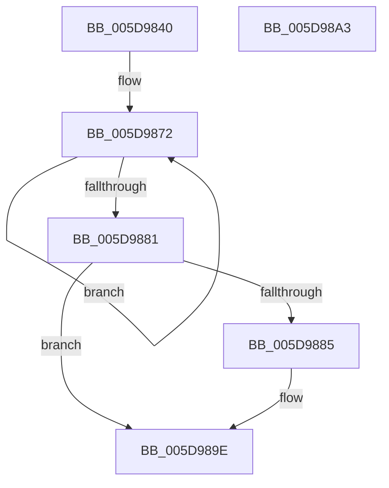

# PopIdleAoAcDozeS4TimerCallback

- RVA: `0x005D9840`–`0x005D98A4` (길이 `100` bytes)
- VA: `0x00000001405D9840`
- 실행 섹션: `.text`
- PDB 이름 있음: `예`; PDB Function 태그: `아니요`
- unwind 정보 RVA: `0x0005C788`
- 디코드: `23`개 명령, `100/100` bytes 표시
- 미해석 바이트: `0` (있으면 어셈블리에 `.byte`로 보존)

> 이 문서는 커널 이미지의 기계어와 PDB 기호를 분석해 생성했습니다. 4번과 5번은 함수 원형과 자료형을 바이너리 사용 방식에서 추정한 C 해석이며 원본 소스 복구 결과는 아닙니다.

## 1. Dependencies

- 직접 호출 지점: **4**; 고유 호출 대상: **4**
- 직접 호출자로 확인된 함수: **0**
- RIP 상대 이미지 참조: **4**

### Outgoing calls
- `0x005D984B` → [KeAcquireSpinLockRaiseToDpc](../20/KeAcquireSpinLockRaiseToDpc_function_00208470.md) (function, `0x00208470`)
- `0x005D9860` → [KeReleaseSpinLock](../39/KeReleaseSpinLock_function_00392BA0.md) (function, `0x00392BA0`)
- `0x005D9888` → [PopDeepSleepSetDisengageReason](../38/PopDeepSleepSetDisengageReason_function_0038FEC4.md) (function, `0x0038FEC4`)
- `0x005D9899` → [ExQueueWorkItem](../2F/ExQueueWorkItem_function_002F9520.md) (function, `0x002F9520`)

### Direct callers
- 이 함수 시작 RVA로 연결되는 직접 call은 확인되지 않았습니다. 간접 호출은 완전히 역산할 수 없습니다.

### Static image references
- `0x005D9844` → RVA `0x00F08EA8` (`.data`; read)
- `0x005D9852` → RVA `0x00F0BC94` (`.data`; write)
- `0x005D9865` → RVA `0x00F0BC9C` (`.data`; read)
- `0x005D9892` → RVA `0x00F08EC0` (`.data`; read)

## 2. Other-region calls and transfers

- 다른 실행 섹션으로 향하는 call: **0**
- 별도 외부 분기/꼬리 이동을 확인하지 못했습니다.

## 3. Assembly (complete function range)

```asm
005D9840  48 83 EC 28                     sub rsp, 0x28
005D9844  48 8D 0D 5D F6 92 00            lea rcx, [rip + 0x92f65d]
005D984B  E8 20 EC C2 FF                  call 0x140208470
005D9850  8A D0                           mov dl, al
005D9852  C6 05 3B 24 93 00 00            mov byte ptr [rip + 0x93243b], 0
005D9859  48 8D 0D 48 F6 92 00            lea rcx, [rip + 0x92f648]
005D9860  E8 3B 93 DB FF                  call 0x140392ba0
005D9865  0F 0D 0D 30 24 93 00            prefetchw byte ptr [rip + 0x932430]
005D986C  8B 05 2A 24 93 00               mov eax, dword ptr [rip + 0x93242a]
005D9872  8B C8                           mov ecx, eax
005D9874  83 C9 01                        or ecx, 1
005D9877  F0 0F B1 0D 1D 24 93 00         lock cmpxchg dword ptr [rip + 0x93241d], ecx
005D987F  75 F1                           jne 0x1405d9872
005D9881  85 C0                           test eax, eax
005D9883  75 19                           jne 0x1405d989e
005D9885  8D 48 04                        lea ecx, [rax + 4]
005D9888  E8 37 66 DB FF                  call 0x14038fec4
005D988D  BA 01 00 00 00                  mov edx, 1
005D9892  48 8D 0D 27 F6 92 00            lea rcx, [rip + 0x92f627]
005D9899  E8 82 FC D1 FF                  call 0x1402f9520
005D989E  48 83 C4 28                     add rsp, 0x28
005D98A2  C3                              ret
005D98A3  CC                              int3
```

## 4. C-style interpretation (structured pseudocode)

```c
__int64 __fastcall PopIdleAoAcDozeS4TimerCallback(void)
{
    __int64 result;
    __int64 v_rsp;

    v_rsp = (v_rsp) - (40);
    result = KeAcquireSpinLockRaiseToDpc(v_rip + 9631325, a2, a3, a4);
    *(unsigned __int8 *)(v_rip + 9643067) = 0;
    result = KeReleaseSpinLock(v_rip + 9631304, (unsigned __int8)(result), a3, a4);
loc_005D9872:
    a1 = (unsigned int)(((unsigned int)((unsigned int)((unsigned int)(*(unsigned int *)(v_rip + 9643050))))) | (1));
    if (condition_is_not_equal) goto loc_005D9872;
    result = (unsigned int)(*(unsigned int *)(v_rip + 9643050));
    if ((unsigned int)((unsigned int)(*(unsigned int *)(v_rip + 9643050))) == 0) {
        a1 = (unsigned int)(*(unsigned int *)(v_rip + 9643050)) + 4;
        result = PopDeepSleepSetDisengageReason(a1, (unsigned __int8)(result), a3, a4);
        a2 = 1;
        a1 = v_rip + 9631271;
        result = ExQueueWorkItem(a1, a2, a3, a4);
    }
    v_rsp = (v_rsp) + (40);
    return result;
}
```

## 5. (Beta) C Style

```c
void PopIdleAoAcDozeS4TimerCallback(void)
{
    int64_t result;
    int64_t local_rsp;

    local_rsp = (local_rsp) - (40);
    result = KeAcquireSpinLockRaiseToDpc(v_rip + 9631325, a2, a3, a4);
    *(uint8_t *)(v_rip + 0x93243B) = 0;
    result = KeReleaseSpinLock(v_rip + 9631304, (uint8_t)(result), a3, a4);
loc_005D9872:
    a1 = (uint32_t)(((uint32_t)((uint32_t)((uint32_t)(*(uint32_t *)(v_rip + 0x93242A))))) | (1));
    if (condition_is_not_equal) goto loc_005D9872;
    result = (uint32_t)(*(uint32_t *)(v_rip + 0x93242A));
    if ((uint32_t)((uint32_t)(*(uint32_t *)(v_rip + 0x93242A))) == 0) {
        a1 = (uint32_t)(*(uint32_t *)(v_rip + 0x93242A)) + 4;
        result = PopDeepSleepSetDisengageReason(a1, (uint8_t)(result), a3, a4);
        a2 = 1;
        a1 = v_rip + 9631271;
        result = ExQueueWorkItem(a1, a2, a3, a4);
    }
    local_rsp = (local_rsp) + (40);
    return result;
}
```

## 6. Execution-region graph

[열기: 2D/3D 그래프와 함수 탐색 컨트롤 패널](../../../control-panel.html?section=text&rva=0x005D9840&view=graph)

- 2D 그래프는 위에서 아래로 흐르고, 3D 그래프는 빈 공간을 드래그해 회전합니다. Shift+드래그는 이동, 휠은 확대·축소, 함수 노드 선택은 대상 보고서 이동입니다.

### Static fallback


