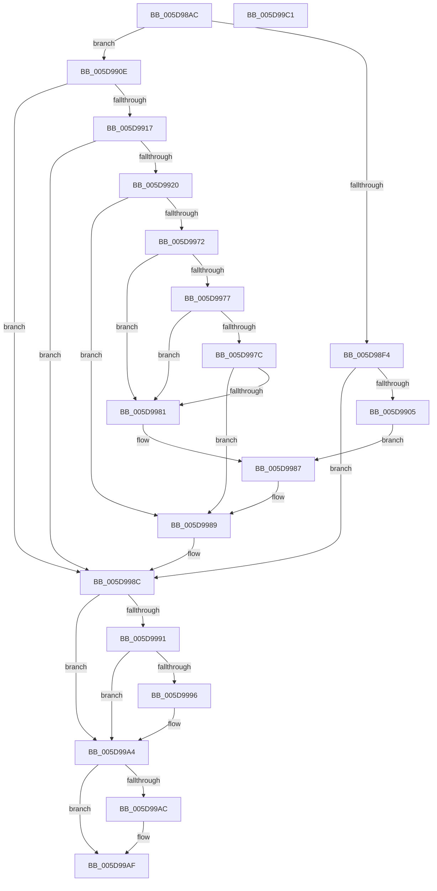

# PopIdleChooseDozeS4Time

- RVA: `0x005D98AC`–`0x005D99C2` (길이 `278` bytes)
- VA: `0x00000001405D98AC`
- 실행 섹션: `.text`
- PDB 이름 있음: `예`; PDB Function 태그: `아니요`
- unwind 정보 RVA: `0x00069588`
- 디코드: `71`개 명령, `278/278` bytes 표시
- 미해석 바이트: `0` (있으면 어셈블리에 `.byte`로 보존)

> 이 문서는 커널 이미지의 기계어와 PDB 기호를 분석해 생성했습니다. 4번과 5번은 함수 원형과 자료형을 바이너리 사용 방식에서 추정한 C 해석이며 원본 소스 복구 결과는 아닙니다.

## 1. Dependencies

- 직접 호출 지점: **0**; 고유 호출 대상: **0**
- 직접 호출자로 확인된 함수: **1**
- RIP 상대 이미지 참조: **7**

### Outgoing calls
- 직접 디코드된 call 명령이 없습니다.

### Direct callers
- [PopIdleArmAoAcDozeS4Timer](../4E/PopIdleArmAoAcDozeS4Timer_function_004E03A8.md) at `0x004E0420`

### Static image references
- `0x005D98D6` → RVA `0x00F0CE68` (`.data`; read)
- `0x005D98DD` → RVA `0x00F08F68` (`.data`; read)
- `0x005D990E` → RVA `0x00F0BC78` (`.data`; read)
- `0x005D9917` → RVA `0x00FC527C` (`ALMOSTRO`; read)
- `0x005D992D` → RVA `0x00F0BCA8` (`.data`; read)
- `0x005D9934` → RVA `0x00FC5334` (`ALMOSTRO`; read)
- `0x005D9955` → RVA `0x00FC5278` (`ALMOSTRO`; read)

## 2. Other-region calls and transfers

- 다른 실행 섹션으로 향하는 call: **0**
- 별도 외부 분기/꼬리 이동을 확인하지 못했습니다.

## 3. Assembly (complete function range)

```asm
005D98AC  48 89 5C 24 08                  mov qword ptr [rsp + 8], rbx
005D98B1  48 89 74 24 10                  mov qword ptr [rsp + 0x10], rsi
005D98B6  48 89 7C 24 18                  mov qword ptr [rsp + 0x18], rdi
005D98BB  48 B8 14 00 00 00 80 F7 FF FF   movabs rax, 0xfffff78000000014
005D98C5  48 8B F1                        mov rsi, rcx
005D98C8  45 33 D2                        xor r10d, r10d
005D98CB  32 DB                           xor bl, bl
005D98CD  45 33 DB                        xor r11d, r11d
005D98D0  48 8B FA                        mov rdi, rdx
005D98D3  48 8B 00                        mov rax, qword ptr [rax]
005D98D6  4C 8B 05 8B 35 93 00            mov r8, qword ptr [rip + 0x93358b]
005D98DD  48 8B 0D 84 F6 92 00            mov rcx, qword ptr [rip + 0x92f684]
005D98E4  45 8B 48 58                     mov r9d, dword ptr [r8 + 0x58]
005D98E8  4D 69 C9 80 96 98 00            imul r9, r9, 0x989680
005D98EF  38 59 02                        cmp byte ptr [rcx + 2], bl
005D98F2  74 1A                           je 0x1405d990e
005D98F4  48 8B 49 30                     mov rcx, qword ptr [rcx + 0x30]
005D98F8  45 8D 5A 06                     lea r11d, [r10 + 6]
005D98FC  48 85 C9                        test rcx, rcx
005D98FF  0F 84 87 00 00 00               je 0x1405d998c
005D9905  48 2B C8                        sub rcx, rax
005D9908  4C 0F 49 D1                     cmovns r10, rcx
005D990C  EB 79                           jmp 0x1405d9987
005D990E  48 39 05 63 23 93 00            cmp qword ptr [rip + 0x932363], rax
005D9915  7E 75                           jle 0x1405d998c
005D9917  83 3D 5E B9 9E 00 01            cmp dword ptr [rip + 0x9eb95e], 1
005D991E  75 6C                           jne 0x1405d998c
005D9920  49 B8 08 00 00 00 80 F7 FF FF   movabs r8, 0xfffff78000000008
005D992A  4D 8B 00                        mov r8, qword ptr [r8]
005D992D  4C 2B 05 74 23 93 00            sub r8, qword ptr [rip + 0x932374]
005D9934  8B 0D FA B9 9E 00               mov ecx, dword ptr [rip + 0x9eb9fa]
005D993A  48 69 D1 80 96 98 00            imul rdx, rcx, 0x989680
005D9941  48 8B CA                        mov rcx, rdx
005D9944  49 2B C8                        sub rcx, r8
005D9947  4C 3B C2                        cmp r8, rdx
005D994A  4C 8B 05 27 23 93 00            mov r8, qword ptr [rip + 0x932327]
005D9951  4C 0F 46 D1                     cmovbe r10, rcx
005D9955  8B 0D 1D B9 9E 00               mov ecx, dword ptr [rip + 0x9eb91d]
005D995B  48 83 C1 3C                     add rcx, 0x3c
005D995F  48 69 D1 80 96 98 00            imul rdx, rcx, 0x989680
005D9966  49 8D 0C 02                     lea rcx, [r10 + rax]
005D996A  4C 2B C2                        sub r8, rdx
005D996D  49 3B C8                        cmp rcx, r8
005D9970  7D 17                           jge 0x1405d9989
005D9972  4D 85 D2                        test r10, r10
005D9975  74 0A                           je 0x1405d9981
005D9977  4D 85 C9                        test r9, r9
005D997A  74 05                           je 0x1405d9981
005D997C  4D 3B D1                        cmp r10, r9
005D997F  73 08                           jae 0x1405d9989
005D9981  41 BB 02 00 00 00               mov r11d, 2
005D9987  B3 01                           mov bl, 1
005D9989  49 F7 DA                        neg r10
005D998C  4D 85 C9                        test r9, r9
005D998F  74 13                           je 0x1405d99a4
005D9991  45 85 DB                        test r11d, r11d
005D9994  75 0E                           jne 0x1405d99a4
005D9996  4D 8B D1                        mov r10, r9
005D9999  B3 01                           mov bl, 1
005D999B  49 F7 DA                        neg r10
005D999E  41 BB 01 00 00 00               mov r11d, 1
005D99A4  4C 89 16                        mov qword ptr [rsi], r10
005D99A7  48 85 FF                        test rdi, rdi
005D99AA  74 03                           je 0x1405d99af
005D99AC  44 89 1F                        mov dword ptr [rdi], r11d
005D99AF  48 8B 74 24 10                  mov rsi, qword ptr [rsp + 0x10]
005D99B4  8A C3                           mov al, bl
005D99B6  48 8B 5C 24 08                  mov rbx, qword ptr [rsp + 8]
005D99BB  48 8B 7C 24 18                  mov rdi, qword ptr [rsp + 0x18]
005D99C0  C3                              ret
005D99C1  CC                              int3
```

## 4. C-style interpretation (structured pseudocode)

```c
__int64 __fastcall PopIdleChooseDozeS4Time(__int64 a1, __int64 a2)
{
    __int64 v_r10;
    __int64 v_r11;
    __int64 v_rbx;
    unsigned __int64 v_stack_p10;
    unsigned __int64 v_stack_p18;
    unsigned __int64 v_stack_p8;

    v_stack_p8 = v_rbx;
    v_stack_p10 = v_rsi;
    v_stack_p18 = v_rdi;
    v_r10 = 0;
    v_rbx = 0;
    v_r11 = 0;
    a4 = ((unsigned int)(*(unsigned int *)(*(unsigned __int64 *)(v_rip + 9647499) + 88))) * ((unsigned int)(*(unsigned int *)(*(unsigned __int64 *)(v_rip + 9647499) + 88)));
    if ((*(unsigned __int8 *)(*(unsigned __int64 *)(v_rip + 9631364) + 2)) == 0) goto loc_005D990E;
    if (*(unsigned __int64 *)(*(unsigned __int64 *)(v_rip + 9631364) + 48) == 0) goto loc_005D998C;
    a1 = (*(unsigned __int64 *)(*(unsigned __int64 *)(v_rip + 9631364) + 48)) - (*(unsigned __int64 *)(result));
    if (!sign_flag) { v_r10 = a1; }
    goto loc_005D9987;
loc_005D990E:
    if ((*(unsigned __int64 *)(v_rip + 9642851)) <= (*(unsigned __int64 *)(result))) goto loc_005D998C;
    if ((*(unsigned int *)(v_rip + 10402142)) != 1) goto loc_005D998C;
    a3 = (*(unsigned __int64 *)(*(unsigned __int64 *)(v_rip + 9647499))) - (*(unsigned __int64 *)(v_rip + 9642868));
    a2 = (a2) * ((unsigned int)(*(unsigned int *)(v_rip + 10402298)));
    a1 = (a2) - (a3);
    if (a3 <= a2) { v_r10 = a1; }
    a1 = ((unsigned int)(*(unsigned int *)(v_rip + 10402077))) + (60);
    a2 = (a2) * (a1);
    a3 = (*(unsigned __int64 *)(v_rip + 9642791)) - (a2);
    if ((v_r10 + *(unsigned __int64 *)(result) * 1) >= a3) goto loc_005D9989;
    if (v_r10 == 0) goto loc_005D9981;
    if (a4 == 0) goto loc_005D9981;
    if (v_r10 >= a4) goto loc_005D9989;
loc_005D9981:
loc_005D9987:
loc_005D9989:
    v_r10 = -(v_r10);
loc_005D998C:
    if (a4 == 0) goto loc_005D99A4;
    v_rbx = 1;
    v_r11 = 2;
    if (2 == 0) {
        v_r10 = a4;
        v_rbx = 1;
        v_r10 = -(v_r10);
        v_r11 = 1;
    }
    *(unsigned __int64 *)(a1) = v_r10;
    if (a2 != 0) {
        *(unsigned int *)(a2) = (unsigned int)(v_r11);
    }
    return (unsigned __int8)(v_rbx);
}
```

## 5. (Beta) C Style

```c
int64_t PopIdleChooseDozeS4Time(void *Arg1, int64_t Arg2)
{
    uint8_t *arg1 = (uint8_t *)Arg1;

    int64_t local_r10;
    int64_t local_r11;
    int64_t local_rbx;
    uint64_t v_stack_p10;
    uint64_t v_stack_p18;
    uint64_t v_stack_p8;

    v_stack_p8 = local_rbx;
    v_stack_p10 = local_rsi;
    v_stack_p18 = local_rdi;
    local_r10 = 0;
    local_rbx = 0;
    local_r11 = 0;
    a4 = ((uint32_t)(*(uint32_t *)(*(uint64_t *)(v_rip + 0x93358B) + 0x58))) * ((uint32_t)(*(uint32_t *)(*(uint64_t *)(v_rip + 0x93358B) + 0x58)));
    if ((*(uint8_t *)(*(uint64_t *)(v_rip + 0x92F684) + 0x2)) == 0) goto loc_005D990E;
    if (*(uint64_t *)(*(uint64_t *)(v_rip + 0x92F684) + 0x30) == 0) goto loc_005D998C;
    Arg1 = (*(uint64_t *)(*(uint64_t *)(v_rip + 0x92F684) + 0x30)) - (*(uint64_t *)(result));
    if (!sign_flag) { local_r10 = Arg1; }
    goto loc_005D9987;
loc_005D990E:
    if ((*(uint64_t *)(v_rip + 0x932363)) <= (*(uint64_t *)(result))) goto loc_005D998C;
    if ((*(uint32_t *)(v_rip + 0x9EB95E)) != 1) goto loc_005D998C;
    a3 = (*(uint64_t *)(*(uint64_t *)(v_rip + 0x93358B))) - (*(uint64_t *)(v_rip + 0x932374));
    Arg2 = (Arg2) * ((uint32_t)(*(uint32_t *)(v_rip + 0x9EB9FA)));
    Arg1 = (Arg2) - (a3);
    if (a3 <= Arg2) { local_r10 = Arg1; }
    Arg1 = ((uint32_t)(*(uint32_t *)(v_rip + 0x9EB91D))) + (60);
    Arg2 = (Arg2) * (Arg1);
    a3 = (*(uint64_t *)(v_rip + 0x932327)) - (Arg2);
    if ((local_r10 + *(uint64_t *)(result) * 1) >= a3) goto loc_005D9989;
    if (local_r10 == 0) goto loc_005D9981;
    if (a4 == 0) goto loc_005D9981;
    if (local_r10 >= a4) goto loc_005D9989;
loc_005D9981:
loc_005D9987:
loc_005D9989:
    local_r10 = -(local_r10);
loc_005D998C:
    if (a4 == 0) goto loc_005D99A4;
    local_rbx = 1;
    local_r11 = 2;
    if (2 == 0) {
        local_r10 = a4;
        local_rbx = 1;
        local_r10 = -(local_r10);
        local_r11 = 1;
    }
    *(uint64_t *)(arg1) = local_r10;
    if (Arg2 != 0) {
        *(uint32_t *)(Arg2) = (uint32_t)(local_r11);
    }
    return (uint8_t)(local_rbx);
}
```

### 관측된 메모리 오프셋

구조체 형식이 확인되지 않은 접근은 인자 기준의 오프셋으로만 기록했습니다.

| 기준 인자 | 오프셋 표현 | 폭 (bit) | 접근 |
|---|---:|---:|---|
| `Arg1` | `+ 0x0` | `64` | `W` |

## 6. Execution-region graph

[열기: 2D/3D 그래프와 함수 탐색 컨트롤 패널](../../../control-panel.html?section=text&rva=0x005D98AC&view=graph)

- 2D 그래프는 위에서 아래로 흐르고, 3D 그래프는 빈 공간을 드래그해 회전합니다. Shift+드래그는 이동, 휠은 확대·축소, 함수 노드 선택은 대상 보고서 이동입니다.

### Static fallback


