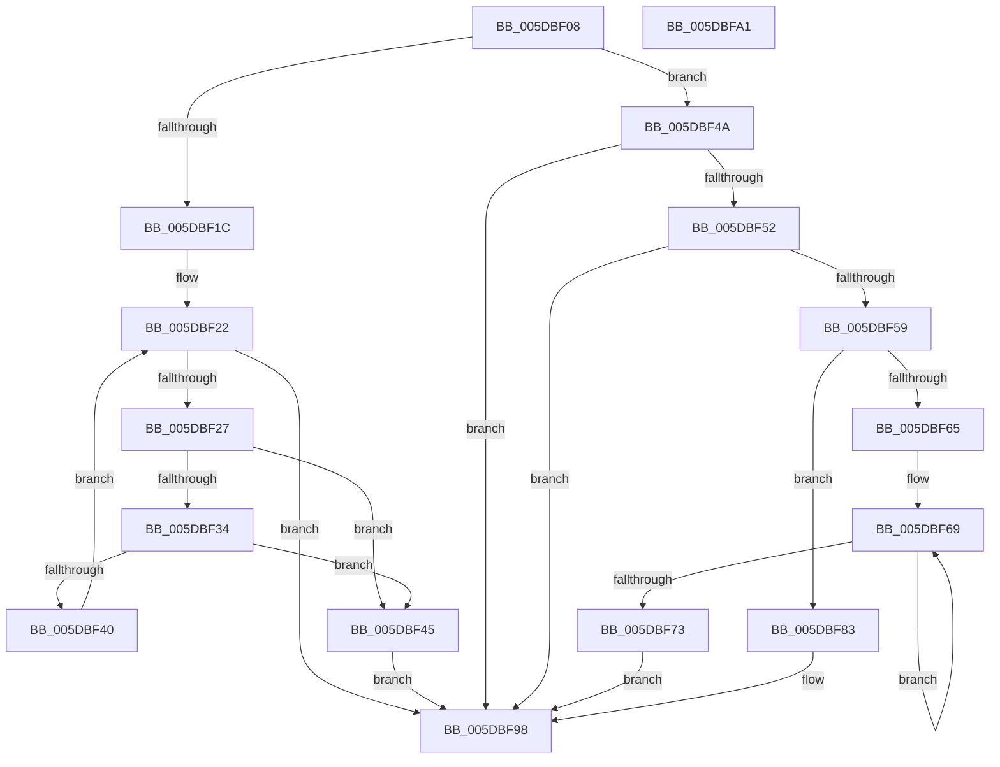

# PopIdleWakeAreIdenticalWakeSources

- RVA: `0x005DBF08`–`0x005DBFA2` (길이 `154` bytes)
- VA: `0x00000001405DBF08`
- 실행 섹션: `.text`
- PDB 이름 있음: `예`; PDB Function 태그: `아니요`
- unwind 정보 RVA: `0x0005CF00`
- 디코드: `50`개 명령, `154/154` bytes 표시
- 미해석 바이트: `0` (있으면 어셈블리에 `.byte`로 보존)

> 이 문서는 커널 이미지의 기계어와 PDB 기호를 분석해 생성했습니다. 4번과 5번은 함수 원형과 자료형을 바이너리 사용 방식에서 추정한 C 해석이며 원본 소스 복구 결과는 아닙니다.

## 1. Dependencies

- 직접 호출 지점: **1**; 고유 호출 대상: **1**
- 직접 호출자로 확인된 함수: **1**
- RIP 상대 이미지 참조: **0**

### Outgoing calls
- `0x005DBF76` → [wcsnicmp](../50/wcsnicmp_function_005001C0.md) (function, `0x005001C0`)

### Direct callers
- [PopIdleWakeFindOrAllocateWakeSource](PopIdleWakeFindOrAllocateWakeSource_function_005DC0E8.md) at `0x005DC15C`

### Static image references
- 디코드된 RIP-relative 메모리 참조가 없습니다.

## 2. Other-region calls and transfers

- 다른 실행 섹션으로 향하는 call: **0**
- 별도 외부 분기/꼬리 이동을 확인하지 못했습니다.

## 3. Assembly (complete function range)

```asm
005DBF08  40 53                           push rbx
005DBF0A  48 83 EC 20                     sub rsp, 0x20
005DBF0E  33 DB                           xor ebx, ebx
005DBF10  44 0F B6 CB                     movzx r9d, bl
005DBF14  81 F9 80 00 00 00               cmp ecx, 0x80
005DBF1A  75 2E                           jne 0x1405dbf4a
005DBF1C  44 8D 4B 01                     lea r9d, [rbx + 1]
005DBF20  8B CB                           mov ecx, ebx
005DBF22  83 F9 03                        cmp ecx, 3
005DBF25  73 71                           jae 0x1405dbf98
005DBF27  44 8B D1                        mov r10d, ecx
005DBF2A  4B 8B 04 D0                     mov rax, qword ptr [r8 + r10*8]
005DBF2E  4A 39 04 D2                     cmp qword ptr [rdx + r10*8], rax
005DBF32  75 11                           jne 0x1405dbf45
005DBF34  4B 8B 44 D0 18                  mov rax, qword ptr [r8 + r10*8 + 0x18]
005DBF39  4A 39 44 D2 18                  cmp qword ptr [rdx + r10*8 + 0x18], rax
005DBF3E  75 05                           jne 0x1405dbf45
005DBF40  41 03 C9                        add ecx, r9d
005DBF43  EB DD                           jmp 0x1405dbf22
005DBF45  44 8A CB                        mov r9b, bl
005DBF48  EB 4E                           jmp 0x1405dbf98
005DBF4A  81 F9 81 00 00 00               cmp ecx, 0x81
005DBF50  75 46                           jne 0x1405dbf98
005DBF52  8A 02                           mov al, byte ptr [rdx]
005DBF54  41 3A 00                        cmp al, byte ptr [r8]
005DBF57  75 3F                           jne 0x1405dbf98
005DBF59  48 83 C2 02                     add rdx, 2
005DBF5D  4D 8D 50 02                     lea r10, [r8 + 2]
005DBF61  3C 03                           cmp al, 3
005DBF63  75 1E                           jne 0x1405dbf83
005DBF65  49 83 C8 FF                     or r8, 0xffffffffffffffff
005DBF69  49 FF C0                        inc r8
005DBF6C  66 42 39 1C 42                  cmp word ptr [rdx + r8*2], bx
005DBF71  75 F6                           jne 0x1405dbf69
005DBF73  49 8B CA                        mov rcx, r10
005DBF76  E8 45 42 F2 FF                  call 0x1405001c0
005DBF7B  85 C0                           test eax, eax
005DBF7D  41 0F 94 C1                     sete r9b
005DBF81  EB 15                           jmp 0x1405dbf98
005DBF83  41 8A 02                        mov al, byte ptr [r10]
005DBF86  41 8B C9                        mov ecx, r9d
005DBF89  38 02                           cmp byte ptr [rdx], al
005DBF8B  41 B9 01 00 00 00               mov r9d, 1
005DBF91  41 0F 44 C9                     cmove ecx, r9d
005DBF95  44 8A C9                        mov r9b, cl
005DBF98  41 8A C1                        mov al, r9b
005DBF9B  48 83 C4 20                     add rsp, 0x20
005DBF9F  5B                              pop rbx
005DBFA0  C3                              ret
005DBFA1  CC                              int3
```

## 4. C-style interpretation (structured pseudocode)

```c
__int64 __fastcall PopIdleWakeAreIdenticalWakeSources(int a1, __int64 a2, __int64 a3)
{
    __int64 result;
    __int64 v_rbx;
    __int64 v_rsp;

    v_rsp = (v_rsp) - (32);
    v_rbx = 0;
    if (a1 != 128) goto loc_005DBF4A;
loc_005DBF22:
    if (0 >= 3) goto loc_005DBF98;
    if ((*(unsigned __int64 *)(a2 + 0 * 8)) != (*(unsigned __int64 *)(a3 + 0 * 8))) goto loc_005DBF45;
    if ((*(unsigned __int64 *)(a2 + 0 * 8 + 24)) != (*(unsigned __int64 *)(a3 + 0 * 8 + 24))) goto loc_005DBF45;
    a1 = (unsigned int)((0) + ((unsigned int)(v_rbx + 1)));
    goto loc_005DBF22;
loc_005DBF45:
    goto loc_005DBF98;
loc_005DBF4A:
    if (a1 != 129) goto loc_005DBF98;
    if (((unsigned __int8)(*(unsigned __int8 *)(a2))) != (*(unsigned __int8 *)(a3))) goto loc_005DBF98;
    a2 = (a2) + (2);
    if (((unsigned __int8)(*(unsigned __int8 *)(a2))) != 3) goto loc_005DBF83;
    a3 = (a3) | (-1);
loc_005DBF69:
    a3 = (a3) + 1;
    if ((*(unsigned __int16 *)(a2 + a3 * 2)) != 0) goto loc_005DBF69;
    result = wcsnicmp(a3 + 2, a2, a3, 0);
    a4 = ((unsigned int)(result) == 0) ? 1 : 0;
    goto loc_005DBF98;
loc_005DBF83:
    a1 = (unsigned int)((unsigned int)(a4));
    if ((*(unsigned __int8 *)(a2)) == ((unsigned __int8)(*(unsigned __int8 *)(a3 + 2)))) { a1 = 1; }
loc_005DBF98:
    v_rsp = (v_rsp) + (32);
    return (unsigned __int8)((unsigned __int8)(a1));
}
```

## 5. (Beta) C Style

```c
int64_t PopIdleWakeAreIdenticalWakeSources(int32_t Arg1, void *Arg2, void *Arg3)
{
    uint8_t *arg2 = (uint8_t *)Arg2;
    uint8_t *arg3 = (uint8_t *)Arg3;

    int64_t result;
    int64_t local_rbx;
    int64_t local_rsp;

    local_rsp = (local_rsp) - (32);
    local_rbx = 0;
    if (Arg1 != 128) goto loc_005DBF4A;
loc_005DBF22:
    if (0 >= 3) goto loc_005DBF98;
    if ((*(uint64_t *)(arg2 + 0x0 * 8)) != (*(uint64_t *)(arg3 + 0x0 * 8))) goto loc_005DBF45;
    if ((*(uint64_t *)(arg2 + 0x0 * 8 + 0x18)) != (*(uint64_t *)(arg3 + 0x0 * 8 + 0x18))) goto loc_005DBF45;
    Arg1 = (uint32_t)((0) + ((uint32_t)(local_rbx + 1)));
    goto loc_005DBF22;
loc_005DBF45:
    goto loc_005DBF98;
loc_005DBF4A:
    if (Arg1 != 129) goto loc_005DBF98;
    if (((uint8_t)(*(uint8_t *)(arg2))) != (*(uint8_t *)(arg3))) goto loc_005DBF98;
    Arg2 = (Arg2) + (2);
    if (((uint8_t)(*(uint8_t *)(arg2))) != 3) goto loc_005DBF83;
    Arg3 = (Arg3) | (-1);
loc_005DBF69:
    Arg3 = (Arg3) + 1;
    if ((*(uint16_t *)(arg2 + arg3 * 2)) != 0) goto loc_005DBF69;
    result = wcsnicmp(Arg3 + 2, Arg2, Arg3, 0);
    a4 = ((uint32_t)(result) == 0) ? 1 : 0;
    goto loc_005DBF98;
loc_005DBF83:
    Arg1 = (uint32_t)((uint32_t)(a4));
    if ((*(uint8_t *)(arg2)) == ((uint8_t)(*(uint8_t *)(arg3 + 0x2)))) { Arg1 = 1; }
loc_005DBF98:
    local_rsp = (local_rsp) + (32);
    return (uint8_t)((uint8_t)(Arg1));
}
```

### 관측된 메모리 오프셋

구조체 형식이 확인되지 않은 접근은 인자 기준의 오프셋으로만 기록했습니다.

| 기준 인자 | 오프셋 표현 | 폭 (bit) | 접근 |
|---|---:|---:|---|
| `Arg2` | `+ 0x0` | `8` | `R` |
| `Arg2` | `+ 0x0 + r10*8` | `64` | `R` |
| `Arg2` | `+ 0x0 + r8*2` | `16` | `R` |
| `Arg2` | `+ 0x18 + r10*8` | `64` | `R` |
| `Arg3` | `+ 0x0` | `8` | `R` |
| `Arg3` | `+ 0x0 + r10*8` | `64` | `R` |
| `Arg3` | `+ 0x2` | `64` | `R` |
| `Arg3` | `+ 0x18 + r10*8` | `64` | `R` |

## 6. Execution-region graph

[열기: 2D/3D 그래프와 함수 탐색 컨트롤 패널](../../../control-panel.html?section=text&rva=0x005DBF08&view=graph)

- 2D 그래프는 위에서 아래로 흐르고, 3D 그래프는 빈 공간을 드래그해 회전합니다. Shift+드래그는 이동, 휠은 확대·축소, 함수 노드 선택은 대상 보고서 이동입니다.

### Static fallback


