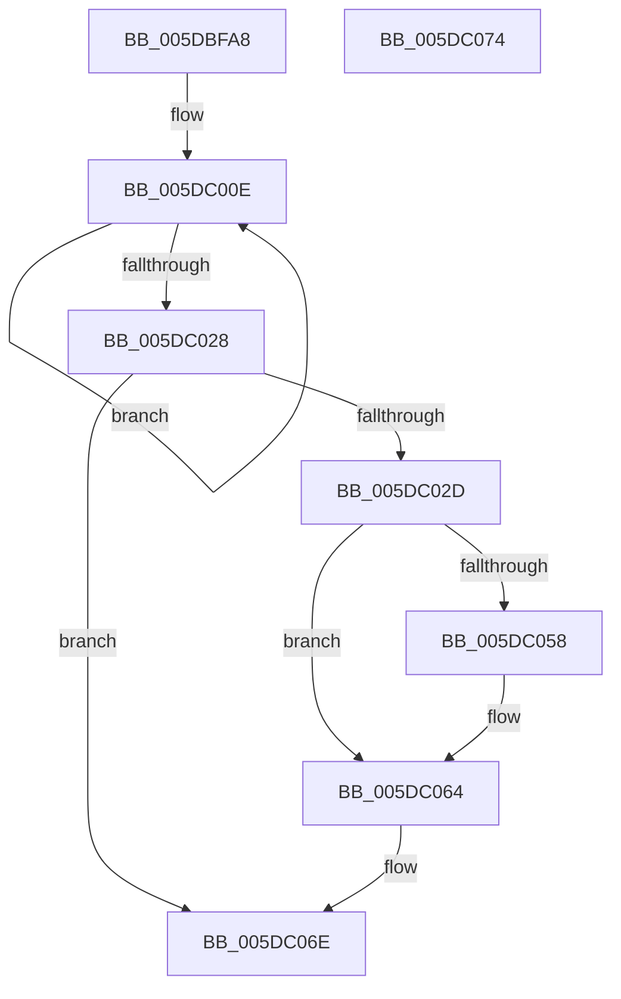

# PopIdleWakeAssignAccountingToSource

- RVA: `0x005DBFA8`–`0x005DC075` (길이 `205` bytes)
- VA: `0x00000001405DBFA8`
- 실행 섹션: `.text`
- PDB 이름 있음: `예`; PDB Function 태그: `아니요`
- unwind 정보 RVA: `0x0005CF00`
- 디코드: `50`개 명령, `205/205` bytes 표시
- 미해석 바이트: `0` (있으면 어셈블리에 `.byte`로 보존)

> 이 문서는 커널 이미지의 기계어와 PDB 기호를 분석해 생성했습니다. 4번과 5번은 함수 원형과 자료형을 바이너리 사용 방식에서 추정한 C 해석이며 원본 소스 복구 결과는 아닙니다.

## 1. Dependencies

- 직접 호출 지점: **2**; 고유 호출 대상: **2**
- 직접 호출자로 확인된 함수: **1**
- RIP 상대 이미지 참조: **1**

### Outgoing calls
- `0x005DC03B` → [KeResetEvent](../24/KeResetEvent_function_00248350.md) (function, `0x00248350`)
- `0x005DC069` → [KeInsertQueueDpc](../20/KeInsertQueueDpc_function_00207C50.md) (function, `0x00207C50`)

### Direct callers
- [PopIdleWakeFindOrAllocateWakeSource](PopIdleWakeFindOrAllocateWakeSource_function_005DC0E8.md) at `0x005DC175`

### Static image references
- `0x005DC013` → RVA `0x00F08288` (`.data`; read/write)

## 2. Other-region calls and transfers

- 다른 실행 섹션으로 향하는 call: **0**
- 별도 외부 분기/꼬리 이동을 확인하지 못했습니다.

## 3. Assembly (complete function range)

```asm
005DBFA8  40 53                           push rbx
005DBFAA  48 83 EC 20                     sub rsp, 0x20
005DBFAE  44 89 02                        mov dword ptr [rdx], r8d
005DBFB1  41 BB 80 00 00 00               mov r11d, 0x80
005DBFB7  41 0F 10 01                     movups xmm0, xmmword ptr [r9]
005DBFBB  48 8B D9                        mov rbx, rcx
005DBFBE  48 8D 4A 08                     lea rcx, [rdx + 8]
005DBFC2  0F 11 01                        movups xmmword ptr [rcx], xmm0
005DBFC5  41 0F 10 49 10                  movups xmm1, xmmword ptr [r9 + 0x10]
005DBFCA  0F 11 49 10                     movups xmmword ptr [rcx + 0x10], xmm1
005DBFCE  41 0F 10 41 20                  movups xmm0, xmmword ptr [r9 + 0x20]
005DBFD3  0F 11 41 20                     movups xmmword ptr [rcx + 0x20], xmm0
005DBFD7  41 0F 10 49 30                  movups xmm1, xmmword ptr [r9 + 0x30]
005DBFDC  0F 11 49 30                     movups xmmword ptr [rcx + 0x30], xmm1
005DBFE0  41 0F 10 41 40                  movups xmm0, xmmword ptr [r9 + 0x40]
005DBFE5  0F 11 41 40                     movups xmmword ptr [rcx + 0x40], xmm0
005DBFE9  41 0F 10 49 50                  movups xmm1, xmmword ptr [r9 + 0x50]
005DBFEE  0F 11 49 50                     movups xmmword ptr [rcx + 0x50], xmm1
005DBFF2  41 0F 10 41 60                  movups xmm0, xmmword ptr [r9 + 0x60]
005DBFF7  0F 11 41 60                     movups xmmword ptr [rcx + 0x60], xmm0
005DBFFB  41 0F 10 41 70                  movups xmm0, xmmword ptr [r9 + 0x70]
005DC000  42 0F 11 44 19 F0               movups xmmword ptr [rcx + r11 - 0x10], xmm0
005DC006  4B 8B 04 19                     mov rax, qword ptr [r9 + r11]
005DC00A  4A 89 04 19                     mov qword ptr [rcx + r11], rax
005DC00E  B8 01 00 00 00                  mov eax, 1
005DC013  F0 0F C1 05 6D C2 92 00         lock xadd dword ptr [rip + 0x92c26d], eax
005DC01B  FF C0                           inc eax
005DC01D  89 82 98 01 00 00               mov dword ptr [rdx + 0x198], eax
005DC023  83 F8 FF                        cmp eax, -1
005DC026  74 E6                           je 0x1405dc00e
005DC028  45 3B C3                        cmp r8d, r11d
005DC02B  75 41                           jne 0x1405dc06e
005DC02D  48 89 8B 18 95 00 00            mov qword ptr [rbx + 0x9518], rcx
005DC034  48 8D 8B 00 95 00 00            lea rcx, [rbx + 0x9500]
005DC03B  E8 10 C3 C6 FF                  call 0x140248350
005DC040  65 8B 14 25 A4 01 00 00         mov edx, dword ptr gs:[0x1a4]
005DC048  48 8D 8B C0 94 00 00            lea rcx, [rbx + 0x94c0]
005DC04F  48 8B 41 38                     mov rax, qword ptr [rcx + 0x38]
005DC053  48 85 C0                        test rax, rax
005DC056  75 0C                           jne 0x1405dc064
005DC058  B8 00 08 00 00                  mov eax, 0x800
005DC05D  66 03 D0                        add dx, ax
005DC060  66 89 51 02                     mov word ptr [rcx + 2], dx
005DC064  45 33 C0                        xor r8d, r8d
005DC067  33 D2                           xor edx, edx
005DC069  E8 E2 BB C2 FF                  call 0x140207c50
005DC06E  48 83 C4 20                     add rsp, 0x20
005DC072  5B                              pop rbx
005DC073  C3                              ret
005DC074  CC                              int3
```

## 4. C-style interpretation (structured pseudocode)

```c
__int64 __fastcall PopIdleWakeAssignAccountingToSource(__int64 a1, __int64 a2, int a3, __int64 a4)
{
    __int64 result;
    __int64 v_rsp;

    v_rsp = (v_rsp) - (32);
    *(unsigned int *)(a2) = a3;
    *(unsigned __int64 *)(a2 + 8) = v_xmm0;
    *(unsigned __int64 *)(a2 + 8 + 16) = v_xmm1;
    *(unsigned __int64 *)(a2 + 8 + 32) = v_xmm0;
    *(unsigned __int64 *)(a2 + 8 + 48) = v_xmm1;
    *(unsigned __int64 *)(a2 + 8 + 64) = v_xmm0;
    *(unsigned __int64 *)(a2 + 8 + 80) = v_xmm1;
    *(unsigned __int64 *)(a2 + 8 + 96) = v_xmm0;
    *(unsigned __int64 *)(a2 + 8 + 128 * 1 - 16) = v_xmm0;
    *(unsigned __int64 *)(a2 + 8 + 128 * 1) = *(unsigned __int64 *)(a4 + 128 * 1);
loc_005DC00E:
    result = (unsigned int)((1) + 1);
    *(unsigned int *)(a2 + 408) = (unsigned int)(result);
    if (((unsigned int)(result)) == -1) goto loc_005DC00E;
    if (a3 != 128) goto loc_005DC06E;
    *(unsigned __int64 *)(a1 + 38168) = a2 + 8;
    result = KeResetEvent(a1 + 38144, a2, a3, a4);
    result = *(unsigned __int64 *)(a1 + 38080 + 56);
    if (*(unsigned __int64 *)(a1 + 38080 + 56) == 0) {
        result = 0x800ULL;
        a2 = (unsigned __int16)(((unsigned int)(*(unsigned int *)(gs_base + (0 + 420)))) + ((unsigned __int16)(result)));
        *(unsigned __int16 *)(a1 + 38080 + 2) = (unsigned __int16)(a2);
    }
    a3 = 0;
    a2 = 0;
    result = KeInsertQueueDpc(a1 + 38080, a2, a3, a4);
loc_005DC06E:
    v_rsp = (v_rsp) + (32);
    return result;
}
```

## 5. (Beta) C Style

```c
int64_t PopIdleWakeAssignAccountingToSource(void *Arg1, void *Arg2, int32_t Arg3, void *Arg4)
{
    uint8_t *arg1 = (uint8_t *)Arg1;
    uint8_t *arg2 = (uint8_t *)Arg2;
    uint8_t *arg4 = (uint8_t *)Arg4;

    int64_t result;
    int64_t local_rsp;

    local_rsp = (local_rsp) - (32);
    *(uint32_t *)(arg2) = Arg3;
    *(uint64_t *)(arg2 + 0x8) = v_xmm0;
    *(uint64_t *)(arg2 + 0x8 + 0x10) = v_xmm1;
    *(uint64_t *)(arg2 + 0x8 + 0x20) = v_xmm0;
    *(uint64_t *)(arg2 + 0x8 + 0x30) = v_xmm1;
    *(uint64_t *)(arg2 + 0x8 + 0x40) = v_xmm0;
    *(uint64_t *)(arg2 + 0x8 + 0x50) = v_xmm1;
    *(uint64_t *)(arg2 + 0x8 + 0x60) = v_xmm0;
    *(uint64_t *)(arg2 + 0x8 + 0x80 * 1 - 0x10) = v_xmm0;
    *(uint64_t *)(arg2 + 0x8 + 0x80 * 1) = *(uint64_t *)(arg4 + 0x80 * 1);
loc_005DC00E:
    result = (uint32_t)((1) + 1);
    *(uint32_t *)(arg2 + 0x198) = (uint32_t)(result);
    if (((uint32_t)(result)) == -1) goto loc_005DC00E;
    if (Arg3 != 128) goto loc_005DC06E;
    *(void **)(arg1 + 0x9518) = Arg2 + 8;
    result = KeResetEvent(Arg1 + 38144, Arg2, Arg3, Arg4);
    result = *(uint64_t *)(arg1 + 0x94C0 + 0x38);
    if (*(uint64_t *)(arg1 + 0x94C0 + 0x38) == 0) {
        result = 0x800ULL;
        Arg2 = (uint16_t)(((uint32_t)(*(uint32_t *)(gs_base + (0 + 0x1A4)))) + ((uint16_t)(result)));
        *(uint16_t *)(arg1 + 0x94C0 + 0x2) = (uint16_t)(Arg2);
    }
    Arg3 = 0;
    Arg2 = 0;
    result = KeInsertQueueDpc(Arg1 + 38080, Arg2, Arg3, Arg4);
loc_005DC06E:
    local_rsp = (local_rsp) + (32);
    return result;
}
```

### 관측된 메모리 오프셋

구조체 형식이 확인되지 않은 접근은 인자 기준의 오프셋으로만 기록했습니다.

| 기준 인자 | 오프셋 표현 | 폭 (bit) | 접근 |
|---|---:|---:|---|
| `Arg1` | `+ 0x2` | `16` | `W` |
| `Arg1` | `+ 0x38` | `64` | `R` |
| `Arg1` | `+ 0x94C0` | `64` | `R` |
| `Arg1` | `+ 0x9500` | `64` | `R` |
| `Arg1` | `+ 0x9518` | `64` | `W` |
| `Arg2` | `- 0x10 + r11*1` | `128` | `R` |
| `Arg2` | `+ 0x0` | `32` | `W` |
| `Arg2` | `+ 0x0` | `128` | `R` |
| `Arg2` | `+ 0x0 + r11*1` | `64` | `W` |
| `Arg2` | `+ 0x8` | `64` | `R` |
| `Arg2` | `+ 0x10` | `128` | `R` |
| `Arg2` | `+ 0x20` | `128` | `R` |
| `Arg2` | `+ 0x30` | `128` | `R` |
| `Arg2` | `+ 0x40` | `128` | `R` |
| `Arg2` | `+ 0x50` | `128` | `R` |
| `Arg2` | `+ 0x60` | `128` | `R` |
| `Arg2` | `+ 0x198` | `32` | `W` |
| `Arg4` | `+ 0x0` | `128` | `R` |
| `Arg4` | `+ 0x0 + r11*1` | `64` | `R` |
| `Arg4` | `+ 0x10` | `128` | `R` |
| `Arg4` | `+ 0x20` | `128` | `R` |
| `Arg4` | `+ 0x30` | `128` | `R` |
| `Arg4` | `+ 0x40` | `128` | `R` |
| `Arg4` | `+ 0x50` | `128` | `R` |
| `Arg4` | `+ 0x60` | `128` | `R` |
| `Arg4` | `+ 0x70` | `128` | `R` |

## 6. Execution-region graph

[열기: 2D/3D 그래프와 함수 탐색 컨트롤 패널](../../../control-panel.html?section=text&rva=0x005DBFA8&view=graph)

- 2D 그래프는 위에서 아래로 흐르고, 3D 그래프는 빈 공간을 드래그해 회전합니다. Shift+드래그는 이동, 휠은 확대·축소, 함수 노드 선택은 대상 보고서 이동입니다.

### Static fallback


