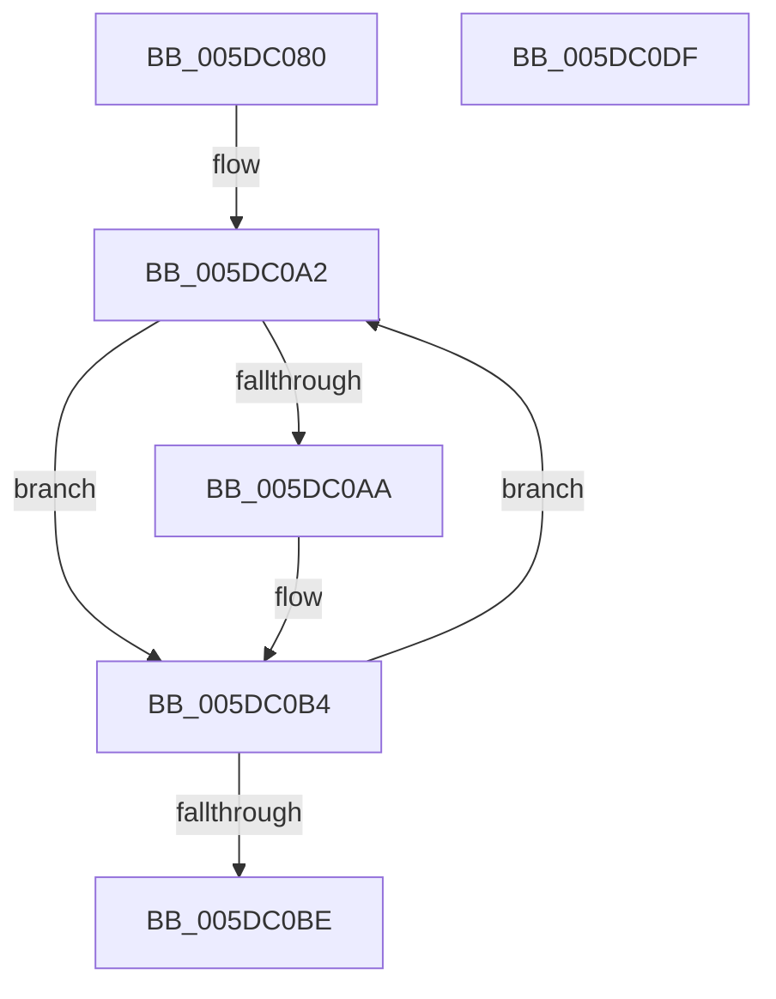

# PopIdleWakeDelayedWakeSourceReferencer

- RVA: `0x005DC080`–`0x005DC0E0` (길이 `96` bytes)
- VA: `0x00000001405DC080`
- 실행 섹션: `.text`
- PDB 이름 있음: `예`; PDB Function 태그: `아니요`
- unwind 정보 RVA: `0x00060BC4`
- 디코드: `26`개 명령, `96/96` bytes 표시
- 미해석 바이트: `0` (있으면 어셈블리에 `.byte`로 보존)

> 이 문서는 커널 이미지의 기계어와 PDB 기호를 분석해 생성했습니다. 4번과 5번은 함수 원형과 자료형을 바이너리 사용 방식에서 추정한 C 해석이며 원본 소스 복구 결과는 아닙니다.

## 1. Dependencies

- 직접 호출 지점: **2**; 고유 호출 대상: **2**
- 직접 호출자로 확인된 함수: **0**
- RIP 상대 이미지 참조: **0**

### Outgoing calls
- `0x005DC0AF` → [ObfReferenceObjectWithTag](../21/ObfReferenceObjectWithTag_function_00210710.md) (function, `0x00210710`)
- `0x005DC0CA` → [KeSetEvent](../33/KeSetEvent_function_0033F310.md) (function, `0x0033F310`)

### Direct callers
- 이 함수 시작 RVA로 연결되는 직접 call은 확인되지 않았습니다. 간접 호출은 완전히 역산할 수 없습니다.

### Static image references
- 디코드된 RIP-relative 메모리 참조가 없습니다.

## 2. Other-region calls and transfers

- 다른 실행 섹션으로 향하는 call: **0**
- 별도 외부 분기/꼬리 이동을 확인하지 못했습니다.

## 3. Assembly (complete function range)

```asm
005DC080  48 89 5C 24 08                  mov qword ptr [rsp + 8], rbx
005DC085  48 89 74 24 10                  mov qword ptr [rsp + 0x10], rsi
005DC08A  57                              push rdi
005DC08B  48 83 EC 20                     sub rsp, 0x20
005DC08F  48 8B 9A 18 95 00 00            mov rbx, qword ptr [rdx + 0x9518]
005DC096  48 8B F2                        mov rsi, rdx
005DC099  48 83 C3 18                     add rbx, 0x18
005DC09D  BF 03 00 00 00                  mov edi, 3
005DC0A2  48 8B 0B                        mov rcx, qword ptr [rbx]
005DC0A5  48 85 C9                        test rcx, rcx
005DC0A8  74 0A                           je 0x1405dc0b4
005DC0AA  BA 50 6F 44 67                  mov edx, 0x67446f50
005DC0AF  E8 5C 46 C3 FF                  call 0x140210710
005DC0B4  48 83 C3 08                     add rbx, 8
005DC0B8  48 83 EF 01                     sub rdi, 1
005DC0BC  75 E4                           jne 0x1405dc0a2
005DC0BE  48 8D 8E 00 95 00 00            lea rcx, [rsi + 0x9500]
005DC0C5  45 33 C0                        xor r8d, r8d
005DC0C8  33 D2                           xor edx, edx
005DC0CA  E8 41 32 D6 FF                  call 0x14033f310
005DC0CF  48 8B 5C 24 30                  mov rbx, qword ptr [rsp + 0x30]
005DC0D4  48 8B 74 24 38                  mov rsi, qword ptr [rsp + 0x38]
005DC0D9  48 83 C4 20                     add rsp, 0x20
005DC0DD  5F                              pop rdi
005DC0DE  C3                              ret
005DC0DF  CC                              int3
```

## 4. C-style interpretation (structured pseudocode)

```c
__int64 __fastcall PopIdleWakeDelayedWakeSourceReferencer(__int64 a1, __int64 a2, int a3)
{
    __int64 result;
    __int64 v_rbx;
    __int64 v_rdi;
    __int64 v_rsp;
    unsigned __int64 v_stack_p10;
    unsigned __int64 v_stack_p8;

    v_stack_p8 = v_rbx;
    v_stack_p10 = v_rsi;
    v_rsp = (v_rsp) - (32);
    v_rbx = (*(unsigned __int64 *)(a2 + 38168)) + (24);
loc_005DC0A2:
    if (*(unsigned __int64 *)(v_rbx) != 0) {
        a2 = 0x67446F50ULL;
        result = ObfReferenceObjectWithTag(*(unsigned __int64 *)(v_rbx), a2, a3, a4);
    }
    v_rbx = (v_rbx) + (8);
    v_rdi = (3) - (1);
    if (condition_is_not_equal) goto loc_005DC0A2;
    a3 = 0;
    a2 = 0;
    result = KeSetEvent(a2 + 38144, a2, a3, a4);
    v_rsp = (v_rsp) + (32);
    return result;
}
```

## 5. (Beta) C Style

```c
int64_t PopIdleWakeDelayedWakeSourceReferencer(int64_t Arg1, void *Arg2, int32_t Arg3)
{
    uint8_t *arg2 = (uint8_t *)Arg2;

    int64_t result;
    int64_t local_rbx;
    int64_t local_rdi;
    int64_t local_rsp;
    uint64_t v_stack_p10;
    uint64_t v_stack_p8;

    v_stack_p8 = local_rbx;
    v_stack_p10 = local_rsi;
    local_rsp = (local_rsp) - (32);
    local_rbx = (*(uint64_t *)(arg2 + 0x9518)) + (24);
loc_005DC0A2:
    if (*(uint64_t *)(local_rbx) != 0) {
        Arg2 = 0x67446F50ULL;
        result = ObfReferenceObjectWithTag(*(uint64_t *)(local_rbx), Arg2, Arg3, a4);
    }
    local_rbx = (local_rbx) + (8);
    local_rdi = (3) - (1);
    if (condition_is_not_equal) goto loc_005DC0A2;
    Arg3 = 0;
    Arg2 = 0;
    result = KeSetEvent(Arg2 + 38144, Arg2, Arg3, a4);
    local_rsp = (local_rsp) + (32);
    return result;
}
```

### 관측된 메모리 오프셋

구조체 형식이 확인되지 않은 접근은 인자 기준의 오프셋으로만 기록했습니다.

| 기준 인자 | 오프셋 표현 | 폭 (bit) | 접근 |
|---|---:|---:|---|
| `Arg2` | `+ 0x9500` | `64` | `R` |
| `Arg2` | `+ 0x9518` | `64` | `R` |

## 6. Execution-region graph

[열기: 2D/3D 그래프와 함수 탐색 컨트롤 패널](../../../control-panel.html?section=text&rva=0x005DC080&view=graph)

- 2D 그래프는 위에서 아래로 흐르고, 3D 그래프는 빈 공간을 드래그해 회전합니다. Shift+드래그는 이동, 휠은 확대·축소, 함수 노드 선택은 대상 보고서 이동입니다.

### Static fallback


