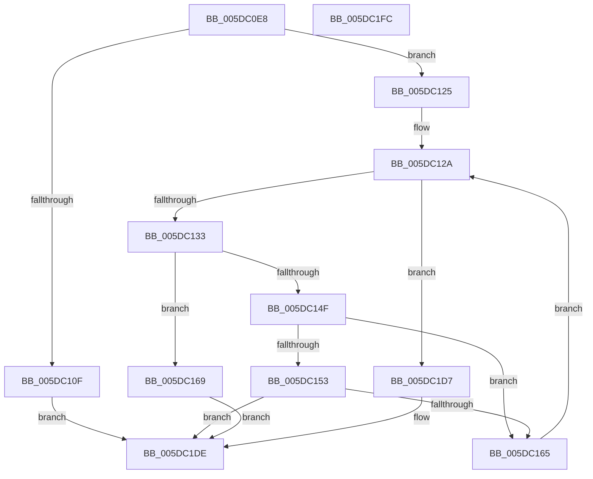

# PopIdleWakeFindOrAllocateWakeSource

- RVA: `0x005DC0E8`–`0x005DC1FD` (길이 `277` bytes)
- VA: `0x00000001405DC0E8`
- 실행 섹션: `.text`
- PDB 이름 있음: `예`; PDB Function 태그: `아니요`
- unwind 정보 RVA: `0x0005E6B4`
- 디코드: `74`개 명령, `277/277` bytes 표시
- 미해석 바이트: `0` (있으면 어셈블리에 `.byte`로 보존)

> 이 문서는 커널 이미지의 기계어와 PDB 기호를 분석해 생성했습니다. 4번과 5번은 함수 원형과 자료형을 바이너리 사용 방식에서 추정한 C 해석이며 원본 소스 복구 결과는 아닙니다.

## 1. Dependencies

- 직접 호출 지점: **2**; 고유 호출 대상: **2**
- 직접 호출자로 확인된 함수: **1**
- RIP 상대 이미지 참조: **0**

### Outgoing calls
- `0x005DC15C` → [PopIdleWakeAreIdenticalWakeSources](PopIdleWakeAreIdenticalWakeSources_function_005DBF08.md) (function, `0x005DBF08`)
- `0x005DC175` → [PopIdleWakeAssignAccountingToSource](PopIdleWakeAssignAccountingToSource_function_005DBFA8.md) (function, `0x005DBFA8`)

### Direct callers
- [PopIdleWakeNotifyWakeSource](PopIdleWakeNotifyWakeSource_function_005DC204.md) at `0x005DC2AB`

### Static image references
- 디코드된 RIP-relative 메모리 참조가 없습니다.

## 2. Other-region calls and transfers

- 다른 실행 섹션으로 향하는 call: **0**
- 별도 외부 분기/꼬리 이동을 확인하지 못했습니다.

## 3. Assembly (complete function range)

```asm
005DC0E8  48 8B C4                        mov rax, rsp
005DC0EB  48 89 58 08                     mov qword ptr [rax + 8], rbx
005DC0EF  48 89 68 10                     mov qword ptr [rax + 0x10], rbp
005DC0F3  48 89 70 18                     mov qword ptr [rax + 0x18], rsi
005DC0F7  48 89 78 20                     mov qword ptr [rax + 0x20], rdi
005DC0FB  41 56                           push r14
005DC0FD  48 83 EC 20                     sub rsp, 0x20
005DC101  48 63 F2                        movsxd rsi, edx
005DC104  4D 8B F0                        mov r14, r8
005DC107  48 8B E9                        mov rbp, rcx
005DC10A  83 FE 0B                        cmp esi, 0xb
005DC10D  77 16                           ja 0x1405dc125
005DC10F  48 69 DE A0 04 00 00            imul rbx, rsi, 0x4a0
005DC116  48 81 C3 90 00 00 00            add rbx, 0x90
005DC11D  48 03 D9                        add rbx, rcx
005DC120  E9 B9 00 00 00                  jmp 0x1405dc1de
005DC125  BF 0C 00 00 00                  mov edi, 0xc
005DC12A  83 FF 20                        cmp edi, 0x20
005DC12D  0F 83 A4 00 00 00               jae 0x1405dc1d7
005DC133  8B C7                           mov eax, edi
005DC135  48 69 D8 A0 04 00 00            imul rbx, rax, 0x4a0
005DC13C  48 81 C3 90 00 00 00            add rbx, 0x90
005DC143  48 03 DD                        add rbx, rbp
005DC146  8B 03                           mov eax, dword ptr [rbx]
005DC148  3D 82 00 00 00                  cmp eax, 0x82
005DC14D  74 1A                           je 0x1405dc169
005DC14F  3B F0                           cmp esi, eax
005DC151  75 12                           jne 0x1405dc165
005DC153  48 8D 53 08                     lea rdx, [rbx + 8]
005DC157  4D 8B C6                        mov r8, r14
005DC15A  8B CE                           mov ecx, esi
005DC15C  E8 A7 FD FF FF                  call 0x1405dbf08
005DC161  84 C0                           test al, al
005DC163  75 79                           jne 0x1405dc1de
005DC165  FF C7                           inc edi
005DC167  EB C1                           jmp 0x1405dc12a
005DC169  4D 8B CE                        mov r9, r14
005DC16C  44 8B C6                        mov r8d, esi
005DC16F  48 8B D3                        mov rdx, rbx
005DC172  48 8B CD                        mov rcx, rbp
005DC175  E8 2E FE FF FF                  call 0x1405dbfa8
005DC17A  89 33                           mov dword ptr [rbx], esi
005DC17C  48 8D 4B 08                     lea rcx, [rbx + 8]
005DC180  41 0F 10 06                     movups xmm0, xmmword ptr [r14]
005DC184  B8 80 00 00 00                  mov eax, 0x80
005DC189  0F 11 01                        movups xmmword ptr [rcx], xmm0
005DC18C  41 0F 10 4E 10                  movups xmm1, xmmword ptr [r14 + 0x10]
005DC191  0F 11 49 10                     movups xmmword ptr [rcx + 0x10], xmm1
005DC195  41 0F 10 46 20                  movups xmm0, xmmword ptr [r14 + 0x20]
005DC19A  0F 11 41 20                     movups xmmword ptr [rcx + 0x20], xmm0
005DC19E  41 0F 10 4E 30                  movups xmm1, xmmword ptr [r14 + 0x30]
005DC1A3  0F 11 49 30                     movups xmmword ptr [rcx + 0x30], xmm1
005DC1A7  41 0F 10 46 40                  movups xmm0, xmmword ptr [r14 + 0x40]
005DC1AC  0F 11 41 40                     movups xmmword ptr [rcx + 0x40], xmm0
005DC1B0  41 0F 10 4E 50                  movups xmm1, xmmword ptr [r14 + 0x50]
005DC1B5  0F 11 49 50                     movups xmmword ptr [rcx + 0x50], xmm1
005DC1B9  41 0F 10 46 60                  movups xmm0, xmmword ptr [r14 + 0x60]
005DC1BE  0F 11 41 60                     movups xmmword ptr [rcx + 0x60], xmm0
005DC1C2  48 03 C8                        add rcx, rax
005DC1C5  41 0F 10 46 70                  movups xmm0, xmmword ptr [r14 + 0x70]
005DC1CA  0F 11 41 F0                     movups xmmword ptr [rcx - 0x10], xmm0
005DC1CE  49 8B 04 06                     mov rax, qword ptr [r14 + rax]
005DC1D2  48 89 01                        mov qword ptr [rcx], rax
005DC1D5  EB 07                           jmp 0x1405dc1de
005DC1D7  48 8D 9D 10 13 00 00            lea rbx, [rbp + 0x1310]
005DC1DE  48 8B 6C 24 38                  mov rbp, qword ptr [rsp + 0x38]
005DC1E3  48 8B C3                        mov rax, rbx
005DC1E6  48 8B 5C 24 30                  mov rbx, qword ptr [rsp + 0x30]
005DC1EB  48 8B 74 24 40                  mov rsi, qword ptr [rsp + 0x40]
005DC1F0  48 8B 7C 24 48                  mov rdi, qword ptr [rsp + 0x48]
005DC1F5  48 83 C4 20                     add rsp, 0x20
005DC1F9  41 5E                           pop r14
005DC1FB  C3                              ret
005DC1FC  CC                              int3
```

## 4. C-style interpretation (structured pseudocode)

```c
__int64 __fastcall PopIdleWakeFindOrAllocateWakeSource(__int64 a1, int a2, __int64 a3)
{
    __int64 result;
    __int64 v_rbx;
    __int64 v_rdi;
    __int64 v_rsp;
    unsigned __int64 v_stack_p10;
    unsigned __int64 v_stack_p18;
    unsigned __int64 v_stack_p20;
    unsigned __int64 v_stack_p8;

    *(unsigned __int64 *)(v_rsp + 8) = v_rbx;
    *(unsigned __int64 *)(v_rsp + 16) = v_rbp;
    *(unsigned __int64 *)(v_rsp + 24) = v_rsi;
    *(unsigned __int64 *)(v_rsp + 32) = v_rdi;
    v_rsp = (v_rsp) - (32);
    if (((unsigned int)((int)(a2))) > 11) goto loc_005DC125;
    v_rbx = (v_rbx) * ((int)(a2));
    v_rbx = (v_rbx) + (144);
    v_rbx = (v_rbx) + (a1);
    goto loc_005DC1DE;
loc_005DC125:
loc_005DC12A:
    if (12 >= 32) goto loc_005DC1D7;
    v_rbx = (v_rbx) * (12);
    v_rbx = (v_rbx) + (144);
    v_rbx = (v_rbx) + (a1);
    if (((unsigned int)((unsigned int)(*(unsigned int *)(v_rbx)))) == 130) goto loc_005DC169;
    if (((unsigned int)((int)(a2))) != ((unsigned int)((unsigned int)(*(unsigned int *)(v_rbx))))) goto loc_005DC165;
    result = PopIdleWakeAreIdenticalWakeSources((unsigned int)((unsigned int)((int)(a2))), v_rbx + 8, a3, a4);
    if ((unsigned __int8)(result) != 0) goto loc_005DC1DE;
loc_005DC165:
    v_rdi = (unsigned int)((12) + 1);
    goto loc_005DC12A;
loc_005DC169:
    result = PopIdleWakeAssignAccountingToSource(a1, v_rbx, (unsigned int)((unsigned int)((int)(a2))), a3);
    *(unsigned int *)(v_rbx) = (unsigned int)((int)(a2));
    *(unsigned __int64 *)(v_rbx + 8) = v_xmm0;
    *(unsigned __int64 *)(v_rbx + 8 + 16) = v_xmm1;
    *(unsigned __int64 *)(v_rbx + 8 + 32) = v_xmm0;
    *(unsigned __int64 *)(v_rbx + 8 + 48) = v_xmm1;
    *(unsigned __int64 *)(v_rbx + 8 + 64) = v_xmm0;
    *(unsigned __int64 *)(v_rbx + 8 + 80) = v_xmm1;
    *(unsigned __int64 *)(v_rbx + 8 + 96) = v_xmm0;
    a1 = (v_rbx + 8) + (128);
    *(unsigned __int64 *)(a1 - 16) = v_xmm0;
    *(unsigned __int64 *)(a1) = *(unsigned __int64 *)(a3 + 128 * 1);
    goto loc_005DC1DE;
loc_005DC1D7:
loc_005DC1DE:
    v_rsp = (v_rsp) + (32);
    return a1 + 4880;
}
```

## 5. (Beta) C Style

```c
void *PopIdleWakeFindOrAllocateWakeSource(void *Arg1, int32_t Arg2, void *Arg3)
{
    uint8_t *arg1 = (uint8_t *)Arg1;
    uint8_t *arg3 = (uint8_t *)Arg3;

    int64_t result;
    int64_t local_rbx;
    int64_t local_rdi;
    int64_t local_rsp;
    uint64_t v_stack_p10;
    uint64_t v_stack_p18;
    uint64_t v_stack_p20;
    uint64_t v_stack_p8;

    *(uint64_t *)(local_rsp + 0x8) = local_rbx;
    *(uint64_t *)(local_rsp + 0x10) = local_rbp;
    *(uint64_t *)(local_rsp + 0x18) = local_rsi;
    *(uint64_t *)(local_rsp + 0x20) = local_rdi;
    local_rsp = (local_rsp) - (32);
    if (((uint32_t)((int32_t)(Arg2))) > 11) goto loc_005DC125;
    local_rbx = (local_rbx) * ((int32_t)(Arg2));
    local_rbx = (local_rbx) + (144);
    local_rbx = (local_rbx) + (Arg1);
    goto loc_005DC1DE;
loc_005DC125:
loc_005DC12A:
    if (12 >= 32) goto loc_005DC1D7;
    local_rbx = (local_rbx) * (12);
    local_rbx = (local_rbx) + (144);
    local_rbx = (local_rbx) + (Arg1);
    if (((uint32_t)((uint32_t)(*(uint32_t *)(local_rbx)))) == 130) goto loc_005DC169;
    if (((uint32_t)((int32_t)(Arg2))) != ((uint32_t)((uint32_t)(*(uint32_t *)(local_rbx))))) goto loc_005DC165;
    result = PopIdleWakeAreIdenticalWakeSources((uint32_t)((uint32_t)((int32_t)(Arg2))), local_rbx + 8, Arg3, a4);
    if ((uint8_t)(result) != 0) goto loc_005DC1DE;
loc_005DC165:
    local_rdi = (uint32_t)((12) + 1);
    goto loc_005DC12A;
loc_005DC169:
    result = PopIdleWakeAssignAccountingToSource(Arg1, local_rbx, (uint32_t)((uint32_t)((int32_t)(Arg2))), Arg3);
    *(uint32_t *)(local_rbx) = (uint32_t)((int32_t)(Arg2));
    *(uint64_t *)(local_rbx + 0x8) = v_xmm0;
    *(uint64_t *)(local_rbx + 0x8 + 0x10) = v_xmm1;
    *(uint64_t *)(local_rbx + 0x8 + 0x20) = v_xmm0;
    *(uint64_t *)(local_rbx + 0x8 + 0x30) = v_xmm1;
    *(uint64_t *)(local_rbx + 0x8 + 0x40) = v_xmm0;
    *(uint64_t *)(local_rbx + 0x8 + 0x50) = v_xmm1;
    *(uint64_t *)(local_rbx + 0x8 + 0x60) = v_xmm0;
    Arg1 = (local_rbx + 8) + (128);
    *(uint64_t *)(arg1 - 0x10) = v_xmm0;
    *(uint64_t *)(arg1) = *(uint64_t *)(arg3 + 0x80 * 1);
    goto loc_005DC1DE;
loc_005DC1D7:
loc_005DC1DE:
    local_rsp = (local_rsp) + (32);
    return Arg1 + 4880;
}
```

### 관측된 메모리 오프셋

구조체 형식이 확인되지 않은 접근은 인자 기준의 오프셋으로만 기록했습니다.

| 기준 인자 | 오프셋 표현 | 폭 (bit) | 접근 |
|---|---:|---:|---|
| `Arg1` | `+ 0x1310` | `64` | `R` |
| `Arg3` | `+ 0x0` | `128` | `R` |
| `Arg3` | `+ 0x0 + rax*1` | `64` | `R` |
| `Arg3` | `+ 0x10` | `128` | `R` |
| `Arg3` | `+ 0x20` | `128` | `R` |
| `Arg3` | `+ 0x30` | `128` | `R` |
| `Arg3` | `+ 0x40` | `128` | `R` |
| `Arg3` | `+ 0x50` | `128` | `R` |
| `Arg3` | `+ 0x60` | `128` | `R` |
| `Arg3` | `+ 0x70` | `128` | `R` |

## 6. Execution-region graph

[열기: 2D/3D 그래프와 함수 탐색 컨트롤 패널](../../../control-panel.html?section=text&rva=0x005DC0E8&view=graph)

- 2D 그래프는 위에서 아래로 흐르고, 3D 그래프는 빈 공간을 드래그해 회전합니다. Shift+드래그는 이동, 휠은 확대·축소, 함수 노드 선택은 대상 보고서 이동입니다.

### Static fallback


