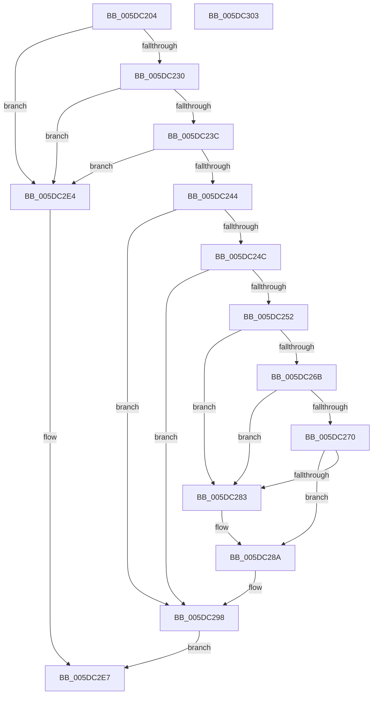

# PopIdleWakeNotifyWakeSource

- RVA: `0x005DC204`–`0x005DC304` (길이 `256` bytes)
- VA: `0x00000001405DC204`
- 실행 섹션: `.text`
- PDB 이름 있음: `예`; PDB Function 태그: `아니요`
- unwind 정보 RVA: `0x0005C954`
- 디코드: `65`개 명령, `256/256` bytes 표시
- 미해석 바이트: `0` (있으면 어셈블리에 `.byte`로 보존)

> 이 문서는 커널 이미지의 기계어와 PDB 기호를 분석해 생성했습니다. 4번과 5번은 함수 원형과 자료형을 바이너리 사용 방식에서 추정한 C 해석이며 원본 소스 복구 결과는 아닙니다.

## 1. Dependencies

- 직접 호출 지점: **4**; 고유 호출 대상: **4**
- 직접 호출자로 확인된 함수: **1**
- RIP 상대 이미지 참조: **5**

### Outgoing calls
- `0x005DC293` → [RtlStringCbCopyW](../43/RtlStringCbCopyW_function_0043B910.md) (function, `0x0043B910`)
- `0x005DC29E` → [PopIdleWakeStopActiveIntervalAccounting](../4B/PopIdleWakeStopActiveIntervalAccounting_function_004B40D4.md) (function, `0x004B40D4`)
- `0x005DC2AB` → [PopIdleWakeFindOrAllocateWakeSource](PopIdleWakeFindOrAllocateWakeSource_function_005DC0E8.md) (function, `0x005DC0E8`)
- `0x005DC2CD` → [KeGetCurrentProcessorNumberEx](../40/KeGetCurrentProcessorNumberEx_function_00401690.md) (function, `0x00401690`)

### Direct callers
- [sub_006DD378](../6D/Unknown_function_006DD378.md) at `0x006DD5E7`

### Static image references
- `0x005DC218` → RVA `0x00F08280` (`.data`; read)
- `0x005DC230` → RVA `0x00E0B3B4` (`.data`; read)
- `0x005DC25F` → RVA `0x00F0E820` (`.data`; read)
- `0x005DC277` → RVA `0x00F0E7A0` (`.data`; read)
- `0x005DC283` → RVA `0x006CB480` (` ?? ::FNODOBFM::`string'`; read)

## 2. Other-region calls and transfers

- 다른 실행 섹션으로 향하는 call: **0**
- 별도 외부 분기/꼬리 이동을 확인하지 못했습니다.

## 3. Assembly (complete function range)

```asm
005DC204  48 89 5C 24 08                  mov qword ptr [rsp + 8], rbx
005DC209  48 89 6C 24 10                  mov qword ptr [rsp + 0x10], rbp
005DC20E  48 89 74 24 18                  mov qword ptr [rsp + 0x18], rsi
005DC213  57                              push rdi
005DC214  48 83 EC 20                     sub rsp, 0x20
005DC218  48 8B 1D 61 C0 92 00            mov rbx, qword ptr [rip + 0x92c061]
005DC21F  49 8B E9                        mov rbp, r9
005DC222  49 8B F0                        mov rsi, r8
005DC225  8B FA                           mov edi, edx
005DC227  48 85 DB                        test rbx, rbx
005DC22A  0F 84 B4 00 00 00               je 0x1405dc2e4
005DC230  3B 0D 7E F1 82 00               cmp ecx, dword ptr [rip + 0x82f17e]
005DC236  0F 85 A8 00 00 00               jne 0x1405dc2e4
005DC23C  85 D2                           test edx, edx
005DC23E  0F 88 A0 00 00 00               js 0x1405dc2e4
005DC244  81 FA 81 00 00 00               cmp edx, 0x81
005DC24A  75 4C                           jne 0x1405dc298
005DC24C  41 80 38 03                     cmp byte ptr [r8], 3
005DC250  75 46                           jne 0x1405dc298
005DC252  48 B8 14 00 00 00 80 F7 FF FF   movabs rax, 0xfffff78000000014
005DC25C  48 8B 00                        mov rax, qword ptr [rax]
005DC25F  48 8B 0D BA 25 93 00            mov rcx, qword ptr [rip + 0x9325ba]
005DC266  48 85 C9                        test rcx, rcx
005DC269  74 18                           je 0x1405dc283
005DC26B  48 3B C1                        cmp rax, rcx
005DC26E  72 13                           jb 0x1405dc283
005DC270  48 81 C1 00 2D 31 01            add rcx, 0x1312d00
005DC277  4C 8D 05 22 25 93 00            lea r8, [rip + 0x932522]
005DC27E  48 3B C8                        cmp rcx, rax
005DC281  73 07                           jae 0x1405dc28a
005DC283  4C 8D 05 F6 F1 0E 00            lea r8, [rip + 0xef1f6]
005DC28A  48 8D 4E 02                     lea rcx, [rsi + 2]
005DC28E  BA 80 00 00 00                  mov edx, 0x80
005DC293  E8 78 F6 E5 FF                  call 0x14043b910
005DC298  48 8B D5                        mov rdx, rbp
005DC29B  48 8B CB                        mov rcx, rbx
005DC29E  E8 31 7E ED FF                  call 0x1404b40d4
005DC2A3  4C 8B C6                        mov r8, rsi
005DC2A6  8B D7                           mov edx, edi
005DC2A8  48 8B CB                        mov rcx, rbx
005DC2AB  E8 38 FE FF FF                  call 0x1405dc0e8
005DC2B0  48 8B 4C 24 50                  mov rcx, qword ptr [rsp + 0x50]
005DC2B5  48 89 43 28                     mov qword ptr [rbx + 0x28], rax
005DC2B9  48 8B C1                        mov rax, rcx
005DC2BC  48 2B C5                        sub rax, rbp
005DC2BF  48 89 4B 30                     mov qword ptr [rbx + 0x30], rcx
005DC2C3  48 89 4B 08                     mov qword ptr [rbx + 8], rcx
005DC2C7  33 C9                           xor ecx, ecx
005DC2C9  48 89 43 38                     mov qword ptr [rbx + 0x38], rax
005DC2CD  E8 BE 53 E2 FF                  call 0x140401690
005DC2D2  83 0B 10                        or dword ptr [rbx], 0x10
005DC2D5  89 43 40                        mov dword ptr [rbx + 0x40], eax
005DC2D8  48 8B 43 28                     mov rax, qword ptr [rbx + 0x28]
005DC2DC  8B 88 98 01 00 00               mov ecx, dword ptr [rax + 0x198]
005DC2E2  EB 03                           jmp 0x1405dc2e7
005DC2E4  83 C9 FF                        or ecx, 0xffffffff
005DC2E7  48 8B 44 24 58                  mov rax, qword ptr [rsp + 0x58]
005DC2EC  89 08                           mov dword ptr [rax], ecx
005DC2EE  48 8B 5C 24 30                  mov rbx, qword ptr [rsp + 0x30]
005DC2F3  48 8B 6C 24 38                  mov rbp, qword ptr [rsp + 0x38]
005DC2F8  48 8B 74 24 40                  mov rsi, qword ptr [rsp + 0x40]
005DC2FD  48 83 C4 20                     add rsp, 0x20
005DC301  5F                              pop rdi
005DC302  C3                              ret
005DC303  CC                              int3
```

## 4. C-style interpretation (structured pseudocode)

```c
__int64 __fastcall PopIdleWakeNotifyWakeSource(int a1, int a2, __int64 a3, __int64 a4, __int64 a5, __int64 a6)
{
    __int64 result;
    __int64 v_rsp;
    unsigned __int64 v_stack_p10;
    unsigned __int64 v_stack_p18;
    unsigned __int64 v_stack_p8;

    v_stack_p8 = v_rbx;
    v_stack_p10 = v_rbp;
    v_stack_p18 = v_rsi;
    v_rsp = (v_rsp) - (32);
    if (*(unsigned __int64 *)(v_rip + 9617505) == 0) goto loc_005DC2E4;
    if (a1 != (*(unsigned int *)(v_rip + 8581502))) goto loc_005DC2E4;
    if (sign_flag) goto loc_005DC2E4;
    if (a2 != 129) goto loc_005DC298;
    if ((*(unsigned __int8 *)(a3)) != 3) goto loc_005DC298;
    if (*(unsigned __int64 *)(v_rip + 9643450) == 0) goto loc_005DC283;
    if ((*(unsigned __int64 *)(result)) < (*(unsigned __int64 *)(v_rip + 9643450))) goto loc_005DC283;
    a1 = (*(unsigned __int64 *)(v_rip + 9643450)) + (0x1312D00ULL);
    if (a1 < (*(unsigned __int64 *)(result))) {
        a3 = v_rip + 979446;
    }
    result = RtlStringCbCopyW(a3 + 2, 128, a3, a4);
loc_005DC298:
    result = PopIdleWakeStopActiveIntervalAccounting(*(unsigned __int64 *)(v_rip + 9617505), a4, a3, a4);
    result = PopIdleWakeFindOrAllocateWakeSource(*(unsigned __int64 *)(v_rip + 9617505), (unsigned int)((unsigned int)((unsigned int)(a2))), a3, a4);
    *(unsigned __int64 *)(*(unsigned __int64 *)(v_rip + 9617505) + 40) = result;
    result = (a5) - (a4);
    *(unsigned __int64 *)(*(unsigned __int64 *)(v_rip + 9617505) + 48) = a5;
    *(unsigned __int64 *)(*(unsigned __int64 *)(v_rip + 9617505) + 8) = a5;
    a1 = 0;
    *(unsigned __int64 *)(*(unsigned __int64 *)(v_rip + 9617505) + 56) = result;
    result = KeGetCurrentProcessorNumberEx(a1, (unsigned int)((unsigned int)((unsigned int)(a2))), a3, a4);
    *(unsigned int *)(*(unsigned __int64 *)(v_rip + 9617505) + 64) = (unsigned int)(result);
    goto loc_005DC2E7;
loc_005DC2E4:
    a1 = (unsigned int)(((unsigned int)(*(unsigned int *)(*(unsigned __int64 *)(*(unsigned __int64 *)(v_rip + 9617505) + 40) + 408))) | (0xFFFFFFFFULL));
loc_005DC2E7:
    *(unsigned int *)(a6) = a1;
    v_rsp = (v_rsp) + (32);
    return a6;
}
```

## 5. (Beta) C Style

```c
void *PopIdleWakeNotifyWakeSource(int32_t Arg1, int32_t Arg2, void *Arg3, int64_t Arg4, int64_t Arg5, void *Arg6)
{
    uint8_t *arg3 = (uint8_t *)Arg3;
    uint8_t *arg6 = (uint8_t *)Arg6;

    int64_t result;
    int64_t local_rsp;
    uint64_t v_stack_p10;
    uint64_t v_stack_p18;
    uint64_t v_stack_p8;

    v_stack_p8 = local_rbx;
    v_stack_p10 = local_rbp;
    v_stack_p18 = local_rsi;
    local_rsp = (local_rsp) - (32);
    if (*(uint64_t *)(v_rip + 0x92C061) == 0) goto loc_005DC2E4;
    if (Arg1 != (*(uint32_t *)(v_rip + 0x82F17E))) goto loc_005DC2E4;
    if (sign_flag) goto loc_005DC2E4;
    if (Arg2 != 129) goto loc_005DC298;
    if ((*(uint8_t *)(arg3)) != 3) goto loc_005DC298;
    if (*(uint64_t *)(v_rip + 0x9325BA) == 0) goto loc_005DC283;
    if ((*(uint64_t *)(result)) < (*(uint64_t *)(v_rip + 0x9325BA))) goto loc_005DC283;
    Arg1 = (*(uint64_t *)(v_rip + 0x9325BA)) + (0x1312D00ULL);
    if (Arg1 < (*(uint64_t *)(result))) {
        Arg3 = v_rip + 979446;
    }
    result = RtlStringCbCopyW(Arg3 + 2, 128, Arg3, Arg4);
loc_005DC298:
    result = PopIdleWakeStopActiveIntervalAccounting(*(uint64_t *)(v_rip + 0x92C061), Arg4, Arg3, Arg4);
    result = PopIdleWakeFindOrAllocateWakeSource(*(uint64_t *)(v_rip + 0x92C061), (uint32_t)((uint32_t)((uint32_t)(Arg2))), Arg3, Arg4);
    *(uint64_t *)(*(uint64_t *)(v_rip + 0x92C061) + 0x28) = result;
    result = (Arg5) - (Arg4);
    *(uint64_t *)(*(uint64_t *)(v_rip + 0x92C061) + 0x30) = Arg5;
    *(uint64_t *)(*(uint64_t *)(v_rip + 0x92C061) + 0x8) = Arg5;
    Arg1 = 0;
    *(uint64_t *)(*(uint64_t *)(v_rip + 0x92C061) + 0x38) = result;
    result = KeGetCurrentProcessorNumberEx(Arg1, (uint32_t)((uint32_t)((uint32_t)(Arg2))), Arg3, Arg4);
    *(uint32_t *)(*(uint64_t *)(v_rip + 0x92C061) + 0x40) = (uint32_t)(result);
    goto loc_005DC2E7;
loc_005DC2E4:
    Arg1 = (uint32_t)(((uint32_t)(*(uint32_t *)(*(uint64_t *)(*(uint64_t *)(v_rip + 0x92C061) + 0x28) + 0x198))) | (0xFFFFFFFFULL));
loc_005DC2E7:
    *(uint32_t *)(arg6) = Arg1;
    local_rsp = (local_rsp) + (32);
    return Arg6;
}
```

### 관측된 메모리 오프셋

구조체 형식이 확인되지 않은 접근은 인자 기준의 오프셋으로만 기록했습니다.

| 기준 인자 | 오프셋 표현 | 폭 (bit) | 접근 |
|---|---:|---:|---|
| `Arg3` | `+ 0x0` | `8` | `R` |
| `Arg3` | `+ 0x2` | `64` | `R` |
| `Arg6` | `+ 0x0` | `32` | `W` |

## 6. Execution-region graph

[열기: 2D/3D 그래프와 함수 탐색 컨트롤 패널](../../../control-panel.html?section=text&rva=0x005DC204&view=graph)

- 2D 그래프는 위에서 아래로 흐르고, 3D 그래프는 빈 공간을 드래그해 회전합니다. Shift+드래그는 이동, 휠은 확대·축소, 함수 노드 선택은 대상 보고서 이동입니다.

### Static fallback


