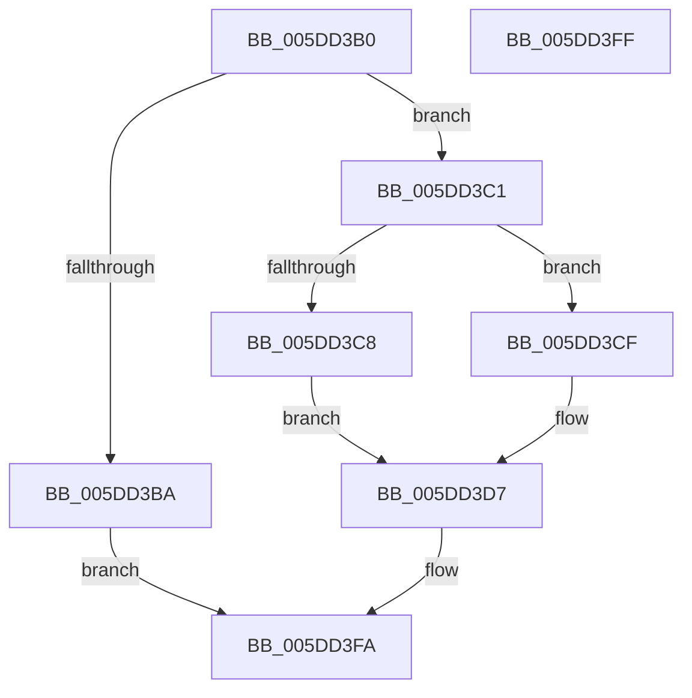

# PopIntSteerSetMode

- RVA: `0x005DD3B0`–`0x005DD400` (길이 `80` bytes)
- VA: `0x00000001405DD3B0`
- 실행 섹션: `.text`
- PDB 이름 있음: `예`; PDB Function 태그: `아니요`
- unwind 정보 RVA: `0x0005C788`
- 디코드: `22`개 명령, `80/80` bytes 표시
- 미해석 바이트: `0` (있으면 어셈블리에 `.byte`로 보존)

> 이 문서는 커널 이미지의 기계어와 PDB 기호를 분석해 생성했습니다. 4번과 5번은 함수 원형과 자료형을 바이너리 사용 방식에서 추정한 C 해석이며 원본 소스 복구 결과는 아닙니다.

## 1. Dependencies

- 직접 호출 지점: **3**; 고유 호출 대상: **3**
- 직접 호출자로 확인된 함수: **0**
- RIP 상대 이미지 참조: **3**

### Outgoing calls
- `0x005DD3E4` → [PpmAcquireLock](../2D/PpmAcquireLock_function_002D9AA4.md) (function, `0x002D9AA4`)
- `0x005DD3E9` → [PpmCheckReInit](../../page/A8/PpmCheckReInit_function_00A84DD8.md) (function, `0x00A84DD8`)
- `0x005DD3F3` → [PpmCheckCustomRun](../3B/PpmCheckCustomRun_function_003BEC2C.md) (function, `0x003BEC2C`)

### Direct callers
- 이 함수 시작 RVA로 연결되는 직접 call은 확인되지 않았습니다. 간접 호출은 완전히 역산할 수 없습니다.

### Static image references
- `0x005DD3CF` → RVA `0x00E67A68` (`.data`; write)
- `0x005DD3D7` → RVA `0x00F0CC00` (`.data`; read)
- `0x005DD3DE` → RVA `0x00E67A6C` (`.data`; write)

## 2. Other-region calls and transfers

- 다른 실행 섹션으로 향하는 call: **1**
  - `0x005DD3E9` → [PpmCheckReInit](../../page/A8/PpmCheckReInit_function_00A84DD8.md) (`.text` → `PAGE`)
- 별도 외부 분기/꼬리 이동을 확인하지 못했습니다.

## 3. Assembly (complete function range)

```asm
005DD3B0  48 83 EC 28                     sub rsp, 0x28
005DD3B4  41 83 F8 04                     cmp r8d, 4
005DD3B8  74 07                           je 0x1405dd3c1
005DD3BA  B8 0D 00 00 C0                  mov eax, 0xc000000d
005DD3BF  EB 39                           jmp 0x1405dd3fa
005DD3C1  8B 02                           mov eax, dword ptr [rdx]
005DD3C3  83 F8 04                        cmp eax, 4
005DD3C6  75 07                           jne 0x1405dd3cf
005DD3C8  B8 01 00 00 00                  mov eax, 1
005DD3CD  EB 08                           jmp 0x1405dd3d7
005DD3CF  89 05 93 A6 88 00               mov dword ptr [rip + 0x88a693], eax
005DD3D5  33 C0                           xor eax, eax
005DD3D7  48 8D 0D 22 F8 92 00            lea rcx, [rip + 0x92f822]
005DD3DE  89 05 88 A6 88 00               mov dword ptr [rip + 0x88a688], eax
005DD3E4  E8 BB C6 CF FF                  call 0x1402d9aa4
005DD3E9  E8 EA 79 4A 00                  call 0x140a84dd8
005DD3EE  B9 04 00 00 00                  mov ecx, 4
005DD3F3  E8 34 18 DE FF                  call 0x1403bec2c
005DD3F8  33 C0                           xor eax, eax
005DD3FA  48 83 C4 28                     add rsp, 0x28
005DD3FE  C3                              ret
005DD3FF  CC                              int3
```

## 4. C-style interpretation (structured pseudocode)

```c
__int64 __fastcall PopIntSteerSetMode(__int64 a1, __int64 a2, int a3)
{
    __int64 result;
    __int64 v_rsp;

    v_rsp = (v_rsp) - (40);
    if (a3 == 4) goto loc_005DD3C1;
    goto loc_005DD3FA;
loc_005DD3C1:
    if (((unsigned int)((unsigned int)(*(unsigned int *)(a2)))) != 4) goto loc_005DD3CF;
    goto loc_005DD3D7;
loc_005DD3CF:
    *(unsigned int *)(v_rip + 8955539) = 1;
    result = 0;
loc_005DD3D7:
    *(unsigned int *)(v_rip + 8955528) = 0;
    result = PpmAcquireLock(v_rip + 9631778, a2, a3, a4);
    result = PpmCheckReInit(v_rip + 9631778, a2, a3, a4);
    result = PpmCheckCustomRun(4, a2, a3, a4);
    result = 0;
loc_005DD3FA:
    v_rsp = (v_rsp) + (40);
    return result;
}
```

## 5. (Beta) C Style

```c
int64_t PopIntSteerSetMode(int64_t Arg1, void *Arg2, int32_t Arg3)
{
    uint8_t *arg2 = (uint8_t *)Arg2;

    int64_t result;
    int64_t local_rsp;

    local_rsp = (local_rsp) - (40);
    if (Arg3 == 4) goto loc_005DD3C1;
    goto loc_005DD3FA;
loc_005DD3C1:
    if (((uint32_t)((uint32_t)(*(uint32_t *)(arg2)))) != 4) goto loc_005DD3CF;
    goto loc_005DD3D7;
loc_005DD3CF:
    *(uint32_t *)(v_rip + 0x88A693) = 1;
    result = 0;
loc_005DD3D7:
    *(uint32_t *)(v_rip + 0x88A688) = 0;
    result = PpmAcquireLock(v_rip + 9631778, Arg2, Arg3, a4);
    result = PpmCheckReInit(v_rip + 9631778, Arg2, Arg3, a4);
    result = PpmCheckCustomRun(4, Arg2, Arg3, a4);
    result = 0;
loc_005DD3FA:
    local_rsp = (local_rsp) + (40);
    return result;
}
```

### 관측된 메모리 오프셋

구조체 형식이 확인되지 않은 접근은 인자 기준의 오프셋으로만 기록했습니다.

| 기준 인자 | 오프셋 표현 | 폭 (bit) | 접근 |
|---|---:|---:|---|
| `Arg2` | `+ 0x0` | `32` | `R` |

## 6. Execution-region graph

[열기: 2D/3D 그래프와 함수 탐색 컨트롤 패널](../../../control-panel.html?section=text&rva=0x005DD3B0&view=graph)

- 2D 그래프는 위에서 아래로 흐르고, 3D 그래프는 빈 공간을 드래그해 회전합니다. Shift+드래그는 이동, 휠은 확대·축소, 함수 노드 선택은 대상 보고서 이동입니다.

### Static fallback


