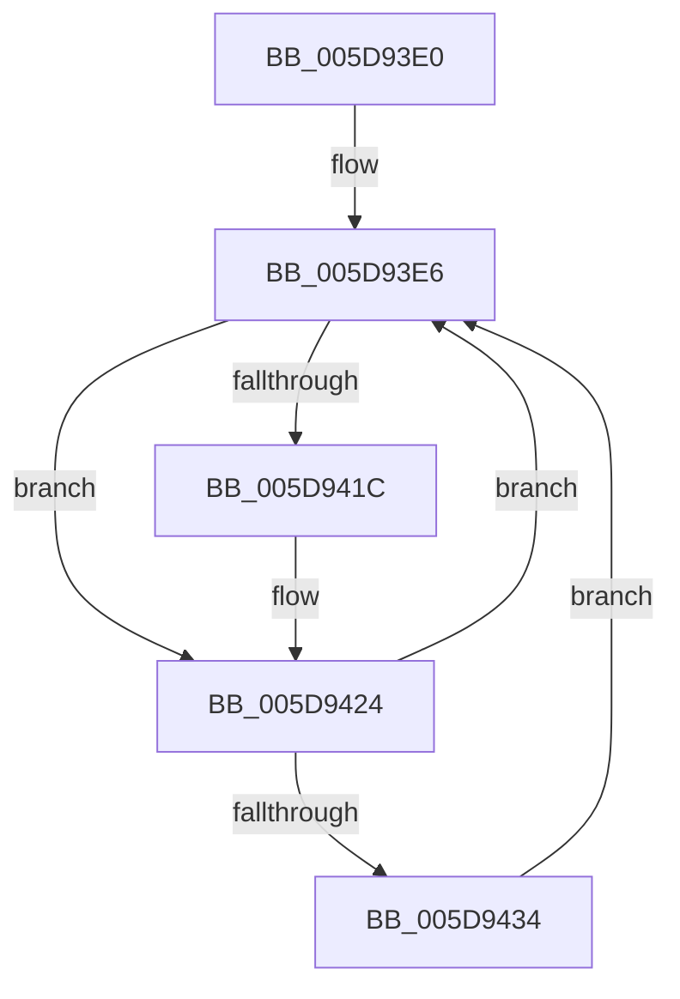

# PopIrpWorkerControl

- RVA: `0x005D93E0`–`0x005D943D` (길이 `93` bytes)
- VA: `0x00000001405D93E0`
- 실행 섹션: `.text`
- PDB 이름 있음: `예`; PDB Function 태그: `아니요`
- unwind 정보 RVA: `0x000C8648`
- 디코드: `23`개 명령, `93/93` bytes 표시
- 미해석 바이트: `0` (있으면 어셈블리에 `.byte`로 보존)

> 이 문서는 커널 이미지의 기계어와 PDB 기호를 분석해 생성했습니다. 4번과 5번은 함수 원형과 자료형을 바이너리 사용 방식에서 추정한 C 해석이며 원본 소스 복구 결과는 아닙니다.

## 1. Dependencies

- 직접 호출 지점: **4**; 고유 호출 대상: **4**
- 직접 호출자로 확인된 함수: **0**
- RIP 상대 이미지 참조: **5**

### Outgoing calls
- `0x005D93FD` → [KeWaitForSingleObject](../20/KeWaitForSingleObject_function_0020E6B0.md) (function, `0x0020E6B0`)
- `0x005D9409` → [ExAcquireFastMutex](../20/ExAcquireFastMutex_function_0020E5A0.md) (function, `0x0020E5A0`)
- `0x005D942B` → [ExReleaseFastMutex](../25/ExReleaseFastMutex_function_002519C0.md) (function, `0x002519C0`)
- `0x005D9436` → [PopCreateDynamicIrpWorker](../4A/PopCreateDynamicIrpWorker_function_004A175C.md) (function, `0x004A175C`)

### Direct callers
- 이 함수 시작 RVA로 연결되는 직접 call은 확인되지 않았습니다. 간접 호출은 완전히 역산할 수 없습니다.

### Static image references
- `0x005D93EC` → RVA `0x00F09180` (`.data`; read)
- `0x005D9402` → RVA `0x00F091A0` (`.data`; read)
- `0x005D940E` → RVA `0x00F091D8` (`.data`; read)
- `0x005D9414` → RVA `0x00F091E0` (`.data`; write)
- `0x005D941C` → RVA `0x00F091DC` (`.data`; read/write)

## 2. Other-region calls and transfers

- 다른 실행 섹션으로 향하는 call: **0**
- 별도 외부 분기/꼬리 이동을 확인하지 못했습니다.

## 3. Assembly (complete function range)

```asm
005D93E0  40 53                           push rbx
005D93E2  48 83 EC 30                     sub rsp, 0x30
005D93E6  48 83 64 24 20 00               and qword ptr [rsp + 0x20], 0
005D93EC  48 8D 0D 8D FD 92 00            lea rcx, [rip + 0x92fd8d]
005D93F3  45 33 C9                        xor r9d, r9d
005D93F6  45 33 C0                        xor r8d, r8d
005D93F9  33 D2                           xor edx, edx
005D93FB  32 DB                           xor bl, bl
005D93FD  E8 AE 52 C3 FF                  call 0x14020e6b0
005D9402  48 8D 0D 97 FD 92 00            lea rcx, [rip + 0x92fd97]
005D9409  E8 92 51 C3 FF                  call 0x14020e5a0
005D940E  38 1D C4 FD 92 00               cmp byte ptr [rip + 0x92fdc4], bl
005D9414  88 1D C6 FD 92 00               mov byte ptr [rip + 0x92fdc6], bl
005D941A  74 08                           je 0x1405d9424
005D941C  FF 05 BA FD 92 00               inc dword ptr [rip + 0x92fdba]
005D9422  B3 01                           mov bl, 1
005D9424  48 8D 0D 75 FD 92 00            lea rcx, [rip + 0x92fd75]
005D942B  E8 90 85 C7 FF                  call 0x1402519c0
005D9430  84 DB                           test bl, bl
005D9432  74 B2                           je 0x1405d93e6
005D9434  33 C9                           xor ecx, ecx
005D9436  E8 21 83 EC FF                  call 0x1404a175c
005D943B  EB A9                           jmp 0x1405d93e6
```

## 4. C-style interpretation (structured pseudocode)

```c
__int64 __fastcall PopIrpWorkerControl(__int64 a1, int a2, int a3, int a4)
{
    __int64 result;
    __int64 v_rbx;
    __int64 v_rsp;
    unsigned __int64 v_stack_m18;

    v_rsp = (v_rsp) - (48);
loc_005D93E6:
    a4 = 0;
    a3 = 0;
    a2 = 0;
    v_rbx = 0;
    result = KeWaitForSingleObject(v_rip + 9633165, a2, a3, a4);
    result = ExAcquireFastMutex(v_rip + 9633175, a2, a3, a4);
    *(unsigned __int8 *)(v_rip + 9633222) = 0;
    if ((*(unsigned __int8 *)(v_rip + 9633220)) != 0) {
        v_rbx = 1;
    }
    result = ExReleaseFastMutex(v_rip + 9633141, a2, a3, a4);
    if ((unsigned __int8)(v_rbx) == 0) goto loc_005D93E6;
    a1 = 0;
    result = PopCreateDynamicIrpWorker(a1, a2, a3, a4);
    goto loc_005D93E6;
}
```

## 5. (Beta) C Style

```c
int64_t PopIrpWorkerControl(int64_t Arg1, int32_t Arg2, int32_t Arg3, int32_t Arg4)
{
    int64_t result;
    int64_t local_rbx;
    int64_t local_rsp;
    uint64_t v_stack_m18;

    local_rsp = (local_rsp) - (48);
loc_005D93E6:
    Arg4 = 0;
    Arg3 = 0;
    Arg2 = 0;
    local_rbx = 0;
    result = KeWaitForSingleObject(v_rip + 9633165, Arg2, Arg3, Arg4);
    result = ExAcquireFastMutex(v_rip + 9633175, Arg2, Arg3, Arg4);
    *(uint8_t *)(v_rip + 0x92FDC6) = 0;
    if ((*(uint8_t *)(v_rip + 0x92FDC4)) != 0) {
        local_rbx = 1;
    }
    result = ExReleaseFastMutex(v_rip + 9633141, Arg2, Arg3, Arg4);
    if ((uint8_t)(local_rbx) == 0) goto loc_005D93E6;
    Arg1 = 0;
    result = PopCreateDynamicIrpWorker(Arg1, Arg2, Arg3, Arg4);
    goto loc_005D93E6;
}
```

## 6. Execution-region graph

[열기: 2D/3D 그래프와 함수 탐색 컨트롤 패널](../../../control-panel.html?section=text&rva=0x005D93E0&view=graph)

- 2D 그래프는 위에서 아래로 흐르고, 3D 그래프는 빈 공간을 드래그해 회전합니다. Shift+드래그는 이동, 휠은 확대·축소, 함수 노드 선택은 대상 보고서 이동입니다.

### Static fallback


