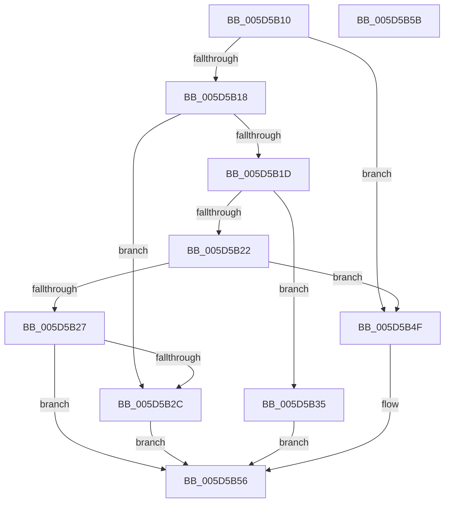

# PopKsrCallback

- RVA: `0x005D5B10`–`0x005D5B5C` (길이 `76` bytes)
- VA: `0x00000001405D5B10`
- 실행 섹션: `.text`
- PDB 이름 있음: `예`; PDB Function 태그: `아니요`
- unwind 정보 RVA: `0x0005C788`
- 디코드: `22`개 명령, `76/76` bytes 표시
- 미해석 바이트: `0` (있으면 어셈블리에 `.byte`로 보존)

> 이 문서는 커널 이미지의 기계어와 PDB 기호를 분석해 생성했습니다. 4번과 5번은 함수 원형과 자료형을 바이너리 사용 방식에서 추정한 C 해석이며 원본 소스 복구 결과는 아닙니다.

## 1. Dependencies

- 직접 호출 지점: **1**; 고유 호출 대상: **1**
- 직접 호출자로 확인된 함수: **0**
- RIP 상대 이미지 참조: **3**

### Outgoing calls
- `0x005D5B48` → [PopQueueWorkItem](../4A/PopQueueWorkItem_function_004A20F8.md) (function, `0x004A20F8`)

### Direct callers
- 이 함수 시작 RVA로 연결되는 직접 call은 확인되지 않았습니다. 간접 호출은 완전히 역산할 수 없습니다.

### Static image references
- `0x005D5B2C` → RVA `0x00F0B6D8` (`.data`; write)
- `0x005D5B3A` → RVA `0x00F05C30` (`.data`; write)
- `0x005D5B41` → RVA `0x00F0F100` (`.data`; read)

## 2. Other-region calls and transfers

- 다른 실행 섹션으로 향하는 call: **0**
- 별도 외부 분기/꼬리 이동을 확인하지 못했습니다.

## 3. Assembly (complete function range)

```asm
005D5B10  48 83 EC 28                     sub rsp, 0x28
005D5B14  85 D2                           test edx, edx
005D5B16  74 37                           je 0x1405d5b4f
005D5B18  83 EA 01                        sub edx, 1
005D5B1B  74 0F                           je 0x1405d5b2c
005D5B1D  83 EA 01                        sub edx, 1
005D5B20  74 13                           je 0x1405d5b35
005D5B22  83 EA 01                        sub edx, 1
005D5B25  74 28                           je 0x1405d5b4f
005D5B27  83 FA 01                        cmp edx, 1
005D5B2A  75 2A                           jne 0x1405d5b56
005D5B2C  C6 05 A5 5B 93 00 00            mov byte ptr [rip + 0x935ba5], 0
005D5B33  EB 21                           jmp 0x1405d5b56
005D5B35  BA 01 00 00 00                  mov edx, 1
005D5B3A  C6 05 EF 00 93 00 00            mov byte ptr [rip + 0x9300ef], 0
005D5B41  48 8D 0D B8 95 93 00            lea rcx, [rip + 0x9395b8]
005D5B48  E8 AB C5 EC FF                  call 0x1404a20f8
005D5B4D  EB 07                           jmp 0x1405d5b56
005D5B4F  C6 05 82 5B 93 00 01            mov byte ptr [rip + 0x935b82], 1
005D5B56  48 83 C4 28                     add rsp, 0x28
005D5B5A  C3                              ret
005D5B5B  CC                              int3
```

## 4. C-style interpretation (structured pseudocode)

```c
__int64 __fastcall PopKsrCallback(__int64 a1, int a2)
{
    __int64 result;
    __int64 v_rsp;

    v_rsp = (v_rsp) - (40);
    if (a2 == 0) goto loc_005D5B4F;
    a2 = (unsigned int)((a2) - (1));
    if (condition_is_equal) goto loc_005D5B2C;
    a2 = (unsigned int)((a2) - (1));
    if (condition_is_equal) goto loc_005D5B35;
    a2 = (unsigned int)((a2) - (1));
    if (condition_is_equal) goto loc_005D5B4F;
    if (a2 != 1) goto loc_005D5B56;
loc_005D5B2C:
    *(unsigned __int8 *)(v_rip + 9657253) = 0;
    goto loc_005D5B56;
loc_005D5B35:
    *(unsigned __int8 *)(v_rip + 9634031) = 0;
    result = PopQueueWorkItem(v_rip + 9672120, 1, a3, a4);
    goto loc_005D5B56;
loc_005D5B4F:
    *(unsigned __int8 *)(v_rip + 9657218) = 1;
loc_005D5B56:
    v_rsp = (v_rsp) + (40);
    return result;
}
```

## 5. (Beta) C Style

```c
int64_t PopKsrCallback(int64_t Arg1, int32_t Arg2)
{
    int64_t result;
    int64_t local_rsp;

    local_rsp = (local_rsp) - (40);
    if (Arg2 == 0) goto loc_005D5B4F;
    Arg2 = (uint32_t)((Arg2) - (1));
    if (condition_is_equal) goto loc_005D5B2C;
    Arg2 = (uint32_t)((Arg2) - (1));
    if (condition_is_equal) goto loc_005D5B35;
    Arg2 = (uint32_t)((Arg2) - (1));
    if (condition_is_equal) goto loc_005D5B4F;
    if (Arg2 != 1) goto loc_005D5B56;
loc_005D5B2C:
    *(uint8_t *)(v_rip + 0x935BA5) = 0;
    goto loc_005D5B56;
loc_005D5B35:
    *(uint8_t *)(v_rip + 0x9300EF) = 0;
    result = PopQueueWorkItem(v_rip + 9672120, 1, a3, a4);
    goto loc_005D5B56;
loc_005D5B4F:
    *(uint8_t *)(v_rip + 0x935B82) = 1;
loc_005D5B56:
    local_rsp = (local_rsp) + (40);
    return result;
}
```

## 6. Execution-region graph

[열기: 2D/3D 그래프와 함수 탐색 컨트롤 패널](../../../control-panel.html?section=text&rva=0x005D5B10&view=graph)

- 2D 그래프는 위에서 아래로 흐르고, 3D 그래프는 빈 공간을 드래그해 회전합니다. Shift+드래그는 이동, 휠은 확대·축소, 함수 노드 선택은 대상 보고서 이동입니다.

### Static fallback


