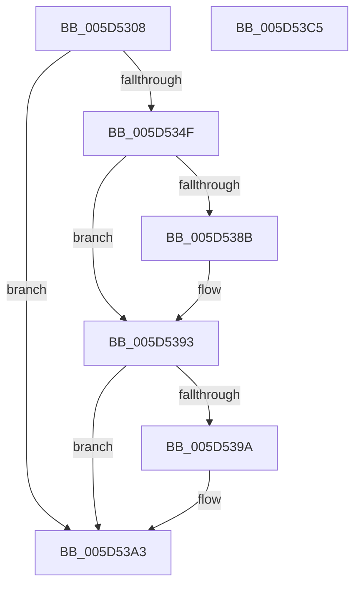

# PopLidReliabilityInit

- RVA: `0x005D5308`–`0x005D53C6` (길이 `190` bytes)
- VA: `0x00000001405D5308`
- 실행 섹션: `.text`
- PDB 이름 있음: `예`; PDB Function 태그: `아니요`
- unwind 정보 RVA: `0x000CC5D4`
- 디코드: `49`개 명령, `190/190` bytes 표시
- 미해석 바이트: `0` (있으면 어셈블리에 `.byte`로 보존)

> 이 문서는 커널 이미지의 기계어와 PDB 기호를 분석해 생성했습니다. 4번과 5번은 함수 원형과 자료형을 바이너리 사용 방식에서 추정한 C 해석이며 원본 소스 복구 결과는 아닙니다.

## 1. Dependencies

- 직접 호출 지점: **6**; 고유 호출 대상: **6**
- 직접 호출자로 확인된 함수: **1**
- RIP 상대 이미지 참조: **2**

### Outgoing calls
- `0x005D5346` → [PopOpenPersistedRegistryKey](../../page/75/PopOpenPersistedRegistryKey_function_00754260.md) (function, `0x00754260`)
- `0x005D535A` → [RtlInitUnicodeString](../42/RtlInitUnicodeString_function_0042A780.md) (function, `0x0042A780`)
- `0x005D5382` → [ZwQueryValueKey](../6A/ZwQueryValueKey_function_006AD3B0.md) (function, `0x006AD3B0`)
- `0x005D539E` → [ZwClose](../6A/ZwClose_function_006AD2B0.md) (function, `0x006AD2B0`)
- `0x005D53A6` → [PdcPoLidReliabilityUpdateCallback](../../page/75/PdcPoLidReliabilityUpdateCallback_function_0075F110.md) (function, `0x0075F110`)
- `0x005D53B2` → [_security_check_cookie](../6A/_security_check_cookie_function_006AC640.md) (function, `0x006AC640`)

### Direct callers
- [PoInitSystem](../../init/C7/PoInitSystem_function_00C72358.md) at `0x00C7320B`

### Static image references
- `0x005D5315` → RVA `0x00E0A740` (`.data`; read)
- `0x005D534F` → RVA `0x00029360` (`.rdata`; read)

## 2. Other-region calls and transfers

- 다른 실행 섹션으로 향하는 call: **2**
  - `0x005D5346` → [PopOpenPersistedRegistryKey](../../page/75/PopOpenPersistedRegistryKey_function_00754260.md) (`.text` → `PAGE`)
  - `0x005D53A6` → [PdcPoLidReliabilityUpdateCallback](../../page/75/PdcPoLidReliabilityUpdateCallback_function_0075F110.md) (`.text` → `PAGE`)
- 별도 외부 분기/꼬리 이동을 확인하지 못했습니다.

## 3. Assembly (complete function range)

```asm
005D5308  48 89 7C 24 08                  mov qword ptr [rsp + 8], rdi
005D530D  55                              push rbp
005D530E  48 8B EC                        mov rbp, rsp
005D5311  48 83 EC 70                     sub rsp, 0x70
005D5315  48 8B 05 24 54 83 00            mov rax, qword ptr [rip + 0x835424]
005D531C  48 33 C4                        xor rax, rsp
005D531F  48 89 45 F8                     mov qword ptr [rbp - 8], rax
005D5323  48 83 65 C0 00                  and qword ptr [rbp - 0x40], 0
005D5328  48 8D 55 C0                     lea rdx, [rbp - 0x40]
005D532C  83 65 C8 00                     and dword ptr [rbp - 0x38], 0
005D5330  0F 57 C0                        xorps xmm0, xmm0
005D5333  0F 57 C9                        xorps xmm1, xmm1
005D5336  33 C0                           xor eax, eax
005D5338  0F 11 45 D0                     movups xmmword ptr [rbp - 0x30], xmm0
005D533C  89 45 F0                        mov dword ptr [rbp - 0x10], eax
005D533F  40 B7 01                        mov dil, 1
005D5342  0F 11 4D E0                     movups xmmword ptr [rbp - 0x20], xmm1
005D5346  E8 15 EF 17 00                  call 0x140754260
005D534B  85 C0                           test eax, eax
005D534D  78 54                           js 0x1405d53a3
005D534F  48 8D 15 0A 40 A5 FF            lea rdx, [rip - 0x5abff6]
005D5356  48 8D 4D D0                     lea rcx, [rbp - 0x30]
005D535A  E8 21 54 E5 FF                  call 0x14042a780
005D535F  48 8B 4D C0                     mov rcx, qword ptr [rbp - 0x40]
005D5363  48 8D 45 C8                     lea rax, [rbp - 0x38]
005D5367  48 89 44 24 28                  mov qword ptr [rsp + 0x28], rax
005D536C  4C 8D 4D E0                     lea r9, [rbp - 0x20]
005D5370  41 B8 02 00 00 00               mov r8d, 2
005D5376  C7 44 24 20 14 00 00 00         mov dword ptr [rsp + 0x20], 0x14
005D537E  48 8D 55 D0                     lea rdx, [rbp - 0x30]
005D5382  E8 29 80 0D 00                  call 0x1406ad3b0
005D5387  85 C0                           test eax, eax
005D5389  78 08                           js 0x1405d5393
005D538B  80 7D EC 00                     cmp byte ptr [rbp - 0x14], 0
005D538F  40 0F 95 C7                     setne dil
005D5393  48 83 7D C0 00                  cmp qword ptr [rbp - 0x40], 0
005D5398  74 09                           je 0x1405d53a3
005D539A  48 8B 4D C0                     mov rcx, qword ptr [rbp - 0x40]
005D539E  E8 0D 7F 0D 00                  call 0x1406ad2b0
005D53A3  40 8A CF                        mov cl, dil
005D53A6  E8 65 9D 18 00                  call 0x14075f110
005D53AB  48 8B 4D F8                     mov rcx, qword ptr [rbp - 8]
005D53AF  48 33 CC                        xor rcx, rsp
005D53B2  E8 89 72 0D 00                  call 0x1406ac640
005D53B7  48 8B BC 24 80 00 00 00         mov rdi, qword ptr [rsp + 0x80]
005D53BF  48 83 C4 70                     add rsp, 0x70
005D53C3  5D                              pop rbp
005D53C4  C3                              ret
005D53C5  CC                              int3
```

## 4. C-style interpretation (structured pseudocode)

```c
__int64 __fastcall PopLidReliabilityInit(void)
{
    __int64 result;
    __int64 v_rdi;
    __int64 v_rsp;
    unsigned __int64 v_stack_m10;
    unsigned int v_stack_m18;
    unsigned __int8 v_stack_m1C;
    unsigned __int64 v_stack_m28;
    unsigned __int64 v_stack_m38;
    unsigned int v_stack_m40;
    unsigned __int64 v_stack_m48;
    unsigned __int64 v_stack_m50;
    unsigned int v_stack_m58;
    unsigned __int64 v_stack_p8;

    v_stack_p8 = v_rdi;
    v_rsp = (v_rsp) - (112);
    result = (*(unsigned __int64 *)(v_rip + 8606756)) ^ (v_rsp);
    v_stack_m10 = result;
    result = 0;
    v_stack_m38 = v_xmm0;
    v_stack_m18 = 0;
    v_stack_m28 = v_xmm1;
    result = PopOpenPersistedRegistryKey(a1, v_stack_m48, a3, a4);
    if (sign_flag) goto loc_005D53A3;
    result = RtlInitUnicodeString(v_stack_m38, v_rip - 5947382, a3, a4);
    v_stack_m50 = v_stack_m40;
    v_stack_m58 = 20;
    result = ZwQueryValueKey(v_stack_m48, v_stack_m38, 2, v_stack_m28);
    v_rdi = 1;
    if (!(sign_flag)) {
        v_rdi = (v_stack_m1C != 0) ? 1 : 0;
    }
    if (v_stack_m48 != 0) {
        a1 = v_stack_m48;
        result = ZwClose(a1, v_stack_m38, 2, v_stack_m28);
    }
    result = PdcPoLidReliabilityUpdateCallback((unsigned __int8)(v_rdi), v_stack_m38, 2, v_stack_m28);
    a1 = (v_stack_m10) ^ (v_rsp);
    result = _security_check_cookie(a1, v_stack_m38, 2, v_stack_m28);
    v_rsp = (v_rsp) + (112);
    return result;
}
```

## 5. (Beta) C Style

```c
void PopLidReliabilityInit(void)
{
    int64_t result;
    int64_t local_rdi;
    int64_t local_rsp;
    uint64_t v_stack_m10;
    uint32_t v_stack_m18;
    uint8_t v_stack_m1C;
    uint64_t v_stack_m28;
    uint64_t v_stack_m38;
    uint32_t v_stack_m40;
    uint64_t v_stack_m48;
    uint64_t v_stack_m50;
    uint32_t v_stack_m58;
    uint64_t v_stack_p8;

    v_stack_p8 = local_rdi;
    local_rsp = (local_rsp) - (112);
    result = (*(uint64_t *)(v_rip + 0x835424)) ^ (local_rsp);
    v_stack_m10 = result;
    result = 0;
    v_stack_m38 = v_xmm0;
    v_stack_m18 = 0;
    v_stack_m28 = v_xmm1;
    result = PopOpenPersistedRegistryKey(a1, v_stack_m48, a3, a4);
    if (sign_flag) goto loc_005D53A3;
    result = RtlInitUnicodeString(v_stack_m38, v_rip - 5947382, a3, a4);
    v_stack_m50 = v_stack_m40;
    v_stack_m58 = 20;
    result = ZwQueryValueKey(v_stack_m48, v_stack_m38, 2, v_stack_m28);
    local_rdi = 1;
    if (!(sign_flag)) {
        local_rdi = (v_stack_m1C != 0) ? 1 : 0;
    }
    if (v_stack_m48 != 0) {
        a1 = v_stack_m48;
        result = ZwClose(a1, v_stack_m38, 2, v_stack_m28);
    }
    result = PdcPoLidReliabilityUpdateCallback((uint8_t)(local_rdi), v_stack_m38, 2, v_stack_m28);
    a1 = (v_stack_m10) ^ (local_rsp);
    result = _security_check_cookie(a1, v_stack_m38, 2, v_stack_m28);
    local_rsp = (local_rsp) + (112);
    return result;
}
```

## 6. Execution-region graph

[열기: 2D/3D 그래프와 함수 탐색 컨트롤 패널](../../../control-panel.html?section=text&rva=0x005D5308&view=graph)

- 2D 그래프는 위에서 아래로 흐르고, 3D 그래프는 빈 공간을 드래그해 회전합니다. Shift+드래그는 이동, 휠은 확대·축소, 함수 노드 선택은 대상 보고서 이동입니다.

### Static fallback


