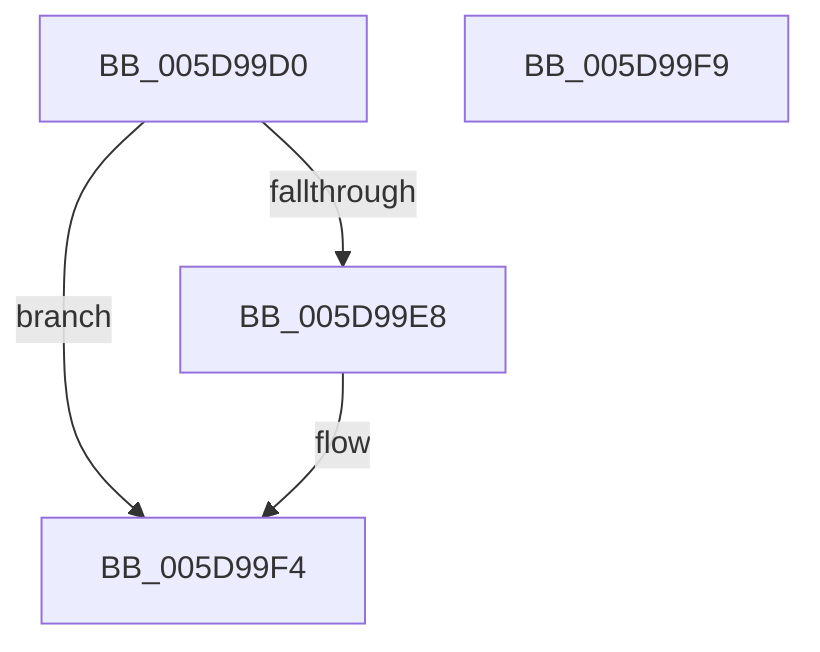

# PopNetRefreshTimerCallback

- RVA: `0x005D99D0`–`0x005D99FA` (길이 `42` bytes)
- VA: `0x00000001405D99D0`
- 실행 섹션: `.text`
- PDB 이름 있음: `예`; PDB Function 태그: `아니요`
- unwind 정보 RVA: `0x0005C788`
- 디코드: `11`개 명령, `42/42` bytes 표시
- 미해석 바이트: `0` (있으면 어셈블리에 `.byte`로 보존)

> 이 문서는 커널 이미지의 기계어와 PDB 기호를 분석해 생성했습니다. 4번과 5번은 함수 원형과 자료형을 바이너리 사용 방식에서 추정한 C 해석이며 원본 소스 복구 결과는 아닙니다.

## 1. Dependencies

- 직접 호출 지점: **1**; 고유 호출 대상: **1**
- 직접 호출자로 확인된 함수: **0**
- RIP 상대 이미지 참조: **2**

### Outgoing calls
- `0x005D99EF` → [PopQueueWorkItem](../4A/PopQueueWorkItem_function_004A20F8.md) (function, `0x004A20F8`)

### Direct callers
- 이 함수 시작 RVA로 연결되는 직접 call은 확인되지 않았습니다. 간접 호출은 완전히 역산할 수 없습니다.

### Static image references
- `0x005D99DE` → RVA `0x00E678E4` (`.data`; read)
- `0x005D99E8` → RVA `0x00F08788` (`.data`; read)

## 2. Other-region calls and transfers

- 다른 실행 섹션으로 향하는 call: **0**
- 별도 외부 분기/꼬리 이동을 확인하지 못했습니다.

## 3. Assembly (complete function range)

```asm
005D99D0  48 83 EC 28                     sub rsp, 0x28
005D99D4  B9 02 00 00 00                  mov ecx, 2
005D99D9  8D 51 FF                        lea edx, [rcx - 1]
005D99DC  8B C2                           mov eax, edx
005D99DE  F0 0F B1 0D FE DE 88 00         lock cmpxchg dword ptr [rip + 0x88defe], ecx
005D99E6  75 0C                           jne 0x1405d99f4
005D99E8  48 8D 0D 99 ED 92 00            lea rcx, [rip + 0x92ed99]
005D99EF  E8 04 87 EC FF                  call 0x1404a20f8
005D99F4  48 83 C4 28                     add rsp, 0x28
005D99F8  C3                              ret
005D99F9  CC                              int3
```

## 4. C-style interpretation (structured pseudocode)

```c
__int64 __fastcall PopNetRefreshTimerCallback(void)
{
    __int64 result;
    __int64 v_rsp;

    v_rsp = (v_rsp) - (40);
    result = (unsigned int)((unsigned int)(2 - 1));
    if (!(condition_is_not_equal)) {
        a1 = v_rip + 9629081;
        result = PopQueueWorkItem(a1, 2 - 1, a3, a4);
    }
    v_rsp = (v_rsp) + (40);
    return result;
}
```

## 5. (Beta) C Style

```c
void PopNetRefreshTimerCallback(void)
{
    int64_t result;
    int64_t local_rsp;

    local_rsp = (local_rsp) - (40);
    result = (uint32_t)((uint32_t)(2 - 1));
    if (!(condition_is_not_equal)) {
        a1 = v_rip + 9629081;
        result = PopQueueWorkItem(a1, 2 - 1, a3, a4);
    }
    local_rsp = (local_rsp) + (40);
    return result;
}
```

## 6. Execution-region graph

[열기: 2D/3D 그래프와 함수 탐색 컨트롤 패널](../../../control-panel.html?section=text&rva=0x005D99D0&view=graph)

- 2D 그래프는 위에서 아래로 흐르고, 3D 그래프는 빈 공간을 드래그해 회전합니다. Shift+드래그는 이동, 휠은 확대·축소, 함수 노드 선택은 대상 보고서 이동입니다.

### Static fallback


