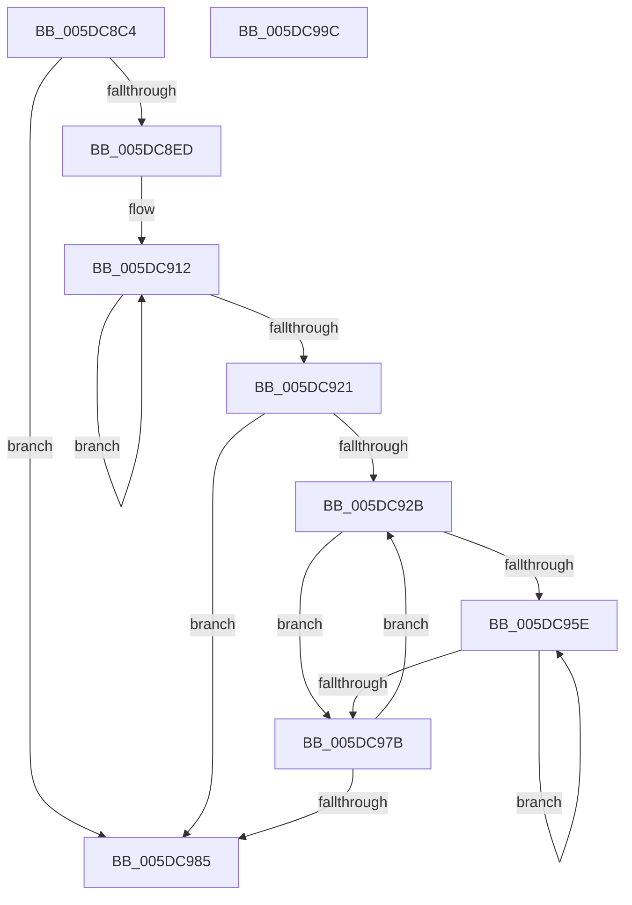

# PopPepClearDripsDeviceVetoMask

- RVA: `0x005DC8C4`–`0x005DC99D` (길이 `217` bytes)
- VA: `0x00000001405DC8C4`
- 실행 섹션: `.text`
- PDB 이름 있음: `예`; PDB Function 태그: `아니요`
- unwind 정보 RVA: `0x0005C954`
- 디코드: `55`개 명령, `217/217` bytes 표시
- 미해석 바이트: `0` (있으면 어셈블리에 `.byte`로 보존)

> 이 문서는 커널 이미지의 기계어와 PDB 기호를 분석해 생성했습니다. 4번과 5번은 함수 원형과 자료형을 바이너리 사용 방식에서 추정한 C 해석이며 원본 소스 복구 결과는 아닙니다.

## 1. Dependencies

- 직접 호출 지점: **2**; 고유 호출 대상: **1**
- 직접 호출자로 확인된 함수: **1**
- RIP 상대 이미지 참조: **0**

### Outgoing calls
- `0x005DC8FF` → [PopPepUpdateIdleStateRefCount](../2B/PopPepUpdateIdleStateRefCount_function_002BF930.md) (function, `0x002BF930`)
- `0x005DC94E` → [PopPepUpdateIdleStateRefCount](../2B/PopPepUpdateIdleStateRefCount_function_002BF930.md) (function, `0x002BF930`)

### Direct callers
- [PopFxClearDeviceConstraints](../4B/PopFxClearDeviceConstraints_function_004B05F8.md) at `0x004B0696`

### Static image references
- 디코드된 RIP-relative 메모리 참조가 없습니다.

## 2. Other-region calls and transfers

- 다른 실행 섹션으로 향하는 call: **0**
- 별도 외부 분기/꼬리 이동을 확인하지 못했습니다.

## 3. Assembly (complete function range)

```asm
005DC8C4  48 89 5C 24 08                  mov qword ptr [rsp + 8], rbx
005DC8C9  48 89 6C 24 10                  mov qword ptr [rsp + 0x10], rbp
005DC8CE  48 89 74 24 18                  mov qword ptr [rsp + 0x18], rsi
005DC8D3  57                              push rdi
005DC8D4  48 83 EC 20                     sub rsp, 0x20
005DC8D8  83 B9 AC 00 00 00 02            cmp dword ptr [rcx + 0xac], 2
005DC8DF  48 8B D9                        mov rbx, rcx
005DC8E2  BF 01 00 00 C0                  mov edi, 0xc0000001
005DC8E7  0F 85 98 00 00 00               jne 0x1405dc985
005DC8ED  4C 8D 89 B8 00 00 00            lea r9, [rcx + 0xb8]
005DC8F4  45 33 C0                        xor r8d, r8d
005DC8F7  8B 89 90 00 00 00               mov ecx, dword ptr [rcx + 0x90]
005DC8FD  33 D2                           xor edx, edx
005DC8FF  E8 2C 30 CE FF                  call 0x1402bf930
005DC904  48 8D 83 9C 00 00 00            lea rax, [rbx + 0x9c]
005DC90B  B9 03 00 00 00                  mov ecx, 3
005DC910  33 FF                           xor edi, edi
005DC912  89 78 F4                        mov dword ptr [rax - 0xc], edi
005DC915  89 38                           mov dword ptr [rax], edi
005DC917  48 8D 40 04                     lea rax, [rax + 4]
005DC91B  48 83 E9 01                     sub rcx, 1
005DC91F  75 F1                           jne 0x1405dc912
005DC921  8B F7                           mov esi, edi
005DC923  39 BB B4 00 00 00               cmp dword ptr [rbx + 0xb4], edi
005DC929  76 5A                           jbe 0x1405dc985
005DC92B  8B C6                           mov eax, esi
005DC92D  4C 8D 8B 80 01 00 00            lea r9, [rbx + 0x180]
005DC934  48 69 E8 D0 00 00 00            imul rbp, rax, 0xd0
005DC93B  45 33 C0                        xor r8d, r8d
005DC93E  33 D2                           xor edx, edx
005DC940  4C 03 CD                        add r9, rbp
005DC943  48 8B 8C 2B 88 01 00 00         mov rcx, qword ptr [rbx + rbp + 0x188]
005DC94B  8B 49 10                        mov ecx, dword ptr [rcx + 0x10]
005DC94E  E8 DD 2F CE FF                  call 0x1402bf930
005DC953  8B D7                           mov edx, edi
005DC955  39 BC 2B 7C 01 00 00            cmp dword ptr [rbx + rbp + 0x17c], edi
005DC95C  76 1D                           jbe 0x1405dc97b
005DC95E  8B C2                           mov eax, edx
005DC960  FF C2                           inc edx
005DC962  48 8D 0C 40                     lea rcx, [rax + rax*2]
005DC966  48 8B 84 2B 88 01 00 00         mov rax, qword ptr [rbx + rbp + 0x188]
005DC96E  89 7C C8 10                     mov dword ptr [rax + rcx*8 + 0x10], edi
005DC972  3B 94 2B 7C 01 00 00            cmp edx, dword ptr [rbx + rbp + 0x17c]
005DC979  72 E3                           jb 0x1405dc95e
005DC97B  FF C6                           inc esi
005DC97D  3B B3 B4 00 00 00               cmp esi, dword ptr [rbx + 0xb4]
005DC983  72 A6                           jb 0x1405dc92b
005DC985  48 8B 5C 24 30                  mov rbx, qword ptr [rsp + 0x30]
005DC98A  8B C7                           mov eax, edi
005DC98C  48 8B 6C 24 38                  mov rbp, qword ptr [rsp + 0x38]
005DC991  48 8B 74 24 40                  mov rsi, qword ptr [rsp + 0x40]
005DC996  48 83 C4 20                     add rsp, 0x20
005DC99A  5F                              pop rdi
005DC99B  C3                              ret
005DC99C  CC                              int3
```

## 4. C-style interpretation (structured pseudocode)

```c
__int64 __fastcall PopPepClearDripsDeviceVetoMask(__int64 a1, int a2, int a3)
{
    __int64 result;
    __int64 v_rbp;
    __int64 v_rdi;
    __int64 v_rsi;
    __int64 v_rsp;
    unsigned __int64 v_stack_p10;
    unsigned __int64 v_stack_p18;
    unsigned __int64 v_stack_p8;

    v_stack_p8 = v_rbx;
    v_stack_p10 = v_rbp;
    v_stack_p18 = v_rsi;
    v_rsp = (v_rsp) - (32);
    if ((*(unsigned int *)(a1 + 172)) != 2) goto loc_005DC985;
    a3 = 0;
    a2 = 0;
    result = PopPepUpdateIdleStateRefCount((unsigned int)(*(unsigned int *)(a1 + 144)), a2, a3, a1 + 184);
    v_rdi = 0;
loc_005DC912:
    *(unsigned int *)(a1 + 156 - 12) = 0;
    *(unsigned int *)(a1 + 156) = 0;
    a1 = (3) - (1);
    if (condition_is_not_equal) goto loc_005DC912;
    if ((*(unsigned int *)(a1 + 180)) <= 0) goto loc_005DC985;
loc_005DC92B:
    v_rbp = (v_rbp) * (0);
    a3 = 0;
    a2 = 0;
    a4 = (a1 + 384) + (v_rbp);
    result = PopPepUpdateIdleStateRefCount((unsigned int)(*(unsigned int *)(*(unsigned __int64 *)(a1 + v_rbp * 1 + 392) + 16)), a2, a3, a4);
    if ((*(unsigned int *)(a1 + v_rbp * 1 + 380)) <= 0) goto loc_005DC97B;
loc_005DC95E:
    a2 = (unsigned int)((0) + 1);
    *(unsigned int *)(*(unsigned __int64 *)(a1 + v_rbp * 1 + 392) + 0 + 0 * 2 * 8 + 16) = 0;
    if (a2 < (*(unsigned int *)(a1 + v_rbp * 1 + 380))) goto loc_005DC95E;
loc_005DC97B:
    v_rsi = (unsigned int)((0) + 1);
    if (((unsigned int)(v_rsi)) < (*(unsigned int *)(a1 + 180))) goto loc_005DC92B;
loc_005DC985:
    v_rsp = (v_rsp) + (32);
    return 0;
}
```

## 5. (Beta) C Style

```c
int64_t PopPepClearDripsDeviceVetoMask(void *Arg1, int32_t Arg2, int32_t Arg3)
{
    uint8_t *arg1 = (uint8_t *)Arg1;

    int64_t result;
    int64_t local_rbp;
    int64_t local_rdi;
    int64_t local_rsi;
    int64_t local_rsp;
    uint64_t v_stack_p10;
    uint64_t v_stack_p18;
    uint64_t v_stack_p8;

    v_stack_p8 = local_rbx;
    v_stack_p10 = local_rbp;
    v_stack_p18 = local_rsi;
    local_rsp = (local_rsp) - (32);
    if ((*(uint32_t *)(arg1 + 0xAC)) != 2) goto loc_005DC985;
    Arg3 = 0;
    Arg2 = 0;
    result = PopPepUpdateIdleStateRefCount((uint32_t)(*(uint32_t *)(arg1 + 0x90)), Arg2, Arg3, Arg1 + 184);
    local_rdi = 0;
loc_005DC912:
    *(uint32_t *)(arg1 + 0x9C - 0xC) = 0;
    *(uint32_t *)(arg1 + 0x9C) = 0;
    Arg1 = (3) - (1);
    if (condition_is_not_equal) goto loc_005DC912;
    if ((*(uint32_t *)(arg1 + 0xB4)) <= 0) goto loc_005DC985;
loc_005DC92B:
    local_rbp = (local_rbp) * (0);
    Arg3 = 0;
    Arg2 = 0;
    a4 = (Arg1 + 384) + (local_rbp);
    result = PopPepUpdateIdleStateRefCount((uint32_t)(*(uint32_t *)(*(uint64_t *)(arg1 + local_rbp * 1 + 0x188) + 0x10)), Arg2, Arg3, a4);
    if ((*(uint32_t *)(arg1 + local_rbp * 1 + 0x17C)) <= 0) goto loc_005DC97B;
loc_005DC95E:
    Arg2 = (uint32_t)((0) + 1);
    *(uint32_t *)(*(uint64_t *)(arg1 + local_rbp * 1 + 0x188) + 0x0 + 0x0 * 2 * 8 + 0x10) = 0;
    if (Arg2 < (*(uint32_t *)(arg1 + local_rbp * 1 + 0x17C))) goto loc_005DC95E;
loc_005DC97B:
    local_rsi = (uint32_t)((0) + 1);
    if (((uint32_t)(local_rsi)) < (*(uint32_t *)(arg1 + 0xB4))) goto loc_005DC92B;
loc_005DC985:
    local_rsp = (local_rsp) + (32);
    return 0;
}
```

### 관측된 메모리 오프셋

구조체 형식이 확인되지 않은 접근은 인자 기준의 오프셋으로만 기록했습니다.

| 기준 인자 | 오프셋 표현 | 폭 (bit) | 접근 |
|---|---:|---:|---|
| `Arg1` | `- 0xC` | `32` | `W` |
| `Arg1` | `+ 0x0` | `32` | `W` |
| `Arg1` | `+ 0x4` | `64` | `R` |
| `Arg1` | `+ 0x90` | `32` | `R` |
| `Arg1` | `+ 0x9C` | `64` | `R` |
| `Arg1` | `+ 0xAC` | `32` | `R` |
| `Arg1` | `+ 0xB4` | `32` | `R` |
| `Arg1` | `+ 0xB8` | `64` | `R` |
| `Arg1` | `+ 0x17C + rbp*1` | `32` | `R` |
| `Arg1` | `+ 0x180` | `64` | `R` |
| `Arg1` | `+ 0x188 + rbp*1` | `64` | `R` |

## 6. Execution-region graph

[열기: 2D/3D 그래프와 함수 탐색 컨트롤 패널](../../../control-panel.html?section=text&rva=0x005DC8C4&view=graph)

- 2D 그래프는 위에서 아래로 흐르고, 3D 그래프는 빈 공간을 드래그해 회전합니다. Shift+드래그는 이동, 휠은 확대·축소, 함수 노드 선택은 대상 보고서 이동입니다.

### Static fallback


