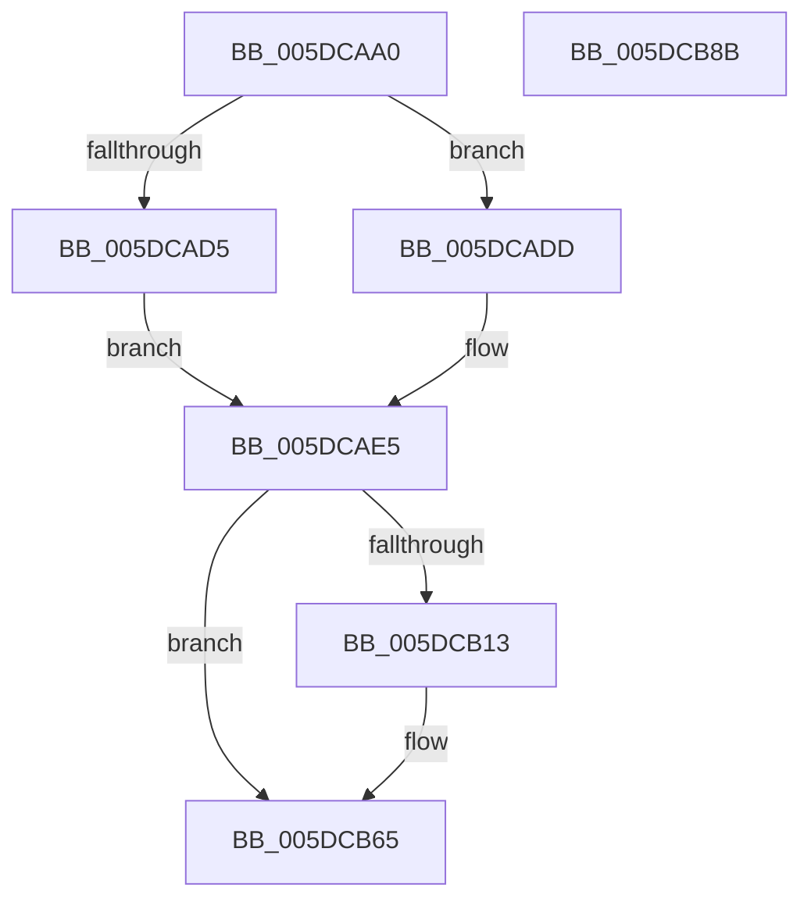

# PopPepComponentSetWakeHint

- RVA: `0x005DCAA0`–`0x005DCB8C` (길이 `236` bytes)
- VA: `0x00000001405DCAA0`
- 실행 섹션: `.text`
- PDB 이름 있음: `예`; PDB Function 태그: `아니요`
- unwind 정보 RVA: `0x000B4164`
- 디코드: `65`개 명령, `236/236` bytes 표시
- 미해석 바이트: `0` (있으면 어셈블리에 `.byte`로 보존)

> 이 문서는 커널 이미지의 기계어와 PDB 기호를 분석해 생성했습니다. 4번과 5번은 함수 원형과 자료형을 바이너리 사용 방식에서 추정한 C 해석이며 원본 소스 복구 결과는 아닙니다.

## 1. Dependencies

- 직접 호출 지점: **7**; 고유 호출 대상: **6**
- 직접 호출자로 확인된 함수: **1**
- RIP 상대 이미지 참조: **0**

### Outgoing calls
- `0x005DCAFC` → [PopPepLockActivityLink](../26/PopPepLockActivityLink_function_0026F7A0.md) (function, `0x0026F7A0`)
- `0x005DCB27` → [PopPepCountReadyActivities](../43/PopPepCountReadyActivities_function_0043E160.md) (function, `0x0043E160`)
- `0x005DCB37` → [PopPepUpdateIdleState](../2B/PopPepUpdateIdleState_function_002BF794.md) (function, `0x002BF794`)
- `0x005DCB45` → [PopPepPromoteActivities](../24/PopPepPromoteActivities_function_0024D0D0.md) (function, `0x0024D0D0`)
- `0x005DCB53` → [PopPepCountReadyActivities](../43/PopPepCountReadyActivities_function_0043E160.md) (function, `0x0043E160`)
- `0x005DCB60` → [PopPepRequestWork](../39/PopPepRequestWork_function_003986F0.md) (function, `0x003986F0`)
- `0x005DCB73` → [PopPepReleaseActivityLink](../24/PopPepReleaseActivityLink_function_0024CC90.md) (function, `0x0024CC90`)

### Direct callers
- [PoFxSetComponentWake](PoFxSetComponentWake_function_005D2150.md) at `0x005D2179`

### Static image references
- 디코드된 RIP-relative 메모리 참조가 없습니다.

## 2. Other-region calls and transfers

- 다른 실행 섹션으로 향하는 call: **0**
- 별도 외부 분기/꼬리 이동을 확인하지 못했습니다.

## 3. Assembly (complete function range)

```asm
005DCAA0  48 89 5C 24 08                  mov qword ptr [rsp + 8], rbx
005DCAA5  48 89 6C 24 10                  mov qword ptr [rsp + 0x10], rbp
005DCAAA  56                              push rsi
005DCAAB  57                              push rdi
005DCAAC  41 56                           push r14
005DCAAE  48 83 EC 30                     sub rsp, 0x30
005DCAB2  8B C2                           mov eax, edx
005DCAB4  48 8D B9 C0 00 00 00            lea rdi, [rcx + 0xc0]
005DCABB  48 69 D0 D0 00 00 00            imul rdx, rax, 0xd0
005DCAC2  41 8A E8                        mov bpl, r8b
005DCAC5  C6 44 24 60 00                  mov byte ptr [rsp + 0x60], 0
005DCACA  48 03 FA                        add rdi, rdx
005DCACD  48 8B F1                        mov rsi, rcx
005DCAD0  45 84 C0                        test r8b, r8b
005DCAD3  74 08                           je 0x1405dcadd
005DCAD5  8B 9F 94 00 00 00               mov ebx, dword ptr [rdi + 0x94]
005DCADB  EB 08                           jmp 0x1405dcae5
005DCADD  8B 9F BC 00 00 00               mov ebx, dword ptr [rdi + 0xbc]
005DCAE3  FF CB                           dec ebx
005DCAE5  41 B9 01 00 00 00               mov r9d, 1
005DCAEB  48 8D 44 24 60                  lea rax, [rsp + 0x60]
005DCAF0  48 8B D7                        mov rdx, rdi
005DCAF3  48 89 44 24 20                  mov qword ptr [rsp + 0x20], rax
005DCAF8  45 8D 41 05                     lea r8d, [r9 + 5]
005DCAFC  E8 9F 2C C9 FF                  call 0x14026f7a0
005DCB01  40 88 AF 90 00 00 00            mov byte ptr [rdi + 0x90], bpl
005DCB08  44 8A F0                        mov r14b, al
005DCB0B  39 9F A4 00 00 00               cmp dword ptr [rdi + 0xa4], ebx
005DCB11  74 52                           je 0x1405dcb65
005DCB13  BD 02 00 00 00                  mov ebp, 2
005DCB18  89 9F A4 00 00 00               mov dword ptr [rdi + 0xa4], ebx
005DCB1E  44 8B C5                        mov r8d, ebp
005DCB21  48 8B D7                        mov rdx, rdi
005DCB24  48 8B CE                        mov rcx, rsi
005DCB27  E8 34 16 E6 FF                  call 0x14043e160
005DCB2C  41 B0 01                        mov r8b, 1
005DCB2F  48 8B D7                        mov rdx, rdi
005DCB32  48 8B CE                        mov rcx, rsi
005DCB35  8B D8                           mov ebx, eax
005DCB37  E8 58 2C CE FF                  call 0x1402bf794
005DCB3C  44 8B C5                        mov r8d, ebp
005DCB3F  48 8B D7                        mov rdx, rdi
005DCB42  48 8B CE                        mov rcx, rsi
005DCB45  E8 86 05 C7 FF                  call 0x14024d0d0
005DCB4A  44 8B C5                        mov r8d, ebp
005DCB4D  48 8B D7                        mov rdx, rdi
005DCB50  48 8B CE                        mov rcx, rsi
005DCB53  E8 08 16 E6 FF                  call 0x14043e160
005DCB58  44 8B C0                        mov r8d, eax
005DCB5B  8B D3                           mov edx, ebx
005DCB5D  48 8B CE                        mov rcx, rsi
005DCB60  E8 8B BB DB FF                  call 0x1403986f0
005DCB65  44 8A 4C 24 60                  mov r9b, byte ptr [rsp + 0x60]
005DCB6A  45 8A C6                        mov r8b, r14b
005DCB6D  48 8B D7                        mov rdx, rdi
005DCB70  48 8B CE                        mov rcx, rsi
005DCB73  E8 18 01 C7 FF                  call 0x14024cc90
005DCB78  48 8B 5C 24 50                  mov rbx, qword ptr [rsp + 0x50]
005DCB7D  48 8B 6C 24 58                  mov rbp, qword ptr [rsp + 0x58]
005DCB82  48 83 C4 30                     add rsp, 0x30
005DCB86  41 5E                           pop r14
005DCB88  5F                              pop rdi
005DCB89  5E                              pop rsi
005DCB8A  C3                              ret
005DCB8B  CC                              int3
```

## 4. C-style interpretation (structured pseudocode)

```c
__int64 __fastcall PopPepComponentSetWakeHint(__int64 a1, int a2, unsigned __int8 a3)
{
    __int64 result;
    __int64 v_rbp;
    __int64 v_rbx;
    __int64 v_rdi;
    __int64 v_rsp;
    unsigned __int64 v_stack_m28;
    unsigned __int64 v_stack_p10;
    unsigned __int8 v_stack_p18;
    unsigned __int64 v_stack_p8;

    v_stack_p8 = v_rbx;
    v_stack_p10 = v_rbp;
    v_rsp = (v_rsp) - (48);
    a2 = (a2) * ((unsigned int)(a2));
    v_stack_p18 = 0;
    v_rdi = (a1 + 192) + (a2);
    if (a3 == 0) goto loc_005DCADD;
    goto loc_005DCAE5;
loc_005DCADD:
    v_rbx = (unsigned int)(((unsigned int)(*(unsigned int *)(v_rdi + 188))) - 1);
loc_005DCAE5:
    v_stack_m28 = v_stack_p18;
    result = PopPepLockActivityLink(a1, v_rdi, 1 + 5, 1);
    *(unsigned __int8 *)(v_rdi + 144) = a3;
    v_rbp = a3;
    if ((*(unsigned int *)(v_rdi + 164)) != ((unsigned int)(v_rbx))) {
        v_rbp = 2;
        *(unsigned int *)(v_rdi + 164) = (unsigned int)(v_rbx);
        a3 = (unsigned int)(v_rbp);
        a2 = v_rdi;
        a1 = a1;
        result = PopPepCountReadyActivities(a1, a2, a3, 1);
        a3 = 1;
        a2 = v_rdi;
        a1 = a1;
        v_rbx = (unsigned int)(result);
        result = PopPepUpdateIdleState(a1, a2, a3, 1);
        a3 = (unsigned int)(v_rbp);
        a2 = v_rdi;
        a1 = a1;
        result = PopPepPromoteActivities(a1, a2, a3, 1);
        a3 = (unsigned int)(v_rbp);
        a2 = v_rdi;
        a1 = a1;
        result = PopPepCountReadyActivities(a1, a2, a3, 1);
        a3 = (unsigned int)(result);
        a2 = (unsigned int)(v_rbx);
        a1 = a1;
        result = PopPepRequestWork(a1, a2, a3, 1);
    }
    result = PopPepReleaseActivityLink(a1, v_rdi, (unsigned __int8)((unsigned __int8)(result)), v_stack_p18);
    v_rsp = (v_rsp) + (48);
    return result;
}
```

## 5. (Beta) C Style

```c
int64_t PopPepComponentSetWakeHint(void *Arg1, int32_t Arg2, uint8_t Arg3)
{
    uint8_t *arg1 = (uint8_t *)Arg1;

    int64_t result;
    int64_t local_rbp;
    int64_t local_rbx;
    int64_t local_rdi;
    int64_t local_rsp;
    uint64_t v_stack_m28;
    uint64_t v_stack_p10;
    uint8_t v_stack_p18;
    uint64_t v_stack_p8;

    v_stack_p8 = local_rbx;
    v_stack_p10 = local_rbp;
    local_rsp = (local_rsp) - (48);
    Arg2 = (Arg2) * ((uint32_t)(Arg2));
    v_stack_p18 = 0;
    local_rdi = (Arg1 + 192) + (Arg2);
    if (Arg3 == 0) goto loc_005DCADD;
    goto loc_005DCAE5;
loc_005DCADD:
    local_rbx = (uint32_t)(((uint32_t)(*(uint32_t *)(local_rdi + 0xBC))) - 1);
loc_005DCAE5:
    v_stack_m28 = v_stack_p18;
    result = PopPepLockActivityLink(Arg1, local_rdi, 1 + 5, 1);
    *(uint8_t *)(local_rdi + 0x90) = Arg3;
    local_rbp = Arg3;
    if ((*(uint32_t *)(local_rdi + 0xA4)) != ((uint32_t)(local_rbx))) {
        local_rbp = 2;
        *(uint32_t *)(local_rdi + 0xA4) = (uint32_t)(local_rbx);
        Arg3 = (uint32_t)(local_rbp);
        Arg2 = local_rdi;
        Arg1 = Arg1;
        result = PopPepCountReadyActivities(Arg1, Arg2, Arg3, 1);
        Arg3 = 1;
        Arg2 = local_rdi;
        Arg1 = Arg1;
        local_rbx = (uint32_t)(result);
        result = PopPepUpdateIdleState(Arg1, Arg2, Arg3, 1);
        Arg3 = (uint32_t)(local_rbp);
        Arg2 = local_rdi;
        Arg1 = Arg1;
        result = PopPepPromoteActivities(Arg1, Arg2, Arg3, 1);
        Arg3 = (uint32_t)(local_rbp);
        Arg2 = local_rdi;
        Arg1 = Arg1;
        result = PopPepCountReadyActivities(Arg1, Arg2, Arg3, 1);
        Arg3 = (uint32_t)(result);
        Arg2 = (uint32_t)(local_rbx);
        Arg1 = Arg1;
        result = PopPepRequestWork(Arg1, Arg2, Arg3, 1);
    }
    result = PopPepReleaseActivityLink(Arg1, local_rdi, (uint8_t)((uint8_t)(result)), v_stack_p18);
    local_rsp = (local_rsp) + (48);
    return result;
}
```

### 관측된 메모리 오프셋

구조체 형식이 확인되지 않은 접근은 인자 기준의 오프셋으로만 기록했습니다.

| 기준 인자 | 오프셋 표현 | 폭 (bit) | 접근 |
|---|---:|---:|---|
| `Arg1` | `+ 0x90` | `8` | `W` |
| `Arg1` | `+ 0x94` | `32` | `R` |
| `Arg1` | `+ 0xA4` | `32` | `R` |
| `Arg1` | `+ 0xA4` | `32` | `W` |
| `Arg1` | `+ 0xBC` | `32` | `R` |
| `Arg1` | `+ 0xC0` | `64` | `R` |

## 6. Execution-region graph

[열기: 2D/3D 그래프와 함수 탐색 컨트롤 패널](../../../control-panel.html?section=text&rva=0x005DCAA0&view=graph)

- 2D 그래프는 위에서 아래로 흐르고, 3D 그래프는 빈 공간을 드래그해 회전합니다. Shift+드래그는 이동, 휠은 확대·축소, 함수 노드 선택은 대상 보고서 이동입니다.

### Static fallback


