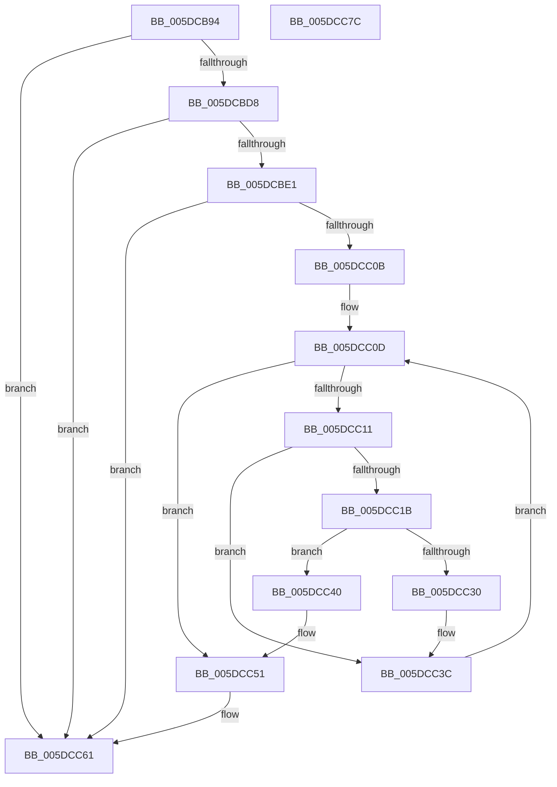

# PopPepInitializeDebuggerMasks

- RVA: `0x005DCB94`–`0x005DCC7D` (길이 `233` bytes)
- VA: `0x00000001405DCB94`
- 실행 섹션: `.text`
- PDB 이름 있음: `예`; PDB Function 태그: `아니요`
- unwind 정보 RVA: `0x000CD698`
- 디코드: `60`개 명령, `233/233` bytes 표시
- 미해석 바이트: `0` (있으면 어셈블리에 `.byte`로 보존)

> 이 문서는 커널 이미지의 기계어와 PDB 기호를 분석해 생성했습니다. 4번과 5번은 함수 원형과 자료형을 바이너리 사용 방식에서 추정한 C 해석이며 원본 소스 복구 결과는 아닙니다.

## 1. Dependencies

- 직접 호출 지점: **4**; 고유 호출 대상: **4**
- 직접 호출자로 확인된 함수: **1**
- RIP 상대 이미지 참조: **4**

### Outgoing calls
- `0x005DCC02` → [guard_dispatch_icall](../6B/guard_dispatch_icall_function_006BAAD0.md) (function, `0x006BAAD0`)
- `0x005DCC4B` → [PopFxBugCheck](../2B/PopFxBugCheck_function_002BFC6C.md) (function, `0x002BFC6C`)
- `0x005DCC5C` → [PopDiagTraceDebuggerTransitionRequirements](PopDiagTraceDebuggerTransitionRequirements_function_005D6430.md) (function, `0x005D6430`)
- `0x005DCC69` → [_security_check_cookie](../6A/_security_check_cookie_function_006AC640.md) (function, `0x006AC640`)

### Direct callers
- [PopPepPlatformStateRegistered](PopPepPlatformStateRegistered_function_005DCDB8.md) at `0x005DCEB9`

### Static image references
- `0x005DCBA0` → RVA `0x00E0A740` (`.data`; read)
- `0x005DCBCB` → RVA `0x00E676B8` (`.data`; read)
- `0x005DCC1B` → RVA `0x00FC52C8` (`ALMOSTRO`; read)
- `0x005DCC35` → RVA `0x00FC6BA4` (`ALMOSTRO`; write)

## 2. Other-region calls and transfers

- 다른 실행 섹션으로 향하는 call: **0**
- 별도 외부 분기/꼬리 이동을 확인하지 못했습니다.

## 3. Assembly (complete function range)

```asm
005DCB94  4C 8B DC                        mov r11, rsp
005DCB97  49 89 5B 18                     mov qword ptr [r11 + 0x18], rbx
005DCB9B  57                              push rdi
005DCB9C  48 83 EC 60                     sub rsp, 0x60
005DCBA0  48 8B 05 99 DB 82 00            mov rax, qword ptr [rip + 0x82db99]
005DCBA7  48 33 C4                        xor rax, rsp
005DCBAA  48 89 44 24 58                  mov qword ptr [rsp + 0x58], rax
005DCBAF  48 8B 59 20                     mov rbx, qword ptr [rcx + 0x20]
005DCBB3  0F 57 C0                        xorps xmm0, xmm0
005DCBB6  83 64 24 2C 00                  and dword ptr [rsp + 0x2c], 0
005DCBBB  8B FA                           mov edi, edx
005DCBBD  0F 11 44 24 38                  movups xmmword ptr [rsp + 0x38], xmm0
005DCBC2  0F 11 44 24 48                  movups xmmword ptr [rsp + 0x48], xmm0
005DCBC7  48 8B 4B 40                     mov rcx, qword ptr [rbx + 0x40]
005DCBCB  48 3B 0D E6 AA 88 00            cmp rcx, qword ptr [rip + 0x88aae6]
005DCBD2  0F 85 89 00 00 00               jne 0x1405dcc61
005DCBD8  48 85 C9                        test rcx, rcx
005DCBDB  0F 84 80 00 00 00               je 0x1405dcc61
005DCBE1  48 8B 43 48                     mov rax, qword ptr [rbx + 0x48]
005DCBE5  49 89 43 B8                     mov qword ptr [r11 - 0x48], rax
005DCBE9  49 8D 43 D0                     lea rax, [r11 - 0x30]
005DCBED  49 89 43 C8                     mov qword ptr [r11 - 0x38], rax
005DCBF1  89 54 24 28                     mov dword ptr [rsp + 0x28], edx
005DCBF5  49 8D 53 B8                     lea rdx, [r11 - 0x48]
005DCBF9  48 8B 41 60                     mov rax, qword ptr [rcx + 0x60]
005DCBFD  B9 23 00 00 00                  mov ecx, 0x23
005DCC02  E8 C9 DE 0D 00                  call 0x1406baad0
005DCC07  84 C0                           test al, al
005DCC09  74 56                           je 0x1405dcc61
005DCC0B  33 C0                           xor eax, eax
005DCC0D  3B C7                           cmp eax, edi
005DCC0F  73 40                           jae 0x1405dcc51
005DCC11  80 7C 04 38 00                  cmp byte ptr [rsp + rax + 0x38], 0
005DCC16  44 8B C0                        mov r8d, eax
005DCC19  74 21                           je 0x1405dcc3c
005DCC1B  48 8B 0D A6 86 9E 00            mov rcx, qword ptr [rip + 0x9e86a6]
005DCC22  49 69 D0 C0 01 00 00            imul rdx, r8, 0x1c0
005DCC29  80 7C 0A 39 00                  cmp byte ptr [rdx + rcx + 0x39], 0
005DCC2E  74 10                           je 0x1405dcc40
005DCC30  C6 44 0A 38 01                  mov byte ptr [rdx + rcx + 0x38], 1
005DCC35  C6 05 68 9F 9E 00 01            mov byte ptr [rip + 0x9e9f68], 1
005DCC3C  FF C0                           inc eax
005DCC3E  EB CD                           jmp 0x1405dcc0d
005DCC40  45 33 C9                        xor r9d, r9d
005DCC43  48 8B D3                        mov rdx, rbx
005DCC46  B9 1F 06 00 00                  mov ecx, 0x61f
005DCC4B  E8 1C 30 CE FF                  call 0x1402bfc6c
005DCC50  CC                              int3
005DCC51  44 8B C7                        mov r8d, edi
005DCC54  48 8D 54 24 38                  lea rdx, [rsp + 0x38]
005DCC59  48 8B CB                        mov rcx, rbx
005DCC5C  E8 CF 97 FF FF                  call 0x1405d6430
005DCC61  48 8B 4C 24 58                  mov rcx, qword ptr [rsp + 0x58]
005DCC66  48 33 CC                        xor rcx, rsp
005DCC69  E8 D2 F9 0C 00                  call 0x1406ac640
005DCC6E  48 8B 9C 24 80 00 00 00         mov rbx, qword ptr [rsp + 0x80]
005DCC76  48 83 C4 60                     add rsp, 0x60
005DCC7A  5F                              pop rdi
005DCC7B  C3                              ret
005DCC7C  CC                              int3
```

## 4. C-style interpretation (structured pseudocode)

```c
__int64 __fastcall PopPepInitializeDebuggerMasks(__int64 a1, int a2, __int64 a3, int a4)
{
    __int64 result;
    __int64 v_rsp;
    unsigned __int64 v_stack_m10;
    unsigned __int64 v_stack_m20;
    unsigned __int64 v_stack_m30;
    unsigned int v_stack_m3C;
    unsigned int v_stack_m40;
    unsigned __int64 v_stack_p18;

    *(unsigned __int64 *)(v_rsp + 24) = v_rbx;
    v_rsp = (v_rsp) - (96);
    result = (*(unsigned __int64 *)(v_rip + 8575897)) ^ (v_rsp);
    v_stack_m10 = result;
    v_stack_m30 = v_xmm0;
    v_stack_m20 = v_xmm0;
    if ((*(unsigned __int64 *)(*(unsigned __int64 *)(a1 + 32) + 64)) != (*(unsigned __int64 *)(v_rip + 8956646))) goto loc_005DCC61;
    if (*(unsigned __int64 *)(*(unsigned __int64 *)(a1 + 32) + 64) == 0) goto loc_005DCC61;
    *(unsigned __int64 *)(v_rsp - 72) = *(unsigned __int64 *)(*(unsigned __int64 *)(a1 + 32) + 72);
    *(unsigned __int64 *)(v_rsp - 56) = v_rsp - 48;
    v_stack_m40 = a2;
    result = guard_dispatch_icall(35, v_rsp - 72, a3, a4);
    if ((unsigned __int8)(result) == 0) goto loc_005DCC61;
    result = 0;
loc_005DCC0D:
    if (0 >= ((unsigned int)((unsigned int)(a2)))) goto loc_005DCC51;
    if ((*(unsigned __int8 *)(v_rsp + result * 1 + 56)) == 0) goto loc_005DCC3C;
    a2 = (v_rsp - 72) * (0);
    if ((*(unsigned __int8 *)(a2 + *(unsigned __int64 *)(v_rip + 10389158) * 1 + 57)) == 0) goto loc_005DCC40;
    *(unsigned __int8 *)(a2 + *(unsigned __int64 *)(v_rip + 10389158) * 1 + 56) = 1;
    *(unsigned __int8 *)(v_rip + 10395496) = 1;
loc_005DCC3C:
    result = (unsigned int)((result) + 1);
    goto loc_005DCC0D;
loc_005DCC40:
    a4 = 0;
    result = PopFxBugCheck((unsigned int)(0x61FULL), *(unsigned __int64 *)(a1 + 32), 0, a4);
loc_005DCC51:
    result = PopDiagTraceDebuggerTransitionRequirements(*(unsigned __int64 *)(a1 + 32), v_stack_m30, (unsigned int)((unsigned int)((unsigned int)(a2))), a4);
loc_005DCC61:
    a1 = (v_stack_m10) ^ (v_rsp);
    result = _security_check_cookie(a1, v_stack_m30, (unsigned int)((unsigned int)((unsigned int)(a2))), a4);
    v_rsp = (v_rsp) + (96);
    return result;
}
```

## 5. (Beta) C Style

```c
int64_t PopPepInitializeDebuggerMasks(void *Arg1, int32_t Arg2, int64_t Arg3, int32_t Arg4)
{
    uint8_t *arg1 = (uint8_t *)Arg1;

    int64_t result;
    int64_t local_rsp;
    uint64_t v_stack_m10;
    uint64_t v_stack_m20;
    uint64_t v_stack_m30;
    uint32_t v_stack_m3C;
    uint32_t v_stack_m40;
    uint64_t v_stack_p18;

    *(uint64_t *)(local_rsp + 0x18) = local_rbx;
    local_rsp = (local_rsp) - (96);
    result = (*(uint64_t *)(v_rip + 0x82DB99)) ^ (local_rsp);
    v_stack_m10 = result;
    v_stack_m30 = v_xmm0;
    v_stack_m20 = v_xmm0;
    if ((*(uint64_t *)(*(uint64_t *)(arg1 + 0x20) + 0x40)) != (*(uint64_t *)(v_rip + 0x88AAE6))) goto loc_005DCC61;
    if (*(uint64_t *)(*(uint64_t *)(arg1 + 0x20) + 0x40) == 0) goto loc_005DCC61;
    *(uint64_t *)(local_rsp - 0x48) = *(uint64_t *)(*(uint64_t *)(arg1 + 0x20) + 0x48);
    *(uint64_t *)(local_rsp - 0x38) = local_rsp - 48;
    v_stack_m40 = Arg2;
    result = guard_dispatch_icall(35, local_rsp - 72, Arg3, Arg4);
    if ((uint8_t)(result) == 0) goto loc_005DCC61;
    result = 0;
loc_005DCC0D:
    if (0 >= ((uint32_t)((uint32_t)(Arg2)))) goto loc_005DCC51;
    if ((*(uint8_t *)(local_rsp + result * 1 + 0x38)) == 0) goto loc_005DCC3C;
    Arg2 = (local_rsp - 72) * (0);
    if ((*(uint8_t *)(Arg2 + *(uint64_t *)(v_rip + 0x9E86A6) * 1 + 0x39)) == 0) goto loc_005DCC40;
    *(uint8_t *)(Arg2 + *(uint64_t *)(v_rip + 0x9E86A6) * 1 + 0x38) = 1;
    *(uint8_t *)(v_rip + 0x9E9F68) = 1;
loc_005DCC3C:
    result = (uint32_t)((result) + 1);
    goto loc_005DCC0D;
loc_005DCC40:
    Arg4 = 0;
    result = PopFxBugCheck((uint32_t)(0x61FULL), *(uint64_t *)(arg1 + 0x20), 0, Arg4);
loc_005DCC51:
    result = PopDiagTraceDebuggerTransitionRequirements(*(uint64_t *)(arg1 + 0x20), v_stack_m30, (uint32_t)((uint32_t)((uint32_t)(Arg2))), Arg4);
loc_005DCC61:
    Arg1 = (v_stack_m10) ^ (local_rsp);
    result = _security_check_cookie(Arg1, v_stack_m30, (uint32_t)((uint32_t)((uint32_t)(Arg2))), Arg4);
    local_rsp = (local_rsp) + (96);
    return result;
}
```

### 관측된 메모리 오프셋

구조체 형식이 확인되지 않은 접근은 인자 기준의 오프셋으로만 기록했습니다.

| 기준 인자 | 오프셋 표현 | 폭 (bit) | 접근 |
|---|---:|---:|---|
| `Arg1` | `+ 0x20` | `64` | `R` |

## 6. Execution-region graph

[열기: 2D/3D 그래프와 함수 탐색 컨트롤 패널](../../../control-panel.html?section=text&rva=0x005DCB94&view=graph)

- 2D 그래프는 위에서 아래로 흐르고, 3D 그래프는 빈 공간을 드래그해 회전합니다. Shift+드래그는 이동, 휠은 확대·축소, 함수 노드 선택은 대상 보고서 이동입니다.

### Static fallback


