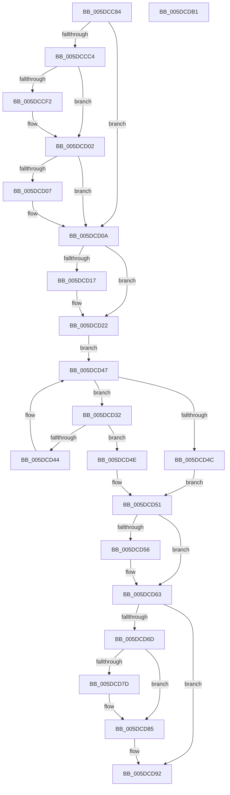

# PopPepIterateDeviceList

- RVA: `0x005DCC84`–`0x005DCDB2` (길이 `302` bytes)
- VA: `0x00000001405DCC84`
- 실행 섹션: `.text`
- PDB 이름 있음: `예`; PDB Function 태그: `아니요`
- unwind 정보 RVA: `0x0008C20C`
- 디코드: `85`개 명령, `302/302` bytes 표시
- 미해석 바이트: `0` (있으면 어셈블리에 `.byte`로 보존)

> 이 문서는 커널 이미지의 기계어와 PDB 기호를 분석해 생성했습니다. 4번과 5번은 함수 원형과 자료형을 바이너리 사용 방식에서 추정한 C 해석이며 원본 소스 복구 결과는 아닙니다.

## 1. Dependencies

- 직접 호출 지점: **8**; 고유 호출 대상: **6**
- 직접 호출자로 확인된 함수: **1**
- RIP 상대 이미지 참조: **2**

### Outgoing calls
- `0x005DCCDD` → [KeAbPreAcquire](../21/KeAbPreAcquire_function_00210230.md) (function, `0x00210230`)
- `0x005DCCFD` → [ExfAcquirePushLockSharedEx](../21/ExfAcquirePushLockSharedEx_function_0021044C.md) (function, `0x0021044C`)
- `0x005DCD1D` → [guard_dispatch_icall](../6B/guard_dispatch_icall_function_006BAAD0.md) (function, `0x006BAAD0`)
- `0x005DCD3B` → [guard_dispatch_icall](../6B/guard_dispatch_icall_function_006BAAD0.md) (function, `0x006BAAD0`)
- `0x005DCD5E` → [guard_dispatch_icall](../6B/guard_dispatch_icall_function_006BAAD0.md) (function, `0x006BAAD0`)
- `0x005DCD80` → [ExfReleasePushLockShared](../26/ExfReleasePushLockShared_function_00263440.md) (function, `0x00263440`)
- `0x005DCD88` → [KeAbPostRelease](../2E/KeAbPostRelease_function_002E1600.md) (function, `0x002E1600`)
- `0x005DCD8D` → [KeLeaveCriticalRegion](../25/KeLeaveCriticalRegion_function_0025D8B0.md) (function, `0x0025D8B0`)

### Direct callers
- [PopPlRegisterPowerPlane](../4D/PopPlRegisterPowerPlane_function_004DB504.md) at `0x004DB5C9`
- [PopPlRegisterPowerPlane](../4D/PopPlRegisterPowerPlane_function_004DB504.md) at `0x004DB5F6`
- [PopPlRegisterPowerPlane](../4D/PopPlRegisterPowerPlane_function_004DB504.md) at `0x004DB622`

### Static image references
- `0x005DCCA3` → RVA `0x00F07678` (`.data`; read)
- `0x005DCD22` → RVA `0x00F07680` (`.data`; read)

## 2. Other-region calls and transfers

- 다른 실행 섹션으로 향하는 call: **0**
- 별도 외부 분기/꼬리 이동을 확인하지 못했습니다.

## 3. Assembly (complete function range)

```asm
005DCC84  48 89 5C 24 08                  mov qword ptr [rsp + 8], rbx
005DCC89  48 89 6C 24 10                  mov qword ptr [rsp + 0x10], rbp
005DCC8E  48 89 74 24 18                  mov qword ptr [rsp + 0x18], rsi
005DCC93  57                              push rdi
005DCC94  41 54                           push r12
005DCC96  41 55                           push r13
005DCC98  41 56                           push r14
005DCC9A  41 57                           push r15
005DCC9C  48 83 EC 30                     sub rsp, 0x30
005DCCA0  45 33 E4                        xor r12d, r12d
005DCCA3  4C 8D 2D CE A9 92 00            lea r13, [rip + 0x92a9ce]
005DCCAA  4D 8B F0                        mov r14, r8
005DCCAD  4C 8B FA                        mov r15, rdx
005DCCB0  48 8B E9                        mov rbp, rcx
005DCCB3  B3 01                           mov bl, 1
005DCCB5  BE 11 00 00 00                  mov esi, 0x11
005DCCBA  44 38 A4 24 80 00 00 00         cmp byte ptr [rsp + 0x80], r12b
005DCCC2  74 46                           je 0x1405dcd0a
005DCCC4  65 48 8B 04 25 88 01 00 00      mov rax, qword ptr gs:[0x188]
005DCCCD  45 33 C0                        xor r8d, r8d
005DCCD0  33 D2                           xor edx, edx
005DCCD2  49 8B CD                        mov rcx, r13
005DCCD5  66 FF 88 E4 01 00 00            dec word ptr [rax + 0x1e4]
005DCCDC  90                              nop
005DCCDD  E8 4E 35 C3 FF                  call 0x140210230
005DCCE2  48 8B F8                        mov rdi, rax
005DCCE5  33 C0                           xor eax, eax
005DCCE7  F0 48 0F B1 35 88 A9 92 00      lock cmpxchg qword ptr [rip + 0x92a988], rsi
005DCCF0  74 10                           je 0x1405dcd02
005DCCF2  4D 8B CD                        mov r9, r13
005DCCF5  4C 8B C7                        mov r8, rdi
005DCCF8  33 D2                           xor edx, edx
005DCCFA  49 8B CD                        mov rcx, r13
005DCCFD  E8 4A 37 C3 FF                  call 0x14021044c
005DCD02  48 85 FF                        test rdi, rdi
005DCD05  74 03                           je 0x1405dcd0a
005DCD07  88 5F 0A                        mov byte ptr [rdi + 0xa], bl
005DCD0A  48 8B B4 24 90 00 00 00         mov rsi, qword ptr [rsp + 0x90]
005DCD12  48 85 ED                        test rbp, rbp
005DCD15  74 0B                           je 0x1405dcd22
005DCD17  48 8B CE                        mov rcx, rsi
005DCD1A  48 8B C5                        mov rax, rbp
005DCD1D  E8 AE DD 0D 00                  call 0x1406baad0
005DCD22  48 8B 3D 57 A9 92 00            mov rdi, qword ptr [rip + 0x92a957]
005DCD29  48 8D 2D 50 A9 92 00            lea rbp, [rip + 0x92a950]
005DCD30  EB 15                           jmp 0x1405dcd47
005DCD32  48 8B D6                        mov rdx, rsi
005DCD35  48 8B CF                        mov rcx, rdi
005DCD38  49 8B C7                        mov rax, r15
005DCD3B  E8 90 DD 0D 00                  call 0x1406baad0
005DCD40  84 C0                           test al, al
005DCD42  74 0A                           je 0x1405dcd4e
005DCD44  48 8B 3F                        mov rdi, qword ptr [rdi]
005DCD47  48 3B FD                        cmp rdi, rbp
005DCD4A  75 E6                           jne 0x1405dcd32
005DCD4C  EB 03                           jmp 0x1405dcd51
005DCD4E  41 8A DC                        mov bl, r12b
005DCD51  4D 85 F6                        test r14, r14
005DCD54  74 0D                           je 0x1405dcd63
005DCD56  48 8B D6                        mov rdx, rsi
005DCD59  8A CB                           mov cl, bl
005DCD5B  49 8B C6                        mov rax, r14
005DCD5E  E8 6D DD 0D 00                  call 0x1406baad0
005DCD63  44 38 A4 24 88 00 00 00         cmp byte ptr [rsp + 0x88], r12b
005DCD6B  74 25                           je 0x1405dcd92
005DCD6D  B8 11 00 00 00                  mov eax, 0x11
005DCD72  F0 4C 0F B1 25 FD A8 92 00      lock cmpxchg qword ptr [rip + 0x92a8fd], r12
005DCD7B  74 08                           je 0x1405dcd85
005DCD7D  49 8B CD                        mov rcx, r13
005DCD80  E8 BB 66 C8 FF                  call 0x140263440
005DCD85  49 8B CD                        mov rcx, r13
005DCD88  E8 73 48 D0 FF                  call 0x1402e1600
005DCD8D  E8 1E 0B C8 FF                  call 0x14025d8b0
005DCD92  48 8B 6C 24 68                  mov rbp, qword ptr [rsp + 0x68]
005DCD97  8A C3                           mov al, bl
005DCD99  48 8B 5C 24 60                  mov rbx, qword ptr [rsp + 0x60]
005DCD9E  48 8B 74 24 70                  mov rsi, qword ptr [rsp + 0x70]
005DCDA3  48 83 C4 30                     add rsp, 0x30
005DCDA7  41 5F                           pop r15
005DCDA9  41 5E                           pop r14
005DCDAB  41 5D                           pop r13
005DCDAD  41 5C                           pop r12
005DCDAF  5F                              pop rdi
005DCDB0  C3                              ret
005DCDB1  CC                              int3
```

## 4. C-style interpretation (structured pseudocode)

```c
__int64 __fastcall PopPepIterateDeviceList(__int64 a1, __int64 a2, __int64 a3, __int64 a4, unsigned __int8 a5, unsigned __int8 a6, __int64 a7)
{
    __int64 result;
    __int64 v_r12;
    __int64 v_rsp;
    unsigned __int64 v_stack_p10;
    unsigned __int64 v_stack_p18;
    unsigned __int64 v_stack_p8;

    v_stack_p8 = v_rbx;
    v_stack_p10 = v_rbp;
    v_stack_p18 = v_rsi;
    v_rsp = (v_rsp) - (48);
    v_r12 = 0;
    if (a5 == 0) goto loc_005DCD0A;
    a3 = 0;
    a2 = 0;
    result = KeAbPreAcquire(v_rip + 9611726, a2, a3, a4);
    result = 0;
    if (!(condition_is_equal)) {
        a4 = v_rip + 9611726;
        a3 = 0;
        a2 = 0;
        a1 = v_rip + 9611726;
        result = ExfAcquirePushLockSharedEx(a1, a2, a3, a4);
    }
    if (result != 0) {
        *(unsigned __int8 *)(result + 10) = 1;
    }
    if (a1 != 0) {
        a1 = a7;
        result = a1;
        result = guard_dispatch_icall(a1, a2, a3, a4);
    }
    goto loc_005DCD47;
loc_005DCD32:
    result = guard_dispatch_icall(*(unsigned __int64 *)(v_rip + 9611607), a7, a3, a4);
    if ((unsigned __int8)(result) == 0) goto loc_005DCD4E;
loc_005DCD47:
    if ((*(unsigned __int64 *)(*(unsigned __int64 *)(v_rip + 9611607))) != (v_rip + 9611600)) goto loc_005DCD32;
    goto loc_005DCD51;
loc_005DCD4E:
loc_005DCD51:
    if (a3 != 0) {
        a2 = a7;
        a1 = 0;
        result = a3;
        result = guard_dispatch_icall(a1, a2, a3, a4);
    }
    if (a6 == 0) goto loc_005DCD92;
    result = 17;
    if (a6 != 0) {
        a1 = v_rip + 9611726;
        result = ExfReleasePushLockShared(a1, a2, a3, a4);
    }
    result = KeAbPostRelease(v_rip + 9611726, a2, a3, a4);
    result = KeLeaveCriticalRegion(v_rip + 9611726, a2, a3, a4);
loc_005DCD92:
    v_rsp = (v_rsp) + (48);
    return 0;
}
```

## 5. (Beta) C Style

```c
int64_t PopPepIterateDeviceList(int64_t Arg1, int64_t Arg2, int64_t Arg3, int64_t Arg4, uint8_t Arg5, uint8_t Arg6, int64_t Arg7)
{
    int64_t result;
    int64_t local_r12;
    int64_t local_rsp;
    uint64_t v_stack_p10;
    uint64_t v_stack_p18;
    uint64_t v_stack_p8;

    v_stack_p8 = local_rbx;
    v_stack_p10 = local_rbp;
    v_stack_p18 = local_rsi;
    local_rsp = (local_rsp) - (48);
    local_r12 = 0;
    if (Arg5 == 0) goto loc_005DCD0A;
    Arg3 = 0;
    Arg2 = 0;
    result = KeAbPreAcquire(v_rip + 9611726, Arg2, Arg3, Arg4);
    result = 0;
    if (!(condition_is_equal)) {
        Arg4 = v_rip + 9611726;
        Arg3 = 0;
        Arg2 = 0;
        Arg1 = v_rip + 9611726;
        result = ExfAcquirePushLockSharedEx(Arg1, Arg2, Arg3, Arg4);
    }
    if (result != 0) {
        *(uint8_t *)(result + 0xA) = 1;
    }
    if (Arg1 != 0) {
        Arg1 = Arg7;
        result = Arg1;
        result = guard_dispatch_icall(Arg1, Arg2, Arg3, Arg4);
    }
    goto loc_005DCD47;
loc_005DCD32:
    result = guard_dispatch_icall(*(uint64_t *)(v_rip + 0x92A957), Arg7, Arg3, Arg4);
    if ((uint8_t)(result) == 0) goto loc_005DCD4E;
loc_005DCD47:
    if ((*(uint64_t *)(*(uint64_t *)(v_rip + 0x92A957))) != (v_rip + 9611600)) goto loc_005DCD32;
    goto loc_005DCD51;
loc_005DCD4E:
loc_005DCD51:
    if (Arg3 != 0) {
        Arg2 = Arg7;
        Arg1 = 0;
        result = Arg3;
        result = guard_dispatch_icall(Arg1, Arg2, Arg3, Arg4);
    }
    if (Arg6 == 0) goto loc_005DCD92;
    result = 17;
    if (Arg6 != 0) {
        Arg1 = v_rip + 9611726;
        result = ExfReleasePushLockShared(Arg1, Arg2, Arg3, Arg4);
    }
    result = KeAbPostRelease(v_rip + 9611726, Arg2, Arg3, Arg4);
    result = KeLeaveCriticalRegion(v_rip + 9611726, Arg2, Arg3, Arg4);
loc_005DCD92:
    local_rsp = (local_rsp) + (48);
    return 0;
}
```

## 6. Execution-region graph

[열기: 2D/3D 그래프와 함수 탐색 컨트롤 패널](../../../control-panel.html?section=text&rva=0x005DCC84&view=graph)

- 2D 그래프는 위에서 아래로 흐르고, 3D 그래프는 빈 공간을 드래그해 회전합니다. Shift+드래그는 이동, 휠은 확대·축소, 함수 노드 선택은 대상 보고서 이동입니다.

### Static fallback


