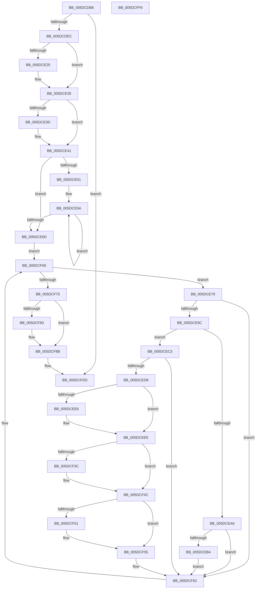

# PopPepPlatformStateRegistered

- RVA: `0x005DCDB8`–`0x005DCFF7` (길이 `575` bytes)
- VA: `0x00000001405DCDB8`
- 실행 섹션: `.text`
- PDB 이름 있음: `예`; PDB Function 태그: `아니요`
- unwind 정보 RVA: `0x000CD6B0`
- 디코드: `148`개 명령, `575/575` bytes 표시
- 미해석 바이트: `0` (있으면 어셈블리에 `.byte`로 보존)

> 이 문서는 커널 이미지의 기계어와 PDB 기호를 분석해 생성했습니다. 4번과 5번은 함수 원형과 자료형을 바이너리 사용 방식에서 추정한 C 해석이며 원본 소스 복구 결과는 아닙니다.

## 1. Dependencies

- 직접 호출 지점: **20**; 고유 호출 대상: **16**
- 직접 호출자로 확인된 함수: **1**
- RIP 상대 이미지 참조: **5**

### Outgoing calls
- `0x005DCE0C` → [KeAbPreAcquire](../21/KeAbPreAcquire_function_00210230.md) (function, `0x00210230`)
- `0x005DCE30` → [ExfAcquirePushLockSharedEx](../21/ExfAcquirePushLockSharedEx_function_0021044C.md) (function, `0x0021044C`)
- `0x005DCE41` → [PopPepInitializeConstraintOverrides](../../page/77/PopPepInitializeConstraintOverrides_function_00770BD0.md) (function, `0x00770BD0`)
- `0x005DCE7D` → [ExAcquireSpinLockShared](../24/ExAcquireSpinLockShared_function_0024DCE0.md) (function, `0x0024DCE0`)
- `0x005DCE8E` → [ExReleaseSpinLockShared](../2F/ExReleaseSpinLockShared_function_002F0EF0.md) (function, `0x002F0EF0`)
- `0x005DCEB9` → [PopPepInitializeDebuggerMasks](PopPepInitializeDebuggerMasks_function_005DCB94.md) (function, `0x005DCB94`)
- `0x005DCECB` → [PopFxTryReferenceDevice](../2C/PopFxTryReferenceDevice_function_002C0628.md) (function, `0x002C0628`)
- `0x005DCEE9` → [ExfReleasePushLockShared](../26/ExfReleasePushLockShared_function_00263440.md) (function, `0x00263440`)
- `0x005DCEF1` → [KeAbPostRelease](../2E/KeAbPostRelease_function_002E1600.md) (function, `0x002E1600`)
- `0x005DCF03` → [PopFxActivateDevice](../4A/PopFxActivateDevice_function_004A0DC8.md) (function, `0x004A0DC8`)
- `0x005DCF0D` → [PopPepInitializeVetoMasks](../4C/PopPepInitializeVetoMasks_function_004C9350.md) (function, `0x004C9350`)
- `0x005DCF1A` → [PoFxIdleDevice](../48/PoFxIdleDevice_function_00483EE8.md) (function, `0x00483EE8`)
- `0x005DCF27` → [KeAbPreAcquire](../21/KeAbPreAcquire_function_00210230.md) (function, `0x00210230`)
- `0x005DCF47` → [ExfAcquirePushLockSharedEx](../21/ExfAcquirePushLockSharedEx_function_0021044C.md) (function, `0x0021044C`)
- `0x005DCF5D` → [PopFxDereferenceDevice](../27/PopFxDereferenceDevice_function_0027038C.md) (function, `0x0027038C`)
- `0x005DCF86` → [ExfReleasePushLockShared](../26/ExfReleasePushLockShared_function_00263440.md) (function, `0x00263440`)
- `0x005DCF8E` → [KeAbPostRelease](../2E/KeAbPostRelease_function_002E1600.md) (function, `0x002E1600`)
- `0x005DCF93` → [KeLeaveCriticalRegion](../25/KeLeaveCriticalRegion_function_0025D8B0.md) (function, `0x0025D8B0`)
- `0x005DCFAC` → [PopPepUpdateIdleStateRefCount](../2B/PopPepUpdateIdleStateRefCount_function_002BF930.md) (function, `0x002BF930`)
- `0x005DCFD8` → [ZwUpdateWnfStateData](../6B/ZwUpdateWnfStateData_function_006B0D10.md) (function, `0x006B0D10`)

### Direct callers
- [PopFxEnablePlatformStates](PopFxEnablePlatformStates_function_005D2A98.md) at `0x005D2AA0`

### Static image references
- `0x005DCDCE` → RVA `0x00FC6AD0` (`ALMOSTRO`; read)
- `0x005DCDDD` → RVA `0x00FC52C8` (`ALMOSTRO`; read)
- `0x005DCDF5` → RVA `0x00F07678` (`.data`; read)
- `0x005DCE6D` → RVA `0x00F07680` (`.data`; read)
- `0x005DCFC3` → RVA `0x00020A50` (`.rdata`; read)

## 2. Other-region calls and transfers

- 다른 실행 섹션으로 향하는 call: **1**
  - `0x005DCE41` → [PopPepInitializeConstraintOverrides](../../page/77/PopPepInitializeConstraintOverrides_function_00770BD0.md) (`.text` → `PAGE`)
- 별도 외부 분기/꼬리 이동을 확인하지 못했습니다.

## 3. Assembly (complete function range)

```asm
005DCDB8  48 89 5C 24 08                  mov qword ptr [rsp + 8], rbx
005DCDBD  48 89 6C 24 20                  mov qword ptr [rsp + 0x20], rbp
005DCDC2  56                              push rsi
005DCDC3  57                              push rdi
005DCDC4  41 55                           push r13
005DCDC6  41 56                           push r14
005DCDC8  41 57                           push r15
005DCDCA  48 83 EC 40                     sub rsp, 0x40
005DCDCE  48 8B 15 FB 9C 9E 00            mov rdx, qword ptr [rip + 0x9e9cfb]
005DCDD5  48 83 C2 40                     add rdx, 0x40
005DCDD9  8B E9                           mov ebp, ecx
005DCDDB  33 C0                           xor eax, eax
005DCDDD  F0 48 0F B1 15 E2 84 9E 00      lock cmpxchg qword ptr [rip + 0x9e84e2], rdx
005DCDE6  0F 85 F1 01 00 00               jne 0x1405dcfdd
005DCDEC  65 48 8B 04 25 88 01 00 00      mov rax, qword ptr gs:[0x188]
005DCDF5  4C 8D 3D 7C A8 92 00            lea r15, [rip + 0x92a87c]
005DCDFC  45 33 C0                        xor r8d, r8d
005DCDFF  33 D2                           xor edx, edx
005DCE01  49 8B CF                        mov rcx, r15
005DCE04  66 FF 88 E4 01 00 00            dec word ptr [rax + 0x1e4]
005DCE0B  90                              nop
005DCE0C  E8 1F 34 C3 FF                  call 0x140210230
005DCE11  48 8B D8                        mov rbx, rax
005DCE14  33 C0                           xor eax, eax
005DCE16  44 8D 68 11                     lea r13d, [rax + 0x11]
005DCE1A  F0 4C 0F B1 2D 55 A8 92 00      lock cmpxchg qword ptr [rip + 0x92a855], r13
005DCE23  74 10                           je 0x1405dce35
005DCE25  4D 8B CF                        mov r9, r15
005DCE28  4C 8B C3                        mov r8, rbx
005DCE2B  33 D2                           xor edx, edx
005DCE2D  49 8B CF                        mov rcx, r15
005DCE30  E8 17 36 C3 FF                  call 0x14021044c
005DCE35  45 33 F6                        xor r14d, r14d
005DCE38  48 85 DB                        test rbx, rbx
005DCE3B  74 04                           je 0x1405dce41
005DCE3D  C6 43 0A 01                     mov byte ptr [rbx + 0xa], 1
005DCE41  E8 8A 3D 19 00                  call 0x140770bd0
005DCE46  48 8B 05 7B 84 9E 00            mov rax, qword ptr [rip + 0x9e847b]
005DCE4D  85 ED                           test ebp, ebp
005DCE4F  74 1C                           je 0x1405dce6d
005DCE51  48 05 80 01 00 00               add rax, 0x180
005DCE57  48 8B CD                        mov rcx, rbp
005DCE5A  C7 00 01 00 00 40               mov dword ptr [rax], 0x40000001
005DCE60  48 8D 80 C0 01 00 00            lea rax, [rax + 0x1c0]
005DCE67  48 83 E9 01                     sub rcx, 1
005DCE6B  75 ED                           jne 0x1405dce5a
005DCE6D  48 8B 35 0C A8 92 00            mov rsi, qword ptr [rip + 0x92a80c]
005DCE74  E9 EC 00 00 00                  jmp 0x1405dcf65
005DCE79  48 8D 4E 40                     lea rcx, [rsi + 0x40]
005DCE7D  E8 5E 0E C7 FF                  call 0x14024dce0
005DCE82  8B 9E AC 00 00 00               mov ebx, dword ptr [rsi + 0xac]
005DCE88  48 8D 4E 40                     lea rcx, [rsi + 0x40]
005DCE8C  8A D0                           mov dl, al
005DCE8E  E8 5D 40 D1 FF                  call 0x1402f0ef0
005DCE93  83 FB 01                        cmp ebx, 1
005DCE96  0F 85 C6 00 00 00               jne 0x1405dcf62
005DCE9C  48 8B 5E 20                     mov rbx, qword ptr [rsi + 0x20]
005DCEA0  4C 39 73 30                     cmp qword ptr [rbx + 0x30], r14
005DCEA4  75 1D                           jne 0x1405dcec3
005DCEA6  8B 83 60 03 00 00               mov eax, dword ptr [rbx + 0x360]
005DCEAC  A8 02                           test al, 2
005DCEAE  0F 84 AE 00 00 00               je 0x1405dcf62
005DCEB4  8B D5                           mov edx, ebp
005DCEB6  48 8B CE                        mov rcx, rsi
005DCEB9  E8 D6 FC FF FF                  call 0x1405dcb94
005DCEBE  E9 9F 00 00 00                  jmp 0x1405dcf62
005DCEC3  BA 02 00 00 00                  mov edx, 2
005DCEC8  48 8B CB                        mov rcx, rbx
005DCECB  E8 58 37 CE FF                  call 0x1402c0628
005DCED0  85 C0                           test eax, eax
005DCED2  0F 88 8A 00 00 00               js 0x1405dcf62
005DCED8  49 8B C5                        mov rax, r13
005DCEDB  F0 4C 0F B1 35 94 A7 92 00      lock cmpxchg qword ptr [rip + 0x92a794], r14
005DCEE4  74 08                           je 0x1405dceee
005DCEE6  49 8B CF                        mov rcx, r15
005DCEE9  E8 52 65 C8 FF                  call 0x140263440
005DCEEE  49 8B CF                        mov rcx, r15
005DCEF1  E8 0A 47 D0 FF                  call 0x1402e1600
005DCEF6  48 8B 4B 30                     mov rcx, qword ptr [rbx + 0x30]
005DCEFA  45 33 C0                        xor r8d, r8d
005DCEFD  33 D2                           xor edx, edx
005DCEFF  48 8B 49 20                     mov rcx, qword ptr [rcx + 0x20]
005DCF03  E8 C0 3E EC FF                  call 0x1404a0dc8
005DCF08  8B D5                           mov edx, ebp
005DCF0A  48 8B CE                        mov rcx, rsi
005DCF0D  E8 3E C4 EE FF                  call 0x1404c9350
005DCF12  48 8B 4B 30                     mov rcx, qword ptr [rbx + 0x30]
005DCF16  48 8B 49 20                     mov rcx, qword ptr [rcx + 0x20]
005DCF1A  E8 C9 6F EA FF                  call 0x140483ee8
005DCF1F  45 33 C0                        xor r8d, r8d
005DCF22  33 D2                           xor edx, edx
005DCF24  49 8B CF                        mov rcx, r15
005DCF27  E8 04 33 C3 FF                  call 0x140210230
005DCF2C  48 8B F8                        mov rdi, rax
005DCF2F  33 C0                           xor eax, eax
005DCF31  F0 4C 0F B1 2D 3E A7 92 00      lock cmpxchg qword ptr [rip + 0x92a73e], r13
005DCF3A  74 10                           je 0x1405dcf4c
005DCF3C  4D 8B CF                        mov r9, r15
005DCF3F  4C 8B C7                        mov r8, rdi
005DCF42  33 D2                           xor edx, edx
005DCF44  49 8B CF                        mov rcx, r15
005DCF47  E8 00 35 C3 FF                  call 0x14021044c
005DCF4C  48 85 FF                        test rdi, rdi
005DCF4F  74 04                           je 0x1405dcf55
005DCF51  C6 47 0A 01                     mov byte ptr [rdi + 0xa], 1
005DCF55  BA 02 00 00 00                  mov edx, 2
005DCF5A  48 8B CB                        mov rcx, rbx
005DCF5D  E8 2A 34 C9 FF                  call 0x14027038c
005DCF62  48 8B 36                        mov rsi, qword ptr [rsi]
005DCF65  48 8D 05 14 A7 92 00            lea rax, [rip + 0x92a714]
005DCF6C  48 3B F0                        cmp rsi, rax
005DCF6F  0F 85 04 FF FF FF               jne 0x1405dce79
005DCF75  49 8B C5                        mov rax, r13
005DCF78  F0 4C 0F B1 35 F7 A6 92 00      lock cmpxchg qword ptr [rip + 0x92a6f7], r14
005DCF81  74 08                           je 0x1405dcf8b
005DCF83  49 8B CF                        mov rcx, r15
005DCF86  E8 B5 64 C8 FF                  call 0x140263440
005DCF8B  49 8B CF                        mov rcx, r15
005DCF8E  E8 6D 46 D0 FF                  call 0x1402e1600
005DCF93  E8 18 09 C8 FF                  call 0x14025d8b0
005DCF98  8B CD                           mov ecx, ebp
005DCF9A  B8 01 00 00 00                  mov eax, 1
005DCF9F  D3 E0                           shl eax, cl
005DCFA1  45 33 C9                        xor r9d, r9d
005DCFA4  45 33 C0                        xor r8d, r8d
005DCFA7  33 D2                           xor edx, edx
005DCFA9  8D 48 FF                        lea ecx, [rax - 1]
005DCFAC  E8 7F 29 CE FF                  call 0x1402bf930
005DCFB1  45 33 C9                        xor r9d, r9d
005DCFB4  44 89 74 24 30                  mov dword ptr [rsp + 0x30], r14d
005DCFB9  44 89 74 24 28                  mov dword ptr [rsp + 0x28], r14d
005DCFBE  48 8D 54 24 78                  lea rdx, [rsp + 0x78]
005DCFC3  48 8D 0D 86 3A A4 FF            lea rcx, [rip - 0x5bc57a]
005DCFCA  C6 44 24 78 01                  mov byte ptr [rsp + 0x78], 1
005DCFCF  4C 89 74 24 20                  mov qword ptr [rsp + 0x20], r14
005DCFD4  45 8D 41 01                     lea r8d, [r9 + 1]
005DCFD8  E8 33 3D 0D 00                  call 0x1406b0d10
005DCFDD  4C 8D 5C 24 40                  lea r11, [rsp + 0x40]
005DCFE2  49 8B 5B 30                     mov rbx, qword ptr [r11 + 0x30]
005DCFE6  49 8B 6B 48                     mov rbp, qword ptr [r11 + 0x48]
005DCFEA  49 8B E3                        mov rsp, r11
005DCFED  41 5F                           pop r15
005DCFEF  41 5E                           pop r14
005DCFF1  41 5D                           pop r13
005DCFF3  5F                              pop rdi
005DCFF4  5E                              pop rsi
005DCFF5  C3                              ret
005DCFF6  CC                              int3
```

## 4. C-style interpretation (structured pseudocode)

```c
__int64 __fastcall PopPepPlatformStateRegistered(int a1, __int64 a2, int a3)
{
    __int64 result;
    __int64 v_r14;
    __int64 v_rsp;
    unsigned __int64 v_stack_m28;
    unsigned int v_stack_m38;
    unsigned int v_stack_m40;
    unsigned __int64 v_stack_m48;
    unsigned __int64 v_stack_p10;
    unsigned __int64 v_stack_p20;
    unsigned __int64 v_stack_p8;

    v_stack_p8 = v_rbx;
    v_stack_p20 = v_rbp;
    v_rsp = (v_rsp) - (64);
    a2 = (*(unsigned __int64 *)(v_rip + 10394875)) + (64);
    result = 0;
    if (condition_is_not_equal) goto loc_005DCFDD;
    a3 = 0;
    a2 = 0;
    result = KeAbPreAcquire(v_rip + 9611388, a2, a3, a4);
    result = 0;
    if (!(condition_is_equal)) {
        a4 = v_rip + 9611388;
        a3 = 0;
        a2 = 0;
        a1 = v_rip + 9611388;
        result = ExfAcquirePushLockSharedEx(a1, a2, a3, a4);
    }
    v_r14 = 0;
    if (result != 0) {
        *(unsigned __int8 *)(result + 10) = 1;
    }
    result = PopPepInitializeConstraintOverrides(a1, a2, a3, a4);
    if ((unsigned int)((unsigned int)(a1)) == 0) goto loc_005DCE6D;
    result = (*(unsigned __int64 *)(v_rip + 10388603)) + (384);
loc_005DCE5A:
    *(unsigned int *)(result) = 0x40000001ULL;
    a1 = ((unsigned int)(a1)) - (1);
    if (condition_is_not_equal) goto loc_005DCE5A;
loc_005DCE6D:
    goto loc_005DCF65;
loc_005DCE79:
    result = ExAcquireSpinLockShared(*(unsigned __int64 *)(v_rip + 9611276) + 64, a2, a3, a4);
    result = ExReleaseSpinLockShared(*(unsigned __int64 *)(v_rip + 9611276) + 64, (unsigned __int8)(result), a3, a4);
    if (((unsigned int)((unsigned int)(*(unsigned int *)(*(unsigned __int64 *)(v_rip + 9611276) + 172)))) != 1) goto loc_005DCF62;
    if ((*(unsigned __int64 *)(*(unsigned __int64 *)(*(unsigned __int64 *)(v_rip + 9611276) + 32) + 48)) != 0) goto loc_005DCEC3;
    if ((((unsigned __int8)((unsigned int)(*(unsigned int *)(*(unsigned __int64 *)(*(unsigned __int64 *)(v_rip + 9611276) + 32) + 864)))) & (2)) == 0) goto loc_005DCF62;
    result = PopPepInitializeDebuggerMasks(*(unsigned __int64 *)(v_rip + 9611276), (unsigned int)((unsigned int)((unsigned int)(a1))), a3, a4);
    goto loc_005DCF62;
loc_005DCEC3:
    result = PopFxTryReferenceDevice(*(unsigned __int64 *)(*(unsigned __int64 *)(v_rip + 9611276) + 32), 2, a3, a4);
    if (sign_flag) goto loc_005DCF62;
    result = result + 17;
    if ((unsigned int)(result) != 0) {
        a1 = v_rip + 9611388;
        result = ExfReleasePushLockShared(a1, 2, a3, a4);
    }
    result = KeAbPostRelease(v_rip + 9611388, 2, a3, a4);
    a3 = 0;
    a2 = 0;
    result = PopFxActivateDevice(*(unsigned __int64 *)(*(unsigned __int64 *)(*(unsigned __int64 *)(*(unsigned __int64 *)(v_rip + 9611276) + 32) + 48) + 32), a2, a3, a4);
    result = PopPepInitializeVetoMasks(*(unsigned __int64 *)(v_rip + 9611276), (unsigned int)((unsigned int)((unsigned int)(a1))), a3, a4);
    result = PoFxIdleDevice(*(unsigned __int64 *)(*(unsigned __int64 *)(*(unsigned __int64 *)(*(unsigned __int64 *)(v_rip + 9611276) + 32) + 48) + 32), (unsigned int)((unsigned int)((unsigned int)(a1))), a3, a4);
    a3 = 0;
    a2 = 0;
    result = KeAbPreAcquire(v_rip + 9611388, a2, a3, a4);
    result = 0;
    if (!(condition_is_equal)) {
        a4 = v_rip + 9611388;
        a3 = 0;
        a2 = 0;
        a1 = v_rip + 9611388;
        result = ExfAcquirePushLockSharedEx(a1, a2, a3, a4);
    }
    if (result != 0) {
        *(unsigned __int8 *)(result + 10) = 1;
    }
    result = PopFxDereferenceDevice(*(unsigned __int64 *)(*(unsigned __int64 *)(v_rip + 9611276) + 32), 2, a3, a4);
loc_005DCF62:
loc_005DCF65:
    if ((*(unsigned __int64 *)(*(unsigned __int64 *)(v_rip + 9611276))) != (v_rip + 9611028)) goto loc_005DCE79;
    result = result + 17;
    if ((*(unsigned __int64 *)(*(unsigned __int64 *)(v_rip + 9611276))) != (v_rip + 9611028)) {
        a1 = v_rip + 9611388;
        result = ExfReleasePushLockShared(a1, 2, a3, a4);
    }
    result = KeAbPostRelease(v_rip + 9611388, 2, a3, a4);
    result = KeLeaveCriticalRegion(v_rip + 9611388, 2, a3, a4);
    result = (unsigned int)((1) << ((unsigned __int8)((unsigned int)((unsigned int)((unsigned int)(a1))))));
    a4 = 0;
    a3 = 0;
    a2 = 0;
    result = PopPepUpdateIdleStateRefCount(result - 1, a2, a3, a4);
    a4 = 0;
    v_stack_m38 = 0;
    v_stack_m40 = 0;
    v_stack_p10 = 1;
    v_stack_m48 = 0;
    result = ZwUpdateWnfStateData(v_rip - 6014330, v_stack_p10, a4 + 1, a4);
loc_005DCFDD:
    return result;
}
```

## 5. (Beta) C Style

```c
int64_t PopPepPlatformStateRegistered(int32_t Arg1, int64_t Arg2, int32_t Arg3)
{
    int64_t result;
    int64_t local_r14;
    int64_t local_rsp;
    uint64_t v_stack_m28;
    uint32_t v_stack_m38;
    uint32_t v_stack_m40;
    uint64_t v_stack_m48;
    uint64_t v_stack_p10;
    uint64_t v_stack_p20;
    uint64_t v_stack_p8;

    v_stack_p8 = local_rbx;
    v_stack_p20 = local_rbp;
    local_rsp = (local_rsp) - (64);
    Arg2 = (*(uint64_t *)(v_rip + 0x9E9CFB)) + (64);
    result = 0;
    if (condition_is_not_equal) goto loc_005DCFDD;
    Arg3 = 0;
    Arg2 = 0;
    result = KeAbPreAcquire(v_rip + 9611388, Arg2, Arg3, a4);
    result = 0;
    if (!(condition_is_equal)) {
        a4 = v_rip + 9611388;
        Arg3 = 0;
        Arg2 = 0;
        Arg1 = v_rip + 9611388;
        result = ExfAcquirePushLockSharedEx(Arg1, Arg2, Arg3, a4);
    }
    local_r14 = 0;
    if (result != 0) {
        *(uint8_t *)(result + 0xA) = 1;
    }
    result = PopPepInitializeConstraintOverrides(Arg1, Arg2, Arg3, a4);
    if ((uint32_t)((uint32_t)(Arg1)) == 0) goto loc_005DCE6D;
    result = (*(uint64_t *)(v_rip + 0x9E847B)) + (384);
loc_005DCE5A:
    *(uint32_t *)(result) = 0x40000001ULL;
    Arg1 = ((uint32_t)(Arg1)) - (1);
    if (condition_is_not_equal) goto loc_005DCE5A;
loc_005DCE6D:
    goto loc_005DCF65;
loc_005DCE79:
    result = ExAcquireSpinLockShared(*(uint64_t *)(v_rip + 0x92A80C) + 64, Arg2, Arg3, a4);
    result = ExReleaseSpinLockShared(*(uint64_t *)(v_rip + 0x92A80C) + 64, (uint8_t)(result), Arg3, a4);
    if (((uint32_t)((uint32_t)(*(uint32_t *)(*(uint64_t *)(v_rip + 0x92A80C) + 0xAC)))) != 1) goto loc_005DCF62;
    if ((*(uint64_t *)(*(uint64_t *)(*(uint64_t *)(v_rip + 0x92A80C) + 0x20) + 0x30)) != 0) goto loc_005DCEC3;
    if ((((uint8_t)((uint32_t)(*(uint32_t *)(*(uint64_t *)(*(uint64_t *)(v_rip + 0x92A80C) + 0x20) + 0x360)))) & (2)) == 0) goto loc_005DCF62;
    result = PopPepInitializeDebuggerMasks(*(uint64_t *)(v_rip + 0x92A80C), (uint32_t)((uint32_t)((uint32_t)(Arg1))), Arg3, a4);
    goto loc_005DCF62;
loc_005DCEC3:
    result = PopFxTryReferenceDevice(*(uint64_t *)(*(uint64_t *)(v_rip + 0x92A80C) + 0x20), 2, Arg3, a4);
    if (sign_flag) goto loc_005DCF62;
    result = result + 17;
    if ((uint32_t)(result) != 0) {
        Arg1 = v_rip + 9611388;
        result = ExfReleasePushLockShared(Arg1, 2, Arg3, a4);
    }
    result = KeAbPostRelease(v_rip + 9611388, 2, Arg3, a4);
    Arg3 = 0;
    Arg2 = 0;
    result = PopFxActivateDevice(*(uint64_t *)(*(uint64_t *)(*(uint64_t *)(*(uint64_t *)(v_rip + 0x92A80C) + 0x20) + 0x30) + 0x20), Arg2, Arg3, a4);
    result = PopPepInitializeVetoMasks(*(uint64_t *)(v_rip + 0x92A80C), (uint32_t)((uint32_t)((uint32_t)(Arg1))), Arg3, a4);
    result = PoFxIdleDevice(*(uint64_t *)(*(uint64_t *)(*(uint64_t *)(*(uint64_t *)(v_rip + 0x92A80C) + 0x20) + 0x30) + 0x20), (uint32_t)((uint32_t)((uint32_t)(Arg1))), Arg3, a4);
    Arg3 = 0;
    Arg2 = 0;
    result = KeAbPreAcquire(v_rip + 9611388, Arg2, Arg3, a4);
    result = 0;
    if (!(condition_is_equal)) {
        a4 = v_rip + 9611388;
        Arg3 = 0;
        Arg2 = 0;
        Arg1 = v_rip + 9611388;
        result = ExfAcquirePushLockSharedEx(Arg1, Arg2, Arg3, a4);
    }
    if (result != 0) {
        *(uint8_t *)(result + 0xA) = 1;
    }
    result = PopFxDereferenceDevice(*(uint64_t *)(*(uint64_t *)(v_rip + 0x92A80C) + 0x20), 2, Arg3, a4);
loc_005DCF62:
loc_005DCF65:
    if ((*(uint64_t *)(*(uint64_t *)(v_rip + 0x92A80C))) != (v_rip + 9611028)) goto loc_005DCE79;
    result = result + 17;
    if ((*(uint64_t *)(*(uint64_t *)(v_rip + 0x92A80C))) != (v_rip + 9611028)) {
        Arg1 = v_rip + 9611388;
        result = ExfReleasePushLockShared(Arg1, 2, Arg3, a4);
    }
    result = KeAbPostRelease(v_rip + 9611388, 2, Arg3, a4);
    result = KeLeaveCriticalRegion(v_rip + 9611388, 2, Arg3, a4);
    result = (uint32_t)((1) << ((uint8_t)((uint32_t)((uint32_t)((uint32_t)(Arg1))))));
    a4 = 0;
    Arg3 = 0;
    Arg2 = 0;
    result = PopPepUpdateIdleStateRefCount(result - 1, Arg2, Arg3, a4);
    a4 = 0;
    v_stack_m38 = 0;
    v_stack_m40 = 0;
    v_stack_p10 = 1;
    v_stack_m48 = 0;
    result = ZwUpdateWnfStateData(v_rip - 6014330, v_stack_p10, a4 + 1, a4);
loc_005DCFDD:
    return result;
}
```

## 6. Execution-region graph

[열기: 2D/3D 그래프와 함수 탐색 컨트롤 패널](../../../control-panel.html?section=text&rva=0x005DCDB8&view=graph)

- 2D 그래프는 위에서 아래로 흐르고, 3D 그래프는 빈 공간을 드래그해 회전합니다. Shift+드래그는 이동, 휠은 확대·축소, 함수 노드 선택은 대상 보고서 이동입니다.

### Static fallback


