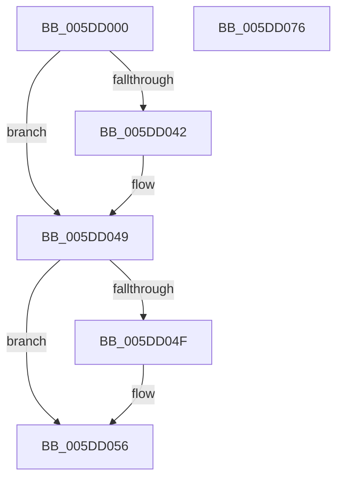

# PopPepRegisterComponentPerfStates

- RVA: `0x005DD000`–`0x005DD077` (길이 `119` bytes)
- VA: `0x00000001405DD000`
- 실행 섹션: `.text`
- PDB 이름 있음: `예`; PDB Function 태그: `아니요`
- unwind 정보 RVA: `0x0005C954`
- 디코드: `29`개 명령, `119/119` bytes 표시
- 미해석 바이트: `0` (있으면 어셈블리에 `.byte`로 보존)

> 이 문서는 커널 이미지의 기계어와 PDB 기호를 분석해 생성했습니다. 4번과 5번은 함수 원형과 자료형을 바이너리 사용 방식에서 추정한 C 해석이며 원본 소스 복구 결과는 아닙니다.

## 1. Dependencies

- 직접 호출 지점: **2**; 고유 호출 대상: **2**
- 직접 호출자로 확인된 함수: **1**
- RIP 상대 이미지 참조: **0**

### Outgoing calls
- `0x005DD027` → [ExAcquireSpinLockShared](../24/ExAcquireSpinLockShared_function_0024DCE0.md) (function, `0x0024DCE0`)
- `0x005DD05C` → [ExReleaseSpinLockShared](../2F/ExReleaseSpinLockShared_function_002F0EF0.md) (function, `0x002F0EF0`)

### Direct callers
- [PopFxRegisterComponentPerfStates](../../page/75/PopFxRegisterComponentPerfStates_function_00759764.md) at `0x00759B29`

### Static image references
- 디코드된 RIP-relative 메모리 참조가 없습니다.

## 2. Other-region calls and transfers

- 다른 실행 섹션으로 향하는 call: **0**
- 별도 외부 분기/꼬리 이동을 확인하지 못했습니다.

## 3. Assembly (complete function range)

```asm
005DD000  48 89 5C 24 08                  mov qword ptr [rsp + 8], rbx
005DD005  48 89 6C 24 10                  mov qword ptr [rsp + 0x10], rbp
005DD00A  48 89 74 24 18                  mov qword ptr [rsp + 0x18], rsi
005DD00F  57                              push rdi
005DD010  48 83 EC 20                     sub rsp, 0x20
005DD014  48 8B F9                        mov rdi, rcx
005DD017  8B C2                           mov eax, edx
005DD019  48 83 C1 40                     add rcx, 0x40
005DD01D  49 8B F0                        mov rsi, r8
005DD020  48 69 D8 D0 00 00 00            imul rbx, rax, 0xd0
005DD027  E8 B4 0C C7 FF                  call 0x14024dce0
005DD02C  C6 84 3B 78 01 00 00 01         mov byte ptr [rbx + rdi + 0x178], 1
005DD034  48 89 B4 3B D8 00 00 00         mov qword ptr [rbx + rdi + 0xd8], rsi
005DD03C  40 F6 C6 02                     test sil, 2
005DD040  74 07                           je 0x1405dd049
005DD042  C6 87 B0 00 00 00 01            mov byte ptr [rdi + 0xb0], 1
005DD049  40 F6 C6 04                     test sil, 4
005DD04D  74 07                           je 0x1405dd056
005DD04F  C6 87 B1 00 00 00 01            mov byte ptr [rdi + 0xb1], 1
005DD056  8A D0                           mov dl, al
005DD058  48 8D 4F 40                     lea rcx, [rdi + 0x40]
005DD05C  E8 8F 3E D1 FF                  call 0x1402f0ef0
005DD061  48 8B 5C 24 30                  mov rbx, qword ptr [rsp + 0x30]
005DD066  48 8B 6C 24 38                  mov rbp, qword ptr [rsp + 0x38]
005DD06B  48 8B 74 24 40                  mov rsi, qword ptr [rsp + 0x40]
005DD070  48 83 C4 20                     add rsp, 0x20
005DD074  5F                              pop rdi
005DD075  C3                              ret
005DD076  CC                              int3
```

## 4. C-style interpretation (structured pseudocode)

```c
__int64 __fastcall PopPepRegisterComponentPerfStates(__int64 a1, int a2, __int64 a3)
{
    __int64 result;
    __int64 v_rbx;
    __int64 v_rsp;
    unsigned __int64 v_stack_p10;
    unsigned __int64 v_stack_p18;
    unsigned __int64 v_stack_p8;

    v_stack_p8 = v_rbx;
    v_stack_p10 = v_rbp;
    v_stack_p18 = v_rsi;
    v_rsp = (v_rsp) - (32);
    a1 = (a1) + (64);
    v_rbx = (v_rbx) * ((unsigned int)(a2));
    result = ExAcquireSpinLockShared(a1, a2, a3, a4);
    *(unsigned __int8 *)(v_rbx + a1 * 1 + 376) = 1;
    *(unsigned __int64 *)(v_rbx + a1 * 1 + 216) = a3;
    if ((((unsigned __int8)(a3)) & (2)) != 0) {
        *(unsigned __int8 *)(a1 + 176) = 1;
    }
    if ((((unsigned __int8)(a3)) & (4)) != 0) {
        *(unsigned __int8 *)(a1 + 177) = 1;
    }
    result = ExReleaseSpinLockShared(a1 + 64, (unsigned __int8)(result), a3, a4);
    v_rsp = (v_rsp) + (32);
    return result;
}
```

## 5. (Beta) C Style

```c
int64_t PopPepRegisterComponentPerfStates(void *Arg1, int32_t Arg2, int64_t Arg3)
{
    uint8_t *arg1 = (uint8_t *)Arg1;

    int64_t result;
    int64_t local_rbx;
    int64_t local_rsp;
    uint64_t v_stack_p10;
    uint64_t v_stack_p18;
    uint64_t v_stack_p8;

    v_stack_p8 = local_rbx;
    v_stack_p10 = local_rbp;
    v_stack_p18 = local_rsi;
    local_rsp = (local_rsp) - (32);
    Arg1 = (Arg1) + (64);
    local_rbx = (local_rbx) * ((uint32_t)(Arg2));
    result = ExAcquireSpinLockShared(Arg1, Arg2, Arg3, a4);
    *(uint8_t *)(local_rbx + arg1 * 1 + 0x178) = 1;
    *(uint64_t *)(local_rbx + arg1 * 1 + 0xD8) = Arg3;
    if ((((uint8_t)(Arg3)) & (2)) != 0) {
        *(uint8_t *)(arg1 + 0xB0) = 1;
    }
    if ((((uint8_t)(Arg3)) & (4)) != 0) {
        *(uint8_t *)(arg1 + 0xB1) = 1;
    }
    result = ExReleaseSpinLockShared(Arg1 + 64, (uint8_t)(result), Arg3, a4);
    local_rsp = (local_rsp) + (32);
    return result;
}
```

### 관측된 메모리 오프셋

구조체 형식이 확인되지 않은 접근은 인자 기준의 오프셋으로만 기록했습니다.

| 기준 인자 | 오프셋 표현 | 폭 (bit) | 접근 |
|---|---:|---:|---|
| `Arg1` | `+ 0x40` | `64` | `R` |
| `Arg1` | `+ 0xB0` | `8` | `W` |
| `Arg1` | `+ 0xB1` | `8` | `W` |

## 6. Execution-region graph

[열기: 2D/3D 그래프와 함수 탐색 컨트롤 패널](../../../control-panel.html?section=text&rva=0x005DD000&view=graph)

- 2D 그래프는 위에서 아래로 흐르고, 3D 그래프는 빈 공간을 드래그해 회전합니다. Shift+드래그는 이동, 휠은 확대·축소, 함수 노드 선택은 대상 보고서 이동입니다.

### Static fallback


