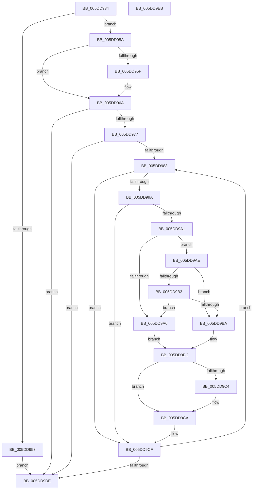

# PopPlCalculateDevicePowerDraw

- RVA: `0x005DD934`–`0x005DD9EC` (길이 `184` bytes)
- VA: `0x00000001405DD934`
- 실행 섹션: `.text`
- PDB 이름 있음: `예`; PDB Function 태그: `아니요`
- unwind 정보 RVA: `0x000950EC`
- 디코드: `53`개 명령, `184/184` bytes 표시
- 미해석 바이트: `0` (있으면 어셈블리에 `.byte`로 보존)

> 이 문서는 커널 이미지의 기계어와 PDB 기호를 분석해 생성했습니다. 4번과 5번은 함수 원형과 자료형을 바이너리 사용 방식에서 추정한 C 해석이며 원본 소스 복구 결과는 아닙니다.

## 1. Dependencies

- 직접 호출 지점: **0**; 고유 호출 대상: **0**
- 직접 호출자로 확인된 함수: **4**
- RIP 상대 이미지 참조: **0**

### Outgoing calls
- 직접 디코드된 call 명령이 없습니다.

### Direct callers
- [PopPlUnregisterDevice](../4E/PopPlUnregisterDevice_function_004E3FF4.md) at `0x004E406C`
- [PopPlRegisterDeviceIterator](PopPlRegisterDeviceIterator_function_005DDE20.md) at `0x005DDEAA`
- [sub_006DBF86](../6D/Unknown_function_006DBF86.md) at `0x006DBFC1`
- [sub_006F5DD8](../6F/Unknown_function_006F5DD8.md) at `0x006F5E06`

### Static image references
- 디코드된 RIP-relative 메모리 참조가 없습니다.

## 2. Other-region calls and transfers

- 다른 실행 섹션으로 향하는 call: **0**
- 별도 외부 분기/꼬리 이동을 확인하지 못했습니다.

## 3. Assembly (complete function range)

```asm
005DD934  48 89 5C 24 08                  mov qword ptr [rsp + 8], rbx
005DD939  48 89 7C 24 10                  mov qword ptr [rsp + 0x10], rdi
005DD93E  4C 8B 99 C8 04 00 00            mov r11, qword ptr [rcx + 0x4c8]
005DD945  49 8B F9                        mov rdi, r9
005DD948  49 8B D8                        mov rbx, r8
005DD94B  4C 8B D1                        mov r10, rcx
005DD94E  4D 85 DB                        test r11, r11
005DD951  75 07                           jne 0x1405dd95a
005DD953  33 D2                           xor edx, edx
005DD955  E9 84 00 00 00                  jmp 0x1405dd9de
005DD95A  48 85 D2                        test rdx, rdx
005DD95D  75 0B                           jne 0x1405dd96a
005DD95F  48 8B 51 30                     mov rdx, qword ptr [rcx + 0x30]
005DD963  48 81 C2 9C 00 00 00            add rdx, 0x9c
005DD96A  48 63 0A                        movsxd rcx, dword ptr [rdx]
005DD96D  41 8B 54 CB 20                  mov edx, dword ptr [r11 + rcx*8 + 0x20]
005DD972  83 F9 01                        cmp ecx, 1
005DD975  7F 67                           jg 0x1405dd9de
005DD977  45 33 C0                        xor r8d, r8d
005DD97A  45 39 82 64 03 00 00            cmp dword ptr [r10 + 0x364], r8d
005DD981  76 5B                           jbe 0x1405dd9de
005DD983  49 8B 82 68 03 00 00            mov rax, qword ptr [r10 + 0x368]
005DD98A  4A 8B 0C C0                     mov rcx, qword ptr [rax + r8*8]
005DD98E  4C 8B 89 B0 01 00 00            mov r9, qword ptr [rcx + 0x1b0]
005DD995  4D 85 C9                        test r9, r9
005DD998  74 35                           je 0x1405dd9cf
005DD99A  49 83 79 18 00                  cmp qword ptr [r9 + 0x18], 0
005DD99F  74 2E                           je 0x1405dd9cf
005DD9A1  48 85 DB                        test rbx, rbx
005DD9A4  75 08                           jne 0x1405dd9ae
005DD9A6  8B 89 98 00 00 00               mov ecx, dword ptr [rcx + 0x98]
005DD9AC  EB 0E                           jmp 0x1405dd9bc
005DD9AE  48 85 FF                        test rdi, rdi
005DD9B1  74 07                           je 0x1405dd9ba
005DD9B3  8B 07                           mov eax, dword ptr [rdi]
005DD9B5  49 3B C0                        cmp rax, r8
005DD9B8  75 EC                           jne 0x1405dd9a6
005DD9BA  8B 0B                           mov ecx, dword ptr [rbx]
005DD9BC  8B C1                           mov eax, ecx
005DD9BE  49 3B 41 18                     cmp rax, qword ptr [r9 + 0x18]
005DD9C2  72 06                           jb 0x1405dd9ca
005DD9C4  41 8B 49 18                     mov ecx, dword ptr [r9 + 0x18]
005DD9C8  FF C9                           dec ecx
005DD9CA  41 2B 54 C9 24                  sub edx, dword ptr [r9 + rcx*8 + 0x24]
005DD9CF  41 8B 8A 64 03 00 00            mov ecx, dword ptr [r10 + 0x364]
005DD9D6  49 FF C0                        inc r8
005DD9D9  4C 3B C1                        cmp r8, rcx
005DD9DC  72 A5                           jb 0x1405dd983
005DD9DE  48 8B 5C 24 08                  mov rbx, qword ptr [rsp + 8]
005DD9E3  8B C2                           mov eax, edx
005DD9E5  48 8B 7C 24 10                  mov rdi, qword ptr [rsp + 0x10]
005DD9EA  C3                              ret
005DD9EB  CC                              int3
```

## 4. C-style interpretation (structured pseudocode)

```c
__int64 __fastcall PopPlCalculateDevicePowerDraw(__int64 a1, int a2, __int64 a3, __int64 a4)
{
    unsigned __int64 v_stack_p10;
    unsigned __int64 v_stack_p8;

    v_stack_p8 = v_rbx;
    v_stack_p10 = v_rdi;
    if (*(unsigned __int64 *)(a1 + 1224) != 0) goto loc_005DD95A;
    a2 = 0;
    goto loc_005DD9DE;
loc_005DD95A:
    if (0 == 0) {
        a2 = *(unsigned __int64 *)(a1 + 48);
        a2 = (a2) + (156);
    }
    if (((unsigned int)((int)(*(unsigned int *)(a2)))) > 1) goto loc_005DD9DE;
    a3 = 0;
    if ((*(unsigned int *)(a1 + 868)) <= 0) goto loc_005DD9DE;
loc_005DD983:
    if (*(unsigned __int64 *)(*(unsigned __int64 *)(*(unsigned __int64 *)(a1 + 872) + a3 * 8) + 432) == 0) goto loc_005DD9CF;
    if ((*(unsigned __int64 *)(*(unsigned __int64 *)(*(unsigned __int64 *)(*(unsigned __int64 *)(a1 + 872) + a3 * 8) + 432) + 24)) == 0) goto loc_005DD9CF;
    if (0 != 0) goto loc_005DD9AE;
loc_005DD9A6:
    goto loc_005DD9BC;
loc_005DD9AE:
    if (a4 == 0) goto loc_005DD9BA;
    if (((unsigned int)(*(unsigned int *)(a4))) != 0) goto loc_005DD9A6;
loc_005DD9BA:
loc_005DD9BC:
    if (((unsigned int)((unsigned int)((unsigned int)(*(unsigned int *)(a3))))) >= (*(unsigned __int64 *)(*(unsigned __int64 *)(*(unsigned __int64 *)(*(unsigned __int64 *)(a1 + 872) + a3 * 8) + 432) + 24))) {
        a1 = *(unsigned int *)(*(unsigned __int64 *)(*(unsigned __int64 *)(*(unsigned __int64 *)(a1 + 872) + a3 * 8) + 432) + 24);
        a1 = (unsigned int)((a1) - 1);
    }
    a2 = (unsigned int)(((unsigned int)(*(unsigned int *)(*(unsigned __int64 *)(a1 + 1224) + (int)(*(unsigned int *)(a2)) * 8 + 32))) - (*(unsigned int *)(*(unsigned __int64 *)(*(unsigned __int64 *)(*(unsigned __int64 *)(a1 + 872) + a3 * 8) + 432) + a1 * 8 + 36)));
loc_005DD9CF:
    a3 = (a3) + 1;
    if (a3 < ((unsigned int)(*(unsigned int *)(a1 + 868)))) goto loc_005DD983;
loc_005DD9DE:
    return (unsigned int)(a2);
}
```

## 5. (Beta) C Style

```c
int64_t PopPlCalculateDevicePowerDraw(void *Arg1, int32_t Arg2, int64_t Arg3, int64_t Arg4)
{
    uint8_t *arg1 = (uint8_t *)Arg1;

    uint64_t v_stack_p10;
    uint64_t v_stack_p8;

    v_stack_p8 = local_rbx;
    v_stack_p10 = local_rdi;
    if (*(uint64_t *)(arg1 + 0x4C8) != 0) goto loc_005DD95A;
    Arg2 = 0;
    goto loc_005DD9DE;
loc_005DD95A:
    if (0 == 0) {
        Arg2 = *(uint64_t *)(arg1 + 0x30);
        Arg2 = (Arg2) + (156);
    }
    if (((uint32_t)((int32_t)(*(uint32_t *)(Arg2)))) > 1) goto loc_005DD9DE;
    Arg3 = 0;
    if ((*(uint32_t *)(arg1 + 0x364)) <= 0) goto loc_005DD9DE;
loc_005DD983:
    if (*(uint64_t *)(*(uint64_t *)(*(uint64_t *)(arg1 + 0x368) + Arg3 * 8) + 0x1B0) == 0) goto loc_005DD9CF;
    if ((*(uint64_t *)(*(uint64_t *)(*(uint64_t *)(*(uint64_t *)(arg1 + 0x368) + Arg3 * 8) + 0x1B0) + 0x18)) == 0) goto loc_005DD9CF;
    if (0 != 0) goto loc_005DD9AE;
loc_005DD9A6:
    goto loc_005DD9BC;
loc_005DD9AE:
    if (Arg4 == 0) goto loc_005DD9BA;
    if (((uint32_t)(*(uint32_t *)(Arg4))) != 0) goto loc_005DD9A6;
loc_005DD9BA:
loc_005DD9BC:
    if (((uint32_t)((uint32_t)((uint32_t)(*(uint32_t *)(Arg3))))) >= (*(uint64_t *)(*(uint64_t *)(*(uint64_t *)(*(uint64_t *)(arg1 + 0x368) + Arg3 * 8) + 0x1B0) + 0x18))) {
        Arg1 = *(uint32_t *)(*(uint64_t *)(*(uint64_t *)(*(uint64_t *)(arg1 + 0x368) + Arg3 * 8) + 0x1B0) + 0x18);
        Arg1 = (uint32_t)((Arg1) - 1);
    }
    Arg2 = (uint32_t)(((uint32_t)(*(uint32_t *)(*(uint64_t *)(arg1 + 0x4C8) + (int32_t)(*(uint32_t *)(Arg2)) * 8 + 0x20))) - (*(uint32_t *)(*(uint64_t *)(*(uint64_t *)(*(uint64_t *)(arg1 + 0x368) + Arg3 * 8) + 0x1B0) + arg1 * 8 + 0x24)));
loc_005DD9CF:
    Arg3 = (Arg3) + 1;
    if (Arg3 < ((uint32_t)(*(uint32_t *)(arg1 + 0x364)))) goto loc_005DD983;
loc_005DD9DE:
    return (uint32_t)(Arg2);
}
```

### 관측된 메모리 오프셋

구조체 형식이 확인되지 않은 접근은 인자 기준의 오프셋으로만 기록했습니다.

| 기준 인자 | 오프셋 표현 | 폭 (bit) | 접근 |
|---|---:|---:|---|
| `Arg1` | `+ 0x30` | `64` | `R` |
| `Arg1` | `+ 0x364` | `32` | `R` |
| `Arg1` | `+ 0x368` | `64` | `R` |
| `Arg1` | `+ 0x4C8` | `64` | `R` |

## 6. Execution-region graph

[열기: 2D/3D 그래프와 함수 탐색 컨트롤 패널](../../../control-panel.html?section=text&rva=0x005DD934&view=graph)

- 2D 그래프는 위에서 아래로 흐르고, 3D 그래프는 빈 공간을 드래그해 회전합니다. Shift+드래그는 이동, 휠은 확대·축소, 함수 노드 선택은 대상 보고서 이동입니다.

### Static fallback


