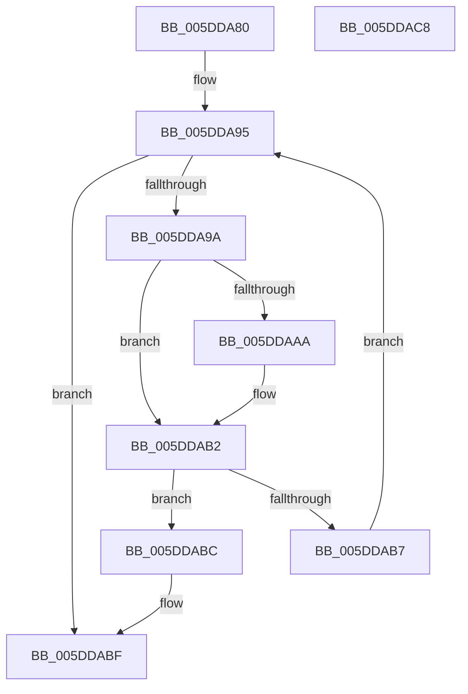

# PopPlLookupComponentPowerProfile

- RVA: `0x005DDA80`–`0x005DDAC9` (길이 `73` bytes)
- VA: `0x00000001405DDA80`
- 실행 섹션: `.text`
- PDB 이름 있음: `예`; PDB Function 태그: `아니요`
- unwind 정보 RVA: `0x00071750`
- 디코드: `24`개 명령, `73/73` bytes 표시
- 미해석 바이트: `0` (있으면 어셈블리에 `.byte`로 보존)

> 이 문서는 커널 이미지의 기계어와 PDB 기호를 분석해 생성했습니다. 4번과 5번은 함수 원형과 자료형을 바이너리 사용 방식에서 추정한 C 해석이며 원본 소스 복구 결과는 아닙니다.

## 1. Dependencies

- 직접 호출 지점: **0**; 고유 호출 대상: **0**
- 직접 호출자로 확인된 함수: **1**
- RIP 상대 이미지 참조: **0**

### Outgoing calls
- 직접 디코드된 call 명령이 없습니다.

### Direct callers
- [PopPlRegisterComponent](../4A/PopPlRegisterComponent_function_004AA1FC.md) at `0x004AA328`

### Static image references
- 디코드된 RIP-relative 메모리 참조가 없습니다.

## 2. Other-region calls and transfers

- 다른 실행 섹션으로 향하는 call: **0**
- 별도 외부 분기/꼬리 이동을 확인하지 못했습니다.

## 3. Assembly (complete function range)

```asm
005DDA80  48 89 5C 24 08                  mov qword ptr [rsp + 8], rbx
005DDA85  48 8B 59 48                     mov rbx, qword ptr [rcx + 0x48]
005DDA89  45 33 C0                        xor r8d, r8d
005DDA8C  45 8B C8                        mov r9d, r8d
005DDA8F  4C 8B DA                        mov r11, rdx
005DDA92  4C 8B D1                        mov r10, rcx
005DDA95  4C 3B CB                        cmp r9, rbx
005DDA98  73 25                           jae 0x1405ddabf
005DDA9A  49 8B 42 50                     mov rax, qword ptr [r10 + 0x50]
005DDA9E  49 8B 0B                        mov rcx, qword ptr [r11]
005DDAA1  4A 8B 14 C8                     mov rdx, qword ptr [rax + r9*8]
005DDAA5  48 2B 0A                        sub rcx, qword ptr [rdx]
005DDAA8  75 08                           jne 0x1405ddab2
005DDAAA  49 8B 4B 08                     mov rcx, qword ptr [r11 + 8]
005DDAAE  48 2B 4A 08                     sub rcx, qword ptr [rdx + 8]
005DDAB2  48 85 C9                        test rcx, rcx
005DDAB5  74 05                           je 0x1405ddabc
005DDAB7  49 FF C1                        inc r9
005DDABA  EB D9                           jmp 0x1405dda95
005DDABC  4C 8B C2                        mov r8, rdx
005DDABF  48 8B 5C 24 08                  mov rbx, qword ptr [rsp + 8]
005DDAC4  49 8B C0                        mov rax, r8
005DDAC7  C3                              ret
005DDAC8  CC                              int3
```

## 4. C-style interpretation (structured pseudocode)

```c
__int64 __fastcall PopPlLookupComponentPowerProfile(__int64 a1, __int64 a2, int a3)
{
    unsigned __int64 v_stack_p8;

    v_stack_p8 = v_rbx;
    a3 = 0;
loc_005DDA95:
    if (0 >= (*(unsigned __int64 *)(a1 + 72))) goto loc_005DDABF;
    a1 = (*(unsigned __int64 *)(a2)) - (*(unsigned __int64 *)(*(unsigned __int64 *)(*(unsigned __int64 *)(a1 + 80) + 0 * 8)));
    if (!(condition_is_not_equal)) {
        a1 = *(unsigned __int64 *)(a2 + 8);
        a1 = (a1) - (*(unsigned __int64 *)(*(unsigned __int64 *)(*(unsigned __int64 *)(a1 + 80) + 0 * 8) + 8));
    }
    if (a1 == 0) goto loc_005DDABC;
    a4 = (0) + 1;
    goto loc_005DDA95;
loc_005DDABC:
loc_005DDABF:
    return *(unsigned __int64 *)(*(unsigned __int64 *)(a1 + 80) + 0 * 8);
}
```

## 5. (Beta) C Style

```c
int64_t PopPlLookupComponentPowerProfile(void *Arg1, void *Arg2, int32_t Arg3)
{
    uint8_t *arg1 = (uint8_t *)Arg1;
    uint8_t *arg2 = (uint8_t *)Arg2;

    uint64_t v_stack_p8;

    v_stack_p8 = local_rbx;
    Arg3 = 0;
loc_005DDA95:
    if (0 >= (*(uint64_t *)(arg1 + 0x48))) goto loc_005DDABF;
    Arg1 = (*(uint64_t *)(arg2)) - (*(uint64_t *)(*(uint64_t *)(*(uint64_t *)(arg1 + 0x50) + 0x0 * 8)));
    if (!(condition_is_not_equal)) {
        Arg1 = *(uint64_t *)(arg2 + 0x8);
        Arg1 = (Arg1) - (*(uint64_t *)(*(uint64_t *)(*(uint64_t *)(arg1 + 0x50) + 0x0 * 8) + 0x8));
    }
    if (Arg1 == NULL) goto loc_005DDABC;
    a4 = (0) + 1;
    goto loc_005DDA95;
loc_005DDABC:
loc_005DDABF:
    return *(uint64_t *)(*(uint64_t *)(arg1 + 0x50) + 0x0 * 8);
}
```

### 관측된 메모리 오프셋

구조체 형식이 확인되지 않은 접근은 인자 기준의 오프셋으로만 기록했습니다.

| 기준 인자 | 오프셋 표현 | 폭 (bit) | 접근 |
|---|---:|---:|---|
| `Arg1` | `+ 0x48` | `64` | `R` |
| `Arg1` | `+ 0x50` | `64` | `R` |
| `Arg2` | `+ 0x0` | `64` | `R` |
| `Arg2` | `+ 0x8` | `64` | `R` |

## 6. Execution-region graph

[열기: 2D/3D 그래프와 함수 탐색 컨트롤 패널](../../../control-panel.html?section=text&rva=0x005DDA80&view=graph)

- 2D 그래프는 위에서 아래로 흐르고, 3D 그래프는 빈 공간을 드래그해 회전합니다. Shift+드래그는 이동, 휠은 확대·축소, 함수 노드 선택은 대상 보고서 이동입니다.

### Static fallback


