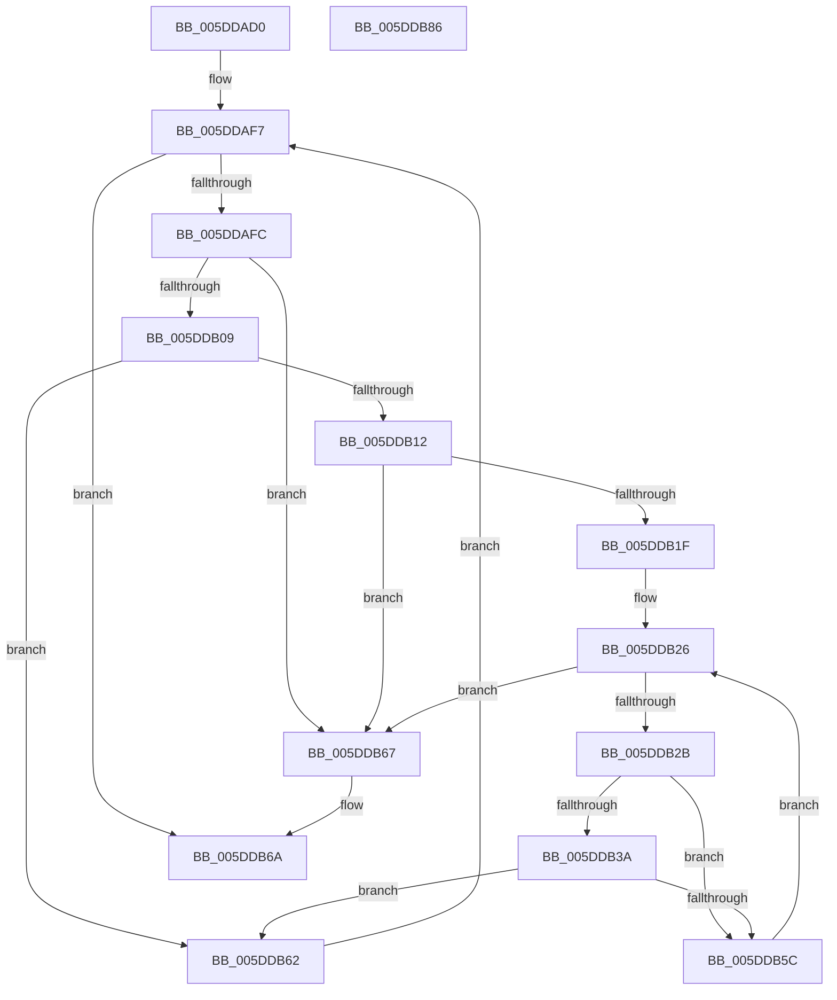

# PopPlLookupDevicePowerProfile

- RVA: `0x005DDAD0`–`0x005DDB87` (길이 `183` bytes)
- VA: `0x00000001405DDAD0`
- 실행 섹션: `.text`
- PDB 이름 있음: `예`; PDB Function 태그: `아니요`
- unwind 정보 RVA: `0x000BE9E8`
- 디코드: `57`개 명령, `183/183` bytes 표시
- 미해석 바이트: `0` (있으면 어셈블리에 `.byte`로 보존)

> 이 문서는 커널 이미지의 기계어와 PDB 기호를 분석해 생성했습니다. 4번과 5번은 함수 원형과 자료형을 바이너리 사용 방식에서 추정한 C 해석이며 원본 소스 복구 결과는 아닙니다.

## 1. Dependencies

- 직접 호출 지점: **0**; 고유 호출 대상: **0**
- 직접 호출자로 확인된 함수: **3**
- RIP 상대 이미지 참조: **0**

### Outgoing calls
- 직접 디코드된 call 명령이 없습니다.

### Direct callers
- [PopPlRegisterDevice](../4B/PopPlRegisterDevice_function_004B820C.md) at `0x004B8278`
- [PopPlActivateDeviceIterator](PopPlActivateDeviceIterator_function_005DD8F0.md) at `0x005DD908`
- [PopPlIdleDeviceIterator](PopPlIdleDeviceIterator_function_005DDA40.md) at `0x005DDA58`

### Static image references
- 디코드된 RIP-relative 메모리 참조가 없습니다.

## 2. Other-region calls and transfers

- 다른 실행 섹션으로 향하는 call: **0**
- 별도 외부 분기/꼬리 이동을 확인하지 못했습니다.

## 3. Assembly (complete function range)

```asm
005DDAD0  48 8B C4                        mov rax, rsp
005DDAD3  48 89 58 08                     mov qword ptr [rax + 8], rbx
005DDAD7  48 89 68 10                     mov qword ptr [rax + 0x10], rbp
005DDADB  48 89 70 18                     mov qword ptr [rax + 0x18], rsi
005DDADF  48 89 78 20                     mov qword ptr [rax + 0x20], rdi
005DDAE3  41 56                           push r14
005DDAE5  41 57                           push r15
005DDAE7  4C 8B 79 30                     mov r15, qword ptr [rcx + 0x30]
005DDAEB  45 33 DB                        xor r11d, r11d
005DDAEE  45 8B D3                        mov r10d, r11d
005DDAF1  48 8B DA                        mov rbx, rdx
005DDAF4  48 8B E9                        mov rbp, rcx
005DDAF7  4D 3B D7                        cmp r10, r15
005DDAFA  73 6E                           jae 0x1405ddb6a
005DDAFC  48 8B 45 38                     mov rax, qword ptr [rbp + 0x38]
005DDB00  4E 8B 0C D0                     mov r9, qword ptr [rax + r10*8]
005DDB04  49 3B D9                        cmp rbx, r9
005DDB07  74 5E                           je 0x1405ddb67
005DDB09  0F B7 03                        movzx eax, word ptr [rbx]
005DDB0C  66 41 3B 01                     cmp ax, word ptr [r9]
005DDB10  75 50                           jne 0x1405ddb62
005DDB12  4C 8B 43 08                     mov r8, qword ptr [rbx + 8]
005DDB16  49 8B 79 08                     mov rdi, qword ptr [r9 + 8]
005DDB1A  4C 3B C7                        cmp r8, rdi
005DDB1D  74 48                           je 0x1405ddb67
005DDB1F  49 8D 34 00                     lea rsi, [r8 + rax]
005DDB23  49 2B F8                        sub rdi, r8
005DDB26  4C 3B C6                        cmp r8, rsi
005DDB29  73 3C                           jae 0x1405ddb67
005DDB2B  41 0F B7 08                     movzx ecx, word ptr [r8]
005DDB2F  46 0F B7 34 07                  movzx r14d, word ptr [rdi + r8]
005DDB34  66 41 3B CE                     cmp cx, r14w
005DDB38  74 22                           je 0x1405ddb5c
005DDB3A  8D 41 9F                        lea eax, [rcx - 0x61]
005DDB3D  83 F8 19                        cmp eax, 0x19
005DDB40  8D 51 E0                        lea edx, [rcx - 0x20]
005DDB43  41 8D 46 9F                     lea eax, [r14 - 0x61]
005DDB47  66 0F 47 D1                     cmova dx, cx
005DDB4B  83 F8 19                        cmp eax, 0x19
005DDB4E  41 8D 4E E0                     lea ecx, [r14 - 0x20]
005DDB52  66 41 0F 47 CE                  cmova cx, r14w
005DDB57  66 3B D1                        cmp dx, cx
005DDB5A  75 06                           jne 0x1405ddb62
005DDB5C  49 83 C0 02                     add r8, 2
005DDB60  EB C4                           jmp 0x1405ddb26
005DDB62  49 FF C2                        inc r10
005DDB65  EB 90                           jmp 0x1405ddaf7
005DDB67  4D 8B D9                        mov r11, r9
005DDB6A  48 8B 5C 24 18                  mov rbx, qword ptr [rsp + 0x18]
005DDB6F  49 8B C3                        mov rax, r11
005DDB72  48 8B 6C 24 20                  mov rbp, qword ptr [rsp + 0x20]
005DDB77  48 8B 74 24 28                  mov rsi, qword ptr [rsp + 0x28]
005DDB7C  48 8B 7C 24 30                  mov rdi, qword ptr [rsp + 0x30]
005DDB81  41 5F                           pop r15
005DDB83  41 5E                           pop r14
005DDB85  C3                              ret
005DDB86  CC                              int3
```

## 4. C-style interpretation (structured pseudocode)

```c
__int64 __fastcall PopPlLookupDevicePowerProfile(__int64 a1, __int64 a2)
{
    __int64 v_r10;
    __int64 v_r11;
    __int64 v_rdi;
    unsigned __int64 v_stack_p10;
    unsigned __int64 v_stack_p18;
    unsigned __int64 v_stack_p20;
    unsigned __int64 v_stack_p8;

    *(unsigned __int64 *)(v_rsp + 8) = v_rbx;
    *(unsigned __int64 *)(v_rsp + 16) = v_rbp;
    *(unsigned __int64 *)(v_rsp + 24) = v_rsi;
    *(unsigned __int64 *)(v_rsp + 32) = v_rdi;
    v_r11 = 0;
loc_005DDAF7:
    if (0 >= (*(unsigned __int64 *)(a1 + 48))) goto loc_005DDB6A;
    if (a2 == (*(unsigned __int64 *)(*(unsigned __int64 *)(a1 + 56) + 0 * 8))) goto loc_005DDB67;
    if (((unsigned __int16)(*(unsigned __int16 *)(a2))) != (*(unsigned __int16 *)(*(unsigned __int64 *)(*(unsigned __int64 *)(a1 + 56) + 0 * 8)))) goto loc_005DDB62;
    if ((*(unsigned __int64 *)(a2 + 8)) == (*(unsigned __int64 *)(*(unsigned __int64 *)(*(unsigned __int64 *)(a1 + 56) + 0 * 8) + 8))) goto loc_005DDB67;
    v_rdi = (*(unsigned __int64 *)(*(unsigned __int64 *)(*(unsigned __int64 *)(a1 + 56) + 0 * 8) + 8)) - (*(unsigned __int64 *)(a2 + 8));
loc_005DDB26:
    if ((*(unsigned __int64 *)(a2 + 8)) >= (*(unsigned __int64 *)(a2 + 8) + *(unsigned __int16 *)(a2) * 1)) goto loc_005DDB67;
    if (((unsigned __int16)(*(unsigned __int16 *)(*(unsigned __int64 *)(a2 + 8)))) == ((unsigned __int16)(*(unsigned __int16 *)(v_rdi + *(unsigned __int64 *)(a2 + 8) * 1)))) goto loc_005DDB5C;
    a2 = *(unsigned __int16 *)(*(unsigned __int64 *)(a2 + 8)) - 32;
    if (((unsigned int)(*(unsigned __int16 *)(*(unsigned __int64 *)(a2 + 8)) - 97)) > 25) { a2 = (unsigned __int16)(*(unsigned __int16 *)(*(unsigned __int64 *)(a2 + 8))); }
    a1 = *(unsigned __int16 *)(v_rdi + *(unsigned __int64 *)(a2 + 8) * 1) - 32;
    if (((unsigned int)(*(unsigned __int16 *)(v_rdi + *(unsigned __int64 *)(a2 + 8) * 1) - 97)) > 25) { a1 = (unsigned __int16)(*(unsigned __int16 *)(v_rdi + *(unsigned __int64 *)(a2 + 8) * 1)); }
    if (((unsigned __int16)(a2)) != ((unsigned __int16)(a1))) goto loc_005DDB62;
loc_005DDB5C:
    a3 = (*(unsigned __int64 *)(a2 + 8)) + (2);
    goto loc_005DDB26;
loc_005DDB62:
    v_r10 = (0) + 1;
    goto loc_005DDAF7;
loc_005DDB67:
loc_005DDB6A:
    return *(unsigned __int64 *)(*(unsigned __int64 *)(a1 + 56) + 0 * 8);
}
```

## 5. (Beta) C Style

```c
int64_t PopPlLookupDevicePowerProfile(void *Arg1, int64_t Arg2)
{
    uint8_t *arg1 = (uint8_t *)Arg1;

    int64_t local_r10;
    int64_t local_r11;
    int64_t local_rdi;
    uint64_t v_stack_p10;
    uint64_t v_stack_p18;
    uint64_t v_stack_p20;
    uint64_t v_stack_p8;

    *(uint64_t *)(local_rsp + 0x8) = local_rbx;
    *(uint64_t *)(local_rsp + 0x10) = local_rbp;
    *(uint64_t *)(local_rsp + 0x18) = local_rsi;
    *(uint64_t *)(local_rsp + 0x20) = local_rdi;
    local_r11 = 0;
loc_005DDAF7:
    if (0 >= (*(uint64_t *)(arg1 + 0x30))) goto loc_005DDB6A;
    if (Arg2 == (*(uint64_t *)(*(uint64_t *)(arg1 + 0x38) + 0x0 * 8))) goto loc_005DDB67;
    if (((uint16_t)(*(uint16_t *)(Arg2))) != (*(uint16_t *)(*(uint64_t *)(*(uint64_t *)(arg1 + 0x38) + 0x0 * 8)))) goto loc_005DDB62;
    if ((*(uint64_t *)(Arg2 + 0x8)) == (*(uint64_t *)(*(uint64_t *)(*(uint64_t *)(arg1 + 0x38) + 0x0 * 8) + 0x8))) goto loc_005DDB67;
    local_rdi = (*(uint64_t *)(*(uint64_t *)(*(uint64_t *)(arg1 + 0x38) + 0x0 * 8) + 0x8)) - (*(uint64_t *)(Arg2 + 0x8));
loc_005DDB26:
    if ((*(uint64_t *)(Arg2 + 0x8)) >= (*(uint64_t *)(Arg2 + 0x8) + *(uint16_t *)(Arg2) * 1)) goto loc_005DDB67;
    if (((uint16_t)(*(uint16_t *)(*(uint64_t *)(Arg2 + 0x8)))) == ((uint16_t)(*(uint16_t *)(local_rdi + *(uint64_t *)(Arg2 + 0x8) * 1)))) goto loc_005DDB5C;
    Arg2 = *(uint16_t *)(*(uint64_t *)(Arg2 + 0x8)) - 32;
    if (((uint32_t)(*(uint16_t *)(*(uint64_t *)(Arg2 + 0x8)) - 97)) > 25) { Arg2 = (uint16_t)(*(uint16_t *)(*(uint64_t *)(Arg2 + 0x8))); }
    Arg1 = *(uint16_t *)(local_rdi + *(uint64_t *)(Arg2 + 0x8) * 1) - 32;
    if (((uint32_t)(*(uint16_t *)(local_rdi + *(uint64_t *)(Arg2 + 0x8) * 1) - 97)) > 25) { Arg1 = (uint16_t)(*(uint16_t *)(local_rdi + *(uint64_t *)(Arg2 + 0x8) * 1)); }
    if (((uint16_t)(Arg2)) != ((uint16_t)(Arg1))) goto loc_005DDB62;
loc_005DDB5C:
    a3 = (*(uint64_t *)(Arg2 + 0x8)) + (2);
    goto loc_005DDB26;
loc_005DDB62:
    local_r10 = (0) + 1;
    goto loc_005DDAF7;
loc_005DDB67:
loc_005DDB6A:
    return *(uint64_t *)(*(uint64_t *)(arg1 + 0x38) + 0x0 * 8);
}
```

### 관측된 메모리 오프셋

구조체 형식이 확인되지 않은 접근은 인자 기준의 오프셋으로만 기록했습니다.

| 기준 인자 | 오프셋 표현 | 폭 (bit) | 접근 |
|---|---:|---:|---|
| `Arg1` | `+ 0x30` | `64` | `R` |
| `Arg1` | `+ 0x38` | `64` | `R` |

## 6. Execution-region graph

[열기: 2D/3D 그래프와 함수 탐색 컨트롤 패널](../../../control-panel.html?section=text&rva=0x005DDAD0&view=graph)

- 2D 그래프는 위에서 아래로 흐르고, 3D 그래프는 빈 공간을 드래그해 회전합니다. Shift+드래그는 이동, 휠은 확대·축소, 함수 노드 선택은 대상 보고서 이동입니다.

### Static fallback


