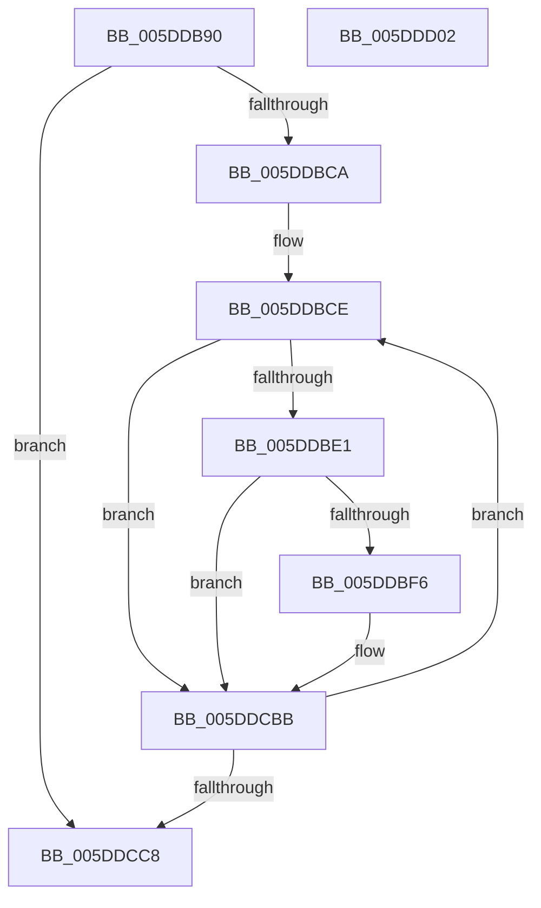

# PopPlPublishInitialPowerDraw

- RVA: `0x005DDB90`–`0x005DDD03` (길이 `371` bytes)
- VA: `0x00000001405DDB90`
- 실행 섹션: `.text`
- PDB 이름 있음: `예`; PDB Function 태그: `아니요`
- unwind 정보 RVA: `0x000CD7A4`
- 디코드: `89`개 명령, `371/371` bytes 표시
- 미해석 바이트: `0` (있으면 어셈블리에 `.byte`로 보존)

> 이 문서는 커널 이미지의 기계어와 PDB 기호를 분석해 생성했습니다. 4번과 5번은 함수 원형과 자료형을 바이너리 사용 방식에서 추정한 C 해석이며 원본 소스 복구 결과는 아닙니다.

## 1. Dependencies

- 직접 호출 지점: **4**; 고유 호출 대상: **4**
- 직접 호출자로 확인된 함수: **0**
- RIP 상대 이미지 참조: **3**

### Outgoing calls
- `0x005DDCB6` → [tlgWriteEx_EtwWriteEx](../4A/tlgWriteEx_EtwWriteEx_function_004AA348.md) (function, `0x004AA348`)
- `0x005DDCCD` → [PopPlPublishSystemPowerChange](PopPlPublishSystemPowerChange_function_005DDD0C.md) (function, `0x005DDD0C`)
- `0x005DDCD9` → [KeReleaseSpinLock](../39/KeReleaseSpinLock_function_00392BA0.md) (function, `0x00392BA0`)
- `0x005DDCE5` → [_security_check_cookie](../6A/_security_check_cookie_function_006AC640.md) (function, `0x006AC640`)

### Direct callers
- 이 함수 시작 RVA로 연결되는 직접 call은 확인되지 않았습니다. 간접 호출은 완전히 역산할 수 없습니다.

### Static image references
- `0x005DDBAA` → RVA `0x00E0A740` (`.data`; read)
- `0x005DDBE9` → RVA `0x00E07748` (`.data`; read)
- `0x005DDC56` → RVA `0x0005060E` (`.rdata`; read)

## 2. Other-region calls and transfers

- 다른 실행 섹션으로 향하는 call: **0**
- 별도 외부 분기/꼬리 이동을 확인하지 못했습니다.

## 3. Assembly (complete function range)

```asm
005DDB90  48 89 5C 24 08                  mov qword ptr [rsp + 8], rbx
005DDB95  48 89 74 24 18                  mov qword ptr [rsp + 0x18], rsi
005DDB9A  55                              push rbp
005DDB9B  57                              push rdi
005DDB9C  41 57                           push r15
005DDB9E  48 8D 6C 24 B9                  lea rbp, [rsp - 0x47]
005DDBA3  48 81 EC 00 01 00 00            sub rsp, 0x100
005DDBAA  48 8B 05 8F CB 82 00            mov rax, qword ptr [rip + 0x82cb8f]
005DDBB1  48 33 C4                        xor rax, rsp
005DDBB4  48 89 45 37                     mov qword ptr [rbp + 0x37], rax
005DDBB8  48 8B 5A 08                     mov rbx, qword ptr [rdx + 8]
005DDBBC  33 FF                           xor edi, edi
005DDBBE  8B 32                           mov esi, dword ptr [rdx]
005DDBC0  48 39 7B 30                     cmp qword ptr [rbx + 0x30], rdi
005DDBC4  0F 86 FE 00 00 00               jbe 0x1405ddcc8
005DDBCA  44 8D 7F 01                     lea r15d, [rdi + 1]
005DDBCE  48 8B 43 38                     mov rax, qword ptr [rbx + 0x38]
005DDBD2  48 8B 0C F8                     mov rcx, qword ptr [rax + rdi*8]
005DDBD6  48 83 79 18 00                  cmp qword ptr [rcx + 0x18], 0
005DDBDB  0F 85 DA 00 00 00               jne 0x1405ddcbb
005DDBE1  8B 51 28                        mov edx, dword ptr [rcx + 0x28]
005DDBE4  03 F2                           add esi, edx
005DDBE6  89 51 20                        mov dword ptr [rcx + 0x20], edx
005DDBE9  83 3D 58 9B 82 00 05            cmp dword ptr [rip + 0x829b58], 5
005DDBF0  0F 86 C5 00 00 00               jbe 0x1405ddcbb
005DDBF6  83 65 D3 00                     and dword ptr [rbp - 0x2d], 0
005DDBFA  48 8D 45 87                     lea rax, [rbp - 0x79]
005DDBFE  83 65 E3 00                     and dword ptr [rbp - 0x1d], 0
005DDC02  45 8B CF                        mov r9d, r15d
005DDC05  83 65 F3 00                     and dword ptr [rbp - 0xd], 0
005DDC09  83 65 8B 00                     and dword ptr [rbp - 0x75], 0
005DDC0D  83 65 03 00                     and dword ptr [rbp + 3], 0
005DDC11  83 65 13 00                     and dword ptr [rbp + 0x13], 0
005DDC15  83 65 93 00                     and dword ptr [rbp - 0x6d], 0
005DDC19  83 65 23 00                     and dword ptr [rbp + 0x23], 0
005DDC1D  48 89 45 C7                     mov qword ptr [rbp - 0x39], rax
005DDC21  48 8D 45 EF                     lea rax, [rbp - 0x11]
005DDC25  48 89 45 D7                     mov qword ptr [rbp - 0x29], rax
005DDC29  48 8B 41 08                     mov rax, qword ptr [rcx + 8]
005DDC2D  48 89 45 E7                     mov qword ptr [rbp - 0x19], rax
005DDC31  0F B7 01                        movzx eax, word ptr [rcx]
005DDC34  89 45 EF                        mov dword ptr [rbp - 0x11], eax
005DDC37  48 8D 45 8B                     lea rax, [rbp - 0x75]
005DDC3B  48 89 45 F7                     mov qword ptr [rbp - 9], rax
005DDC3F  48 8D 45 8F                     lea rax, [rbp - 0x71]
005DDC43  48 89 45 07                     mov qword ptr [rbp + 7], rax
005DDC47  48 8D 45 93                     lea rax, [rbp - 0x6d]
005DDC4B  48 89 45 17                     mov qword ptr [rbp + 0x17], rax
005DDC4F  48 8B 41 10                     mov rax, qword ptr [rcx + 0x10]
005DDC53  89 55 8F                        mov dword ptr [rbp - 0x71], edx
005DDC56  48 8D 15 B1 29 A7 FF            lea rdx, [rip - 0x58d64f]
005DDC5D  66 44 89 7D 87                  mov word ptr [rbp - 0x79], r15w
005DDC62  C7 45 CF 02 00 00 00            mov dword ptr [rbp - 0x31], 2
005DDC69  C7 45 DF 02 00 00 00            mov dword ptr [rbp - 0x21], 2
005DDC70  C7 45 FF 04 00 00 00            mov dword ptr [rbp - 1], 4
005DDC77  C7 45 0F 04 00 00 00            mov dword ptr [rbp + 0xf], 4
005DDC7E  C7 45 1F 04 00 00 00            mov dword ptr [rbp + 0x1f], 4
005DDC85  8B 48 1C                        mov ecx, dword ptr [rax + 0x1c]
005DDC88  48 8D 45 97                     lea rax, [rbp - 0x69]
005DDC8C  83 65 33 00                     and dword ptr [rbp + 0x33], 0
005DDC90  48 89 45 27                     mov qword ptr [rbp + 0x27], rax
005DDC94  48 8D 45 A7                     lea rax, [rbp - 0x59]
005DDC98  89 4D 97                        mov dword ptr [rbp - 0x69], ecx
005DDC9B  48 8D 0D A6 9A 82 00            lea rcx, [rip + 0x829aa6]
005DDCA2  48 89 44 24 38                  mov qword ptr [rsp + 0x38], rax
005DDCA7  C7 44 24 30 09 00 00 00         mov dword ptr [rsp + 0x30], 9
005DDCAF  C7 45 2F 04 00 00 00            mov dword ptr [rbp + 0x2f], 4
005DDCB6  E8 8D C6 EC FF                  call 0x1404aa348
005DDCBB  49 03 FF                        add rdi, r15
005DDCBE  48 3B 7B 30                     cmp rdi, qword ptr [rbx + 0x30]
005DDCC2  0F 82 06 FF FF FF               jb 0x1405ddbce
005DDCC8  8B D6                           mov edx, esi
005DDCCA  48 8B CB                        mov rcx, rbx
005DDCCD  E8 3A 00 00 00                  call 0x1405ddd0c
005DDCD2  8A 53 18                        mov dl, byte ptr [rbx + 0x18]
005DDCD5  48 8D 4B 10                     lea rcx, [rbx + 0x10]
005DDCD9  E8 C2 4E DB FF                  call 0x140392ba0
005DDCDE  48 8B 4D 37                     mov rcx, qword ptr [rbp + 0x37]
005DDCE2  48 33 CC                        xor rcx, rsp
005DDCE5  E8 56 E9 0C 00                  call 0x1406ac640
005DDCEA  4C 8D 9C 24 00 01 00 00         lea r11, [rsp + 0x100]
005DDCF2  49 8B 5B 20                     mov rbx, qword ptr [r11 + 0x20]
005DDCF6  49 8B 73 30                     mov rsi, qword ptr [r11 + 0x30]
005DDCFA  49 8B E3                        mov rsp, r11
005DDCFD  41 5F                           pop r15
005DDCFF  5F                              pop rdi
005DDD00  5D                              pop rbp
005DDD01  C3                              ret
005DDD02  CC                              int3
```

## 4. C-style interpretation (structured pseudocode)

```c
__int64 __fastcall PopPlPublishInitialPowerDraw(__int64 a1, __int64 a2)
{
    __int64 result;
    __int64 v_rdi;
    __int64 v_rsi;
    __int64 v_rsp;
    unsigned __int64 v_stack_m18;
    unsigned __int64 v_stack_m28;
    unsigned int v_stack_m2C;
    unsigned int v_stack_m30;
    unsigned __int64 v_stack_m38;
    unsigned int v_stack_m3C;
    unsigned int v_stack_m40;
    unsigned __int64 v_stack_m48;
    unsigned int v_stack_m4C;
    unsigned int v_stack_m50;
    unsigned __int64 v_stack_m58;
    unsigned int v_stack_m5C;
    unsigned __int64 v_stack_m5F;
    unsigned int v_stack_m60;
    unsigned __int64 v_stack_m68;
    unsigned int v_stack_m6C;
    unsigned __int64 v_stack_m70;
    unsigned __int64 v_stack_m78;
    unsigned int v_stack_m7C;
    unsigned int v_stack_m80;
    unsigned __int64 v_stack_m88;
    unsigned int v_stack_m8C;
    unsigned int v_stack_m90;
    unsigned __int64 v_stack_m98;
    unsigned __int64 v_stack_mB8;
    unsigned __int64 v_stack_mC8;
    unsigned int v_stack_mCC;
    unsigned __int64 v_stack_mD0;
    unsigned int v_stack_mD4;
    unsigned __int64 v_stack_mD8;
    unsigned __int64 v_stack_mE0;
    unsigned int v_stack_mE8;
    unsigned __int64 v_stack_p18;
    unsigned __int64 v_stack_p8;

    v_stack_p8 = v_rbx;
    v_stack_p18 = v_rsi;
    v_rsp = (v_rsp) - (256);
    result = (*(unsigned __int64 *)(v_rip + 8571791)) ^ (v_rsp);
    v_stack_m28 = result;
    v_rdi = 0;
    if ((*(unsigned __int64 *)(*(unsigned __int64 *)(a2 + 8) + 48)) <= 0) goto loc_005DDCC8;
loc_005DDBCE:
    if ((*(unsigned __int64 *)(*(unsigned __int64 *)(*(unsigned __int64 *)(*(unsigned __int64 *)(a2 + 8) + 56) + v_rdi * 8) + 24)) != 0) goto loc_005DDCBB;
    v_rsi = (unsigned int)(((unsigned int)(*(unsigned int *)(a2))) + ((unsigned int)((unsigned int)(*(unsigned int *)(*(unsigned __int64 *)(*(unsigned __int64 *)(*(unsigned __int64 *)(a2 + 8) + 56) + v_rdi * 8) + 40)))));
    *(unsigned int *)(*(unsigned __int64 *)(*(unsigned __int64 *)(*(unsigned __int64 *)(a2 + 8) + 56) + v_rdi * 8) + 32) = (unsigned int)((unsigned int)(*(unsigned int *)(*(unsigned __int64 *)(*(unsigned __int64 *)(*(unsigned __int64 *)(a2 + 8) + 56) + v_rdi * 8) + 40)));
    result = *(unsigned __int64 *)(*(unsigned __int64 *)(a2 + 8) + 56);
    if ((*(unsigned int *)(v_rip + 8559448)) >= = 5) {
        result = v_stack_mD8;
        a4 = (unsigned int)(v_rdi + 1);
        v_stack_m98 = result;
        result = v_stack_m70;
        v_stack_m88 = result;
        result = *(unsigned __int64 *)(*(unsigned __int64 *)(*(unsigned __int64 *)(*(unsigned __int64 *)(a2 + 8) + 56) + v_rdi * 8) + 8);
        v_stack_m78 = result;
        result = *(unsigned __int16 *)(*(unsigned __int64 *)(*(unsigned __int64 *)(*(unsigned __int64 *)(a2 + 8) + 56) + v_rdi * 8));
        v_stack_m70 = (unsigned int)(result);
        result = v_stack_mD4;
        v_stack_m68 = result;
        result = v_stack_mD0;
        v_stack_m58 = result;
        result = v_stack_mCC;
        v_stack_m48 = result;
        result = *(unsigned __int64 *)(*(unsigned __int64 *)(*(unsigned __int64 *)(*(unsigned __int64 *)(a2 + 8) + 56) + v_rdi * 8) + 16);
        v_stack_mD0 = (unsigned int)((unsigned int)(*(unsigned int *)(*(unsigned __int64 *)(*(unsigned __int64 *)(*(unsigned __int64 *)(a2 + 8) + 56) + v_rdi * 8) + 40)));
        a2 = v_rip - 5822031;
        v_stack_mD8 = (unsigned __int16)(v_rdi + 1);
        v_stack_m90 = 2;
        v_stack_m80 = 2;
        v_stack_m60 = 4;
        v_stack_m50 = 4;
        v_stack_m40 = 4;
        a1 = *(unsigned int *)(result + 28);
        result = v_stack_mC8;
        v_stack_m38 = result;
        result = v_stack_mB8;
        v_stack_mC8 = (unsigned int)(a1);
        a1 = v_rip + 8559270;
        v_stack_mE0 = result;
        v_stack_mE8 = 9;
        v_stack_m30 = 4;
        result = tlgWriteEx_EtwWriteEx(a1, a2, a3, a4);
    }
    v_rdi = (v_rdi) + (v_rdi + 1);
    if (v_rdi < (*(unsigned __int64 *)(*(unsigned __int64 *)(a2 + 8) + 48))) goto loc_005DDBCE;
loc_005DDCC8:
    result = PopPlPublishSystemPowerChange(*(unsigned __int64 *)(a2 + 8), (unsigned int)((unsigned int)(v_rsi)), a3, a4);
    result = KeReleaseSpinLock(*(unsigned __int64 *)(a2 + 8) + 16, *(unsigned __int8 *)(*(unsigned __int64 *)(a2 + 8) + 24), a3, a4);
    a1 = (v_stack_m28) ^ (v_rsp);
    result = _security_check_cookie(a1, *(unsigned __int8 *)(*(unsigned __int64 *)(a2 + 8) + 24), a3, a4);
    return result;
}
```

## 5. (Beta) C Style

```c
int64_t PopPlPublishInitialPowerDraw(int64_t Arg1, void *Arg2)
{
    uint8_t *arg2 = (uint8_t *)Arg2;

    int64_t result;
    int64_t local_rdi;
    int64_t local_rsi;
    int64_t local_rsp;
    uint64_t v_stack_m18;
    uint64_t v_stack_m28;
    uint32_t v_stack_m2C;
    uint32_t v_stack_m30;
    uint64_t v_stack_m38;
    uint32_t v_stack_m3C;
    uint32_t v_stack_m40;
    uint64_t v_stack_m48;
    uint32_t v_stack_m4C;
    uint32_t v_stack_m50;
    uint64_t v_stack_m58;
    uint32_t v_stack_m5C;
    uint64_t v_stack_m5F;
    uint32_t v_stack_m60;
    uint64_t v_stack_m68;
    uint32_t v_stack_m6C;
    uint64_t v_stack_m70;
    uint64_t v_stack_m78;
    uint32_t v_stack_m7C;
    uint32_t v_stack_m80;
    uint64_t v_stack_m88;
    uint32_t v_stack_m8C;
    uint32_t v_stack_m90;
    uint64_t v_stack_m98;
    uint64_t v_stack_mB8;
    uint64_t v_stack_mC8;
    uint32_t v_stack_mCC;
    uint64_t v_stack_mD0;
    uint32_t v_stack_mD4;
    uint64_t v_stack_mD8;
    uint64_t v_stack_mE0;
    uint32_t v_stack_mE8;
    uint64_t v_stack_p18;
    uint64_t v_stack_p8;

    v_stack_p8 = local_rbx;
    v_stack_p18 = local_rsi;
    local_rsp = (local_rsp) - (256);
    result = (*(uint64_t *)(v_rip + 0x82CB8F)) ^ (local_rsp);
    v_stack_m28 = result;
    local_rdi = 0;
    if ((*(uint64_t *)(*(uint64_t *)(arg2 + 0x8) + 0x30)) <= 0) goto loc_005DDCC8;
loc_005DDBCE:
    if ((*(uint64_t *)(*(uint64_t *)(*(uint64_t *)(*(uint64_t *)(arg2 + 0x8) + 0x38) + local_rdi * 8) + 0x18)) != 0) goto loc_005DDCBB;
    local_rsi = (uint32_t)(((uint32_t)(*(uint32_t *)(arg2))) + ((uint32_t)((uint32_t)(*(uint32_t *)(*(uint64_t *)(*(uint64_t *)(*(uint64_t *)(arg2 + 0x8) + 0x38) + local_rdi * 8) + 0x28)))));
    *(uint32_t *)(*(uint64_t *)(*(uint64_t *)(*(uint64_t *)(arg2 + 0x8) + 0x38) + local_rdi * 8) + 0x20) = (uint32_t)((uint32_t)(*(uint32_t *)(*(uint64_t *)(*(uint64_t *)(*(uint64_t *)(arg2 + 0x8) + 0x38) + local_rdi * 8) + 0x28)));
    result = *(uint64_t *)(*(uint64_t *)(arg2 + 0x8) + 0x38);
    if ((*(uint32_t *)(v_rip + 0x829B58)) >= = 5) {
        result = v_stack_mD8;
        a4 = (uint32_t)(local_rdi + 1);
        v_stack_m98 = result;
        result = v_stack_m70;
        v_stack_m88 = result;
        result = *(uint64_t *)(*(uint64_t *)(*(uint64_t *)(*(uint64_t *)(arg2 + 0x8) + 0x38) + local_rdi * 8) + 0x8);
        v_stack_m78 = result;
        result = *(uint16_t *)(*(uint64_t *)(*(uint64_t *)(*(uint64_t *)(arg2 + 0x8) + 0x38) + local_rdi * 8));
        v_stack_m70 = (uint32_t)(result);
        result = v_stack_mD4;
        v_stack_m68 = result;
        result = v_stack_mD0;
        v_stack_m58 = result;
        result = v_stack_mCC;
        v_stack_m48 = result;
        result = *(uint64_t *)(*(uint64_t *)(*(uint64_t *)(*(uint64_t *)(arg2 + 0x8) + 0x38) + local_rdi * 8) + 0x10);
        v_stack_mD0 = (uint32_t)((uint32_t)(*(uint32_t *)(*(uint64_t *)(*(uint64_t *)(*(uint64_t *)(arg2 + 0x8) + 0x38) + local_rdi * 8) + 0x28)));
        Arg2 = v_rip - 5822031;
        v_stack_mD8 = (uint16_t)(local_rdi + 1);
        v_stack_m90 = 2;
        v_stack_m80 = 2;
        v_stack_m60 = 4;
        v_stack_m50 = 4;
        v_stack_m40 = 4;
        Arg1 = *(uint32_t *)(result + 0x1C);
        result = v_stack_mC8;
        v_stack_m38 = result;
        result = v_stack_mB8;
        v_stack_mC8 = (uint32_t)(Arg1);
        Arg1 = v_rip + 8559270;
        v_stack_mE0 = result;
        v_stack_mE8 = 9;
        v_stack_m30 = 4;
        result = tlgWriteEx_EtwWriteEx(Arg1, Arg2, a3, a4);
    }
    local_rdi = (local_rdi) + (local_rdi + 1);
    if (local_rdi < (*(uint64_t *)(*(uint64_t *)(arg2 + 0x8) + 0x30))) goto loc_005DDBCE;
loc_005DDCC8:
    result = PopPlPublishSystemPowerChange(*(uint64_t *)(arg2 + 0x8), (uint32_t)((uint32_t)(local_rsi)), a3, a4);
    result = KeReleaseSpinLock(*(uint64_t *)(arg2 + 0x8) + 16, *(uint8_t *)(*(uint64_t *)(arg2 + 0x8) + 0x18), a3, a4);
    Arg1 = (v_stack_m28) ^ (local_rsp);
    result = _security_check_cookie(Arg1, *(uint8_t *)(*(uint64_t *)(arg2 + 0x8) + 0x18), a3, a4);
    return result;
}
```

### 관측된 메모리 오프셋

구조체 형식이 확인되지 않은 접근은 인자 기준의 오프셋으로만 기록했습니다.

| 기준 인자 | 오프셋 표현 | 폭 (bit) | 접근 |
|---|---:|---:|---|
| `Arg2` | `+ 0x0` | `32` | `R` |
| `Arg2` | `+ 0x8` | `64` | `R` |

## 6. Execution-region graph

[열기: 2D/3D 그래프와 함수 탐색 컨트롤 패널](../../../control-panel.html?section=text&rva=0x005DDB90&view=graph)

- 2D 그래프는 위에서 아래로 흐르고, 3D 그래프는 빈 공간을 드래그해 회전합니다. Shift+드래그는 이동, 휠은 확대·축소, 함수 노드 선택은 대상 보고서 이동입니다.

### Static fallback


