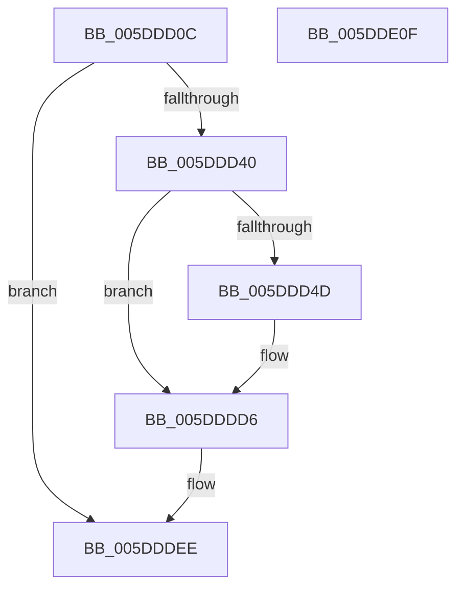

# PopPlPublishSystemPowerChange

- RVA: `0x005DDD0C`–`0x005DDE10` (길이 `260` bytes)
- VA: `0x00000001405DDD0C`
- 실행 섹션: `.text`
- PDB 이름 있음: `예`; PDB Function 태그: `아니요`
- unwind 정보 RVA: `0x0009F188`
- 디코드: `61`개 명령, `260/260` bytes 표시
- 미해석 바이트: `0` (있으면 어셈블리에 `.byte`로 보존)

> 이 문서는 커널 이미지의 기계어와 PDB 기호를 분석해 생성했습니다. 4번과 5번은 함수 원형과 자료형을 바이너리 사용 방식에서 추정한 C 해석이며 원본 소스 복구 결과는 아닙니다.

## 1. Dependencies

- 직접 호출 지점: **3**; 고유 호출 대상: **3**
- 직접 호출자로 확인된 함수: **4**
- RIP 상대 이미지 참조: **3**

### Outgoing calls
- `0x005DDDD1` → [tlgWriteEx_EtwWriteEx](../4A/tlgWriteEx_EtwWriteEx_function_004AA348.md) (function, `0x004AA348`)
- `0x005DDDE9` → [guard_dispatch_icall](../6B/guard_dispatch_icall_function_006BAAD0.md) (function, `0x006BAAD0`)
- `0x005DDDF5` → [_security_check_cookie](../6A/_security_check_cookie_function_006AC640.md) (function, `0x006AC640`)

### Direct callers
- [PopPlUnregisterDevice](../4E/PopPlUnregisterDevice_function_004E3FF4.md) at `0x004E4158`
- [PopPlPublishInitialPowerDraw](PopPlPublishInitialPowerDraw_function_005DDB90.md) at `0x005DDCCD`
- [sub_006DBF86](../6D/Unknown_function_006DBF86.md) at `0x006DC101`
- [sub_006F5DD8](../6F/Unknown_function_006F5DD8.md) at `0x006F5F6F`

### Static image references
- `0x005DDD23` → RVA `0x00E0A740` (`.data`; read)
- `0x005DDD40` → RVA `0x00E07748` (`.data`; read)
- `0x005DDD61` → RVA `0x0005051F` (`.rdata`; read)

## 2. Other-region calls and transfers

- 다른 실행 섹션으로 향하는 call: **0**
- 별도 외부 분기/꼬리 이동을 확인하지 못했습니다.

## 3. Assembly (complete function range)

```asm
005DDD0C  48 89 5C 24 10                  mov qword ptr [rsp + 0x10], rbx
005DDD11  48 89 7C 24 18                  mov qword ptr [rsp + 0x18], rdi
005DDD16  55                              push rbp
005DDD17  48 8D 6C 24 A9                  lea rbp, [rsp - 0x57]
005DDD1C  48 81 EC D0 00 00 00            sub rsp, 0xd0
005DDD23  48 8B 05 16 CA 82 00            mov rax, qword ptr [rip + 0x82ca16]
005DDD2A  48 33 C4                        xor rax, rsp
005DDD2D  48 89 45 47                     mov qword ptr [rbp + 0x47], rax
005DDD31  8B FA                           mov edi, edx
005DDD33  48 8B D9                        mov rbx, rcx
005DDD36  33 D2                           xor edx, edx
005DDD38  85 FF                           test edi, edi
005DDD3A  0F 84 AE 00 00 00               je 0x1405dddee
005DDD40  83 3D 01 9A 82 00 05            cmp dword ptr [rip + 0x829a01], 5
005DDD47  0F 86 89 00 00 00               jbe 0x1405dddd6
005DDD4D  44 8D 4A 01                     lea r9d, [rdx + 1]
005DDD51  89 55 23                        mov dword ptr [rbp + 0x23], edx
005DDD54  48 8D 45 C7                     lea rax, [rbp - 0x39]
005DDD58  66 44 89 4D C7                  mov word ptr [rbp - 0x39], r9w
005DDD5D  48 89 45 F7                     mov qword ptr [rbp - 9], rax
005DDD61  48 8D 15 B7 27 A7 FF            lea rdx, [rip - 0x58d849]
005DDD68  48 8D 45 1F                     lea rax, [rbp + 0x1f]
005DDD6C  48 C7 45 FF 02 00 00 00         mov qword ptr [rbp - 1], 2
005DDD74  48 89 45 07                     mov qword ptr [rbp + 7], rax
005DDD78  48 8B 41 08                     mov rax, qword ptr [rcx + 8]
005DDD7C  48 89 45 17                     mov qword ptr [rbp + 0x17], rax
005DDD80  0F B7 01                        movzx eax, word ptr [rcx]
005DDD83  89 45 1F                        mov dword ptr [rbp + 0x1f], eax
005DDD86  48 8D 45 CB                     lea rax, [rbp - 0x35]
005DDD8A  48 89 45 27                     mov qword ptr [rbp + 0x27], rax
005DDD8E  8B 41 1C                        mov eax, dword ptr [rcx + 0x1c]
005DDD91  48 8D 0D B0 99 82 00            lea rcx, [rip + 0x8299b0]
005DDD98  03 C7                           add eax, edi
005DDD9A  48 C7 45 0F 02 00 00 00         mov qword ptr [rbp + 0xf], 2
005DDDA2  89 45 CF                        mov dword ptr [rbp - 0x31], eax
005DDDA5  48 8D 45 CF                     lea rax, [rbp - 0x31]
005DDDA9  48 89 45 37                     mov qword ptr [rbp + 0x37], rax
005DDDAD  48 8D 45 D7                     lea rax, [rbp - 0x29]
005DDDB1  48 89 44 24 38                  mov qword ptr [rsp + 0x38], rax
005DDDB6  C7 44 24 30 07 00 00 00         mov dword ptr [rsp + 0x30], 7
005DDDBE  89 7D CB                        mov dword ptr [rbp - 0x35], edi
005DDDC1  48 C7 45 2F 04 00 00 00         mov qword ptr [rbp + 0x2f], 4
005DDDC9  48 C7 45 3F 04 00 00 00         mov qword ptr [rbp + 0x3f], 4
005DDDD1  E8 72 C5 EC FF                  call 0x1404aa348
005DDDD6  8B 43 1C                        mov eax, dword ptr [rbx + 0x1c]
005DDDD9  03 C7                           add eax, edi
005DDDDB  89 43 1C                        mov dword ptr [rbx + 0x1c], eax
005DDDDE  8B 53 1C                        mov edx, dword ptr [rbx + 0x1c]
005DDDE1  48 8B 4B 20                     mov rcx, qword ptr [rbx + 0x20]
005DDDE5  48 8B 43 28                     mov rax, qword ptr [rbx + 0x28]
005DDDE9  E8 E2 CC 0D 00                  call 0x1406baad0
005DDDEE  48 8B 4D 47                     mov rcx, qword ptr [rbp + 0x47]
005DDDF2  48 33 CC                        xor rcx, rsp
005DDDF5  E8 46 E8 0C 00                  call 0x1406ac640
005DDDFA  4C 8D 9C 24 D0 00 00 00         lea r11, [rsp + 0xd0]
005DDE02  49 8B 5B 18                     mov rbx, qword ptr [r11 + 0x18]
005DDE06  49 8B 7B 20                     mov rdi, qword ptr [r11 + 0x20]
005DDE0A  49 8B E3                        mov rsp, r11
005DDE0D  5D                              pop rbp
005DDE0E  C3                              ret
005DDE0F  CC                              int3
```

## 4. C-style interpretation (structured pseudocode)

```c
__int64 __fastcall PopPlPublishSystemPowerChange(__int64 a1, int a2)
{
    __int64 result;
    __int64 v_rsp;
    unsigned __int64 v_stack_m18;
    unsigned __int64 v_stack_m20;
    unsigned __int64 v_stack_m28;
    unsigned __int64 v_stack_m30;
    unsigned __int64 v_stack_m38;
    unsigned int v_stack_m3C;
    unsigned __int64 v_stack_m40;
    unsigned __int64 v_stack_m48;
    unsigned __int64 v_stack_m50;
    unsigned __int64 v_stack_m58;
    unsigned __int64 v_stack_m5F;
    unsigned __int64 v_stack_m60;
    unsigned __int64 v_stack_m68;
    unsigned __int64 v_stack_m8;
    unsigned __int64 v_stack_m88;
    unsigned int v_stack_m90;
    unsigned __int64 v_stack_m94;
    unsigned __int64 v_stack_m98;
    unsigned __int64 v_stack_mA0;
    unsigned int v_stack_mA8;
    unsigned __int64 v_stack_p10;
    unsigned __int64 v_stack_p18;

    v_stack_p10 = v_rbx;
    v_stack_p18 = v_rdi;
    v_rsp = (v_rsp) - (208);
    result = (*(unsigned __int64 *)(v_rip + 8571414)) ^ (v_rsp);
    v_stack_m18 = result;
    a2 = 0;
    if ((unsigned int)((unsigned int)(a2)) == 0) goto loc_005DDDEE;
    if ((*(unsigned int *)(v_rip + 8559105)) >= = 5) {
        a4 = a2 + 1;
        v_stack_m3C = 0;
        result = v_stack_m98;
        v_stack_m98 = (unsigned __int16)(a4);
        v_stack_m68 = result;
        a2 = v_rip - 5822537;
        result = v_stack_m40;
        v_stack_m60 = 2;
        v_stack_m58 = result;
        result = *(unsigned __int64 *)(a1 + 8);
        v_stack_m48 = result;
        result = *(unsigned __int16 *)(a1);
        v_stack_m40 = (unsigned int)(result);
        result = v_stack_m94;
        v_stack_m38 = result;
        result = *(unsigned int *)(a1 + 28);
        a1 = v_rip + 8559024;
        result = (unsigned int)((result) + ((unsigned int)((unsigned int)(a2))));
        v_stack_m50 = 2;
        v_stack_m90 = (unsigned int)(result);
        result = v_stack_m90;
        v_stack_m28 = result;
        result = v_stack_m88;
        v_stack_mA0 = result;
        v_stack_mA8 = 7;
        v_stack_m94 = (unsigned int)((unsigned int)(a2));
        v_stack_m30 = 4;
        v_stack_m20 = 4;
        result = tlgWriteEx_EtwWriteEx(a1, a2, a3, a4);
    }
    result = (unsigned int)(((unsigned int)(*(unsigned int *)(a1 + 28))) + ((unsigned int)((unsigned int)(a2))));
    *(unsigned int *)(a1 + 28) = (unsigned int)(result);
    result = guard_dispatch_icall(*(unsigned __int64 *)(a1 + 32), (unsigned int)(*(unsigned int *)(a1 + 28)), a3, a4);
loc_005DDDEE:
    a1 = (v_stack_m18) ^ (v_rsp);
    result = _security_check_cookie(a1, (unsigned int)(*(unsigned int *)(a1 + 28)), a3, a4);
    return result;
}
```

## 5. (Beta) C Style

```c
int64_t PopPlPublishSystemPowerChange(void *Arg1, int32_t Arg2)
{
    uint8_t *arg1 = (uint8_t *)Arg1;

    int64_t result;
    int64_t local_rsp;
    uint64_t v_stack_m18;
    uint64_t v_stack_m20;
    uint64_t v_stack_m28;
    uint64_t v_stack_m30;
    uint64_t v_stack_m38;
    uint32_t v_stack_m3C;
    uint64_t v_stack_m40;
    uint64_t v_stack_m48;
    uint64_t v_stack_m50;
    uint64_t v_stack_m58;
    uint64_t v_stack_m5F;
    uint64_t v_stack_m60;
    uint64_t v_stack_m68;
    uint64_t v_stack_m8;
    uint64_t v_stack_m88;
    uint32_t v_stack_m90;
    uint64_t v_stack_m94;
    uint64_t v_stack_m98;
    uint64_t v_stack_mA0;
    uint32_t v_stack_mA8;
    uint64_t v_stack_p10;
    uint64_t v_stack_p18;

    v_stack_p10 = local_rbx;
    v_stack_p18 = local_rdi;
    local_rsp = (local_rsp) - (208);
    result = (*(uint64_t *)(v_rip + 0x82CA16)) ^ (local_rsp);
    v_stack_m18 = result;
    Arg2 = 0;
    if ((uint32_t)((uint32_t)(Arg2)) == 0) goto loc_005DDDEE;
    if ((*(uint32_t *)(v_rip + 0x829A01)) >= = 5) {
        a4 = Arg2 + 1;
        v_stack_m3C = 0;
        result = v_stack_m98;
        v_stack_m98 = (uint16_t)(a4);
        v_stack_m68 = result;
        Arg2 = v_rip - 5822537;
        result = v_stack_m40;
        v_stack_m60 = 2;
        v_stack_m58 = result;
        result = *(uint64_t *)(arg1 + 0x8);
        v_stack_m48 = result;
        result = *(uint16_t *)(arg1);
        v_stack_m40 = (uint32_t)(result);
        result = v_stack_m94;
        v_stack_m38 = result;
        result = *(uint32_t *)(arg1 + 0x1C);
        Arg1 = v_rip + 8559024;
        result = (uint32_t)((result) + ((uint32_t)((uint32_t)(Arg2))));
        v_stack_m50 = 2;
        v_stack_m90 = (uint32_t)(result);
        result = v_stack_m90;
        v_stack_m28 = result;
        result = v_stack_m88;
        v_stack_mA0 = result;
        v_stack_mA8 = 7;
        v_stack_m94 = (uint32_t)((uint32_t)(Arg2));
        v_stack_m30 = 4;
        v_stack_m20 = 4;
        result = tlgWriteEx_EtwWriteEx(Arg1, Arg2, a3, a4);
    }
    result = (uint32_t)(((uint32_t)(*(uint32_t *)(arg1 + 0x1C))) + ((uint32_t)((uint32_t)(Arg2))));
    *(uint32_t *)(arg1 + 0x1C) = (uint32_t)(result);
    result = guard_dispatch_icall(*(uint64_t *)(arg1 + 0x20), (uint32_t)(*(uint32_t *)(arg1 + 0x1C)), a3, a4);
loc_005DDDEE:
    Arg1 = (v_stack_m18) ^ (local_rsp);
    result = _security_check_cookie(Arg1, (uint32_t)(*(uint32_t *)(arg1 + 0x1C)), a3, a4);
    return result;
}
```

### 관측된 메모리 오프셋

구조체 형식이 확인되지 않은 접근은 인자 기준의 오프셋으로만 기록했습니다.

| 기준 인자 | 오프셋 표현 | 폭 (bit) | 접근 |
|---|---:|---:|---|
| `Arg1` | `+ 0x0` | `16` | `R` |
| `Arg1` | `+ 0x8` | `64` | `R` |
| `Arg1` | `+ 0x1C` | `32` | `R` |
| `Arg1` | `+ 0x1C` | `32` | `W` |
| `Arg1` | `+ 0x20` | `64` | `R` |
| `Arg1` | `+ 0x28` | `64` | `R` |

## 6. Execution-region graph

[열기: 2D/3D 그래프와 함수 탐색 컨트롤 패널](../../../control-panel.html?section=text&rva=0x005DDD0C&view=graph)

- 2D 그래프는 위에서 아래로 흐르고, 3D 그래프는 빈 공간을 드래그해 회전합니다. Shift+드래그는 이동, 휠은 확대·축소, 함수 노드 선택은 대상 보고서 이동입니다.

### Static fallback


