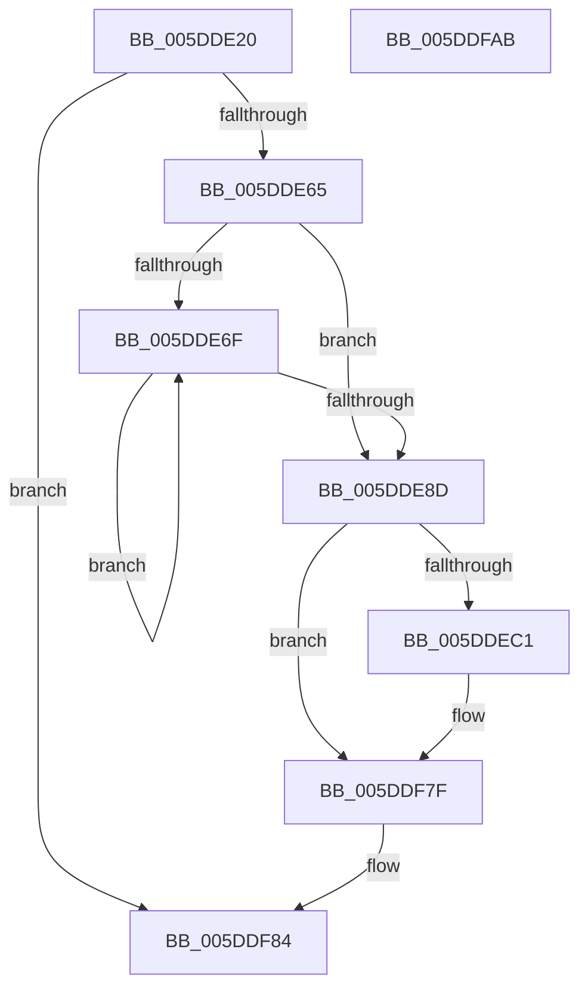

# PopPlRegisterDeviceIterator

- RVA: `0x005DDE20`–`0x005DDFAC` (길이 `396` bytes)
- VA: `0x00000001405DDE20`
- 실행 섹션: `.text`
- PDB 이름 있음: `예`; PDB Function 태그: `아니요`
- unwind 정보 RVA: `0x000CD7C8`
- 디코드: `99`개 명령, `396/396` bytes 표시
- 미해석 바이트: `0` (있으면 어셈블리에 `.byte`로 보존)

> 이 문서는 커널 이미지의 기계어와 PDB 기호를 분석해 생성했습니다. 4번과 5번은 함수 원형과 자료형을 바이너리 사용 방식에서 추정한 C 해석이며 원본 소스 복구 결과는 아닙니다.

## 1. Dependencies

- 직접 호출 지점: **5**; 고유 호출 대상: **5**
- 직접 호출자로 확인된 함수: **0**
- RIP 상대 이미지 참조: **3**

### Outgoing calls
- `0x005DDE52` → [PopPlRegisterDevice](../4B/PopPlRegisterDevice_function_004B820C.md) (function, `0x004B820C`)
- `0x005DDE7A` → [PopPlRegisterComponent](../4A/PopPlRegisterComponent_function_004AA1FC.md) (function, `0x004AA1FC`)
- `0x005DDEAA` → [PopPlCalculateDevicePowerDraw](PopPlCalculateDevicePowerDraw_function_005DD934.md) (function, `0x005DD934`)
- `0x005DDF7A` → [tlgWriteEx_EtwWriteEx](../4A/tlgWriteEx_EtwWriteEx_function_004AA348.md) (function, `0x004AA348`)
- `0x005DDF8E` → [_security_check_cookie](../6A/_security_check_cookie_function_006AC640.md) (function, `0x006AC640`)

### Direct callers
- 이 함수 시작 RVA로 연결되는 직접 call은 확인되지 않았습니다. 간접 호출은 완전히 역산할 수 없습니다.

### Static image references
- `0x005DDE3A` → RVA `0x00E0A740` (`.data`; read)
- `0x005DDEB4` → RVA `0x00E07748` (`.data`; read)
- `0x005DDF67` → RVA `0x0005058B` (`.rdata`; read)

## 2. Other-region calls and transfers

- 다른 실행 섹션으로 향하는 call: **0**
- 별도 외부 분기/꼬리 이동을 확인하지 못했습니다.

## 3. Assembly (complete function range)

```asm
005DDE20  48 89 5C 24 18                  mov qword ptr [rsp + 0x18], rbx
005DDE25  48 89 74 24 20                  mov qword ptr [rsp + 0x20], rsi
005DDE2A  55                              push rbp
005DDE2B  57                              push rdi
005DDE2C  41 57                           push r15
005DDE2E  48 8D 6C 24 B9                  lea rbp, [rsp - 0x47]
005DDE33  48 81 EC 00 01 00 00            sub rsp, 0x100
005DDE3A  48 8B 05 FF C8 82 00            mov rax, qword ptr [rip + 0x82c8ff]
005DDE41  48 33 C4                        xor rax, rsp
005DDE44  48 89 45 37                     mov qword ptr [rbp + 0x37], rax
005DDE48  48 8B 59 20                     mov rbx, qword ptr [rcx + 0x20]
005DDE4C  48 8B F2                        mov rsi, rdx
005DDE4F  48 8B CB                        mov rcx, rbx
005DDE52  E8 B5 A3 ED FF                  call 0x1404b820c
005DDE57  41 BF 01 00 00 00               mov r15d, 1
005DDE5D  84 C0                           test al, al
005DDE5F  0F 84 1F 01 00 00               je 0x1405ddf84
005DDE65  33 FF                           xor edi, edi
005DDE67  39 BB 64 03 00 00               cmp dword ptr [rbx + 0x364], edi
005DDE6D  76 1E                           jbe 0x1405dde8d
005DDE6F  48 8B 8B 68 03 00 00            mov rcx, qword ptr [rbx + 0x368]
005DDE76  48 8B 0C F9                     mov rcx, qword ptr [rcx + rdi*8]
005DDE7A  E8 7D C3 EC FF                  call 0x1404aa1fc
005DDE7F  8B 83 64 03 00 00               mov eax, dword ptr [rbx + 0x364]
005DDE85  49 03 FF                        add rdi, r15
005DDE88  48 3B F8                        cmp rdi, rax
005DDE8B  72 E2                           jb 0x1405dde6f
005DDE8D  83 65 87 00                     and dword ptr [rbp - 0x79], 0
005DDE91  4C 8D 45 87                     lea r8, [rbp - 0x79]
005DDE95  48 8B BB C8 04 00 00            mov rdi, qword ptr [rbx + 0x4c8]
005DDE9C  48 8D 55 8B                     lea rdx, [rbp - 0x75]
005DDEA0  45 33 C9                        xor r9d, r9d
005DDEA3  44 89 7D 8B                     mov dword ptr [rbp - 0x75], r15d
005DDEA7  48 8B CB                        mov rcx, rbx
005DDEAA  E8 85 FA FF FF                  call 0x1405dd934
005DDEAF  89 47 20                        mov dword ptr [rdi + 0x20], eax
005DDEB2  8B C8                           mov ecx, eax
005DDEB4  83 3D 8D 98 82 00 05            cmp dword ptr [rip + 0x82988d], 5
005DDEBB  0F 86 BE 00 00 00               jbe 0x1405ddf7f
005DDEC1  83 65 D3 00                     and dword ptr [rbp - 0x2d], 0
005DDEC5  48 8D 45 87                     lea rax, [rbp - 0x79]
005DDEC9  83 65 E3 00                     and dword ptr [rbp - 0x1d], 0
005DDECD  BA 02 00 00 00                  mov edx, 2
005DDED2  83 65 F3 00                     and dword ptr [rbp - 0xd], 0
005DDED6  45 8B CF                        mov r9d, r15d
005DDED9  83 65 8B 00                     and dword ptr [rbp - 0x75], 0
005DDEDD  83 65 03 00                     and dword ptr [rbp + 3], 0
005DDEE1  83 65 13 00                     and dword ptr [rbp + 0x13], 0
005DDEE5  83 65 93 00                     and dword ptr [rbp - 0x6d], 0
005DDEE9  83 65 23 00                     and dword ptr [rbp + 0x23], 0
005DDEED  48 89 45 C7                     mov qword ptr [rbp - 0x39], rax
005DDEF1  48 8D 45 EF                     lea rax, [rbp - 0x11]
005DDEF5  48 89 45 D7                     mov qword ptr [rbp - 0x29], rax
005DDEF9  48 8B 83 E0 00 00 00            mov rax, qword ptr [rbx + 0xe0]
005DDF00  48 89 45 E7                     mov qword ptr [rbp - 0x19], rax
005DDF04  0F B7 83 D8 00 00 00            movzx eax, word ptr [rbx + 0xd8]
005DDF0B  89 45 EF                        mov dword ptr [rbp - 0x11], eax
005DDF0E  48 8D 45 8B                     lea rax, [rbp - 0x75]
005DDF12  48 89 45 F7                     mov qword ptr [rbp - 9], rax
005DDF16  48 8D 45 8F                     lea rax, [rbp - 0x71]
005DDF1A  48 89 45 07                     mov qword ptr [rbp + 7], rax
005DDF1E  48 8D 45 93                     lea rax, [rbp - 0x6d]
005DDF22  48 89 45 17                     mov qword ptr [rbp + 0x17], rax
005DDF26  48 8B 47 10                     mov rax, qword ptr [rdi + 0x10]
005DDF2A  89 55 CF                        mov dword ptr [rbp - 0x31], edx
005DDF2D  89 55 DF                        mov dword ptr [rbp - 0x21], edx
005DDF30  BA 04 00 00 00                  mov edx, 4
005DDF35  89 4D 8F                        mov dword ptr [rbp - 0x71], ecx
005DDF38  89 55 FF                        mov dword ptr [rbp - 1], edx
005DDF3B  89 55 0F                        mov dword ptr [rbp + 0xf], edx
005DDF3E  89 55 1F                        mov dword ptr [rbp + 0x1f], edx
005DDF41  66 44 89 7D 87                  mov word ptr [rbp - 0x79], r15w
005DDF46  8B 48 1C                        mov ecx, dword ptr [rax + 0x1c]
005DDF49  48 8D 45 97                     lea rax, [rbp - 0x69]
005DDF4D  83 65 33 00                     and dword ptr [rbp + 0x33], 0
005DDF51  89 4D 97                        mov dword ptr [rbp - 0x69], ecx
005DDF54  48 8D 4D A7                     lea rcx, [rbp - 0x59]
005DDF58  48 89 4C 24 38                  mov qword ptr [rsp + 0x38], rcx
005DDF5D  48 8D 0D E4 97 82 00            lea rcx, [rip + 0x8297e4]
005DDF64  89 55 2F                        mov dword ptr [rbp + 0x2f], edx
005DDF67  48 8D 15 1D 26 A7 FF            lea rdx, [rip - 0x58d9e3]
005DDF6E  48 89 45 27                     mov qword ptr [rbp + 0x27], rax
005DDF72  C7 44 24 30 09 00 00 00         mov dword ptr [rsp + 0x30], 9
005DDF7A  E8 C9 C3 EC FF                  call 0x1404aa348
005DDF7F  8B 4F 20                        mov ecx, dword ptr [rdi + 0x20]
005DDF82  01 0E                           add dword ptr [rsi], ecx
005DDF84  41 8A C7                        mov al, r15b
005DDF87  48 8B 4D 37                     mov rcx, qword ptr [rbp + 0x37]
005DDF8B  48 33 CC                        xor rcx, rsp
005DDF8E  E8 AD E6 0C 00                  call 0x1406ac640
005DDF93  4C 8D 9C 24 00 01 00 00         lea r11, [rsp + 0x100]
005DDF9B  49 8B 5B 30                     mov rbx, qword ptr [r11 + 0x30]
005DDF9F  49 8B 73 38                     mov rsi, qword ptr [r11 + 0x38]
005DDFA3  49 8B E3                        mov rsp, r11
005DDFA6  41 5F                           pop r15
005DDFA8  5F                              pop rdi
005DDFA9  5D                              pop rbp
005DDFAA  C3                              ret
005DDFAB  CC                              int3
```

## 4. C-style interpretation (structured pseudocode)

```c
__int64 __fastcall PopPlRegisterDeviceIterator(__int64 a1, __int64 a2, __int64 a3, int a4)
{
    __int64 result;
    __int64 v_rdi;
    __int64 v_rsp;
    unsigned __int64 v_stack_m18;
    unsigned __int64 v_stack_m28;
    unsigned int v_stack_m2C;
    unsigned int v_stack_m30;
    unsigned __int64 v_stack_m38;
    unsigned int v_stack_m3C;
    unsigned int v_stack_m40;
    unsigned __int64 v_stack_m48;
    unsigned int v_stack_m4C;
    unsigned int v_stack_m50;
    unsigned __int64 v_stack_m58;
    unsigned int v_stack_m5C;
    unsigned __int64 v_stack_m5F;
    unsigned int v_stack_m60;
    unsigned __int64 v_stack_m68;
    unsigned int v_stack_m6C;
    unsigned __int64 v_stack_m70;
    unsigned __int64 v_stack_m78;
    unsigned int v_stack_m7C;
    unsigned int v_stack_m80;
    unsigned __int64 v_stack_m88;
    unsigned int v_stack_m8C;
    unsigned int v_stack_m90;
    unsigned __int64 v_stack_m98;
    unsigned __int64 v_stack_mB8;
    unsigned __int64 v_stack_mC8;
    unsigned int v_stack_mCC;
    unsigned __int64 v_stack_mD0;
    unsigned __int64 v_stack_mD4;
    unsigned int v_stack_mD8;
    unsigned __int64 v_stack_mE0;
    unsigned int v_stack_mE8;
    unsigned __int64 v_stack_p18;
    unsigned __int64 v_stack_p20;

    v_stack_p18 = v_rbx;
    v_stack_p20 = v_rsi;
    v_rsp = (v_rsp) - (256);
    result = (*(unsigned __int64 *)(v_rip + 8571135)) ^ (v_rsp);
    v_stack_m28 = result;
    result = PopPlRegisterDevice(*(unsigned __int64 *)(a1 + 32), a2, a3, a4);
    if ((unsigned __int8)(result) == 0) goto loc_005DDF84;
    v_rdi = 0;
    if ((*(unsigned int *)(*(unsigned __int64 *)(a1 + 32) + 868)) <= 0) goto loc_005DDE8D;
loc_005DDE6F:
    result = PopPlRegisterComponent(*(unsigned __int64 *)(*(unsigned __int64 *)(*(unsigned __int64 *)(a1 + 32) + 872) + v_rdi * 8), a2, a3, a4);
    v_rdi = (v_rdi) + (1);
    if (v_rdi < ((unsigned int)(*(unsigned int *)(*(unsigned __int64 *)(a1 + 32) + 868)))) goto loc_005DDE6F;
loc_005DDE8D:
    a4 = 0;
    v_stack_mD4 = 1;
    result = PopPlCalculateDevicePowerDraw(*(unsigned __int64 *)(a1 + 32), v_stack_mD4, v_stack_mD8, a4);
    *(unsigned int *)(*(unsigned __int64 *)(*(unsigned __int64 *)(a1 + 32) + 1224) + 32) = (unsigned int)(result);
    if ((*(unsigned int *)(v_rip + 8558733)) >= = 5) {
        result = v_stack_mD8;
        a2 = 2;
        a4 = 1;
        v_stack_m98 = result;
        result = v_stack_m70;
        v_stack_m88 = result;
        result = *(unsigned __int64 *)(*(unsigned __int64 *)(a1 + 32) + 224);
        v_stack_m78 = result;
        result = *(unsigned __int16 *)(*(unsigned __int64 *)(a1 + 32) + 216);
        v_stack_m70 = (unsigned int)(result);
        result = v_stack_mD4;
        v_stack_m68 = result;
        result = v_stack_mD0;
        v_stack_m58 = result;
        result = v_stack_mCC;
        v_stack_m48 = result;
        result = *(unsigned __int64 *)(*(unsigned __int64 *)(*(unsigned __int64 *)(a1 + 32) + 1224) + 16);
        v_stack_m90 = (unsigned int)(a2);
        v_stack_m80 = (unsigned int)(a2);
        a2 = 4;
        v_stack_mD0 = (unsigned int)((unsigned int)((unsigned int)(result)));
        v_stack_m60 = (unsigned int)(a2);
        v_stack_m50 = (unsigned int)(a2);
        v_stack_m40 = (unsigned int)(a2);
        v_stack_mD8 = 1;
        a1 = *(unsigned int *)(result + 28);
        result = v_stack_mC8;
        v_stack_mC8 = (unsigned int)(a1);
        a1 = v_stack_mB8;
        v_stack_mE0 = a1;
        a1 = v_rip + 8558564;
        v_stack_m30 = (unsigned int)(a2);
        a2 = v_rip - 5822947;
        v_stack_m38 = result;
        v_stack_mE8 = 9;
        result = tlgWriteEx_EtwWriteEx(a1, a2, v_stack_mD8, a4);
    }
loc_005DDF84:
    a1 = (v_stack_m28) ^ (v_rsp);
    result = _security_check_cookie(a1, a2, v_stack_mD8, a4);
    return result;
}
```

## 5. (Beta) C Style

```c
int64_t PopPlRegisterDeviceIterator(void *Arg1, void *Arg2, int64_t Arg3, int32_t Arg4)
{
    uint8_t *arg1 = (uint8_t *)Arg1;
    uint8_t *arg2 = (uint8_t *)Arg2;

    int64_t result;
    int64_t local_rdi;
    int64_t local_rsp;
    uint64_t v_stack_m18;
    uint64_t v_stack_m28;
    uint32_t v_stack_m2C;
    uint32_t v_stack_m30;
    uint64_t v_stack_m38;
    uint32_t v_stack_m3C;
    uint32_t v_stack_m40;
    uint64_t v_stack_m48;
    uint32_t v_stack_m4C;
    uint32_t v_stack_m50;
    uint64_t v_stack_m58;
    uint32_t v_stack_m5C;
    uint64_t v_stack_m5F;
    uint32_t v_stack_m60;
    uint64_t v_stack_m68;
    uint32_t v_stack_m6C;
    uint64_t v_stack_m70;
    uint64_t v_stack_m78;
    uint32_t v_stack_m7C;
    uint32_t v_stack_m80;
    uint64_t v_stack_m88;
    uint32_t v_stack_m8C;
    uint32_t v_stack_m90;
    uint64_t v_stack_m98;
    uint64_t v_stack_mB8;
    uint64_t v_stack_mC8;
    uint32_t v_stack_mCC;
    uint64_t v_stack_mD0;
    uint64_t v_stack_mD4;
    uint32_t v_stack_mD8;
    uint64_t v_stack_mE0;
    uint32_t v_stack_mE8;
    uint64_t v_stack_p18;
    uint64_t v_stack_p20;

    v_stack_p18 = local_rbx;
    v_stack_p20 = local_rsi;
    local_rsp = (local_rsp) - (256);
    result = (*(uint64_t *)(v_rip + 0x82C8FF)) ^ (local_rsp);
    v_stack_m28 = result;
    result = PopPlRegisterDevice(*(uint64_t *)(arg1 + 0x20), Arg2, Arg3, Arg4);
    if ((uint8_t)(result) == 0) goto loc_005DDF84;
    local_rdi = 0;
    if ((*(uint32_t *)(*(uint64_t *)(arg1 + 0x20) + 0x364)) <= 0) goto loc_005DDE8D;
loc_005DDE6F:
    result = PopPlRegisterComponent(*(uint64_t *)(*(uint64_t *)(*(uint64_t *)(arg1 + 0x20) + 0x368) + local_rdi * 8), Arg2, Arg3, Arg4);
    local_rdi = (local_rdi) + (1);
    if (local_rdi < ((uint32_t)(*(uint32_t *)(*(uint64_t *)(arg1 + 0x20) + 0x364)))) goto loc_005DDE6F;
loc_005DDE8D:
    Arg4 = 0;
    v_stack_mD4 = 1;
    result = PopPlCalculateDevicePowerDraw(*(uint64_t *)(arg1 + 0x20), v_stack_mD4, v_stack_mD8, Arg4);
    *(uint32_t *)(*(uint64_t *)(*(uint64_t *)(arg1 + 0x20) + 0x4C8) + 0x20) = (uint32_t)(result);
    if ((*(uint32_t *)(v_rip + 0x82988D)) >= = 5) {
        result = v_stack_mD8;
        Arg2 = 2;
        Arg4 = 1;
        v_stack_m98 = result;
        result = v_stack_m70;
        v_stack_m88 = result;
        result = *(uint64_t *)(*(uint64_t *)(arg1 + 0x20) + 0xE0);
        v_stack_m78 = result;
        result = *(uint16_t *)(*(uint64_t *)(arg1 + 0x20) + 0xD8);
        v_stack_m70 = (uint32_t)(result);
        result = v_stack_mD4;
        v_stack_m68 = result;
        result = v_stack_mD0;
        v_stack_m58 = result;
        result = v_stack_mCC;
        v_stack_m48 = result;
        result = *(uint64_t *)(*(uint64_t *)(*(uint64_t *)(arg1 + 0x20) + 0x4C8) + 0x10);
        v_stack_m90 = (uint32_t)(Arg2);
        v_stack_m80 = (uint32_t)(Arg2);
        Arg2 = 4;
        v_stack_mD0 = (uint32_t)((uint32_t)((uint32_t)(result)));
        v_stack_m60 = (uint32_t)(Arg2);
        v_stack_m50 = (uint32_t)(Arg2);
        v_stack_m40 = (uint32_t)(Arg2);
        v_stack_mD8 = 1;
        Arg1 = *(uint32_t *)(result + 0x1C);
        result = v_stack_mC8;
        v_stack_mC8 = (uint32_t)(Arg1);
        Arg1 = v_stack_mB8;
        v_stack_mE0 = Arg1;
        Arg1 = v_rip + 8558564;
        v_stack_m30 = (uint32_t)(Arg2);
        Arg2 = v_rip - 5822947;
        v_stack_m38 = result;
        v_stack_mE8 = 9;
        result = tlgWriteEx_EtwWriteEx(Arg1, Arg2, v_stack_mD8, Arg4);
    }
loc_005DDF84:
    Arg1 = (v_stack_m28) ^ (local_rsp);
    result = _security_check_cookie(Arg1, Arg2, v_stack_mD8, Arg4);
    return result;
}
```

### 관측된 메모리 오프셋

구조체 형식이 확인되지 않은 접근은 인자 기준의 오프셋으로만 기록했습니다.

| 기준 인자 | 오프셋 표현 | 폭 (bit) | 접근 |
|---|---:|---:|---|
| `Arg1` | `+ 0x20` | `64` | `R` |
| `Arg2` | `+ 0x0` | `32` | `R/W` |

## 6. Execution-region graph

[열기: 2D/3D 그래프와 함수 탐색 컨트롤 패널](../../../control-panel.html?section=text&rva=0x005DDE20&view=graph)

- 2D 그래프는 위에서 아래로 흐르고, 3D 그래프는 빈 공간을 드래그해 회전합니다. Shift+드래그는 이동, 휠은 확대·축소, 함수 노드 선택은 대상 보고서 이동입니다.

### Static fallback


