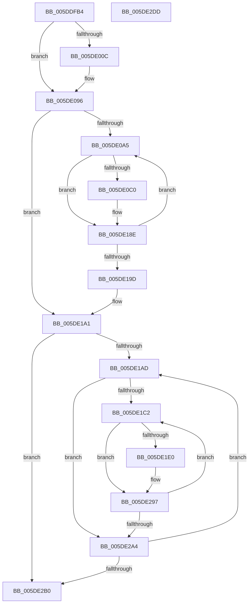

# PopPlTraceLogPowerPlane

- RVA: `0x005DDFB4`–`0x005DE2DE` (길이 `810` bytes)
- VA: `0x00000001405DDFB4`
- 실행 섹션: `.text`
- PDB 이름 있음: `예`; PDB Function 태그: `아니요`
- unwind 정보 RVA: `0x000BC8F8`
- 디코드: `181`개 명령, `810/810` bytes 표시
- 미해석 바이트: `0` (있으면 어셈블리에 `.byte`로 보존)

> 이 문서는 커널 이미지의 기계어와 PDB 기호를 분석해 생성했습니다. 4번과 5번은 함수 원형과 자료형을 바이너리 사용 방식에서 추정한 C 해석이며 원본 소스 복구 결과는 아닙니다.

## 1. Dependencies

- 직접 호출 지점: **4**; 고유 호출 대상: **2**
- 직접 호출자로 확인된 함수: **2**
- RIP 상대 이미지 참조: **5**

### Outgoing calls
- `0x005DE091` → [tlgWriteEx_EtwWriteEx](../4A/tlgWriteEx_EtwWriteEx_function_004AA348.md) (function, `0x004AA348`)
- `0x005DE189` → [tlgWriteEx_EtwWriteEx](../4A/tlgWriteEx_EtwWriteEx_function_004AA348.md) (function, `0x004AA348`)
- `0x005DE292` → [tlgWriteEx_EtwWriteEx](../4A/tlgWriteEx_EtwWriteEx_function_004AA348.md) (function, `0x004AA348`)
- `0x005DE2B7` → [_security_check_cookie](../6A/_security_check_cookie_function_006AC640.md) (function, `0x006AC640`)

### Direct callers
- [PopPlRegisterPowerPlane](../4D/PopPlRegisterPowerPlane_function_004DB504.md) at `0x004DB5FE`
- [sub_00B3A29A](../../page/B3/Unknown_function_00B3A29A.md) at `0x00B3A2AA`

### Static image references
- `0x005DDFD7` → RVA `0x00E0A740` (`.data`; read)
- `0x005DDFEC` → RVA `0x00E07748` (`.data`; read)
- `0x005DE01C` → RVA `0x0005039C` (`.rdata`; read)
- `0x005DE0D0` → RVA `0x000503FA` (`.rdata`; read)
- `0x005DE24A` → RVA `0x00050492` (`.rdata`; read)

## 2. Other-region calls and transfers

- 다른 실행 섹션으로 향하는 call: **0**
- 별도 외부 분기/꼬리 이동을 확인하지 못했습니다.

## 3. Assembly (complete function range)

```asm
005DDFB4  48 8B C4                        mov rax, rsp
005DDFB7  48 89 58 08                     mov qword ptr [rax + 8], rbx
005DDFBB  48 89 70 10                     mov qword ptr [rax + 0x10], rsi
005DDFBF  48 89 78 18                     mov qword ptr [rax + 0x18], rdi
005DDFC3  55                              push rbp
005DDFC4  41 54                           push r12
005DDFC6  41 55                           push r13
005DDFC8  41 56                           push r14
005DDFCA  41 57                           push r15
005DDFCC  48 8D 68 C8                     lea rbp, [rax - 0x38]
005DDFD0  48 81 EC 10 01 00 00            sub rsp, 0x110
005DDFD7  48 8B 05 62 C7 82 00            mov rax, qword ptr [rip + 0x82c762]
005DDFDE  48 33 C4                        xor rax, rsp
005DDFE1  48 89 45 00                     mov qword ptr [rbp], rax
005DDFE5  45 33 E4                        xor r12d, r12d
005DDFE8  48 8D 59 30                     lea rbx, [rcx + 0x30]
005DDFEC  83 3D 55 97 82 00 05            cmp dword ptr [rip + 0x829755], 5
005DDFF3  48 8B F9                        mov rdi, rcx
005DDFF6  66 44 89 64 24 44               mov word ptr [rsp + 0x44], r12w
005DDFFC  45 8D 6C 24 01                  lea r13d, [r12 + 1]
005DE001  45 8D 74 24 04                  lea r14d, [r12 + 4]
005DE006  0F 86 8A 00 00 00               jbe 0x1405de096
005DE00C  48 8D 44 24 40                  lea rax, [rsp + 0x40]
005DE011  66 44 89 6C 24 40               mov word ptr [rsp + 0x40], r13w
005DE017  48 89 44 24 70                  mov qword ptr [rsp + 0x70], rax
005DE01C  48 8D 15 79 23 A7 FF            lea rdx, [rip - 0x58dc87]
005DE023  48 8D 45 98                     lea rax, [rbp - 0x68]
005DE027  48 C7 44 24 78 02 00 00 00      mov qword ptr [rsp + 0x78], 2
005DE030  48 89 45 80                     mov qword ptr [rbp - 0x80], rax
005DE034  45 8B CD                        mov r9d, r13d
005DE037  48 8B 41 08                     mov rax, qword ptr [rcx + 8]
005DE03B  48 89 45 90                     mov qword ptr [rbp - 0x70], rax
005DE03F  0F B7 01                        movzx eax, word ptr [rcx]
005DE042  89 45 98                        mov dword ptr [rbp - 0x68], eax
005DE045  8B 03                           mov eax, dword ptr [rbx]
005DE047  89 44 24 48                     mov dword ptr [rsp + 0x48], eax
005DE04B  48 8D 44 24 48                  lea rax, [rsp + 0x48]
005DE050  48 89 45 A0                     mov qword ptr [rbp - 0x60], rax
005DE054  8B 41 1C                        mov eax, dword ptr [rcx + 0x1c]
005DE057  48 8D 0D EA 96 82 00            lea rcx, [rip + 0x8296ea]
005DE05E  89 44 24 4C                     mov dword ptr [rsp + 0x4c], eax
005DE062  48 8D 44 24 4C                  lea rax, [rsp + 0x4c]
005DE067  48 89 45 B0                     mov qword ptr [rbp - 0x50], rax
005DE06B  48 8D 44 24 50                  lea rax, [rsp + 0x50]
005DE070  48 89 44 24 38                  mov qword ptr [rsp + 0x38], rax
005DE075  C7 44 24 30 07 00 00 00         mov dword ptr [rsp + 0x30], 7
005DE07D  48 C7 45 88 02 00 00 00         mov qword ptr [rbp - 0x78], 2
005DE085  44 89 65 9C                     mov dword ptr [rbp - 0x64], r12d
005DE089  4C 89 75 A8                     mov qword ptr [rbp - 0x58], r14
005DE08D  4C 89 75 B8                     mov qword ptr [rbp - 0x48], r14
005DE091  E8 B2 C2 EC FF                  call 0x1404aa348
005DE096  48 8B 03                        mov rax, qword ptr [rbx]
005DE099  49 8B F4                        mov rsi, r12
005DE09C  48 85 C0                        test rax, rax
005DE09F  0F 84 FC 00 00 00               je 0x1405de1a1
005DE0A5  83 3D 9C 96 82 00 05            cmp dword ptr [rip + 0x82969c], 5
005DE0AC  48 8B 47 38                     mov rax, qword ptr [rdi + 0x38]
005DE0B0  48 8B 0C F0                     mov rcx, qword ptr [rax + rsi*8]
005DE0B4  66 44 89 74 24 44               mov word ptr [rsp + 0x44], r14w
005DE0BA  0F 86 CE 00 00 00               jbe 0x1405de18e
005DE0C0  48 8D 44 24 40                  lea rax, [rsp + 0x40]
005DE0C5  66 44 89 6C 24 40               mov word ptr [rsp + 0x40], r13w
005DE0CB  48 89 44 24 70                  mov qword ptr [rsp + 0x70], rax
005DE0D0  48 8D 15 23 23 A7 FF            lea rdx, [rip - 0x58dcdd]
005DE0D7  48 8D 45 98                     lea rax, [rbp - 0x68]
005DE0DB  48 C7 44 24 78 02 00 00 00      mov qword ptr [rsp + 0x78], 2
005DE0E4  48 89 45 80                     mov qword ptr [rbp - 0x80], rax
005DE0E8  45 8B CD                        mov r9d, r13d
005DE0EB  48 8B 41 08                     mov rax, qword ptr [rcx + 8]
005DE0EF  48 89 45 90                     mov qword ptr [rbp - 0x70], rax
005DE0F3  0F B7 01                        movzx eax, word ptr [rcx]
005DE0F6  89 45 98                        mov dword ptr [rbp - 0x68], eax
005DE0F9  48 8D 45 B8                     lea rax, [rbp - 0x48]
005DE0FD  48 89 45 A0                     mov qword ptr [rbp - 0x60], rax
005DE101  48 8B 47 08                     mov rax, qword ptr [rdi + 8]
005DE105  48 89 45 B0                     mov qword ptr [rbp - 0x50], rax
005DE109  0F B7 07                        movzx eax, word ptr [rdi]
005DE10C  89 45 B8                        mov dword ptr [rbp - 0x48], eax
005DE10F  8B 41 48                        mov eax, dword ptr [rcx + 0x48]
005DE112  89 44 24 4C                     mov dword ptr [rsp + 0x4c], eax
005DE116  48 8D 44 24 4C                  lea rax, [rsp + 0x4c]
005DE11B  48 89 45 C0                     mov qword ptr [rbp - 0x40], rax
005DE11F  8B 41 20                        mov eax, dword ptr [rcx + 0x20]
005DE122  89 44 24 48                     mov dword ptr [rsp + 0x48], eax
005DE126  48 8D 44 24 48                  lea rax, [rsp + 0x48]
005DE12B  48 89 45 D0                     mov qword ptr [rbp - 0x30], rax
005DE12F  48 8D 44 24 44                  lea rax, [rsp + 0x44]
005DE134  48 89 45 E0                     mov qword ptr [rbp - 0x20], rax
005DE138  48 8D 41 24                     lea rax, [rcx + 0x24]
005DE13C  48 89 45 F0                     mov qword ptr [rbp - 0x10], rax
005DE140  48 8D 0D 01 96 82 00            lea rcx, [rip + 0x829601]
005DE147  48 8D 44 24 50                  lea rax, [rsp + 0x50]
005DE14C  48 C7 45 88 02 00 00 00         mov qword ptr [rbp - 0x78], 2
005DE154  48 89 44 24 38                  mov qword ptr [rsp + 0x38], rax
005DE159  C7 44 24 30 0B 00 00 00         mov dword ptr [rsp + 0x30], 0xb
005DE161  44 89 65 9C                     mov dword ptr [rbp - 0x64], r12d
005DE165  48 C7 45 A8 02 00 00 00         mov qword ptr [rbp - 0x58], 2
005DE16D  44 89 65 BC                     mov dword ptr [rbp - 0x44], r12d
005DE171  4C 89 75 C8                     mov qword ptr [rbp - 0x38], r14
005DE175  4C 89 75 D8                     mov qword ptr [rbp - 0x28], r14
005DE179  48 C7 45 E8 02 00 00 00         mov qword ptr [rbp - 0x18], 2
005DE181  48 C7 45 F8 20 00 00 00         mov qword ptr [rbp - 8], 0x20
005DE189  E8 BA C1 EC FF                  call 0x1404aa348
005DE18E  48 8B 03                        mov rax, qword ptr [rbx]
005DE191  49 03 F5                        add rsi, r13
005DE194  48 3B F0                        cmp rsi, rax
005DE197  0F 82 08 FF FF FF               jb 0x1405de0a5
005DE19D  48 8D 5F 30                     lea rbx, [rdi + 0x30]
005DE1A1  49 8B F4                        mov rsi, r12
005DE1A4  48 85 C0                        test rax, rax
005DE1A7  0F 84 03 01 00 00               je 0x1405de2b0
005DE1AD  48 8B 47 38                     mov rax, qword ptr [rdi + 0x38]
005DE1B1  4D 8B F4                        mov r14, r12
005DE1B4  4C 8B 3C F0                     mov r15, qword ptr [rax + rsi*8]
005DE1B8  4D 39 67 48                     cmp qword ptr [r15 + 0x48], r12
005DE1BC  0F 86 E2 00 00 00               jbe 0x1405de2a4
005DE1C2  83 3D 7F 95 82 00 05            cmp dword ptr [rip + 0x82957f], 5
005DE1C9  49 8B 47 50                     mov rax, qword ptr [r15 + 0x50]
005DE1CD  4A 8B 0C F0                     mov rcx, qword ptr [rax + r14*8]
005DE1D1  0F B7 51 18                     movzx edx, word ptr [rcx + 0x18]
005DE1D5  66 89 54 24 44                  mov word ptr [rsp + 0x44], dx
005DE1DA  0F 86 B7 00 00 00               jbe 0x1405de297
005DE1E0  48 8D 44 24 40                  lea rax, [rsp + 0x40]
005DE1E5  48 89 4D 80                     mov qword ptr [rbp - 0x80], rcx
005DE1E9  48 89 44 24 70                  mov qword ptr [rsp + 0x70], rax
005DE1EE  45 8B CD                        mov r9d, r13d
005DE1F1  48 8D 45 A8                     lea rax, [rbp - 0x58]
005DE1F5  66 44 89 6C 24 40               mov word ptr [rsp + 0x40], r13w
005DE1FB  48 89 45 90                     mov qword ptr [rbp - 0x70], rax
005DE1FF  49 8B 47 08                     mov rax, qword ptr [r15 + 8]
005DE203  48 89 45 A0                     mov qword ptr [rbp - 0x60], rax
005DE207  41 0F B7 07                     movzx eax, word ptr [r15]
005DE20B  89 45 A8                        mov dword ptr [rbp - 0x58], eax
005DE20E  48 8D 45 C8                     lea rax, [rbp - 0x38]
005DE212  48 89 45 B0                     mov qword ptr [rbp - 0x50], rax
005DE216  48 8B 47 08                     mov rax, qword ptr [rdi + 8]
005DE21A  48 89 45 C0                     mov qword ptr [rbp - 0x40], rax
005DE21E  0F B7 07                        movzx eax, word ptr [rdi]
005DE221  89 45 C8                        mov dword ptr [rbp - 0x38], eax
005DE224  48 8D 44 24 44                  lea rax, [rsp + 0x44]
005DE229  48 89 45 D0                     mov qword ptr [rbp - 0x30], rax
005DE22D  48 8D 41 20                     lea rax, [rcx + 0x20]
005DE231  48 89 45 E0                     mov qword ptr [rbp - 0x20], rax
005DE235  48 8D 0D 0C 95 82 00            lea rcx, [rip + 0x82950c]
005DE23C  8B C2                           mov eax, edx
005DE23E  48 C7 44 24 78 02 00 00 00      mov qword ptr [rsp + 0x78], 2
005DE247  C1 E0 03                        shl eax, 3
005DE24A  48 8D 15 41 22 A7 FF            lea rdx, [rip - 0x58ddbf]
005DE251  89 45 E8                        mov dword ptr [rbp - 0x18], eax
005DE254  48 8D 44 24 50                  lea rax, [rsp + 0x50]
005DE259  48 89 44 24 38                  mov qword ptr [rsp + 0x38], rax
005DE25E  C7 44 24 30 0A 00 00 00         mov dword ptr [rsp + 0x30], 0xa
005DE266  48 C7 45 88 10 00 00 00         mov qword ptr [rbp - 0x78], 0x10
005DE26E  48 C7 45 98 02 00 00 00         mov qword ptr [rbp - 0x68], 2
005DE276  44 89 65 AC                     mov dword ptr [rbp - 0x54], r12d
005DE27A  48 C7 45 B8 02 00 00 00         mov qword ptr [rbp - 0x48], 2
005DE282  44 89 65 CC                     mov dword ptr [rbp - 0x34], r12d
005DE286  48 C7 45 D8 02 00 00 00         mov qword ptr [rbp - 0x28], 2
005DE28E  44 89 65 EC                     mov dword ptr [rbp - 0x14], r12d
005DE292  E8 B1 C0 EC FF                  call 0x1404aa348
005DE297  4D 03 F5                        add r14, r13
005DE29A  4D 3B 77 48                     cmp r14, qword ptr [r15 + 0x48]
005DE29E  0F 82 1E FF FF FF               jb 0x1405de1c2
005DE2A4  49 03 F5                        add rsi, r13
005DE2A7  48 3B 33                        cmp rsi, qword ptr [rbx]
005DE2AA  0F 82 FD FE FF FF               jb 0x1405de1ad
005DE2B0  48 8B 4D 00                     mov rcx, qword ptr [rbp]
005DE2B4  48 33 CC                        xor rcx, rsp
005DE2B7  E8 84 E3 0C 00                  call 0x1406ac640
005DE2BC  4C 8D 9C 24 10 01 00 00         lea r11, [rsp + 0x110]
005DE2C4  49 8B 5B 30                     mov rbx, qword ptr [r11 + 0x30]
005DE2C8  49 8B 73 38                     mov rsi, qword ptr [r11 + 0x38]
005DE2CC  49 8B 7B 40                     mov rdi, qword ptr [r11 + 0x40]
005DE2D0  49 8B E3                        mov rsp, r11
005DE2D3  41 5F                           pop r15
005DE2D5  41 5E                           pop r14
005DE2D7  41 5D                           pop r13
005DE2D9  41 5C                           pop r12
005DE2DB  5D                              pop rbp
005DE2DC  C3                              ret
005DE2DD  CC                              int3
```

## 4. C-style interpretation (structured pseudocode)

```c
__int64 __fastcall PopPlTraceLogPowerPlane(__int64 a1)
{
    __int64 result;
    __int64 v_r12;
    __int64 v_r14;
    __int64 v_rsi;
    __int64 v_rsp;
    unsigned __int64 v_stack_m100;
    unsigned int v_stack_m108;
    unsigned __int64 v_stack_m28;
    unsigned __int64 v_stack_mC0;
    unsigned __int64 v_stack_mC8;
    unsigned __int64 v_stack_mE8;
    unsigned int v_stack_mEC;
    unsigned int v_stack_mF0;
    unsigned __int16 v_stack_mF4;
    unsigned __int64 v_stack_mF8;

    *(unsigned __int64 *)(v_rsp + 8) = v_rbx;
    *(unsigned __int64 *)(v_rsp + 16) = v_rsi;
    *(unsigned __int64 *)(v_rsp + 24) = v_rdi;
    v_rsp = (v_rsp) - (272);
    result = (*(unsigned __int64 *)(v_rip + 8570722)) ^ (v_rsp);
    *(unsigned __int64 *)(v_rsp - 56) = result;
    v_r12 = 0;
    v_stack_mF4 = 0;
    if ((*(unsigned int *)(v_rip + 8558421)) >= = 5) {
        result = v_stack_mF8;
        v_stack_mF8 = (unsigned __int16)(v_r12 + 1);
        v_stack_mC8 = result;
        a2 = v_rip - 5823623;
        result = v_rsp - 56 - 104;
        v_stack_mC0 = 2;
        *(unsigned __int64 *)(v_rsp - 56 - 128) = result;
        a4 = (unsigned int)(v_r12 + 1);
        result = *(unsigned __int64 *)(a1 + 8);
        *(unsigned __int64 *)(v_rsp - 56 - 112) = result;
        result = *(unsigned __int16 *)(a1);
        *(unsigned int *)(v_rsp - 56 - 104) = (unsigned int)(result);
        result = *(unsigned int *)(a1 + 48);
        v_stack_mF0 = (unsigned int)(result);
        result = v_stack_mF0;
        *(unsigned __int64 *)(v_rsp - 56 - 96) = result;
        result = *(unsigned int *)(a1 + 28);
        a1 = v_rip + 8558314;
        v_stack_mEC = (unsigned int)(result);
        result = v_stack_mEC;
        *(unsigned __int64 *)(v_rsp - 56 - 80) = result;
        result = v_stack_mE8;
        v_stack_m100 = result;
        v_stack_m108 = 7;
        *(unsigned __int64 *)(v_rsp - 56 - 120) = 2;
        *(unsigned int *)(v_rsp - 56 - 100) = 0;
        *(unsigned __int64 *)(v_rsp - 56 - 88) = v_r12 + 4;
        *(unsigned __int64 *)(v_rsp - 56 - 72) = v_r12 + 4;
        result = tlgWriteEx_EtwWriteEx(a1, a2, a3, a4);
    }
    if (*(unsigned __int64 *)(a1 + 48) == 0) goto loc_005DE1A1;
loc_005DE0A5:
    v_stack_mF4 = (unsigned __int16)(v_r12 + 4);
    result = *(unsigned __int64 *)(a1 + 56);
    if ((*(unsigned int *)(v_rip + 8558236)) >= = 5) {
        result = v_stack_mF8;
        v_stack_mF8 = (unsigned __int16)(v_r12 + 1);
        v_stack_mC8 = result;
        a2 = v_rip - 5823709;
        result = v_rsp - 56 - 104;
        v_stack_mC0 = 2;
        *(unsigned __int64 *)(v_rsp - 56 - 128) = result;
        a4 = (unsigned int)(v_r12 + 1);
        result = *(unsigned __int64 *)(*(unsigned __int64 *)(*(unsigned __int64 *)(a1 + 56) + 0 * 8) + 8);
        *(unsigned __int64 *)(v_rsp - 56 - 112) = result;
        result = *(unsigned __int16 *)(*(unsigned __int64 *)(*(unsigned __int64 *)(a1 + 56) + 0 * 8));
        *(unsigned int *)(v_rsp - 56 - 104) = (unsigned int)(result);
        result = v_rsp - 56 - 72;
        *(unsigned __int64 *)(v_rsp - 56 - 96) = result;
        result = *(unsigned __int64 *)(a1 + 8);
        *(unsigned __int64 *)(v_rsp - 56 - 80) = result;
        result = *(unsigned __int16 *)(a1);
        *(unsigned int *)(v_rsp - 56 - 72) = (unsigned int)(result);
        result = *(unsigned int *)(*(unsigned __int64 *)(*(unsigned __int64 *)(a1 + 56) + 0 * 8) + 72);
        v_stack_mEC = (unsigned int)(result);
        result = v_stack_mEC;
        *(unsigned __int64 *)(v_rsp - 56 - 64) = result;
        result = *(unsigned int *)(*(unsigned __int64 *)(*(unsigned __int64 *)(a1 + 56) + 0 * 8) + 32);
        v_stack_mF0 = (unsigned int)(result);
        result = v_stack_mF0;
        *(unsigned __int64 *)(v_rsp - 56 - 48) = result;
        result = v_stack_mF4;
        *(unsigned __int64 *)(v_rsp - 56 - 32) = result;
        result = *(unsigned __int64 *)(*(unsigned __int64 *)(a1 + 56) + 0 * 8) + 36;
        *(unsigned __int64 *)(v_rsp - 56 - 16) = result;
        a1 = v_rip + 8558081;
        result = v_stack_mE8;
        *(unsigned __int64 *)(v_rsp - 56 - 120) = 2;
        v_stack_m100 = result;
        v_stack_m108 = 11;
        *(unsigned int *)(v_rsp - 56 - 100) = 0;
        *(unsigned __int64 *)(v_rsp - 56 - 88) = 2;
        *(unsigned int *)(v_rsp - 56 - 68) = 0;
        *(unsigned __int64 *)(v_rsp - 56 - 56) = v_r12 + 4;
        *(unsigned __int64 *)(v_rsp - 56 - 40) = v_r12 + 4;
        *(unsigned __int64 *)(v_rsp - 56 - 24) = 2;
        *(unsigned __int64 *)(v_rsp - 56 - 8) = 32;
        result = tlgWriteEx_EtwWriteEx(a1, a2, a3, a4);
    }
    v_rsi = (0) + (v_r12 + 1);
    if (v_rsi < (*(unsigned __int64 *)(a1 + 48))) goto loc_005DE0A5;
loc_005DE1A1:
    if (*(unsigned __int64 *)(a1 + 48) == 0) goto loc_005DE2B0;
loc_005DE1AD:
    if ((*(unsigned __int64 *)(*(unsigned __int64 *)(*(unsigned __int64 *)(a1 + 56) + 0 * 8) + 72)) <= 0) goto loc_005DE2A4;
loc_005DE1C2:
    v_stack_mF4 = (unsigned __int16)(*(unsigned __int16 *)(*(unsigned __int64 *)(*(unsigned __int64 *)(*(unsigned __int64 *)(*(unsigned __int64 *)(a1 + 56) + 0 * 8) + 80) + 0 * 8) + 24));
    result = *(unsigned __int64 *)(*(unsigned __int64 *)(*(unsigned __int64 *)(a1 + 56) + 0 * 8) + 80);
    if ((*(unsigned int *)(v_rip + 8557951)) >= = 5) {
        result = v_stack_mF8;
        *(unsigned __int64 *)(v_rsp - 56 - 128) = *(unsigned __int64 *)(*(unsigned __int64 *)(*(unsigned __int64 *)(*(unsigned __int64 *)(a1 + 56) + 0 * 8) + 80) + 0 * 8);
        v_stack_mC8 = result;
        a4 = (unsigned int)(v_r12 + 1);
        result = v_rsp - 56 - 88;
        v_stack_mF8 = (unsigned __int16)(v_r12 + 1);
        *(unsigned __int64 *)(v_rsp - 56 - 112) = result;
        result = *(unsigned __int64 *)(*(unsigned __int64 *)(*(unsigned __int64 *)(a1 + 56) + 0 * 8) + 8);
        *(unsigned __int64 *)(v_rsp - 56 - 96) = result;
        result = *(unsigned __int16 *)(*(unsigned __int64 *)(*(unsigned __int64 *)(a1 + 56) + 0 * 8));
        *(unsigned int *)(v_rsp - 56 - 88) = (unsigned int)(result);
        result = v_rsp - 56 - 56;
        *(unsigned __int64 *)(v_rsp - 56 - 80) = result;
        result = *(unsigned __int64 *)(a1 + 8);
        *(unsigned __int64 *)(v_rsp - 56 - 64) = result;
        result = *(unsigned __int16 *)(a1);
        *(unsigned int *)(v_rsp - 56 - 56) = (unsigned int)(result);
        result = v_stack_mF4;
        *(unsigned __int64 *)(v_rsp - 56 - 48) = result;
        result = *(unsigned __int64 *)(*(unsigned __int64 *)(*(unsigned __int64 *)(*(unsigned __int64 *)(a1 + 56) + 0 * 8) + 80) + 0 * 8) + 32;
        *(unsigned __int64 *)(v_rsp - 56 - 32) = result;
        a1 = v_rip + 8557836;
        result = (unsigned int)(*(unsigned __int16 *)(*(unsigned __int64 *)(*(unsigned __int64 *)(*(unsigned __int64 *)(*(unsigned __int64 *)(a1 + 56) + 0 * 8) + 80) + 0 * 8) + 24));
        v_stack_mC0 = 2;
        result = (unsigned int)((result) << (3));
        a2 = v_rip - 5823935;
        *(unsigned int *)(v_rsp - 56 - 24) = (unsigned int)(result);
        result = v_stack_mE8;
        v_stack_m100 = result;
        v_stack_m108 = 10;
        *(unsigned __int64 *)(v_rsp - 56 - 120) = 16;
        *(unsigned __int64 *)(v_rsp - 56 - 104) = 2;
        *(unsigned int *)(v_rsp - 56 - 84) = 0;
        *(unsigned __int64 *)(v_rsp - 56 - 72) = 2;
        *(unsigned int *)(v_rsp - 56 - 52) = 0;
        *(unsigned __int64 *)(v_rsp - 56 - 40) = 2;
        *(unsigned int *)(v_rsp - 56 - 20) = 0;
        result = tlgWriteEx_EtwWriteEx(a1, a2, a3, a4);
    }
    v_r14 = (0) + (v_r12 + 1);
    if (v_r14 < (*(unsigned __int64 *)(*(unsigned __int64 *)(*(unsigned __int64 *)(a1 + 56) + 0 * 8) + 72))) goto loc_005DE1C2;
loc_005DE2A4:
    v_rsi = (0) + (v_r12 + 1);
    if (v_rsi < (*(unsigned __int64 *)(a1 + 48))) goto loc_005DE1AD;
loc_005DE2B0:
    a1 = (*(unsigned __int64 *)(v_rsp - 56)) ^ (v_rsp);
    result = _security_check_cookie(a1, a2, a3, a4);
    return result;
}
```

## 5. (Beta) C Style

```c
int64_t PopPlTraceLogPowerPlane(void *Arg1)
{
    uint8_t *arg1 = (uint8_t *)Arg1;

    int64_t result;
    int64_t local_r12;
    int64_t local_r14;
    int64_t local_rsi;
    int64_t local_rsp;
    uint64_t v_stack_m100;
    uint32_t v_stack_m108;
    uint64_t v_stack_m28;
    uint64_t v_stack_mC0;
    uint64_t v_stack_mC8;
    uint64_t v_stack_mE8;
    uint32_t v_stack_mEC;
    uint32_t v_stack_mF0;
    uint16_t v_stack_mF4;
    uint64_t v_stack_mF8;

    *(uint64_t *)(local_rsp + 0x8) = local_rbx;
    *(uint64_t *)(local_rsp + 0x10) = local_rsi;
    *(uint64_t *)(local_rsp + 0x18) = local_rdi;
    local_rsp = (local_rsp) - (272);
    result = (*(uint64_t *)(v_rip + 0x82C762)) ^ (local_rsp);
    *(uint64_t *)(local_rsp - 0x38) = result;
    local_r12 = 0;
    v_stack_mF4 = 0;
    if ((*(uint32_t *)(v_rip + 0x829755)) >= = 5) {
        result = v_stack_mF8;
        v_stack_mF8 = (uint16_t)(local_r12 + 1);
        v_stack_mC8 = result;
        a2 = v_rip - 5823623;
        result = local_rsp - 56 - 104;
        v_stack_mC0 = 2;
        *(uint64_t *)(local_rsp - 0x38 - 0x80) = result;
        a4 = (uint32_t)(local_r12 + 1);
        result = *(uint64_t *)(arg1 + 0x8);
        *(uint64_t *)(local_rsp - 0x38 - 0x70) = result;
        result = *(uint16_t *)(arg1);
        *(uint32_t *)(local_rsp - 0x38 - 0x68) = (uint32_t)(result);
        result = *(uint32_t *)(arg1 + 0x30);
        v_stack_mF0 = (uint32_t)(result);
        result = v_stack_mF0;
        *(uint64_t *)(local_rsp - 0x38 - 0x60) = result;
        result = *(uint32_t *)(arg1 + 0x1C);
        Arg1 = v_rip + 8558314;
        v_stack_mEC = (uint32_t)(result);
        result = v_stack_mEC;
        *(uint64_t *)(local_rsp - 0x38 - 0x50) = result;
        result = v_stack_mE8;
        v_stack_m100 = result;
        v_stack_m108 = 7;
        *(uint64_t *)(local_rsp - 0x38 - 0x78) = 2;
        *(uint32_t *)(local_rsp - 0x38 - 0x64) = 0;
        *(uint64_t *)(local_rsp - 0x38 - 0x58) = local_r12 + 4;
        *(uint64_t *)(local_rsp - 0x38 - 0x48) = local_r12 + 4;
        result = tlgWriteEx_EtwWriteEx(Arg1, a2, a3, a4);
    }
    if (*(uint64_t *)(arg1 + 0x30) == 0) goto loc_005DE1A1;
loc_005DE0A5:
    v_stack_mF4 = (uint16_t)(local_r12 + 4);
    result = *(uint64_t *)(arg1 + 0x38);
    if ((*(uint32_t *)(v_rip + 0x82969C)) >= = 5) {
        result = v_stack_mF8;
        v_stack_mF8 = (uint16_t)(local_r12 + 1);
        v_stack_mC8 = result;
        a2 = v_rip - 5823709;
        result = local_rsp - 56 - 104;
        v_stack_mC0 = 2;
        *(uint64_t *)(local_rsp - 0x38 - 0x80) = result;
        a4 = (uint32_t)(local_r12 + 1);
        result = *(uint64_t *)(*(uint64_t *)(*(uint64_t *)(arg1 + 0x38) + 0x0 * 8) + 0x8);
        *(uint64_t *)(local_rsp - 0x38 - 0x70) = result;
        result = *(uint16_t *)(*(uint64_t *)(*(uint64_t *)(arg1 + 0x38) + 0x0 * 8));
        *(uint32_t *)(local_rsp - 0x38 - 0x68) = (uint32_t)(result);
        result = local_rsp - 56 - 72;
        *(uint64_t *)(local_rsp - 0x38 - 0x60) = result;
        result = *(uint64_t *)(arg1 + 0x8);
        *(uint64_t *)(local_rsp - 0x38 - 0x50) = result;
        result = *(uint16_t *)(arg1);
        *(uint32_t *)(local_rsp - 0x38 - 0x48) = (uint32_t)(result);
        result = *(uint32_t *)(*(uint64_t *)(*(uint64_t *)(arg1 + 0x38) + 0x0 * 8) + 0x48);
        v_stack_mEC = (uint32_t)(result);
        result = v_stack_mEC;
        *(uint64_t *)(local_rsp - 0x38 - 0x40) = result;
        result = *(uint32_t *)(*(uint64_t *)(*(uint64_t *)(arg1 + 0x38) + 0x0 * 8) + 0x20);
        v_stack_mF0 = (uint32_t)(result);
        result = v_stack_mF0;
        *(uint64_t *)(local_rsp - 0x38 - 0x30) = result;
        result = v_stack_mF4;
        *(uint64_t *)(local_rsp - 0x38 - 0x20) = result;
        result = *(uint64_t *)(*(uint64_t *)(arg1 + 0x38) + 0x0 * 8) + 36;
        *(uint64_t *)(local_rsp - 0x38 - 0x10) = result;
        Arg1 = v_rip + 8558081;
        result = v_stack_mE8;
        *(uint64_t *)(local_rsp - 0x38 - 0x78) = 2;
        v_stack_m100 = result;
        v_stack_m108 = 11;
        *(uint32_t *)(local_rsp - 0x38 - 0x64) = 0;
        *(uint64_t *)(local_rsp - 0x38 - 0x58) = 2;
        *(uint32_t *)(local_rsp - 0x38 - 0x44) = 0;
        *(uint64_t *)(local_rsp - 0x38 - 0x38) = local_r12 + 4;
        *(uint64_t *)(local_rsp - 0x38 - 0x28) = local_r12 + 4;
        *(uint64_t *)(local_rsp - 0x38 - 0x18) = 2;
        *(uint64_t *)(local_rsp - 0x38 - 0x8) = 32;
        result = tlgWriteEx_EtwWriteEx(Arg1, a2, a3, a4);
    }
    local_rsi = (0) + (local_r12 + 1);
    if (local_rsi < (*(uint64_t *)(arg1 + 0x30))) goto loc_005DE0A5;
loc_005DE1A1:
    if (*(uint64_t *)(arg1 + 0x30) == 0) goto loc_005DE2B0;
loc_005DE1AD:
    if ((*(uint64_t *)(*(uint64_t *)(*(uint64_t *)(arg1 + 0x38) + 0x0 * 8) + 0x48)) <= 0) goto loc_005DE2A4;
loc_005DE1C2:
    v_stack_mF4 = (uint16_t)(*(uint16_t *)(*(uint64_t *)(*(uint64_t *)(*(uint64_t *)(*(uint64_t *)(arg1 + 0x38) + 0x0 * 8) + 0x50) + 0x0 * 8) + 0x18));
    result = *(uint64_t *)(*(uint64_t *)(*(uint64_t *)(arg1 + 0x38) + 0x0 * 8) + 0x50);
    if ((*(uint32_t *)(v_rip + 0x82957F)) >= = 5) {
        result = v_stack_mF8;
        *(uint64_t *)(local_rsp - 0x38 - 0x80) = *(uint64_t *)(*(uint64_t *)(*(uint64_t *)(*(uint64_t *)(arg1 + 0x38) + 0x0 * 8) + 0x50) + 0x0 * 8);
        v_stack_mC8 = result;
        a4 = (uint32_t)(local_r12 + 1);
        result = local_rsp - 56 - 88;
        v_stack_mF8 = (uint16_t)(local_r12 + 1);
        *(uint64_t *)(local_rsp - 0x38 - 0x70) = result;
        result = *(uint64_t *)(*(uint64_t *)(*(uint64_t *)(arg1 + 0x38) + 0x0 * 8) + 0x8);
        *(uint64_t *)(local_rsp - 0x38 - 0x60) = result;
        result = *(uint16_t *)(*(uint64_t *)(*(uint64_t *)(arg1 + 0x38) + 0x0 * 8));
        *(uint32_t *)(local_rsp - 0x38 - 0x58) = (uint32_t)(result);
        result = local_rsp - 56 - 56;
        *(uint64_t *)(local_rsp - 0x38 - 0x50) = result;
        result = *(uint64_t *)(arg1 + 0x8);
        *(uint64_t *)(local_rsp - 0x38 - 0x40) = result;
        result = *(uint16_t *)(arg1);
        *(uint32_t *)(local_rsp - 0x38 - 0x38) = (uint32_t)(result);
        result = v_stack_mF4;
        *(uint64_t *)(local_rsp - 0x38 - 0x30) = result;
        result = *(uint64_t *)(*(uint64_t *)(*(uint64_t *)(*(uint64_t *)(arg1 + 0x38) + 0x0 * 8) + 0x50) + 0x0 * 8) + 32;
        *(uint64_t *)(local_rsp - 0x38 - 0x20) = result;
        Arg1 = v_rip + 8557836;
        result = (uint32_t)(*(uint16_t *)(*(uint64_t *)(*(uint64_t *)(*(uint64_t *)(*(uint64_t *)(arg1 + 0x38) + 0x0 * 8) + 0x50) + 0x0 * 8) + 0x18));
        v_stack_mC0 = 2;
        result = (uint32_t)((result) << (3));
        a2 = v_rip - 5823935;
        *(uint32_t *)(local_rsp - 0x38 - 0x18) = (uint32_t)(result);
        result = v_stack_mE8;
        v_stack_m100 = result;
        v_stack_m108 = 10;
        *(uint64_t *)(local_rsp - 0x38 - 0x78) = 16;
        *(uint64_t *)(local_rsp - 0x38 - 0x68) = 2;
        *(uint32_t *)(local_rsp - 0x38 - 0x54) = 0;
        *(uint64_t *)(local_rsp - 0x38 - 0x48) = 2;
        *(uint32_t *)(local_rsp - 0x38 - 0x34) = 0;
        *(uint64_t *)(local_rsp - 0x38 - 0x28) = 2;
        *(uint32_t *)(local_rsp - 0x38 - 0x14) = 0;
        result = tlgWriteEx_EtwWriteEx(Arg1, a2, a3, a4);
    }
    local_r14 = (0) + (local_r12 + 1);
    if (local_r14 < (*(uint64_t *)(*(uint64_t *)(*(uint64_t *)(arg1 + 0x38) + 0x0 * 8) + 0x48))) goto loc_005DE1C2;
loc_005DE2A4:
    local_rsi = (0) + (local_r12 + 1);
    if (local_rsi < (*(uint64_t *)(arg1 + 0x30))) goto loc_005DE1AD;
loc_005DE2B0:
    Arg1 = (*(uint64_t *)(local_rsp - 0x38)) ^ (local_rsp);
    result = _security_check_cookie(Arg1, a2, a3, a4);
    return result;
}
```

### 관측된 메모리 오프셋

구조체 형식이 확인되지 않은 접근은 인자 기준의 오프셋으로만 기록했습니다.

| 기준 인자 | 오프셋 표현 | 폭 (bit) | 접근 |
|---|---:|---:|---|
| `Arg1` | `+ 0x0` | `16` | `R` |
| `Arg1` | `+ 0x0` | `32` | `R` |
| `Arg1` | `+ 0x0` | `64` | `R` |
| `Arg1` | `+ 0x8` | `64` | `R` |
| `Arg1` | `+ 0x1C` | `32` | `R` |
| `Arg1` | `+ 0x30` | `64` | `R` |
| `Arg1` | `+ 0x38` | `64` | `R` |

## 6. Execution-region graph

[열기: 2D/3D 그래프와 함수 탐색 컨트롤 패널](../../../control-panel.html?section=text&rva=0x005DDFB4&view=graph)

- 2D 그래프는 위에서 아래로 흐르고, 3D 그래프는 빈 공간을 드래그해 회전합니다. Shift+드래그는 이동, 휠은 확대·축소, 함수 노드 선택은 대상 보고서 이동입니다.

### Static fallback


