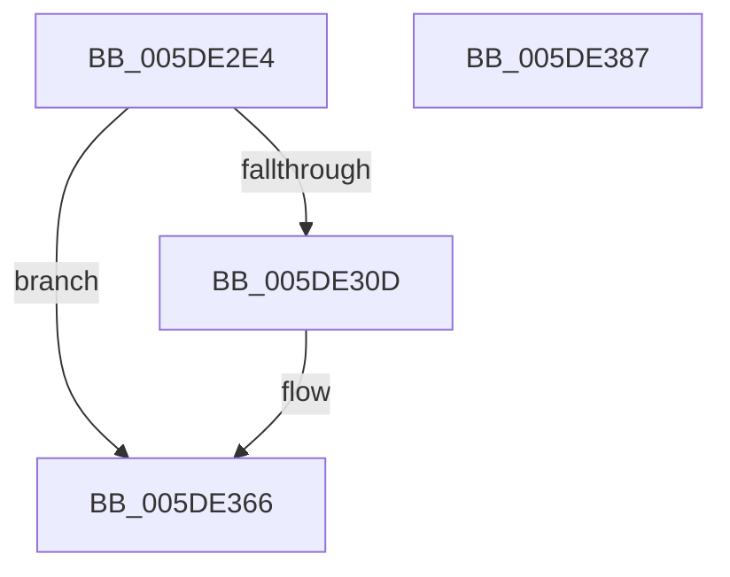

# PopPlUnregisterComponent

- RVA: `0x005DE2E4`–`0x005DE388` (길이 `164` bytes)
- VA: `0x00000001405DE2E4`
- 실행 섹션: `.text`
- PDB 이름 있음: `예`; PDB Function 태그: `아니요`
- unwind 정보 RVA: `0x000CD78C`
- 디코드: `34`개 명령, `164/164` bytes 표시
- 미해석 바이트: `0` (있으면 어셈블리에 `.byte`로 보존)

> 이 문서는 커널 이미지의 기계어와 PDB 기호를 분석해 생성했습니다. 4번과 5번은 함수 원형과 자료형을 바이너리 사용 방식에서 추정한 C 해석이며 원본 소스 복구 결과는 아닙니다.

## 1. Dependencies

- 직접 호출 지점: **2**; 고유 호출 대상: **2**
- 직접 호출자로 확인된 함수: **1**
- RIP 상대 이미지 참조: **3**

### Outgoing calls
- `0x005DE361` → [tlgWriteTransfer_EtwWriteTransfer](../42/tlgWriteTransfer_EtwWriteTransfer_function_004260E0.md) (function, `0x004260E0`)
- `0x005DE379` → [_security_check_cookie](../6A/_security_check_cookie_function_006AC640.md) (function, `0x006AC640`)

### Direct callers
- [PopPlUnregisterDevice](../4E/PopPlUnregisterDevice_function_004E3FF4.md) at `0x004E417A`

### Static image references
- `0x005DE2EF` → RVA `0x00E0A740` (`.data`; read)
- `0x005DE301` → RVA `0x00E07748` (`.data`; read)
- `0x005DE312` → RVA `0x000507F8` (`.rdata`; read)

## 2. Other-region calls and transfers

- 다른 실행 섹션으로 향하는 call: **0**
- 별도 외부 분기/꼬리 이동을 확인하지 못했습니다.

## 3. Assembly (complete function range)

```asm
005DE2E4  4C 8B DC                        mov r11, rsp
005DE2E7  53                              push rbx
005DE2E8  48 81 EC 90 00 00 00            sub rsp, 0x90
005DE2EF  48 8B 05 4A C4 82 00            mov rax, qword ptr [rip + 0x82c44a]
005DE2F6  48 33 C4                        xor rax, rsp
005DE2F9  48 89 84 24 80 00 00 00         mov qword ptr [rsp + 0x80], rax
005DE301  83 3D 40 94 82 00 05            cmp dword ptr [rip + 0x829440], 5
005DE308  48 8B D9                        mov rbx, rcx
005DE30B  76 59                           jbe 0x1405de366
005DE30D  B8 01 00 00 00                  mov eax, 1
005DE312  48 8D 15 DF 24 A7 FF            lea rdx, [rip - 0x58db21]
005DE319  66 89 44 24 30                  mov word ptr [rsp + 0x30], ax
005DE31E  45 33 C9                        xor r9d, r9d
005DE321  49 8D 43 98                     lea rax, [r11 - 0x68]
005DE325  45 33 C0                        xor r8d, r8d
005DE328  49 89 43 C8                     mov qword ptr [r11 - 0x38], rax
005DE32C  49 8D 43 A8                     lea rax, [r11 - 0x58]
005DE330  83 64 24 6C 00                  and dword ptr [rsp + 0x6c], 0
005DE335  C7 44 24 68 02 00 00 00         mov dword ptr [rsp + 0x68], 2
005DE33D  49 89 4B D8                     mov qword ptr [r11 - 0x28], rcx
005DE341  48 8D 0D 00 94 82 00            lea rcx, [rip + 0x829400]
005DE348  83 64 24 7C 00                  and dword ptr [rsp + 0x7c], 0
005DE34D  49 89 43 90                     mov qword ptr [r11 - 0x70], rax
005DE351  C7 44 24 20 04 00 00 00         mov dword ptr [rsp + 0x20], 4
005DE359  C7 44 24 78 10 00 00 00         mov dword ptr [rsp + 0x78], 0x10
005DE361  E8 7A 7D E4 FF                  call 0x1404260e0
005DE366  48 83 A3 B0 01 00 00 00         and qword ptr [rbx + 0x1b0], 0
005DE36E  48 8B 8C 24 80 00 00 00         mov rcx, qword ptr [rsp + 0x80]
005DE376  48 33 CC                        xor rcx, rsp
005DE379  E8 C2 E2 0C 00                  call 0x1406ac640
005DE37E  48 81 C4 90 00 00 00            add rsp, 0x90
005DE385  5B                              pop rbx
005DE386  C3                              ret
005DE387  CC                              int3
```

## 4. C-style interpretation (structured pseudocode)

```c
__int64 __fastcall PopPlUnregisterComponent(__int64 a1, __int64 a2, int a3, int a4)
{
    __int64 result;
    __int64 v_rsp;
    unsigned __int64 v_stack_m18;
    unsigned int v_stack_m1C;
    unsigned int v_stack_m20;
    unsigned int v_stack_m2C;
    unsigned int v_stack_m30;
    unsigned __int16 v_stack_m68;
    unsigned int v_stack_m78;

    v_rsp = (v_rsp) - (144);
    result = (*(unsigned __int64 *)(v_rip + 8569930)) ^ (v_rsp);
    v_stack_m18 = result;
    if ((*(unsigned int *)(v_rip + 8557632)) >= = 5) {
        result = 1;
        a2 = v_rip - 5823265;
        v_stack_m68 = (unsigned __int16)(result);
        a4 = 0;
        result = v_rsp - 104;
        a3 = 0;
        *(unsigned __int64 *)(v_rsp - 56) = result;
        result = v_rsp - 88;
        v_stack_m30 = 2;
        *(unsigned __int64 *)(v_rsp - 40) = a1;
        a1 = v_rip + 8557568;
        *(unsigned __int64 *)(v_rsp - 112) = result;
        v_stack_m78 = 4;
        v_stack_m20 = 16;
        result = tlgWriteTransfer_EtwWriteTransfer(a1, a2, a3, a4);
    }
    a1 = (v_stack_m18) ^ (v_rsp);
    result = _security_check_cookie(a1, a2, a3, a4);
    v_rsp = (v_rsp) + (144);
    return result;
}
```

## 5. (Beta) C Style

```c
int64_t PopPlUnregisterComponent(void *Arg1, int64_t Arg2, int32_t Arg3, int32_t Arg4)
{
    uint8_t *arg1 = (uint8_t *)Arg1;

    int64_t result;
    int64_t local_rsp;
    uint64_t v_stack_m18;
    uint32_t v_stack_m1C;
    uint32_t v_stack_m20;
    uint32_t v_stack_m2C;
    uint32_t v_stack_m30;
    uint16_t v_stack_m68;
    uint32_t v_stack_m78;

    local_rsp = (local_rsp) - (144);
    result = (*(uint64_t *)(v_rip + 0x82C44A)) ^ (local_rsp);
    v_stack_m18 = result;
    if ((*(uint32_t *)(v_rip + 0x829440)) >= = 5) {
        result = 1;
        Arg2 = v_rip - 5823265;
        v_stack_m68 = (uint16_t)(result);
        Arg4 = 0;
        result = local_rsp - 104;
        Arg3 = 0;
        *(uint64_t *)(local_rsp - 0x38) = result;
        result = local_rsp - 88;
        v_stack_m30 = 2;
        *(void **)(local_rsp - 0x28) = Arg1;
        Arg1 = v_rip + 8557568;
        *(uint64_t *)(local_rsp - 0x70) = result;
        v_stack_m78 = 4;
        v_stack_m20 = 16;
        result = tlgWriteTransfer_EtwWriteTransfer(Arg1, Arg2, Arg3, Arg4);
    }
    Arg1 = (v_stack_m18) ^ (local_rsp);
    result = _security_check_cookie(Arg1, Arg2, Arg3, Arg4);
    local_rsp = (local_rsp) + (144);
    return result;
}
```

### 관측된 메모리 오프셋

구조체 형식이 확인되지 않은 접근은 인자 기준의 오프셋으로만 기록했습니다.

| 기준 인자 | 오프셋 표현 | 폭 (bit) | 접근 |
|---|---:|---:|---|
| `Arg1` | `+ 0x1B0` | `64` | `R/W` |

## 6. Execution-region graph

[열기: 2D/3D 그래프와 함수 탐색 컨트롤 패널](../../../control-panel.html?section=text&rva=0x005DE2E4&view=graph)

- 2D 그래프는 위에서 아래로 흐르고, 3D 그래프는 빈 공간을 드래그해 회전합니다. Shift+드래그는 이동, 휠은 확대·축소, 함수 노드 선택은 대상 보고서 이동입니다.

### Static fallback


