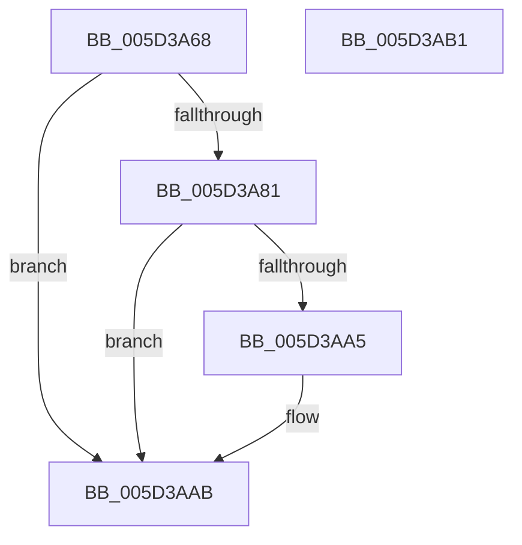

# PopPluginQueryComponentPerfCapabilities

- RVA: `0x005D3A68`–`0x005D3AB2` (길이 `74` bytes)
- VA: `0x00000001405D3A68`
- 실행 섹션: `.text`
- PDB 이름 있음: `예`; PDB Function 태그: `아니요`
- unwind 정보 RVA: `0x00064C80`
- 디코드: `23`개 명령, `74/74` bytes 표시
- 미해석 바이트: `0` (있으면 어셈블리에 `.byte`로 보존)

> 이 문서는 커널 이미지의 기계어와 PDB 기호를 분석해 생성했습니다. 4번과 5번은 함수 원형과 자료형을 바이너리 사용 방식에서 추정한 C 해석이며 원본 소스 복구 결과는 아닙니다.

## 1. Dependencies

- 직접 호출 지점: **1**; 고유 호출 대상: **1**
- 직접 호출자로 확인된 함수: **1**
- RIP 상대 이미지 참조: **0**

### Outgoing calls
- `0x005D3A9C` → [guard_dispatch_icall](../6B/guard_dispatch_icall_function_006BAAD0.md) (function, `0x006BAAD0`)

### Direct callers
- [PopFxPepPerfInfoQuery](../../page/75/PopFxPepPerfInfoQuery_function_00759564.md) at `0x00759595`

### Static image references
- 디코드된 RIP-relative 메모리 참조가 없습니다.

## 2. Other-region calls and transfers

- 다른 실행 섹션으로 향하는 call: **0**
- 별도 외부 분기/꼬리 이동을 확인하지 못했습니다.

## 3. Assembly (complete function range)

```asm
005D3A68  40 53                           push rbx
005D3A6A  48 83 EC 30                     sub rsp, 0x30
005D3A6E  83 64 24 2C 00                  and dword ptr [rsp + 0x2c], 0
005D3A73  49 8B D8                        mov rbx, r8
005D3A76  4C 8B 41 40                     mov r8, qword ptr [rcx + 0x40]
005D3A7A  32 C0                           xor al, al
005D3A7C  4D 85 C0                        test r8, r8
005D3A7F  74 2A                           je 0x1405d3aab
005D3A81  48 8B 41 48                     mov rax, qword ptr [rcx + 0x48]
005D3A85  B9 1C 00 00 00                  mov ecx, 0x1c
005D3A8A  89 54 24 28                     mov dword ptr [rsp + 0x28], edx
005D3A8E  48 8D 54 24 20                  lea rdx, [rsp + 0x20]
005D3A93  48 89 44 24 20                  mov qword ptr [rsp + 0x20], rax
005D3A98  49 8B 40 60                     mov rax, qword ptr [r8 + 0x60]
005D3A9C  E8 2F 70 0E 00                  call 0x1406baad0
005D3AA1  84 C0                           test al, al
005D3AA3  74 06                           je 0x1405d3aab
005D3AA5  8B 4C 24 2C                     mov ecx, dword ptr [rsp + 0x2c]
005D3AA9  89 0B                           mov dword ptr [rbx], ecx
005D3AAB  48 83 C4 30                     add rsp, 0x30
005D3AAF  5B                              pop rbx
005D3AB0  C3                              ret
005D3AB1  CC                              int3
```

## 4. C-style interpretation (structured pseudocode)

```c
__int64 __fastcall PopPluginQueryComponentPerfCapabilities(__int64 a1, int a2, __int64 a3)
{
    __int64 result;
    __int64 v_rsp;
    unsigned int v_stack_m10;
    unsigned __int64 v_stack_m18;
    unsigned int v_stack_mC;

    v_rsp = (v_rsp) - (48);
    result = 0;
    if (*(unsigned __int64 *)(a1 + 64) == 0) goto loc_005D3AAB;
    v_stack_m10 = a2;
    v_stack_m18 = *(unsigned __int64 *)(a1 + 72);
    result = guard_dispatch_icall(28, v_stack_m18, *(unsigned __int64 *)(a1 + 64), a4);
    if ((unsigned __int8)(result) != 0) {
        a1 = v_stack_mC;
        *(unsigned int *)(a3) = (unsigned int)(a1);
    }
    v_rsp = (v_rsp) + (48);
    return result;
}
```

## 5. (Beta) C Style

```c
int64_t PopPluginQueryComponentPerfCapabilities(void *Arg1, int32_t Arg2, void *Arg3)
{
    uint8_t *arg1 = (uint8_t *)Arg1;
    uint8_t *arg3 = (uint8_t *)Arg3;

    int64_t result;
    int64_t local_rsp;
    uint32_t v_stack_m10;
    uint64_t v_stack_m18;
    uint32_t v_stack_mC;

    local_rsp = (local_rsp) - (48);
    result = 0;
    if (*(uint64_t *)(arg1 + 0x40) == 0) goto loc_005D3AAB;
    v_stack_m10 = Arg2;
    v_stack_m18 = *(uint64_t *)(arg1 + 0x48);
    result = guard_dispatch_icall(28, v_stack_m18, *(uint64_t *)(arg1 + 0x40), a4);
    if ((uint8_t)(result) != 0) {
        Arg1 = v_stack_mC;
        *(uint32_t *)(arg3) = (uint32_t)(Arg1);
    }
    local_rsp = (local_rsp) + (48);
    return result;
}
```

### 관측된 메모리 오프셋

구조체 형식이 확인되지 않은 접근은 인자 기준의 오프셋으로만 기록했습니다.

| 기준 인자 | 오프셋 표현 | 폭 (bit) | 접근 |
|---|---:|---:|---|
| `Arg1` | `+ 0x40` | `64` | `R` |
| `Arg1` | `+ 0x48` | `64` | `R` |
| `Arg3` | `+ 0x0` | `32` | `W` |

## 6. Execution-region graph

[열기: 2D/3D 그래프와 함수 탐색 컨트롤 패널](../../../control-panel.html?section=text&rva=0x005D3A68&view=graph)

- 2D 그래프는 위에서 아래로 흐르고, 3D 그래프는 빈 공간을 드래그해 회전합니다. Shift+드래그는 이동, 휠은 확대·축소, 함수 노드 선택은 대상 보고서 이동입니다.

### Static fallback


