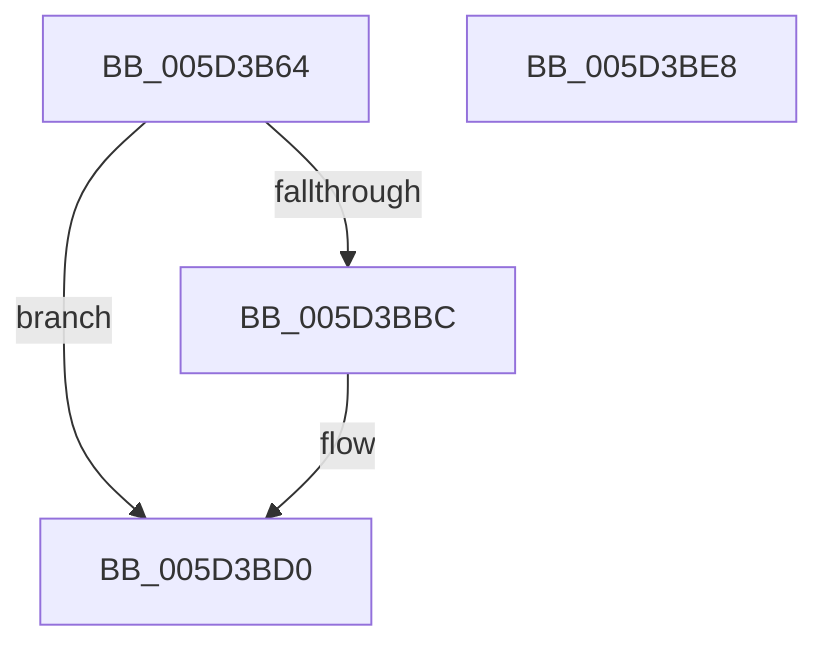

# PopPluginQueryComponentPerfSetName

- RVA: `0x005D3B64`–`0x005D3BE9` (길이 `133` bytes)
- VA: `0x00000001405D3B64`
- 실행 섹션: `.text`
- PDB 이름 있음: `예`; PDB Function 태그: `아니요`
- unwind 정보 RVA: `0x000718AC`
- 디코드: `38`개 명령, `133/133` bytes 표시
- 미해석 바이트: `0` (있으면 어셈블리에 `.byte`로 보존)

> 이 문서는 커널 이미지의 기계어와 PDB 기호를 분석해 생성했습니다. 4번과 5번은 함수 원형과 자료형을 바이너리 사용 방식에서 추정한 C 해석이며 원본 소스 복구 결과는 아닙니다.

## 1. Dependencies

- 직접 호출 지점: **2**; 고유 호출 대상: **2**
- 직접 호출자로 확인된 함수: **1**
- RIP 상대 이미지 참조: **0**

### Outgoing calls
- `0x005D3BB3` → [guard_dispatch_icall](../6B/guard_dispatch_icall_function_006BAAD0.md) (function, `0x006BAAD0`)
- `0x005D3BCA` → [PopFxBugCheck](../2B/PopFxBugCheck_function_002BFC6C.md) (function, `0x002BFC6C`)

### Direct callers
- [PopFxPepPerfInfoQuery](../../page/75/PopFxPepPerfInfoQuery_function_00759564.md) at `0x007596CA`
- [PopFxPepPerfInfoQuery](../../page/75/PopFxPepPerfInfoQuery_function_00759564.md) at `0x00759723`

### Static image references
- 디코드된 RIP-relative 메모리 참조가 없습니다.

## 2. Other-region calls and transfers

- 다른 실행 섹션으로 향하는 call: **0**
- 별도 외부 분기/꼬리 이동을 확인하지 못했습니다.

## 3. Assembly (complete function range)

```asm
005D3B64  4C 8B DC                        mov r11, rsp
005D3B67  49 89 5B 08                     mov qword ptr [r11 + 8], rbx
005D3B6B  49 89 73 10                     mov qword ptr [r11 + 0x10], rsi
005D3B6F  57                              push rdi
005D3B70  48 83 EC 40                     sub rsp, 0x40
005D3B74  48 8B 41 48                     mov rax, qword ptr [rcx + 0x48]
005D3B78  33 F6                           xor esi, esi
005D3B7A  48 8B 79 40                     mov rdi, qword ptr [rcx + 0x40]
005D3B7E  49 8B D9                        mov rbx, r9
005D3B81  89 74 24 32                     mov dword ptr [rsp + 0x32], esi
005D3B85  66 89 74 24 36                  mov word ptr [rsp + 0x36], si
005D3B8A  49 89 43 D8                     mov qword ptr [r11 - 0x28], rax
005D3B8E  8D 4E 1E                        lea ecx, [rsi + 0x1e]
005D3B91  41 0F B7 01                     movzx eax, word ptr [r9]
005D3B95  89 54 24 28                     mov dword ptr [rsp + 0x28], edx
005D3B99  49 8D 53 D8                     lea rdx, [r11 - 0x28]
005D3B9D  45 89 43 E4                     mov dword ptr [r11 - 0x1c], r8d
005D3BA1  66 89 44 24 30                  mov word ptr [rsp + 0x30], ax
005D3BA6  48 8B 44 24 70                  mov rax, qword ptr [rsp + 0x70]
005D3BAB  49 89 43 F0                     mov qword ptr [r11 - 0x10], rax
005D3BAF  48 8B 47 60                     mov rax, qword ptr [rdi + 0x60]
005D3BB3  E8 18 6F 0E 00                  call 0x1406baad0
005D3BB8  84 C0                           test al, al
005D3BBA  75 14                           jne 0x1405d3bd0
005D3BBC  45 33 C9                        xor r9d, r9d
005D3BBF  8D 56 1E                        lea edx, [rsi + 0x1e]
005D3BC2  4C 8B C7                        mov r8, rdi
005D3BC5  B9 05 06 00 00                  mov ecx, 0x605
005D3BCA  E8 9D C0 CE FF                  call 0x1402bfc6c
005D3BCF  CC                              int3
005D3BD0  0F B7 44 24 30                  movzx eax, word ptr [rsp + 0x30]
005D3BD5  48 8B 74 24 58                  mov rsi, qword ptr [rsp + 0x58]
005D3BDA  66 89 03                        mov word ptr [rbx], ax
005D3BDD  48 8B 5C 24 50                  mov rbx, qword ptr [rsp + 0x50]
005D3BE2  48 83 C4 40                     add rsp, 0x40
005D3BE6  5F                              pop rdi
005D3BE7  C3                              ret
005D3BE8  CC                              int3
```

## 4. C-style interpretation (structured pseudocode)

```c
__int64 __fastcall PopPluginQueryComponentPerfSetName(__int64 a1, int a2, int a3, __int64 a4, __int64 a5)
{
    __int64 result;
    __int64 v_rsi;
    __int64 v_rsp;
    unsigned __int16 v_stack_m12;
    unsigned int v_stack_m16;
    unsigned __int16 v_stack_m18;
    unsigned int v_stack_m20;
    unsigned __int64 v_stack_p10;
    unsigned __int64 v_stack_p8;

    *(unsigned __int64 *)(v_rsp + 8) = v_rbx;
    *(unsigned __int64 *)(v_rsp + 16) = v_rsi;
    v_rsp = (v_rsp) - (64);
    v_rsi = 0;
    v_stack_m16 = 0;
    v_stack_m12 = 0;
    *(unsigned __int64 *)(v_rsp - 40) = *(unsigned __int64 *)(a1 + 72);
    v_stack_m20 = a2;
    *(unsigned int *)(v_rsp - 28) = a3;
    v_stack_m18 = (unsigned __int16)(*(unsigned __int16 *)(a4));
    *(unsigned __int64 *)(v_rsp - 16) = a5;
    result = guard_dispatch_icall(v_rsi + 30, v_rsp - 40, a3, a4);
    if ((unsigned __int8)(result) == 0) {
        a4 = 0;
        a2 = v_rsi + 30;
        a3 = *(unsigned __int64 *)(a1 + 64);
        a1 = 0x605ULL;
        result = PopFxBugCheck(a1, a2, a3, a4);
    }
    *(unsigned __int16 *)(a4) = (unsigned __int16)(v_stack_m18);
    v_rsp = (v_rsp) + (64);
    return v_stack_m18;
}
```

## 5. (Beta) C Style

```c
int64_t PopPluginQueryComponentPerfSetName(void *Arg1, int32_t Arg2, int32_t Arg3, void *Arg4, int64_t Arg5)
{
    uint8_t *arg1 = (uint8_t *)Arg1;
    uint8_t *arg4 = (uint8_t *)Arg4;

    int64_t result;
    int64_t local_rsi;
    int64_t local_rsp;
    uint16_t v_stack_m12;
    uint32_t v_stack_m16;
    uint16_t v_stack_m18;
    uint32_t v_stack_m20;
    uint64_t v_stack_p10;
    uint64_t v_stack_p8;

    *(uint64_t *)(local_rsp + 0x8) = local_rbx;
    *(uint64_t *)(local_rsp + 0x10) = local_rsi;
    local_rsp = (local_rsp) - (64);
    local_rsi = 0;
    v_stack_m16 = 0;
    v_stack_m12 = 0;
    *(uint64_t *)(local_rsp - 0x28) = *(uint64_t *)(arg1 + 0x48);
    v_stack_m20 = Arg2;
    *(uint32_t *)(local_rsp - 0x1C) = Arg3;
    v_stack_m18 = (uint16_t)(*(uint16_t *)(arg4));
    *(uint64_t *)(local_rsp - 0x10) = Arg5;
    result = guard_dispatch_icall(local_rsi + 30, local_rsp - 40, Arg3, Arg4);
    if ((uint8_t)(result) == 0) {
        Arg4 = 0;
        Arg2 = local_rsi + 30;
        Arg3 = *(uint64_t *)(arg1 + 0x40);
        Arg1 = 0x605ULL;
        result = PopFxBugCheck(Arg1, Arg2, Arg3, Arg4);
    }
    *(uint16_t *)(arg4) = (uint16_t)(v_stack_m18);
    local_rsp = (local_rsp) + (64);
    return v_stack_m18;
}
```

### 관측된 메모리 오프셋

구조체 형식이 확인되지 않은 접근은 인자 기준의 오프셋으로만 기록했습니다.

| 기준 인자 | 오프셋 표현 | 폭 (bit) | 접근 |
|---|---:|---:|---|
| `Arg1` | `+ 0x40` | `64` | `R` |
| `Arg1` | `+ 0x48` | `64` | `R` |
| `Arg4` | `+ 0x0` | `16` | `R` |
| `Arg4` | `+ 0x0` | `16` | `W` |

## 6. Execution-region graph

[열기: 2D/3D 그래프와 함수 탐색 컨트롤 패널](../../../control-panel.html?section=text&rva=0x005D3B64&view=graph)

- 2D 그래프는 위에서 아래로 흐르고, 3D 그래프는 빈 공간을 드래그해 회전합니다. Shift+드래그는 이동, 휠은 확대·축소, 함수 노드 선택은 대상 보고서 이동입니다.

### Static fallback


