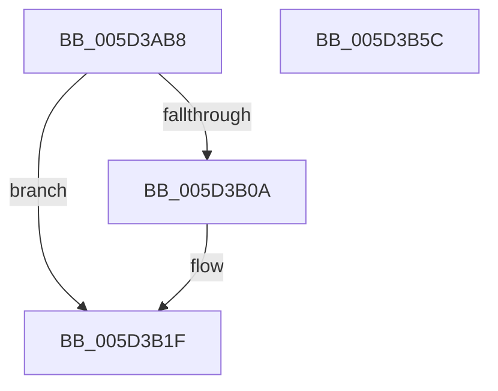

# PopPluginQueryComponentPerfSet

- RVA: `0x005D3AB8`–`0x005D3B5D` (길이 `165` bytes)
- VA: `0x00000001405D3AB8`
- 실행 섹션: `.text`
- PDB 이름 있음: `예`; PDB Function 태그: `아니요`
- unwind 정보 RVA: `0x000C47A0`
- 디코드: `47`개 명령, `165/165` bytes 표시
- 미해석 바이트: `0` (있으면 어셈블리에 `.byte`로 보존)

> 이 문서는 커널 이미지의 기계어와 PDB 기호를 분석해 생성했습니다. 4번과 5번은 함수 원형과 자료형을 바이너리 사용 방식에서 추정한 C 해석이며 원본 소스 복구 결과는 아닙니다.

## 1. Dependencies

- 직접 호출 지점: **2**; 고유 호출 대상: **2**
- 직접 호출자로 확인된 함수: **1**
- RIP 상대 이미지 참조: **0**

### Outgoing calls
- `0x005D3B01` → [guard_dispatch_icall](../6B/guard_dispatch_icall_function_006BAAD0.md) (function, `0x006BAAD0`)
- `0x005D3B19` → [PopFxBugCheck](../2B/PopFxBugCheck_function_002BFC6C.md) (function, `0x002BFC6C`)

### Direct callers
- [PopFxPepPerfInfoQuery](../../page/75/PopFxPepPerfInfoQuery_function_00759564.md) at `0x00759653`

### Static image references
- 디코드된 RIP-relative 메모리 참조가 없습니다.

## 2. Other-region calls and transfers

- 다른 실행 섹션으로 향하는 call: **0**
- 별도 외부 분기/꼬리 이동을 확인하지 못했습니다.

## 3. Assembly (complete function range)

```asm
005D3AB8  48 89 5C 24 08                  mov qword ptr [rsp + 8], rbx
005D3ABD  48 89 7C 24 10                  mov qword ptr [rsp + 0x10], rdi
005D3AC2  55                              push rbp
005D3AC3  48 8B EC                        mov rbp, rsp
005D3AC6  48 83 EC 50                     sub rsp, 0x50
005D3ACA  48 8B 41 48                     mov rax, qword ptr [rcx + 0x48]
005D3ACE  49 8B F9                        mov rdi, r9
005D3AD1  48 8B 59 40                     mov rbx, qword ptr [rcx + 0x40]
005D3AD5  B9 1D 00 00 00                  mov ecx, 0x1d
005D3ADA  48 83 65 E8 00                  and qword ptr [rbp - 0x18], 0
005D3ADF  48 83 65 F0 00                  and qword ptr [rbp - 0x10], 0
005D3AE4  48 83 65 F8 00                  and qword ptr [rbp - 8], 0
005D3AE9  48 83 65 E0 00                  and qword ptr [rbp - 0x20], 0
005D3AEE  89 55 D8                        mov dword ptr [rbp - 0x28], edx
005D3AF1  48 8D 55 D0                     lea rdx, [rbp - 0x30]
005D3AF5  48 89 45 D0                     mov qword ptr [rbp - 0x30], rax
005D3AF9  44 89 45 DC                     mov dword ptr [rbp - 0x24], r8d
005D3AFD  48 8B 43 60                     mov rax, qword ptr [rbx + 0x60]
005D3B01  E8 CA 6F 0E 00                  call 0x1406baad0
005D3B06  84 C0                           test al, al
005D3B08  75 15                           jne 0x1405d3b1f
005D3B0A  45 33 C9                        xor r9d, r9d
005D3B0D  4C 8B C3                        mov r8, rbx
005D3B10  B9 05 06 00 00                  mov ecx, 0x605
005D3B15  41 8D 51 1D                     lea edx, [r9 + 0x1d]
005D3B19  E8 4E C1 CE FF                  call 0x1402bfc6c
005D3B1E  CC                              int3
005D3B1F  8B 45 E8                        mov eax, dword ptr [rbp - 0x18]
005D3B22  48 8B 4D 30                     mov rcx, qword ptr [rbp + 0x30]
005D3B26  48 8B 5C 24 60                  mov rbx, qword ptr [rsp + 0x60]
005D3B2B  89 07                           mov dword ptr [rdi], eax
005D3B2D  8B 45 EC                        mov eax, dword ptr [rbp - 0x14]
005D3B30  48 8B 7C 24 68                  mov rdi, qword ptr [rsp + 0x68]
005D3B35  89 01                           mov dword ptr [rcx], eax
005D3B37  48 8B 4D 38                     mov rcx, qword ptr [rbp + 0x38]
005D3B3B  8B 45 F0                        mov eax, dword ptr [rbp - 0x10]
005D3B3E  89 01                           mov dword ptr [rcx], eax
005D3B40  48 8B 4D 40                     mov rcx, qword ptr [rbp + 0x40]
005D3B44  48 8B 45 F0                     mov rax, qword ptr [rbp - 0x10]
005D3B48  48 89 01                        mov qword ptr [rcx], rax
005D3B4B  48 8B 4D 48                     mov rcx, qword ptr [rbp + 0x48]
005D3B4F  48 8B 45 F8                     mov rax, qword ptr [rbp - 8]
005D3B53  48 89 01                        mov qword ptr [rcx], rax
005D3B56  48 83 C4 50                     add rsp, 0x50
005D3B5A  5D                              pop rbp
005D3B5B  C3                              ret
005D3B5C  CC                              int3
```

## 4. C-style interpretation (structured pseudocode)

```c
__int64 __fastcall PopPluginQueryComponentPerfSet(__int64 a1, int a2, int a3, __int64 a4, __int64 a5, __int64 a6, __int64 a7, __int64 a8)
{
    __int64 result;
    __int64 v_rsp;
    unsigned __int64 v_stack_m10;
    unsigned __int64 v_stack_m18;
    unsigned int v_stack_m1C;
    unsigned __int64 v_stack_m20;
    unsigned __int64 v_stack_m28;
    unsigned int v_stack_m2C;
    unsigned int v_stack_m30;
    unsigned __int64 v_stack_m38;
    unsigned __int64 v_stack_p10;
    unsigned __int64 v_stack_p8;

    v_stack_p8 = v_rbx;
    v_stack_p10 = v_rdi;
    v_rsp = (v_rsp) - (80);
    v_stack_m30 = a2;
    v_stack_m38 = *(unsigned __int64 *)(a1 + 72);
    v_stack_m2C = a3;
    result = guard_dispatch_icall(29, v_stack_m38, a3, a4);
    if ((unsigned __int8)(result) == 0) {
        a4 = 0;
        a3 = *(unsigned __int64 *)(a1 + 64);
        a1 = 0x605ULL;
        a2 = a4 + 29;
        result = PopFxBugCheck(a1, a2, a3, a4);
    }
    *(unsigned int *)(a4) = (unsigned int)((unsigned int)(v_stack_m20));
    *(unsigned int *)(a5) = (unsigned int)((unsigned int)(v_stack_m1C));
    *(unsigned int *)(a6) = (unsigned int)((unsigned int)(v_stack_m18));
    *(unsigned __int64 *)(a7) = v_stack_m18;
    *(unsigned __int64 *)(a8) = v_stack_m10;
    v_rsp = (v_rsp) + (80);
    return v_stack_m10;
}
```

## 5. (Beta) C Style

```c
int64_t PopPluginQueryComponentPerfSet(void *Arg1, int32_t Arg2, int32_t Arg3, void *Arg4, void *Arg5, void *Arg6, void *Arg7, void *Arg8)
{
    uint8_t *arg1 = (uint8_t *)Arg1;
    uint8_t *arg4 = (uint8_t *)Arg4;
    uint8_t *arg5 = (uint8_t *)Arg5;
    uint8_t *arg6 = (uint8_t *)Arg6;
    uint8_t *arg7 = (uint8_t *)Arg7;
    uint8_t *arg8 = (uint8_t *)Arg8;

    int64_t result;
    int64_t local_rsp;
    uint64_t v_stack_m10;
    uint64_t v_stack_m18;
    uint32_t v_stack_m1C;
    uint64_t v_stack_m20;
    uint64_t v_stack_m28;
    uint32_t v_stack_m2C;
    uint32_t v_stack_m30;
    uint64_t v_stack_m38;
    uint64_t v_stack_p10;
    uint64_t v_stack_p8;

    v_stack_p8 = local_rbx;
    v_stack_p10 = local_rdi;
    local_rsp = (local_rsp) - (80);
    v_stack_m30 = Arg2;
    v_stack_m38 = *(uint64_t *)(arg1 + 0x48);
    v_stack_m2C = Arg3;
    result = guard_dispatch_icall(29, v_stack_m38, Arg3, Arg4);
    if ((uint8_t)(result) == 0) {
        Arg4 = 0;
        Arg3 = *(uint64_t *)(arg1 + 0x40);
        Arg1 = 0x605ULL;
        Arg2 = Arg4 + 29;
        result = PopFxBugCheck(Arg1, Arg2, Arg3, Arg4);
    }
    *(uint32_t *)(arg4) = (uint32_t)((uint32_t)(v_stack_m20));
    *(uint32_t *)(arg5) = (uint32_t)((uint32_t)(v_stack_m1C));
    *(uint32_t *)(arg6) = (uint32_t)((uint32_t)(v_stack_m18));
    *(uint64_t *)(arg7) = v_stack_m18;
    *(uint64_t *)(arg8) = v_stack_m10;
    local_rsp = (local_rsp) + (80);
    return v_stack_m10;
}
```

### 관측된 메모리 오프셋

구조체 형식이 확인되지 않은 접근은 인자 기준의 오프셋으로만 기록했습니다.

| 기준 인자 | 오프셋 표현 | 폭 (bit) | 접근 |
|---|---:|---:|---|
| `Arg1` | `+ 0x40` | `64` | `R` |
| `Arg1` | `+ 0x48` | `64` | `R` |
| `Arg4` | `+ 0x0` | `32` | `W` |
| `Arg5` | `+ 0x0` | `32` | `W` |
| `Arg6` | `+ 0x0` | `32` | `W` |
| `Arg7` | `+ 0x0` | `64` | `W` |
| `Arg8` | `+ 0x0` | `64` | `W` |

## 6. Execution-region graph

[열기: 2D/3D 그래프와 함수 탐색 컨트롤 패널](../../../control-panel.html?section=text&rva=0x005D3AB8&view=graph)

- 2D 그래프는 위에서 아래로 흐르고, 3D 그래프는 빈 공간을 드래그해 회전합니다. Shift+드래그는 이동, 휠은 확대·축소, 함수 노드 선택은 대상 보고서 이동입니다.

### Static fallback


