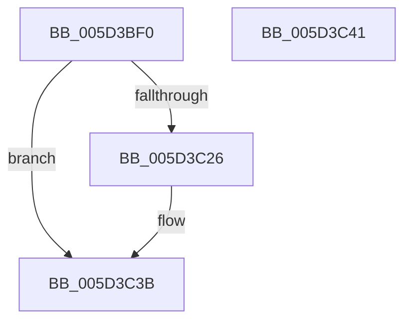

# PopPluginQueryComponentPerfStates

- RVA: `0x005D3BF0`–`0x005D3C42` (길이 `82` bytes)
- VA: `0x00000001405D3BF0`
- 실행 섹션: `.text`
- PDB 이름 있음: `예`; PDB Function 태그: `아니요`
- unwind 정보 RVA: `0x0007F554`
- 디코드: `25`개 명령, `82/82` bytes 표시
- 미해석 바이트: `0` (있으면 어셈블리에 `.byte`로 보존)

> 이 문서는 커널 이미지의 기계어와 PDB 기호를 분석해 생성했습니다. 4번과 5번은 함수 원형과 자료형을 바이너리 사용 방식에서 추정한 C 해석이며 원본 소스 복구 결과는 아닙니다.

## 1. Dependencies

- 직접 호출 지점: **2**; 고유 호출 대상: **2**
- 직접 호출자로 확인된 함수: **1**
- RIP 상대 이미지 참조: **0**

### Outgoing calls
- `0x005D3C1D` → [guard_dispatch_icall](../6B/guard_dispatch_icall_function_006BAAD0.md) (function, `0x006BAAD0`)
- `0x005D3C35` → [PopFxBugCheck](../2B/PopFxBugCheck_function_002BFC6C.md) (function, `0x002BFC6C`)

### Direct callers
- [PopFxPepPerfInfoQuery](../../page/75/PopFxPepPerfInfoQuery_function_00759564.md) at `0x007596AD`

### Static image references
- 디코드된 RIP-relative 메모리 참조가 없습니다.

## 2. Other-region calls and transfers

- 다른 실행 섹션으로 향하는 call: **0**
- 별도 외부 분기/꼬리 이동을 확인하지 못했습니다.

## 3. Assembly (complete function range)

```asm
005D3BF0  4C 8B DC                        mov r11, rsp
005D3BF3  53                              push rbx
005D3BF4  48 83 EC 40                     sub rsp, 0x40
005D3BF8  48 8B 41 48                     mov rax, qword ptr [rcx + 0x48]
005D3BFC  48 8B 59 40                     mov rbx, qword ptr [rcx + 0x40]
005D3C00  B9 1F 00 00 00                  mov ecx, 0x1f
005D3C05  49 89 43 D8                     mov qword ptr [r11 - 0x28], rax
005D3C09  89 54 24 28                     mov dword ptr [rsp + 0x28], edx
005D3C0D  49 8D 53 D8                     lea rdx, [r11 - 0x28]
005D3C11  45 89 43 E4                     mov dword ptr [r11 - 0x1c], r8d
005D3C15  4D 89 4B E8                     mov qword ptr [r11 - 0x18], r9
005D3C19  48 8B 43 60                     mov rax, qword ptr [rbx + 0x60]
005D3C1D  E8 AE 6E 0E 00                  call 0x1406baad0
005D3C22  84 C0                           test al, al
005D3C24  75 15                           jne 0x1405d3c3b
005D3C26  45 33 C9                        xor r9d, r9d
005D3C29  4C 8B C3                        mov r8, rbx
005D3C2C  B9 05 06 00 00                  mov ecx, 0x605
005D3C31  41 8D 51 1F                     lea edx, [r9 + 0x1f]
005D3C35  E8 32 C0 CE FF                  call 0x1402bfc6c
005D3C3A  CC                              int3
005D3C3B  48 83 C4 40                     add rsp, 0x40
005D3C3F  5B                              pop rbx
005D3C40  C3                              ret
005D3C41  CC                              int3
```

## 4. C-style interpretation (structured pseudocode)

```c
__int64 __fastcall PopPluginQueryComponentPerfStates(__int64 a1, int a2, int a3, __int64 a4)
{
    __int64 result;
    __int64 v_rsp;
    unsigned int v_stack_m20;

    v_rsp = (v_rsp) - (64);
    *(unsigned __int64 *)(v_rsp - 40) = *(unsigned __int64 *)(a1 + 72);
    v_stack_m20 = a2;
    *(unsigned int *)(v_rsp - 28) = a3;
    *(unsigned __int64 *)(v_rsp - 24) = a4;
    result = guard_dispatch_icall(31, v_rsp - 40, a3, a4);
    if ((unsigned __int8)(result) == 0) {
        a4 = 0;
        a3 = *(unsigned __int64 *)(a1 + 64);
        a1 = 0x605ULL;
        a2 = a4 + 31;
        result = PopFxBugCheck(a1, a2, a3, a4);
    }
    v_rsp = (v_rsp) + (64);
    return result;
}
```

## 5. (Beta) C Style

```c
int64_t PopPluginQueryComponentPerfStates(void *Arg1, int32_t Arg2, int32_t Arg3, int64_t Arg4)
{
    uint8_t *arg1 = (uint8_t *)Arg1;

    int64_t result;
    int64_t local_rsp;
    uint32_t v_stack_m20;

    local_rsp = (local_rsp) - (64);
    *(uint64_t *)(local_rsp - 0x28) = *(uint64_t *)(arg1 + 0x48);
    v_stack_m20 = Arg2;
    *(uint32_t *)(local_rsp - 0x1C) = Arg3;
    *(uint64_t *)(local_rsp - 0x18) = Arg4;
    result = guard_dispatch_icall(31, local_rsp - 40, Arg3, Arg4);
    if ((uint8_t)(result) == 0) {
        Arg4 = 0;
        Arg3 = *(uint64_t *)(arg1 + 0x40);
        Arg1 = 0x605ULL;
        Arg2 = Arg4 + 31;
        result = PopFxBugCheck(Arg1, Arg2, Arg3, Arg4);
    }
    local_rsp = (local_rsp) + (64);
    return result;
}
```

### 관측된 메모리 오프셋

구조체 형식이 확인되지 않은 접근은 인자 기준의 오프셋으로만 기록했습니다.

| 기준 인자 | 오프셋 표현 | 폭 (bit) | 접근 |
|---|---:|---:|---|
| `Arg1` | `+ 0x40` | `64` | `R` |
| `Arg1` | `+ 0x48` | `64` | `R` |

## 6. Execution-region graph

[열기: 2D/3D 그래프와 함수 탐색 컨트롤 패널](../../../control-panel.html?section=text&rva=0x005D3BF0&view=graph)

- 2D 그래프는 위에서 아래로 흐르고, 3D 그래프는 빈 공간을 드래그해 회전합니다. Shift+드래그는 이동, 휠은 확대·축소, 함수 노드 선택은 대상 보고서 이동입니다.

### Static fallback


