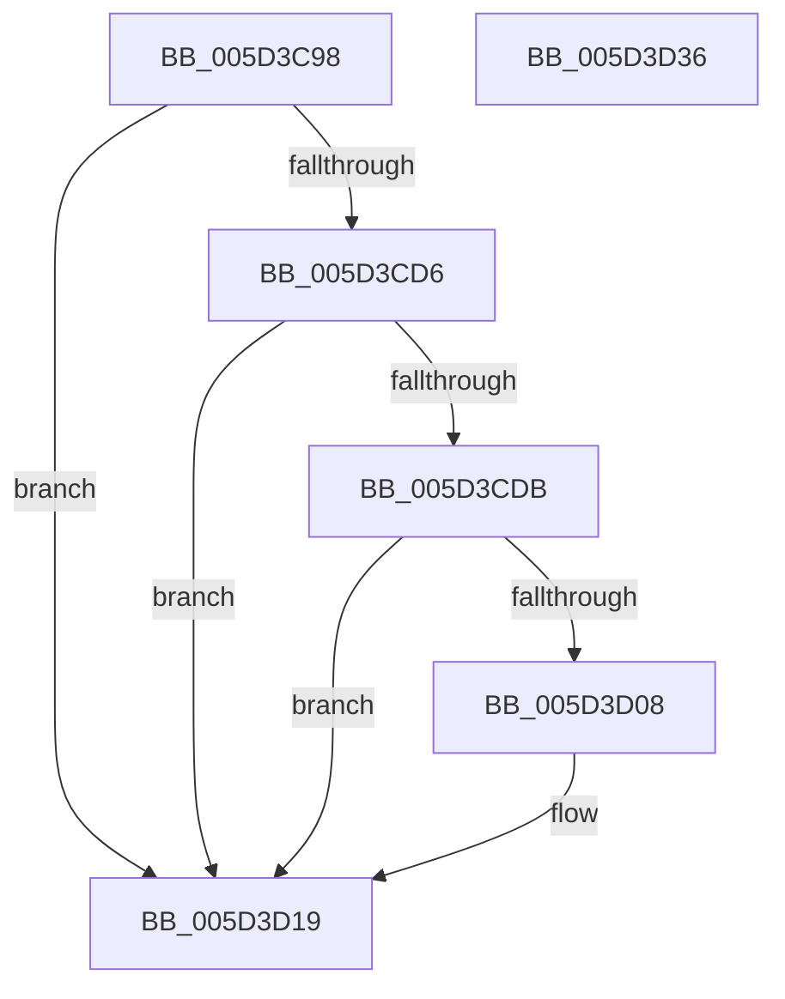

# PopPluginRequestComponentIdleConstraints

- RVA: `0x005D3C98`–`0x005D3D37` (길이 `159` bytes)
- VA: `0x00000001405D3C98`
- 실행 섹션: `.text`
- PDB 이름 있음: `예`; PDB Function 태그: `아니요`
- unwind 정보 RVA: `0x00060130`
- 디코드: `45`개 명령, `159/159` bytes 표시
- 미해석 바이트: `0` (있으면 어셈블리에 `.byte`로 보존)

> 이 문서는 커널 이미지의 기계어와 PDB 기호를 분석해 생성했습니다. 4번과 5번은 함수 원형과 자료형을 바이너리 사용 방식에서 추정한 C 해석이며 원본 소스 복구 결과는 아닙니다.

## 1. Dependencies

- 직접 호출 지점: **2**; 고유 호출 대상: **2**
- 직접 호출자로 확인된 함수: **1**
- RIP 상대 이미지 참조: **1**

### Outgoing calls
- `0x005D3CFD` → [guard_dispatch_icall](../6B/guard_dispatch_icall_function_006BAAD0.md) (function, `0x006BAAD0`)
- `0x005D3D14` → [PopDiagTraceFxComponentIdleConstraints](PopDiagTraceFxComponentIdleConstraints_function_005D668C.md) (function, `0x005D668C`)

### Direct callers
- [PopPepInitializeVetoMasks](../4C/PopPepInitializeVetoMasks_function_004C9350.md) at `0x004C9701`

### Static image references
- `0x005D3CC7` → RVA `0x00E676B8` (`.data`; read)

## 2. Other-region calls and transfers

- 다른 실행 섹션으로 향하는 call: **0**
- 별도 외부 분기/꼬리 이동을 확인하지 못했습니다.

## 3. Assembly (complete function range)

```asm
005D3C98  4C 8B DC                        mov r11, rsp
005D3C9B  49 89 5B 08                     mov qword ptr [r11 + 8], rbx
005D3C9F  49 89 6B 10                     mov qword ptr [r11 + 0x10], rbp
005D3CA3  49 89 73 18                     mov qword ptr [r11 + 0x18], rsi
005D3CA7  49 89 7B 20                     mov qword ptr [r11 + 0x20], rdi
005D3CAB  41 56                           push r14
005D3CAD  48 83 EC 40                     sub rsp, 0x40
005D3CB1  83 64 24 2C 00                  and dword ptr [rsp + 0x2c], 0
005D3CB6  32 DB                           xor bl, bl
005D3CB8  83 64 24 3C 00                  and dword ptr [rsp + 0x3c], 0
005D3CBD  41 8B F1                        mov esi, r9d
005D3CC0  4C 8B 51 40                     mov r10, qword ptr [rcx + 0x40]
005D3CC4  49 8B E8                        mov rbp, r8
005D3CC7  4C 3B 15 EA 39 89 00            cmp r10, qword ptr [rip + 0x8939ea]
005D3CCE  44 8B F2                        mov r14d, edx
005D3CD1  48 8B F9                        mov rdi, rcx
005D3CD4  75 43                           jne 0x1405d3d19
005D3CD6  4D 85 D2                        test r10, r10
005D3CD9  74 3E                           je 0x1405d3d19
005D3CDB  48 8B 41 48                     mov rax, qword ptr [rcx + 0x48]
005D3CDF  B9 1B 00 00 00                  mov ecx, 0x1b
005D3CE4  41 89 53 E0                     mov dword ptr [r11 - 0x20], edx
005D3CE8  49 8D 53 D8                     lea rdx, [r11 - 0x28]
005D3CEC  49 89 43 D8                     mov qword ptr [r11 - 0x28], rax
005D3CF0  4D 89 43 E8                     mov qword ptr [r11 - 0x18], r8
005D3CF4  44 89 4C 24 38                  mov dword ptr [rsp + 0x38], r9d
005D3CF9  49 8B 42 60                     mov rax, qword ptr [r10 + 0x60]
005D3CFD  E8 CE 6D 0E 00                  call 0x1406baad0
005D3D02  8A D8                           mov bl, al
005D3D04  84 C0                           test al, al
005D3D06  74 11                           je 0x1405d3d19
005D3D08  44 8B CE                        mov r9d, esi
005D3D0B  4C 8B C5                        mov r8, rbp
005D3D0E  41 8B D6                        mov edx, r14d
005D3D11  48 8B CF                        mov rcx, rdi
005D3D14  E8 73 29 00 00                  call 0x1405d668c
005D3D19  48 8B 6C 24 58                  mov rbp, qword ptr [rsp + 0x58]
005D3D1E  8A C3                           mov al, bl
005D3D20  48 8B 5C 24 50                  mov rbx, qword ptr [rsp + 0x50]
005D3D25  48 8B 74 24 60                  mov rsi, qword ptr [rsp + 0x60]
005D3D2A  48 8B 7C 24 68                  mov rdi, qword ptr [rsp + 0x68]
005D3D2F  48 83 C4 40                     add rsp, 0x40
005D3D33  41 5E                           pop r14
005D3D35  C3                              ret
005D3D36  CC                              int3
```

## 4. C-style interpretation (structured pseudocode)

```c
__int64 __fastcall PopPluginRequestComponentIdleConstraints(__int64 a1, int a2, __int64 a3, int a4)
{
    __int64 result;
    __int64 v_rbx;
    __int64 v_rsp;
    unsigned int v_stack_m10;
    unsigned int v_stack_m1C;
    unsigned int v_stack_mC;
    unsigned __int64 v_stack_p10;
    unsigned __int64 v_stack_p18;
    unsigned __int64 v_stack_p20;
    unsigned __int64 v_stack_p8;

    *(unsigned __int64 *)(v_rsp + 8) = v_rbx;
    *(unsigned __int64 *)(v_rsp + 16) = v_rbp;
    *(unsigned __int64 *)(v_rsp + 24) = v_rsi;
    *(unsigned __int64 *)(v_rsp + 32) = v_rdi;
    v_rsp = (v_rsp) - (64);
    v_rbx = 0;
    if ((*(unsigned __int64 *)(a1 + 64)) != (*(unsigned __int64 *)(v_rip + 8993258))) goto loc_005D3D19;
    if (*(unsigned __int64 *)(a1 + 64) == 0) goto loc_005D3D19;
    *(unsigned int *)(v_rsp - 32) = a2;
    *(unsigned __int64 *)(v_rsp - 40) = *(unsigned __int64 *)(a1 + 72);
    *(unsigned __int64 *)(v_rsp - 24) = a3;
    v_stack_m10 = a4;
    result = guard_dispatch_icall(27, v_rsp - 40, a3, a4);
    if ((unsigned __int8)(result) != 0) {
        a4 = (unsigned int)((unsigned int)(a4));
        a3 = a3;
        a2 = (unsigned int)((unsigned int)(a2));
        a1 = a1;
        result = PopDiagTraceFxComponentIdleConstraints(a1, a2, a3, a4);
    }
    v_rsp = (v_rsp) + (64);
    return (unsigned __int8)((unsigned __int8)(result));
}
```

## 5. (Beta) C Style

```c
int64_t PopPluginRequestComponentIdleConstraints(void *Arg1, int32_t Arg2, int64_t Arg3, int32_t Arg4)
{
    uint8_t *arg1 = (uint8_t *)Arg1;

    int64_t result;
    int64_t local_rbx;
    int64_t local_rsp;
    uint32_t v_stack_m10;
    uint32_t v_stack_m1C;
    uint32_t v_stack_mC;
    uint64_t v_stack_p10;
    uint64_t v_stack_p18;
    uint64_t v_stack_p20;
    uint64_t v_stack_p8;

    *(uint64_t *)(local_rsp + 0x8) = local_rbx;
    *(uint64_t *)(local_rsp + 0x10) = local_rbp;
    *(uint64_t *)(local_rsp + 0x18) = local_rsi;
    *(uint64_t *)(local_rsp + 0x20) = local_rdi;
    local_rsp = (local_rsp) - (64);
    local_rbx = 0;
    if ((*(uint64_t *)(arg1 + 0x40)) != (*(uint64_t *)(v_rip + 0x8939EA))) goto loc_005D3D19;
    if (*(uint64_t *)(arg1 + 0x40) == 0) goto loc_005D3D19;
    *(uint32_t *)(local_rsp - 0x20) = Arg2;
    *(uint64_t *)(local_rsp - 0x28) = *(uint64_t *)(arg1 + 0x48);
    *(uint64_t *)(local_rsp - 0x18) = Arg3;
    v_stack_m10 = Arg4;
    result = guard_dispatch_icall(27, local_rsp - 40, Arg3, Arg4);
    if ((uint8_t)(result) != 0) {
        Arg4 = (uint32_t)((uint32_t)(Arg4));
        Arg3 = Arg3;
        Arg2 = (uint32_t)((uint32_t)(Arg2));
        Arg1 = Arg1;
        result = PopDiagTraceFxComponentIdleConstraints(Arg1, Arg2, Arg3, Arg4);
    }
    local_rsp = (local_rsp) + (64);
    return (uint8_t)((uint8_t)(result));
}
```

### 관측된 메모리 오프셋

구조체 형식이 확인되지 않은 접근은 인자 기준의 오프셋으로만 기록했습니다.

| 기준 인자 | 오프셋 표현 | 폭 (bit) | 접근 |
|---|---:|---:|---|
| `Arg1` | `+ 0x40` | `64` | `R` |
| `Arg1` | `+ 0x48` | `64` | `R` |

## 6. Execution-region graph

[열기: 2D/3D 그래프와 함수 탐색 컨트롤 패널](../../../control-panel.html?section=text&rva=0x005D3C98&view=graph)

- 2D 그래프는 위에서 아래로 흐르고, 3D 그래프는 빈 공간을 드래그해 회전합니다. Shift+드래그는 이동, 휠은 확대·축소, 함수 노드 선택은 대상 보고서 이동입니다.

### Static fallback


