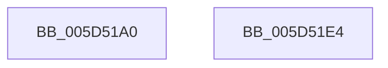

# PopPowerActionWatchdog

- RVA: `0x005D51A0`–`0x005D51E5` (길이 `69` bytes)
- VA: `0x00000001405D51A0`
- 실행 섹션: `.text`
- PDB 이름 있음: `예`; PDB Function 태그: `아니요`
- unwind 정보 RVA: `0x0005C788`
- 디코드: `15`개 명령, `69/69` bytes 표시
- 미해석 바이트: `0` (있으면 어셈블리에 `.byte`로 보존)

> 이 문서는 커널 이미지의 기계어와 PDB 기호를 분석해 생성했습니다. 4번과 5번은 함수 원형과 자료형을 바이너리 사용 방식에서 추정한 C 해석이며 원본 소스 복구 결과는 아닙니다.

## 1. Dependencies

- 직접 호출 지점: **2**; 고유 호출 대상: **2**
- 직접 호출자로 확인된 함수: **1**
- RIP 상대 이미지 참조: **5**

### Outgoing calls
- `0x005D51AB` → [PopInternalAddToDumpFile](../5C/PopInternalAddToDumpFile_function_005CE634.md) (function, `0x005CE634`)
- `0x005D51DA` → [ExQueueWorkItem](../2F/ExQueueWorkItem_function_002F9520.md) (function, `0x002F9520`)

### Direct callers
- [PopSetPowerActionWatchdogState](../4C/PopSetPowerActionWatchdogState_function_004C86B8.md) at `0x004C8712`

### Static image references
- `0x005D51B0` → RVA `0x00F0D158` (`.data`; read/write)
- `0x005D51B8` → RVA `0x005D51F0` (`PopStateTransitionTimeoutDispatch`; read)
- `0x005D51BF` → RVA `0x00F0D140` (`.data`; read/write)
- `0x005D51C7` → RVA `0x00F0D140` (`.data`; read)
- `0x005D51D3` → RVA `0x00F0D150` (`.data`; write)

## 2. Other-region calls and transfers

- 다른 실행 섹션으로 향하는 call: **0**
- 별도 외부 분기/꼬리 이동을 확인하지 못했습니다.

## 3. Assembly (complete function range)

```asm
005D51A0  48 83 EC 28                     sub rsp, 0x28
005D51A4  45 33 C0                        xor r8d, r8d
005D51A7  33 D2                           xor edx, edx
005D51A9  33 C9                           xor ecx, ecx
005D51AB  E8 84 94 FF FF                  call 0x1405ce634
005D51B0  48 83 25 A0 7F 93 00 00         and qword ptr [rip + 0x937fa0], 0
005D51B8  48 8D 05 31 00 00 00            lea rax, [rip + 0x31]
005D51BF  48 83 25 79 7F 93 00 00         and qword ptr [rip + 0x937f79], 0
005D51C7  48 8D 0D 72 7F 93 00            lea rcx, [rip + 0x937f72]
005D51CE  BA 02 00 00 00                  mov edx, 2
005D51D3  48 89 05 76 7F 93 00            mov qword ptr [rip + 0x937f76], rax
005D51DA  E8 41 43 D2 FF                  call 0x1402f9520
005D51DF  48 83 C4 28                     add rsp, 0x28
005D51E3  C3                              ret
005D51E4  CC                              int3
```

## 4. C-style interpretation (structured pseudocode)

```c
__int64 __fastcall PopPowerActionWatchdog(int a1, int a2, int a3)
{
    __int64 result;
    __int64 v_rsp;

    v_rsp = (v_rsp) - (40);
    a3 = 0;
    a2 = 0;
    a1 = 0;
    result = PopInternalAddToDumpFile(a1, a2, a3, a4);
    *(unsigned __int64 *)(v_rip + 9666422) = v_rip + 49;
    result = ExQueueWorkItem(v_rip + 9666418, 2, a3, a4);
    v_rsp = (v_rsp) + (40);
    return result;
}
```

## 5. (Beta) C Style

```c
int64_t PopPowerActionWatchdog(int32_t Arg1, int32_t Arg2, int32_t Arg3)
{
    int64_t result;
    int64_t local_rsp;

    local_rsp = (local_rsp) - (40);
    Arg3 = 0;
    Arg2 = 0;
    Arg1 = 0;
    result = PopInternalAddToDumpFile(Arg1, Arg2, Arg3, a4);
    *(uint64_t *)(v_rip + 0x937F76) = v_rip + 49;
    result = ExQueueWorkItem(v_rip + 9666418, 2, Arg3, a4);
    local_rsp = (local_rsp) + (40);
    return result;
}
```

## 6. Execution-region graph

[열기: 2D/3D 그래프와 함수 탐색 컨트롤 패널](../../../control-panel.html?section=text&rva=0x005D51A0&view=graph)

- 2D 그래프는 위에서 아래로 흐르고, 3D 그래프는 빈 공간을 드래그해 회전합니다. Shift+드래그는 이동, 휠은 확대·축소, 함수 노드 선택은 대상 보고서 이동입니다.

### Static fallback


