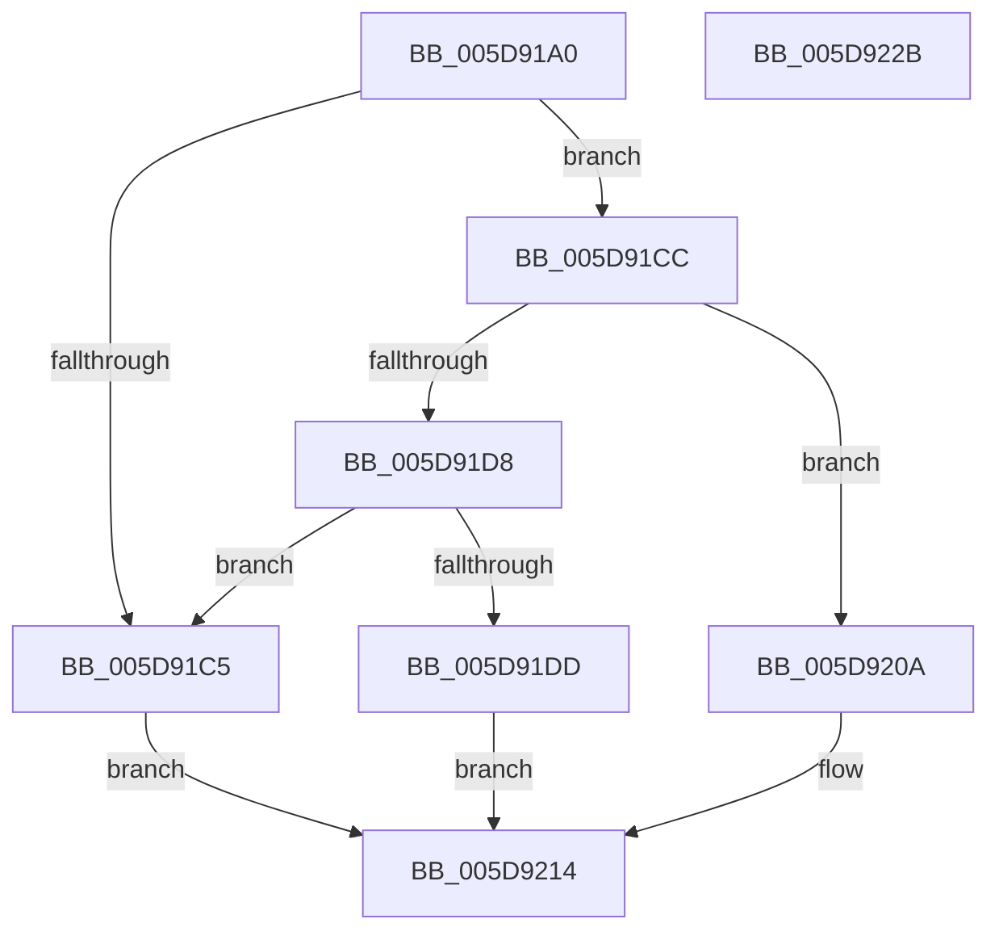

# PopPowerAggregatorHandleResumeIntent

- RVA: `0x005D91A0`–`0x005D922C` (길이 `140` bytes)
- VA: `0x00000001405D91A0`
- 실행 섹션: `.text`
- PDB 이름 있음: `예`; PDB Function 태그: `아니요`
- unwind 정보 RVA: `0x0006C8E8`
- 디코드: `42`개 명령, `140/140` bytes 표시
- 미해석 바이트: `0` (있으면 어셈블리에 `.byte`로 보존)

> 이 문서는 커널 이미지의 기계어와 PDB 기호를 분석해 생성했습니다. 4번과 5번은 함수 원형과 자료형을 바이너리 사용 방식에서 추정한 C 해석이며 원본 소스 복구 결과는 아닙니다.

## 1. Dependencies

- 직접 호출 지점: **1**; 고유 호출 대상: **1**
- 직접 호출자로 확인된 함수: **0**
- RIP 상대 이미지 참조: **0**

### Outgoing calls
- `0x005D91EF` → [PopPowerAggregatorDetermineTargetSystemPowerState](../../page/91/PopPowerAggregatorDetermineTargetSystemPowerState_function_009106A8.md) (function, `0x009106A8`)

### Direct callers
- 이 함수 시작 RVA로 연결되는 직접 call은 확인되지 않았습니다. 간접 호출은 완전히 역산할 수 없습니다.

### Static image references
- 디코드된 RIP-relative 메모리 참조가 없습니다.

## 2. Other-region calls and transfers

- 다른 실행 섹션으로 향하는 call: **1**
  - `0x005D91EF` → [PopPowerAggregatorDetermineTargetSystemPowerState](../../page/91/PopPowerAggregatorDetermineTargetSystemPowerState_function_009106A8.md) (`.text` → `PAGE`)
- 별도 외부 분기/꼬리 이동을 확인하지 못했습니다.

## 3. Assembly (complete function range)

```asm
005D91A0  48 8B C4                        mov rax, rsp
005D91A3  48 89 58 10                     mov qword ptr [rax + 0x10], rbx
005D91A7  48 89 68 18                     mov qword ptr [rax + 0x18], rbp
005D91AB  48 89 70 20                     mov qword ptr [rax + 0x20], rsi
005D91AF  57                              push rdi
005D91B0  48 83 EC 20                     sub rsp, 0x20
005D91B4  33 FF                           xor edi, edi
005D91B6  48 8B F2                        mov rsi, rdx
005D91B9  83 79 10 02                     cmp dword ptr [rcx + 0x10], 2
005D91BD  48 8B D9                        mov rbx, rcx
005D91C0  89 78 08                        mov dword ptr [rax + 8], edi
005D91C3  74 07                           je 0x1405d91cc
005D91C5  BF 03 A0 00 C0                  mov edi, 0xc000a003
005D91CA  EB 48                           jmp 0x1405d9214
005D91CC  40 8A 69 2C                     mov bpl, byte ptr [rcx + 0x2c]
005D91D0  8B 49 28                        mov ecx, dword ptr [rcx + 0x28]
005D91D3  83 E9 01                        sub ecx, 1
005D91D6  74 32                           je 0x1405d920a
005D91D8  83 F9 03                        cmp ecx, 3
005D91DB  75 E8                           jne 0x1405d91c5
005D91DD  8B 5B 30                        mov ebx, dword ptr [rbx + 0x30]
005D91E0  4C 8D 44 24 30                  lea r8, [rsp + 0x30]
005D91E5  4C 8B 4C 24 50                  mov r9, qword ptr [rsp + 0x50]
005D91EA  8B CB                           mov ecx, ebx
005D91EC  40 8A D5                        mov dl, bpl
005D91EF  E8 B4 74 33 00                  call 0x1409106a8
005D91F4  8B 44 24 30                     mov eax, dword ptr [rsp + 0x30]
005D91F8  89 46 1C                        mov dword ptr [rsi + 0x1c], eax
005D91FB  C7 06 04 00 00 00               mov dword ptr [rsi], 4
005D9201  40 88 6E 18                     mov byte ptr [rsi + 0x18], bpl
005D9205  89 5E 20                        mov dword ptr [rsi + 0x20], ebx
005D9208  EB 0A                           jmp 0x1405d9214
005D920A  C7 02 01 00 00 00               mov dword ptr [rdx], 1
005D9210  40 88 6A 18                     mov byte ptr [rdx + 0x18], bpl
005D9214  48 8B 5C 24 38                  mov rbx, qword ptr [rsp + 0x38]
005D9219  8B C7                           mov eax, edi
005D921B  48 8B 6C 24 40                  mov rbp, qword ptr [rsp + 0x40]
005D9220  48 8B 74 24 48                  mov rsi, qword ptr [rsp + 0x48]
005D9225  48 83 C4 20                     add rsp, 0x20
005D9229  5F                              pop rdi
005D922A  C3                              ret
005D922B  CC                              int3
```

## 4. C-style interpretation (structured pseudocode)

```c
__int64 __fastcall PopPowerAggregatorHandleResumeIntent(__int64 a1, __int64 a2, __int64 a3, __int64 a4, __int64 a5)
{
    __int64 result;
    __int64 v_rdi;
    __int64 v_rsp;
    unsigned __int64 v_stack_p10;
    unsigned __int64 v_stack_p18;
    unsigned __int64 v_stack_p20;
    unsigned __int64 v_stack_p8;

    *(unsigned __int64 *)(v_rsp + 16) = v_rbx;
    *(unsigned __int64 *)(v_rsp + 24) = v_rbp;
    *(unsigned __int64 *)(v_rsp + 32) = v_rsi;
    v_rsp = (v_rsp) - (32);
    v_rdi = 0;
    *(unsigned int *)(v_rsp + 8) = 0;
    if ((*(unsigned int *)(a1 + 16)) == 2) goto loc_005D91CC;
loc_005D91C5:
    goto loc_005D9214;
loc_005D91CC:
    a1 = (unsigned int)(((unsigned int)(*(unsigned int *)(a1 + 40))) - (1));
    if (condition_is_equal) goto loc_005D920A;
    if (((unsigned int)(a1)) != 3) goto loc_005D91C5;
    result = PopPowerAggregatorDetermineTargetSystemPowerState((unsigned int)((unsigned int)((unsigned int)(*(unsigned int *)(a1 + 48)))), (unsigned __int8)(*(unsigned __int8 *)(a1 + 44)), v_stack_p8, a5);
    *(unsigned int *)(a2 + 28) = (unsigned int)((unsigned int)(v_stack_p8));
    *(unsigned int *)(a2) = 4;
    *(unsigned __int8 *)(a2 + 24) = (unsigned __int8)(*(unsigned __int8 *)(a1 + 44));
    *(unsigned int *)(a2 + 32) = (unsigned int)((unsigned int)(*(unsigned int *)(a1 + 48)));
    goto loc_005D9214;
loc_005D920A:
    *(unsigned int *)((unsigned __int8)(*(unsigned __int8 *)(a1 + 44))) = 1;
    *(unsigned __int8 *)((unsigned __int8)(*(unsigned __int8 *)(a1 + 44)) + 24) = (unsigned __int8)(*(unsigned __int8 *)(a1 + 44));
loc_005D9214:
    v_rsp = (v_rsp) + (32);
    return (unsigned int)((unsigned int)((unsigned int)(0xC000A003ULL)));
}
```

## 5. (Beta) C Style

```c
int64_t PopPowerAggregatorHandleResumeIntent(void *Arg1, void *Arg2, int64_t Arg3, int64_t Arg4, int64_t Arg5)
{
    uint8_t *arg1 = (uint8_t *)Arg1;
    uint8_t *arg2 = (uint8_t *)Arg2;

    int64_t result;
    int64_t local_rdi;
    int64_t local_rsp;
    uint64_t v_stack_p10;
    uint64_t v_stack_p18;
    uint64_t v_stack_p20;
    uint64_t v_stack_p8;

    *(uint64_t *)(local_rsp + 0x10) = local_rbx;
    *(uint64_t *)(local_rsp + 0x18) = local_rbp;
    *(uint64_t *)(local_rsp + 0x20) = local_rsi;
    local_rsp = (local_rsp) - (32);
    local_rdi = 0;
    *(uint32_t *)(local_rsp + 0x8) = 0;
    if ((*(uint32_t *)(arg1 + 0x10)) == 2) goto loc_005D91CC;
loc_005D91C5:
    goto loc_005D9214;
loc_005D91CC:
    Arg1 = (uint32_t)(((uint32_t)(*(uint32_t *)(arg1 + 0x28))) - (1));
    if (condition_is_equal) goto loc_005D920A;
    if (((uint32_t)(Arg1)) != 3) goto loc_005D91C5;
    result = PopPowerAggregatorDetermineTargetSystemPowerState((uint32_t)((uint32_t)((uint32_t)(*(uint32_t *)(arg1 + 0x30)))), (uint8_t)(*(uint8_t *)(arg1 + 0x2C)), v_stack_p8, Arg5);
    *(uint32_t *)(arg2 + 0x1C) = (uint32_t)((uint32_t)(v_stack_p8));
    *(uint32_t *)(arg2) = 4;
    *(uint8_t *)(arg2 + 0x18) = (uint8_t)(*(uint8_t *)(arg1 + 0x2C));
    *(uint32_t *)(arg2 + 0x20) = (uint32_t)((uint32_t)(*(uint32_t *)(arg1 + 0x30)));
    goto loc_005D9214;
loc_005D920A:
    *(uint32_t *)((uint8_t)(*(uint8_t *)(arg1 + 0x2C))) = 1;
    *(uint8_t *)((uint8_t)(*(uint8_t *)(arg1 + 0x2C)) + 0x18) = (uint8_t)(*(uint8_t *)(arg1 + 0x2C));
loc_005D9214:
    local_rsp = (local_rsp) + (32);
    return (uint32_t)((uint32_t)((uint32_t)(0xC000A003ULL)));
}
```

### 관측된 메모리 오프셋

구조체 형식이 확인되지 않은 접근은 인자 기준의 오프셋으로만 기록했습니다.

| 기준 인자 | 오프셋 표현 | 폭 (bit) | 접근 |
|---|---:|---:|---|
| `Arg1` | `+ 0x10` | `32` | `R` |
| `Arg1` | `+ 0x28` | `32` | `R` |
| `Arg1` | `+ 0x2C` | `8` | `R` |
| `Arg1` | `+ 0x30` | `32` | `R` |
| `Arg2` | `+ 0x0` | `32` | `W` |
| `Arg2` | `+ 0x18` | `8` | `W` |
| `Arg2` | `+ 0x1C` | `32` | `W` |
| `Arg2` | `+ 0x20` | `32` | `W` |

## 6. Execution-region graph

[열기: 2D/3D 그래프와 함수 탐색 컨트롤 패널](../../../control-panel.html?section=text&rva=0x005D91A0&view=graph)

- 2D 그래프는 위에서 아래로 흐르고, 3D 그래프는 빈 공간을 드래그해 회전합니다. Shift+드래그는 이동, 휠은 확대·축소, 함수 노드 선택은 대상 보고서 이동입니다.

### Static fallback


