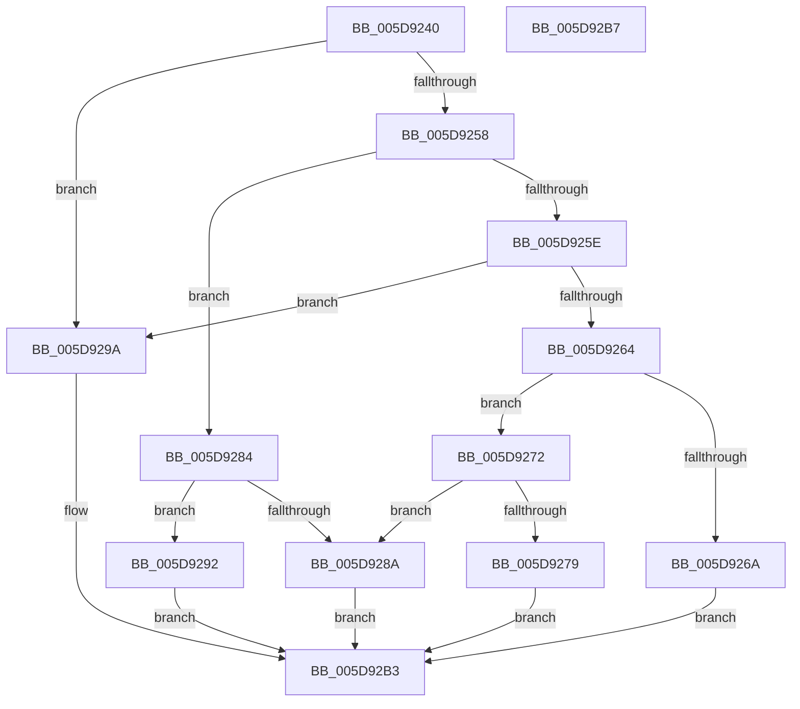

# PopPowerAggregatorHandleSuspendIntent

- RVA: `0x005D9240`–`0x005D92B8` (길이 `120` bytes)
- VA: `0x00000001405D9240`
- 실행 섹션: `.text`
- PDB 이름 있음: `예`; PDB Function 태그: `아니요`
- unwind 정보 RVA: `0x000DB714`
- 디코드: `38`개 명령, `120/120` bytes 표시
- 미해석 바이트: `0` (있으면 어셈블리에 `.byte`로 보존)

> 이 문서는 커널 이미지의 기계어와 PDB 기호를 분석해 생성했습니다. 4번과 5번은 함수 원형과 자료형을 바이너리 사용 방식에서 추정한 C 해석이며 원본 소스 복구 결과는 아닙니다.

## 1. Dependencies

- 직접 호출 지점: **0**; 고유 호출 대상: **0**
- 직접 호출자로 확인된 함수: **0**
- RIP 상대 이미지 참조: **0**

### Outgoing calls
- 직접 디코드된 call 명령이 없습니다.

### Direct callers
- 이 함수 시작 RVA로 연결되는 직접 call은 확인되지 않았습니다. 간접 호출은 완전히 역산할 수 없습니다.

### Static image references
- 디코드된 RIP-relative 메모리 참조가 없습니다.

## 2. Other-region calls and transfers

- 다른 실행 섹션으로 향하는 call: **0**
- 별도 외부 분기/꼬리 이동을 확인하지 못했습니다.

## 3. Assembly (complete function range)

```asm
005D9240  C7 02 02 00 00 00               mov dword ptr [rdx], 2
005D9246  45 33 C0                        xor r8d, r8d
005D9249  8B 41 10                        mov eax, dword ptr [rcx + 0x10]
005D924C  89 42 18                        mov dword ptr [rdx + 0x18], eax
005D924F  44 8B 49 10                     mov r9d, dword ptr [rcx + 0x10]
005D9253  45 85 C9                        test r9d, r9d
005D9256  74 42                           je 0x1405d929a
005D9258  41 83 E9 01                     sub r9d, 1
005D925C  74 26                           je 0x1405d9284
005D925E  41 83 E9 01                     sub r9d, 1
005D9262  74 36                           je 0x1405d929a
005D9264  41 83 F9 02                     cmp r9d, 2
005D9268  74 08                           je 0x1405d9272
005D926A  41 B8 03 A0 00 C0               mov r8d, 0xc000a003
005D9270  EB 41                           jmp 0x1405d92b3
005D9272  8A 41 28                        mov al, byte ptr [rcx + 0x28]
005D9275  84 C0                           test al, al
005D9277  74 11                           je 0x1405d928a
005D9279  88 42 1C                        mov byte ptr [rdx + 0x1c], al
005D927C  8B 41 30                        mov eax, dword ptr [rcx + 0x30]
005D927F  89 42 20                        mov dword ptr [rdx + 0x20], eax
005D9282  EB 2F                           jmp 0x1405d92b3
005D9284  44 38 41 29                     cmp byte ptr [rcx + 0x29], r8b
005D9288  74 08                           je 0x1405d9292
005D928A  41 B8 01 00 00 C0               mov r8d, 0xc0000001
005D9290  EB 21                           jmp 0x1405d92b3
005D9292  8A 41 28                        mov al, byte ptr [rcx + 0x28]
005D9295  88 42 1C                        mov byte ptr [rdx + 0x1c], al
005D9298  EB 19                           jmp 0x1405d92b3
005D929A  0F 10 41 10                     movups xmm0, xmmword ptr [rcx + 0x10]
005D929E  0F 11 02                        movups xmmword ptr [rdx], xmm0
005D92A1  0F 10 49 20                     movups xmm1, xmmword ptr [rcx + 0x20]
005D92A5  0F 11 4A 10                     movups xmmword ptr [rdx + 0x10], xmm1
005D92A9  F2 0F 10 41 30                  movsd xmm0, qword ptr [rcx + 0x30]
005D92AE  F2 0F 11 42 20                  movsd qword ptr [rdx + 0x20], xmm0
005D92B3  41 8B C0                        mov eax, r8d
005D92B6  C3                              ret
005D92B7  CC                              int3
```

## 4. C-style interpretation (structured pseudocode)

```c
__int64 __fastcall PopPowerAggregatorHandleSuspendIntent(__int64 a1, __int64 a2, int a3)
{
    *(unsigned int *)(a2) = 2;
    a3 = 0;
    *(unsigned int *)(a2 + 24) = (unsigned int)((unsigned int)(*(unsigned int *)(a1 + 16)));
    if ((unsigned int)((unsigned int)(*(unsigned int *)(a1 + 16))) == 0) goto loc_005D929A;
    a4 = (unsigned int)(((unsigned int)(*(unsigned int *)(a1 + 16))) - (1));
    if (condition_is_equal) goto loc_005D9284;
    a4 = (unsigned int)((a4) - (1));
    if (condition_is_equal) goto loc_005D929A;
    if (((unsigned int)(a4)) == 2) goto loc_005D9272;
    goto loc_005D92B3;
loc_005D9272:
    if ((unsigned __int8)(*(unsigned __int8 *)(a1 + 40)) == 0) goto loc_005D928A;
    *(unsigned __int8 *)(a2 + 28) = (unsigned __int8)(*(unsigned __int8 *)(a1 + 40));
    *(unsigned int *)(a2 + 32) = (unsigned int)((unsigned int)(*(unsigned int *)(a1 + 48)));
    goto loc_005D92B3;
loc_005D9284:
    if ((*(unsigned __int8 *)(a1 + 41)) == ((unsigned __int8)((unsigned int)(0xC000A003ULL)))) goto loc_005D9292;
loc_005D928A:
    goto loc_005D92B3;
loc_005D9292:
    *(unsigned __int8 *)(a2 + 28) = (unsigned __int8)(*(unsigned __int8 *)(a1 + 40));
    goto loc_005D92B3;
loc_005D929A:
    *(unsigned __int64 *)(a2) = v_xmm0;
    *(unsigned __int64 *)(a2 + 16) = v_xmm1;
    *(unsigned __int64 *)(a2 + 32) = v_xmm0;
loc_005D92B3:
    return (unsigned int)((unsigned int)((unsigned int)(0xC0000001ULL)));
}
```

## 5. (Beta) C Style

```c
int64_t PopPowerAggregatorHandleSuspendIntent(void *Arg1, void *Arg2, int32_t Arg3)
{
    uint8_t *arg1 = (uint8_t *)Arg1;
    uint8_t *arg2 = (uint8_t *)Arg2;

    *(uint32_t *)(arg2) = 2;
    Arg3 = 0;
    *(uint32_t *)(arg2 + 0x18) = (uint32_t)((uint32_t)(*(uint32_t *)(arg1 + 0x10)));
    if ((uint32_t)((uint32_t)(*(uint32_t *)(arg1 + 0x10))) == 0) goto loc_005D929A;
    a4 = (uint32_t)(((uint32_t)(*(uint32_t *)(arg1 + 0x10))) - (1));
    if (condition_is_equal) goto loc_005D9284;
    a4 = (uint32_t)((a4) - (1));
    if (condition_is_equal) goto loc_005D929A;
    if (((uint32_t)(a4)) == 2) goto loc_005D9272;
    goto loc_005D92B3;
loc_005D9272:
    if ((uint8_t)(*(uint8_t *)(arg1 + 0x28)) == 0) goto loc_005D928A;
    *(uint8_t *)(arg2 + 0x1C) = (uint8_t)(*(uint8_t *)(arg1 + 0x28));
    *(uint32_t *)(arg2 + 0x20) = (uint32_t)((uint32_t)(*(uint32_t *)(arg1 + 0x30)));
    goto loc_005D92B3;
loc_005D9284:
    if ((*(uint8_t *)(arg1 + 0x29)) == ((uint8_t)((uint32_t)(0xC000A003ULL)))) goto loc_005D9292;
loc_005D928A:
    goto loc_005D92B3;
loc_005D9292:
    *(uint8_t *)(arg2 + 0x1C) = (uint8_t)(*(uint8_t *)(arg1 + 0x28));
    goto loc_005D92B3;
loc_005D929A:
    *(uint64_t *)(arg2) = v_xmm0;
    *(uint64_t *)(arg2 + 0x10) = v_xmm1;
    *(uint64_t *)(arg2 + 0x20) = v_xmm0;
loc_005D92B3:
    return (uint32_t)((uint32_t)((uint32_t)(0xC0000001ULL)));
}
```

### 관측된 메모리 오프셋

구조체 형식이 확인되지 않은 접근은 인자 기준의 오프셋으로만 기록했습니다.

| 기준 인자 | 오프셋 표현 | 폭 (bit) | 접근 |
|---|---:|---:|---|
| `Arg1` | `+ 0x10` | `32` | `R` |
| `Arg1` | `+ 0x10` | `128` | `R` |
| `Arg1` | `+ 0x20` | `128` | `R` |
| `Arg1` | `+ 0x28` | `8` | `R` |
| `Arg1` | `+ 0x29` | `8` | `R` |
| `Arg1` | `+ 0x30` | `32` | `R` |
| `Arg1` | `+ 0x30` | `64` | `R` |
| `Arg2` | `+ 0x0` | `32` | `W` |
| `Arg2` | `+ 0x0` | `128` | `R` |
| `Arg2` | `+ 0x10` | `128` | `R` |
| `Arg2` | `+ 0x18` | `32` | `W` |
| `Arg2` | `+ 0x1C` | `8` | `W` |
| `Arg2` | `+ 0x20` | `32` | `W` |
| `Arg2` | `+ 0x20` | `64` | `W` |

## 6. Execution-region graph

[열기: 2D/3D 그래프와 함수 탐색 컨트롤 패널](../../../control-panel.html?section=text&rva=0x005D9240&view=graph)

- 2D 그래프는 위에서 아래로 흐르고, 3D 그래프는 빈 공간을 드래그해 회전합니다. Shift+드래그는 이동, 휠은 확대·축소, 함수 노드 선택은 대상 보고서 이동입니다.

### Static fallback


