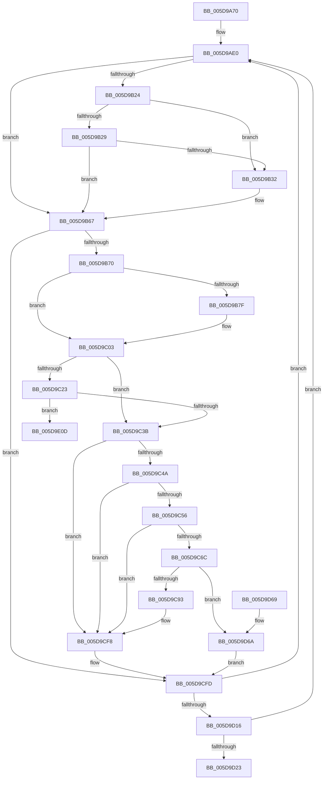

# PopPowerButtonWorkCallback

- RVA: `0x005D9A70`–`0x005D9E36` (길이 `966` bytes)
- VA: `0x00000001405D9A70`
- 실행 섹션: `.text`
- PDB 이름 있음: `예`; PDB Function 태그: `아니요`
- unwind 정보 RVA: `0x000CD050`
- 디코드: `220`개 명령, `966/966` bytes 표시
- 미해석 바이트: `0` (있으면 어셈블리에 `.byte`로 보존)

> 이 문서는 커널 이미지의 기계어와 PDB 기호를 분석해 생성했습니다. 4번과 5번은 함수 원형과 자료형을 바이너리 사용 방식에서 추정한 C 해석이며 원본 소스 복구 결과는 아닙니다.

## 1. Dependencies

- 직접 호출 지점: **23**; 고유 호출 대상: **17**
- 직접 호출자로 확인된 함수: **0**
- RIP 상대 이미지 참조: **22**

### Outgoing calls
- `0x005D9AD4` → [KeAcquireSpinLockRaiseToDpc](../20/KeAcquireSpinLockRaiseToDpc_function_00208470.md) (function, `0x00208470`)
- `0x005D9B01` → [KeReleaseSpinLock](../39/KeReleaseSpinLock_function_00392BA0.md) (function, `0x00392BA0`)
- `0x005D9B34` → [PopRecordPhysicalPowerButton](../../page/75/PopRecordPhysicalPowerButton_function_00754464.md) (function, `0x00754464`)
- `0x005D9B4D` → [PopPublishPowerButtonState](../../page/AD/PopPublishPowerButtonState_function_00ADB8C8.md) (function, `0x00ADB8C8`)
- `0x005D9B62` → [KeDisableTimer2](../39/KeDisableTimer2_function_0039FD58.md) (function, `0x0039FD58`)
- `0x005D9B83` → [ExUuidCreate](../../page/91/ExUuidCreate_function_00917500.md) (function, `0x00917500`)
- `0x005D9B97` → [PopRecordPhysicalPowerButton](../../page/75/PopRecordPhysicalPowerButton_function_00754464.md) (function, `0x00754464`)
- `0x005D9BAF` → [PopQueryPowerButtonBugcheckEnabled](../../page/AC/PopQueryPowerButtonBugcheckEnabled_function_00ACA4E4.md) (function, `0x00ACA4E4`)
- `0x005D9BDE` → [KeInitializeIRTimer](../3A/KeInitializeIRTimer_function_003A4204.md) (function, `0x003A4204`)
- `0x005D9BFA` → [KeSetTimer2](../3A/KeSetTimer2_function_003A08E0.md) (function, `0x003A08E0`)
- `0x005D9C11` → [PopPublishPowerButtonState](../../page/AD/PopPublishPowerButtonState_function_00ADB8C8.md) (function, `0x00ADB8C8`)
- `0x005D9C25` → [PopDiagTracePowerButtonBugcheck](../../page/76/PopDiagTracePowerButtonBugcheck_function_00761F14.md) (function, `0x00761F14`)
- `0x005D9C2A` → [PopRecordPoBlackboxInformation](../../page/77/PopRecordPoBlackboxInformation_function_007731D8.md) (function, `0x007731D8`)
- `0x005D9C70` → [PopBsdPowerTransitionToParam1](../../page/76/PopBsdPowerTransitionToParam1_function_00768EE8.md) (function, `0x00768EE8`)
- `0x005D9CC7` → [DbgkWerCaptureLiveKernelDump](../../page/AC/DbgkWerCaptureLiveKernelDump_function_00AC1E90.md) (function, `0x00AC1E90`)
- `0x005D9CF3` → [DbgPrintEx](../35/DbgPrintEx_function_00359290.md) (function, `0x00359290`)
- `0x005D9D04` → [KeAcquireSpinLockRaiseToDpc](../20/KeAcquireSpinLockRaiseToDpc_function_00208470.md) (function, `0x00208470`)
- `0x005D9D32` → [KeReleaseSpinLock](../39/KeReleaseSpinLock_function_00392BA0.md) (function, `0x00392BA0`)
- `0x005D9D3E` → [_security_check_cookie](../6A/_security_check_cookie_function_006AC640.md) (function, `0x006AC640`)
- `0x005D9DE0` → [DbgkWerCaptureLiveKernelDump2](../../page/AC/DbgkWerCaptureLiveKernelDump2_function_00AC1F10.md) (function, `0x00AC1F10`)
- `0x005D9E03` → [DbgPrintEx](../35/DbgPrintEx_function_00359290.md) (function, `0x00359290`)
- `0x005D9E11` → [PopBsdPowerTransitionToParam1](../../page/76/PopBsdPowerTransitionToParam1_function_00768EE8.md) (function, `0x00768EE8`)
- `0x005D9E30` → [KeBugCheckEx](../4F/KeBugCheckEx_function_004FD660.md) (function, `0x004FD660`)

### Direct callers
- 이 함수 시작 RVA로 연결되는 직접 call은 확인되지 않았습니다. 간접 호출은 완전히 역산할 수 없습니다.

### Static image references
- `0x005D9A97` → RVA `0x00E0A740` (`.data`; read)
- `0x005D9AA8` → RVA `0x00F08600` (`.data`; read)
- `0x005D9AE0` → RVA `0x00F086B8` (`.data`; read)
- `0x005D9AF0` → RVA `0x00F086C8` (`.data`; read)
- `0x005D9B06` → RVA `0x00F086D0` (`.data`; read)
- `0x005D9B29` → RVA `0x00F086D4` (`.data`; read)
- `0x005D9B40` → RVA `0x00F086D0` (`.data`; write)
- `0x005D9B46` → RVA `0x00F08588` (`.data`; write)
- `0x005D9B55` → RVA `0x00F08608` (`.data`; read)
- `0x005D9B8F` → RVA `0x00F08560` (`.data`; write)
- `0x005D9BA0` → RVA `0x00F086D4` (`.data`; write)
- `0x005D9BA7` → RVA `0x00F086D8` (`.data`; write)
- `0x005D9BB7` → RVA `0x00F086E8` (`.data`; write)
- `0x005D9BC8` → RVA `0x005D9A00` (`PopPowerButtonTimerCallback`; read)
- `0x005D9C2F` → RVA `0x00F086E8` (`.data`; read)
- `0x005D9C3B` → RVA `0x00F085A8` (`.data`; read)
- `0x005D9C79` → RVA `0x00F08520` (`.data`; read)
- `0x005D9CA1` → RVA `0x006CC360` (` ?? ::FNODOBFM::`string'`; read)
- `0x005D9CCE` → RVA `0x006CC2E0` (` ?? ::FNODOBFM::`string'`; read)
- `0x005D9D16` → RVA `0x00F086BC` (`.data`; read)
- `0x005D9D23` → RVA `0x00F086B0` (`.data`; read/write)
- `0x005D9DE8` → RVA `0x006CC380` (` ?? ::FNODOBFM::`string'`; read)

## 2. Other-region calls and transfers

- 다른 실행 섹션으로 향하는 call: **12**
  - `0x005D9B34` → [PopRecordPhysicalPowerButton](../../page/75/PopRecordPhysicalPowerButton_function_00754464.md) (`.text` → `PAGE`)
  - `0x005D9B4D` → [PopPublishPowerButtonState](../../page/AD/PopPublishPowerButtonState_function_00ADB8C8.md) (`.text` → `PAGE`)
  - `0x005D9B83` → [ExUuidCreate](../../page/91/ExUuidCreate_function_00917500.md) (`.text` → `PAGE`)
  - `0x005D9B97` → [PopRecordPhysicalPowerButton](../../page/75/PopRecordPhysicalPowerButton_function_00754464.md) (`.text` → `PAGE`)
  - `0x005D9BAF` → [PopQueryPowerButtonBugcheckEnabled](../../page/AC/PopQueryPowerButtonBugcheckEnabled_function_00ACA4E4.md) (`.text` → `PAGE`)
  - `0x005D9C11` → [PopPublishPowerButtonState](../../page/AD/PopPublishPowerButtonState_function_00ADB8C8.md) (`.text` → `PAGE`)
  - `0x005D9C25` → [PopDiagTracePowerButtonBugcheck](../../page/76/PopDiagTracePowerButtonBugcheck_function_00761F14.md) (`.text` → `PAGE`)
  - `0x005D9C2A` → [PopRecordPoBlackboxInformation](../../page/77/PopRecordPoBlackboxInformation_function_007731D8.md) (`.text` → `PAGE`)
  - `0x005D9C70` → [PopBsdPowerTransitionToParam1](../../page/76/PopBsdPowerTransitionToParam1_function_00768EE8.md) (`.text` → `PAGE`)
  - `0x005D9CC7` → [DbgkWerCaptureLiveKernelDump](../../page/AC/DbgkWerCaptureLiveKernelDump_function_00AC1E90.md) (`.text` → `PAGE`)
  - `0x005D9DE0` → [DbgkWerCaptureLiveKernelDump2](../../page/AC/DbgkWerCaptureLiveKernelDump2_function_00AC1F10.md) (`.text` → `PAGE`)
  - `0x005D9E11` → [PopBsdPowerTransitionToParam1](../../page/76/PopBsdPowerTransitionToParam1_function_00768EE8.md) (`.text` → `PAGE`)
- 별도 외부 분기/꼬리 이동을 확인하지 못했습니다.

## 3. Assembly (complete function range)

```asm
005D9A70  48 8B C4                        mov rax, rsp
005D9A73  48 89 58 08                     mov qword ptr [rax + 8], rbx
005D9A77  48 89 70 10                     mov qword ptr [rax + 0x10], rsi
005D9A7B  48 89 78 18                     mov qword ptr [rax + 0x18], rdi
005D9A7F  4C 89 60 20                     mov qword ptr [rax + 0x20], r12
005D9A83  55                              push rbp
005D9A84  41 56                           push r14
005D9A86  41 57                           push r15
005D9A88  48 8D 68 A1                     lea rbp, [rax - 0x5f]
005D9A8C  48 81 EC E0 00 00 00            sub rsp, 0xe0
005D9A93  0F 29 70 D8                     movaps xmmword ptr [rax - 0x28], xmm6
005D9A97  48 8B 05 A2 0C 83 00            mov rax, qword ptr [rip + 0x830ca2]
005D9A9E  48 33 C4                        xor rax, rsp
005D9AA1  48 89 45 2F                     mov qword ptr [rbp + 0x2f], rax
005D9AA5  0F 57 C9                        xorps xmm1, xmm1
005D9AA8  48 8D 0D 51 EB 92 00            lea rcx, [rip + 0x92eb51]
005D9AAF  33 F6                           xor esi, esi
005D9AB1  0F 57 C0                        xorps xmm0, xmm0
005D9AB4  33 C0                           xor eax, eax
005D9AB6  89 75 BB                        mov dword ptr [rbp - 0x45], esi
005D9AB9  0F 11 45 BF                     movups xmmword ptr [rbp - 0x41], xmm0
005D9ABD  48 89 45 DF                     mov qword ptr [rbp - 0x21], rax
005D9AC1  0F 11 45 CF                     movups xmmword ptr [rbp - 0x31], xmm0
005D9AC5  89 75 B7                        mov dword ptr [rbp - 0x49], esi
005D9AC8  0F 11 4D FF                     movups xmmword ptr [rbp - 1], xmm1
005D9ACC  0F 11 4D 0F                     movups xmmword ptr [rbp + 0xf], xmm1
005D9AD0  0F 11 4D 1F                     movups xmmword ptr [rbp + 0x1f], xmm1
005D9AD4  E8 97 E9 C2 FF                  call 0x140208470
005D9AD9  8D 5E 08                        lea ebx, [rsi + 8]
005D9ADC  44 8D 66 01                     lea r12d, [rsi + 1]
005D9AE0  0F 10 35 D1 EB 92 00            movups xmm6, xmmword ptr [rip + 0x92ebd1]
005D9AE7  48 8D 0D 12 EB 92 00            lea rcx, [rip + 0x92eb12]
005D9AEE  8A D0                           mov dl, al
005D9AF0  F2 0F 10 05 D0 EB 92 00         movsd xmm0, qword ptr [rip + 0x92ebd0]
005D9AF8  0F 11 75 E7                     movups xmmword ptr [rbp - 0x19], xmm6
005D9AFC  F2 0F 11 45 F7                  movsd qword ptr [rbp - 9], xmm0
005D9B01  E8 9A 90 DB FF                  call 0x140392ba0
005D9B06  8B 05 C4 EB 92 00               mov eax, dword ptr [rip + 0x92ebc4]
005D9B0C  66 0F 6F C6                     movdqa xmm0, xmm6
005D9B10  66 0F 73 D8 04                  psrldq xmm0, 4
005D9B15  66 41 0F 7E C7                  movd r15d, xmm0
005D9B1A  66 41 0F 7E F6                  movd r14d, xmm6
005D9B1F  41 84 C4                        test r12b, al
005D9B22  74 43                           je 0x1405d9b67
005D9B24  45 84 F4                        test r12b, r14b
005D9B27  74 09                           je 0x1405d9b32
005D9B29  44 3B 3D A4 EB 92 00            cmp r15d, dword ptr [rip + 0x92eba4]
005D9B30  74 35                           je 0x1405d9b67
005D9B32  33 C9                           xor ecx, ecx
005D9B34  E8 2B A9 17 00                  call 0x140754464
005D9B39  48 8D 0D 90 EB 92 00            lea rcx, [rip + 0x92eb90]
005D9B40  89 35 8A EB 92 00               mov dword ptr [rip + 0x92eb8a], esi
005D9B46  40 88 35 3B EA 92 00            mov byte ptr [rip + 0x92ea3b], sil
005D9B4D  E8 76 1D 50 00                  call 0x140adb8c8
005D9B52  45 33 C9                        xor r9d, r9d
005D9B55  48 8D 0D AC EA 92 00            lea rcx, [rip + 0x92eaac]
005D9B5C  45 8A C4                        mov r8b, r12b
005D9B5F  41 8A D4                        mov dl, r12b
005D9B62  E8 F1 61 DC FF                  call 0x14039fd58
005D9B67  45 84 F4                        test r12b, r14b
005D9B6A  0F 84 8D 01 00 00               je 0x1405d9cfd
005D9B70  8B 05 5A EB 92 00               mov eax, dword ptr [rip + 0x92eb5a]
005D9B76  41 84 C4                        test r12b, al
005D9B79  0F 85 84 00 00 00               jne 0x1405d9c03
005D9B7F  48 8D 4D EF                     lea rcx, [rbp - 0x11]
005D9B83  E8 78 D9 33 00                  call 0x140917500
005D9B88  0F 10 75 EF                     movups xmm6, xmmword ptr [rbp - 0x11]
005D9B8C  41 8A CC                        mov cl, r12b
005D9B8F  F3 0F 7F 35 C9 E9 92 00         movdqu xmmword ptr [rip + 0x92e9c9], xmm6
005D9B97  E8 C8 A8 17 00                  call 0x140754464
005D9B9C  44 8B 7D EB                     mov r15d, dword ptr [rbp - 0x15]
005D9BA0  44 89 3D 2D EB 92 00            mov dword ptr [rip + 0x92eb2d], r15d
005D9BA7  F3 0F 7F 35 29 EB 92 00         movdqu xmmword ptr [rip + 0x92eb29], xmm6
005D9BAF  E8 30 09 4F 00                  call 0x140aca4e4
005D9BB4  45 8B C7                        mov r8d, r15d
005D9BB7  89 05 2B EB 92 00               mov dword ptr [rip + 0x92eb2b], eax
005D9BBD  4C 8D 4D BB                     lea r9, [rbp - 0x45]
005D9BC1  C7 45 BB 08 00 01 00            mov dword ptr [rbp - 0x45], 0x10008
005D9BC8  48 8D 15 31 FE FF FF            lea rdx, [rip - 0x1cf]
005D9BCF  C7 44 24 20 02 00 00 00         mov dword ptr [rsp + 0x20], 2
005D9BD7  48 8D 0D 2A EA 92 00            lea rcx, [rip + 0x92ea2a]
005D9BDE  E8 21 A6 DC FF                  call 0x1403a4204
005D9BE3  45 33 C9                        xor r9d, r9d
005D9BE6  48 8D 0D 1B EA 92 00            lea rcx, [rip + 0x92ea1b]
005D9BED  48 C7 C2 80 69 67 FF            mov rdx, 0xffffffffff676980
005D9BF4  41 B8 80 96 98 00               mov r8d, 0x989680
005D9BFA  E8 E1 6C DC FF                  call 0x1403a08e0
005D9BFF  44 8B 75 E7                     mov r14d, dword ptr [rbp - 0x19]
005D9C03  48 8D 0D C6 EA 92 00            lea rcx, [rip + 0x92eac6]
005D9C0A  44 89 35 BF EA 92 00            mov dword ptr [rip + 0x92eabf], r14d
005D9C11  E8 B2 1C 50 00                  call 0x140adb8c8
005D9C16  41 8B DE                        mov ebx, r14d
005D9C19  D1 EB                           shr ebx, 1
005D9C1B  81 FB 58 1B 00 00               cmp ebx, 0x1b58
005D9C21  72 18                           jb 0x1405d9c3b
005D9C23  8B CB                           mov ecx, ebx
005D9C25  E8 EA 82 18 00                  call 0x140761f14
005D9C2A  E8 A9 95 19 00                  call 0x1407731d8
005D9C2F  39 35 B3 EA 92 00               cmp dword ptr [rip + 0x92eab3], esi
005D9C35  0F 85 D2 01 00 00               jne 0x1405d9e0d
005D9C3B  8B 3D 67 E9 92 00               mov edi, dword ptr [rip + 0x92e967]
005D9C41  41 84 FC                        test r12b, dil
005D9C44  0F 84 AE 00 00 00               je 0x1405d9cf8
005D9C4A  39 35 98 EA 92 00               cmp dword ptr [rip + 0x92ea98], esi
005D9C50  0F 85 A2 00 00 00               jne 0x1405d9cf8
005D9C56  8B C7                           mov eax, edi
005D9C58  C1 E8 04                        shr eax, 4
005D9C5B  83 E0 0F                        and eax, 0xf
005D9C5E  69 C0 E8 03 00 00               imul eax, eax, 0x3e8
005D9C64  3B D8                           cmp ebx, eax
005D9C66  0F 85 8C 00 00 00               jne 0x1405d9cf8
005D9C6C  48 8D 4D B7                     lea rcx, [rbp - 0x49]
005D9C70  E8 73 F2 18 00                  call 0x140768ee8
005D9C75  44 8B 45 B7                     mov r8d, dword ptr [rbp - 0x49]
005D9C79  4C 8D 0D A0 E8 92 00            lea r9, [rip + 0x92e8a0]
005D9C80  BB 08 00 00 00                  mov ebx, 8
005D9C85  BA C8 11 00 00                  mov edx, 0x11c8
005D9C8A  40 84 FB                        test bl, dil
005D9C8D  0F 85 D7 00 00 00               jne 0x1405d9d6a
005D9C93  8B DF                           mov ebx, edi
005D9C95  41 8B C6                        mov eax, r14d
005D9C98  83 E3 02                        and ebx, 2
005D9C9B  48 D1 E8                        shr rax, 1
005D9C9E  83 CB 10                        or ebx, 0x10
005D9CA1  48 8D 0D B8 26 0F 00            lea rcx, [rip + 0xf26b8]
005D9CA8  D1 EB                           shr ebx, 1
005D9CAA  83 E7 04                        and edi, 4
005D9CAD  0B DF                           or ebx, edi
005D9CAF  89 5C 24 40                     mov dword ptr [rsp + 0x40], ebx
005D9CB3  48 89 74 24 38                  mov qword ptr [rsp + 0x38], rsi
005D9CB8  48 89 74 24 30                  mov qword ptr [rsp + 0x30], rsi
005D9CBD  48 89 74 24 28                  mov qword ptr [rsp + 0x28], rsi
005D9CC2  48 89 44 24 20                  mov qword ptr [rsp + 0x20], rax
005D9CC7  E8 C4 81 4E 00                  call 0x140ac1e90
005D9CCC  8B CB                           mov ecx, ebx
005D9CCE  4C 8D 05 0B 26 0F 00            lea r8, [rip + 0xf260b]
005D9CD5  C1 E9 02                        shr ecx, 2
005D9CD8  41 23 DC                        and ebx, r12d
005D9CDB  41 23 CC                        and ecx, r12d
005D9CDE  44 8B C8                        mov r9d, eax
005D9CE1  89 4C 24 28                     mov dword ptr [rsp + 0x28], ecx
005D9CE5  BA 02 00 00 00                  mov edx, 2
005D9CEA  B9 92 00 00 00                  mov ecx, 0x92
005D9CEF  89 5C 24 20                     mov dword ptr [rsp + 0x20], ebx
005D9CF3  E8 98 F5 D7 FF                  call 0x140359290
005D9CF8  BB 08 00 00 00                  mov ebx, 8
005D9CFD  48 8D 0D FC E8 92 00            lea rcx, [rip + 0x92e8fc]
005D9D04  E8 67 E7 C2 FF                  call 0x140208470
005D9D09  44 3B 35 A8 E9 92 00            cmp r14d, dword ptr [rip + 0x92e9a8]
005D9D10  0F 85 CA FD FF FF               jne 0x1405d9ae0
005D9D16  44 3B 3D 9F E9 92 00            cmp r15d, dword ptr [rip + 0x92e99f]
005D9D1D  0F 85 BD FD FF FF               jne 0x1405d9ae0
005D9D23  87 35 87 E9 92 00               xchg dword ptr [rip + 0x92e987], esi
005D9D29  8A D0                           mov dl, al
005D9D2B  48 8D 0D CE E8 92 00            lea rcx, [rip + 0x92e8ce]
005D9D32  E8 69 8E DB FF                  call 0x140392ba0
005D9D37  48 8B 4D 2F                     mov rcx, qword ptr [rbp + 0x2f]
005D9D3B  48 33 CC                        xor rcx, rsp
005D9D3E  E8 FD 28 0D 00                  call 0x1406ac640
005D9D43  4C 8D 9C 24 E0 00 00 00         lea r11, [rsp + 0xe0]
005D9D4B  49 8B 5B 20                     mov rbx, qword ptr [r11 + 0x20]
005D9D4F  49 8B 73 28                     mov rsi, qword ptr [r11 + 0x28]
005D9D53  49 8B 7B 30                     mov rdi, qword ptr [r11 + 0x30]
005D9D57  4D 8B 63 38                     mov r12, qword ptr [r11 + 0x38]
005D9D5B  41 0F 28 73 F0                  movaps xmm6, xmmword ptr [r11 - 0x10]
005D9D60  49 8B E3                        mov rsp, r11
005D9D63  41 5F                           pop r15
005D9D65  41 5E                           pop r14
005D9D67  5D                              pop rbp
005D9D68  C3                              ret
005D9D69  CC                              int3
005D9D6A  0F 57 C0                        xorps xmm0, xmm0
005D9D6D  48 89 75 D7                     mov qword ptr [rbp - 0x29], rsi
005D9D71  0F 11 45 FF                     movups xmmword ptr [rbp - 1], xmm0
005D9D75  48 8B 45 07                     mov rax, qword ptr [rbp + 7]
005D9D79  8B CF                           mov ecx, edi
005D9D7B  48 83 E0 FE                     and rax, 0xfffffffffffffffe
005D9D7F  48 C1 E9 08                     shr rcx, 8
005D9D83  49 23 CC                        and rcx, r12
005D9D86  44 89 65 BF                     mov dword ptr [rbp - 0x41], r12d
005D9D8A  48 0B C8                        or rcx, rax
005D9D8D  C7 45 C3 28 00 00 00            mov dword ptr [rbp - 0x3d], 0x28
005D9D94  48 8D 45 FF                     lea rax, [rbp - 1]
005D9D98  48 89 4D 07                     mov qword ptr [rbp + 7], rcx
005D9D9C  48 89 45 DF                     mov qword ptr [rbp - 0x21], rax
005D9DA0  48 8D 4D BF                     lea rcx, [rbp - 0x41]
005D9DA4  48 89 4C 24 30                  mov qword ptr [rsp + 0x30], rcx
005D9DA9  8B C6                           mov eax, esi
005D9DAB  83 C8 18                        or eax, 0x18
005D9DAE  4C 89 64 24 28                  mov qword ptr [rsp + 0x28], r12
005D9DB3  89 45 D7                        mov dword ptr [rbp - 0x29], eax
005D9DB6  48 8D 0D A3 25 0F 00            lea rcx, [rip + 0xf25a3]
005D9DBD  41 8B C6                        mov eax, r14d
005D9DC0  48 D1 E8                        shr rax, 1
005D9DC3  48 89 44 24 20                  mov qword ptr [rsp + 0x20], rax
005D9DC8  F3 0F 7F 45 C7                  movdqu xmmword ptr [rbp - 0x39], xmm0
005D9DCD  44 89 65 FF                     mov dword ptr [rbp - 1], r12d
005D9DD1  0F 11 45 0F                     movups xmmword ptr [rbp + 0xf], xmm0
005D9DD5  C7 45 03 30 00 00 00            mov dword ptr [rbp + 3], 0x30
005D9DDC  0F 11 45 1F                     movups xmmword ptr [rbp + 0x1f], xmm0
005D9DE0  E8 2B 81 4E 00                  call 0x140ac1f10
005D9DE5  C1 EF 08                        shr edi, 8
005D9DE8  4C 8D 05 91 25 0F 00            lea r8, [rip + 0xf2591]
005D9DEF  41 23 FC                        and edi, r12d
005D9DF2  44 8B C8                        mov r9d, eax
005D9DF5  BA 02 00 00 00                  mov edx, 2
005D9DFA  89 7C 24 20                     mov dword ptr [rsp + 0x20], edi
005D9DFE  B9 92 00 00 00                  mov ecx, 0x92
005D9E03  E8 88 F4 D7 FF                  call 0x140359290
005D9E08  E9 F0 FE FF FF                  jmp 0x1405d9cfd
005D9E0D  48 8D 4D B7                     lea rcx, [rbp - 0x49]
005D9E11  E8 D2 F0 18 00                  call 0x140768ee8
005D9E16  8B 55 B7                        mov edx, dword ptr [rbp - 0x49]
005D9E19  4C 8D 05 00 E7 92 00            lea r8, [rip + 0x92e700]
005D9E20  45 8B CE                        mov r9d, r14d
005D9E23  B9 C8 01 00 00                  mov ecx, 0x1c8
005D9E28  49 D1 E9                        shr r9, 1
005D9E2B  48 89 74 24 20                  mov qword ptr [rsp + 0x20], rsi
005D9E30  E8 2B 38 F2 FF                  call 0x1404fd660
005D9E35  CC                              int3
```

## 4. C-style interpretation (structured pseudocode)

```c
__int64 __fastcall PopPowerButtonWorkCallback(__int64 a1, __int64 a2, __int64 a3, int a4)
{
    __int64 result;
    __int64 v_r14;
    __int64 v_r15;
    __int64 v_rbx;
    __int64 v_rdi;
    __int64 v_rsi;
    __int64 v_rsp;
    unsigned __int64 v_stack_m18;
    unsigned __int64 v_stack_mB0;
    unsigned int v_stack_mB8;
    unsigned __int64 v_stack_mC0;
    unsigned __int64 v_stack_mC8;
    unsigned __int64 v_stack_mD0;
    unsigned int v_stack_mD8;

    *(unsigned __int64 *)(v_rsp + 8) = v_rbx;
    *(unsigned __int64 *)(v_rsp + 16) = v_rsi;
    *(unsigned __int64 *)(v_rsp + 24) = v_rdi;
    *(unsigned __int64 *)(v_rsp + 32) = v_r12;
    v_rsp = (v_rsp) - (224);
    *(unsigned __int64 *)(v_rsp - 40) = v_xmm6;
    result = (*(unsigned __int64 *)(v_rip + 8588450)) ^ (v_rsp);
    *(unsigned __int64 *)(v_rsp - 95 + 47) = result;
    v_rsi = 0;
    result = 0;
    *(unsigned int *)(v_rsp - 95 - 69) = 0;
    *(unsigned __int64 *)(v_rsp - 95 - 65) = v_xmm0;
    *(unsigned __int64 *)(v_rsp - 95 - 33) = 0;
    *(unsigned __int64 *)(v_rsp - 95 - 49) = v_xmm0;
    *(unsigned int *)(v_rsp - 95 - 73) = 0;
    *(unsigned __int64 *)(v_rsp - 95 - 1) = v_xmm1;
    *(unsigned __int64 *)(v_rsp - 95 + 15) = v_xmm1;
    *(unsigned __int64 *)(v_rsp - 95 + 31) = v_xmm1;
    result = KeAcquireSpinLockRaiseToDpc(v_rip + 9628497, a2, a3, a4);
loc_005D9AE0:
    *(unsigned __int64 *)(v_rsp - 95 - 25) = v_xmm6;
    *(unsigned __int64 *)(v_rsp - 95 - 9) = v_xmm0;
    result = KeReleaseSpinLock(v_rip + 9628434, (unsigned __int8)(result), a3, a4);
    if ((((unsigned __int8)(v_rsi + 1)) & ((unsigned __int8)((unsigned int)(*(unsigned int *)(v_rip + 9628612))))) == 0) goto loc_005D9B67;
    if ((((unsigned __int8)(v_rsi + 1)) & ((unsigned __int8)(v_r14))) == 0) goto loc_005D9B32;
    result = (unsigned int)(*(unsigned int *)(v_rip + 9628612));
    if (((unsigned int)(v_r15)) != (*(unsigned int *)(v_rip + 9628580))) {
        a1 = 0;
        result = PopRecordPhysicalPowerButton(a1, (unsigned __int8)(result), a3, a4);
        a1 = v_rip + 9628560;
        *(unsigned int *)(v_rip + 9628554) = 0;
        *(unsigned __int8 *)(v_rip + 9628219) = 0;
        result = PopPublishPowerButtonState(a1, (unsigned __int8)(result), a3, a4);
        a4 = 0;
        a1 = v_rip + 9628332;
        a3 = (unsigned __int8)(v_rsi + 1);
        a2 = (unsigned __int8)(v_rsi + 1);
        result = KeDisableTimer2(a1, a2, a3, a4);
    }
    if ((((unsigned __int8)(v_rsi + 1)) & ((unsigned __int8)(v_r14))) == 0) goto loc_005D9CFD;
    result = (unsigned int)(*(unsigned int *)(v_rip + 9628506));
    if ((((unsigned __int8)(v_rsi + 1)) & ((unsigned __int8)((unsigned int)(*(unsigned int *)(v_rip + 9628506))))) == 0) {
        a1 = v_rsp - 95 - 17;
        result = ExUuidCreate(a1, a2, a3, a4);
        a1 = (unsigned __int8)(v_rsi + 1);
        *(unsigned __int64 *)(v_rip + 9628105) = v_xmm6;
        result = PopRecordPhysicalPowerButton(a1, a2, a3, a4);
        v_r15 = *(unsigned int *)(v_rsp - 95 - 21);
        *(unsigned int *)(v_rip + 9628461) = (unsigned int)(v_r15);
        *(unsigned __int64 *)(v_rip + 9628457) = v_xmm6;
        result = PopQueryPowerButtonBugcheckEnabled(a1, a2, a3, a4);
        a3 = (unsigned int)(v_r15);
        *(unsigned int *)(v_rip + 9628459) = (unsigned int)(result);
        a4 = v_rsp - 95 - 69;
        *(unsigned int *)(v_rsp - 95 - 69) = 0x10008ULL;
        a2 = v_rip - 463;
        v_stack_mD8 = 2;
        a1 = v_rip + 9628202;
        result = KeInitializeIRTimer(a1, a2, a3, a4);
        a4 = 0;
        a1 = v_rip + 9628187;
        a2 = 0xFFFFFFFFFF676980ULL;
        a3 = 0x989680ULL;
        result = KeSetTimer2(a1, a2, a3, a4);
        v_r14 = *(unsigned int *)(v_rsp - 95 - 25);
    }
    *(unsigned int *)(v_rip + 9628351) = (unsigned int)(v_r14);
    result = PopPublishPowerButtonState(v_rip + 9628358, a2, a3, a4);
    v_rbx = (unsigned int)(((unsigned int)((unsigned int)(v_r14))) >> (1));
    if (((unsigned int)(v_rbx)) < 0x1B58ULL) goto loc_005D9C3B;
    result = PopDiagTracePowerButtonBugcheck((unsigned int)((unsigned int)(v_rbx)), a2, a3, a4);
    result = PopRecordPoBlackboxInformation((unsigned int)((unsigned int)(v_rbx)), a2, a3, a4);
    if ((*(unsigned int *)(v_rip + 9628339)) != 0) goto loc_005D9E0D;
loc_005D9C3B:
    if ((((unsigned __int8)(v_rsi + 1)) & ((unsigned __int8)((unsigned int)(*(unsigned int *)(v_rip + 9628007))))) == 0) goto loc_005D9CF8;
    if ((*(unsigned int *)(v_rip + 9628312)) != 0) goto loc_005D9CF8;
    result = (unsigned int)(((unsigned int)((unsigned int)((unsigned int)(*(unsigned int *)(v_rip + 9628007))))) >> (4));
    result = (unsigned int)((result) & (15));
    result = (unsigned int)((result) * ((unsigned int)(result)));
    if (((unsigned int)(v_rbx)) != ((unsigned int)(result))) goto loc_005D9CF8;
    result = PopBsdPowerTransitionToParam1(v_rsp - 95 - 73, a2, a3, a4);
    if (((8) & ((unsigned __int8)((unsigned int)(*(unsigned int *)(v_rip + 9628007))))) != 0) goto loc_005D9D6A;
    v_rbx = (unsigned int)(((unsigned int)((unsigned int)((unsigned int)(*(unsigned int *)(v_rip + 9628007))))) & (2));
    result = ((unsigned int)((unsigned int)(v_r14))) >> (1);
    v_rbx = (unsigned int)((v_rbx) | (16));
    v_rbx = (unsigned int)((v_rbx) >> (1));
    v_rdi = (unsigned int)(((unsigned int)(*(unsigned int *)(v_rip + 9628007))) & (4));
    v_rbx = (unsigned int)((v_rbx) | ((unsigned int)(v_rdi)));
    v_stack_mB8 = (unsigned int)(v_rbx);
    v_stack_mC0 = 0;
    v_stack_mC8 = 0;
    v_stack_mD0 = 0;
    v_stack_mD8 = result;
    result = DbgkWerCaptureLiveKernelDump(v_rip + 992952, (unsigned int)(0x11C8ULL), (unsigned int)(*(unsigned int *)(v_rsp - 95 - 73)), v_rip + 9627808);
    a1 = (unsigned int)(((unsigned int)((unsigned int)(v_rbx))) >> (2));
    v_rbx = (unsigned int)((v_rbx) & ((unsigned int)(v_rsi + 1)));
    a1 = (unsigned int)((a1) & ((unsigned int)(v_rsi + 1)));
    v_stack_mD0 = (unsigned int)(a1);
    v_stack_mD8 = (unsigned int)(v_rbx);
    result = DbgPrintEx(146, 2, v_rip + 992779, (unsigned int)((unsigned int)(result)));
loc_005D9CF8:
loc_005D9CFD:
    result = KeAcquireSpinLockRaiseToDpc(v_rip + 9627900, 2, v_rip + 992779, (unsigned int)((unsigned int)(result)));
    if (((unsigned int)(v_r14)) != (*(unsigned int *)(v_rip + 9628072))) goto loc_005D9AE0;
    if (((unsigned int)(v_r15)) != (*(unsigned int *)(v_rip + 9628063))) goto loc_005D9AE0;
    result = KeReleaseSpinLock(v_rip + 9627854, (unsigned __int8)(result), v_rip + 992779, (unsigned int)((unsigned int)(result)));
    a1 = (*(unsigned __int64 *)(v_rsp - 95 + 47)) ^ (v_rsp);
    result = _security_check_cookie(a1, (unsigned __int8)(result), v_rip + 992779, (unsigned int)((unsigned int)(result)));
    return result;
loc_005D9D6A:
    *(unsigned __int64 *)(v_rsp - 95 - 41) = *(unsigned __int64 *)(v_stack_m18 + 40);
    *(unsigned __int64 *)(v_rsp - 95 - 1) = v_xmm0;
    result = (*(unsigned __int64 *)(v_rsp - 95 + 7)) & (-2);
    a1 = ((unsigned int)((unsigned int)(*(unsigned __int64 *)(v_stack_m18 + 48)))) >> (8);
    a1 = (a1) & (*(unsigned __int64 *)(v_stack_m18 + 56));
    *(unsigned int *)(v_rsp - 95 - 65) = (unsigned int)(*(unsigned __int64 *)(v_stack_m18 + 56));
    a1 = (a1) | (result);
    *(unsigned int *)(v_rsp - 95 - 61) = 40;
    *(unsigned __int64 *)(v_rsp - 95 + 7) = a1;
    *(unsigned __int64 *)(v_rsp - 95 - 33) = v_rsp - 95 - 1;
    v_stack_mB0 = v_rsp - 95 - 65;
    result = (unsigned int)(((unsigned int)((unsigned int)(*(unsigned __int64 *)(v_stack_m18 + 40)))) | (24));
    v_stack_mB8 = *(unsigned __int64 *)(v_stack_m18 + 56);
    *(unsigned int *)(v_rsp - 95 - 41) = (unsigned int)(result);
    result = ((unsigned int)((unsigned int)(v_r14))) >> (1);
    v_stack_mC0 = result;
    *(unsigned __int64 *)(v_rsp - 95 - 57) = v_xmm0;
    *(unsigned int *)(v_rsp - 95 - 1) = (unsigned int)(*(unsigned __int64 *)(v_stack_m18 + 56));
    *(unsigned __int64 *)(v_rsp - 95 + 15) = v_xmm0;
    *(unsigned int *)(v_rsp - 95 + 3) = 48;
    *(unsigned __int64 *)(v_rsp - 95 + 31) = v_xmm0;
    result = DbgkWerCaptureLiveKernelDump2(v_rip + 992675, (unsigned __int8)(result), v_rip + 992779, (unsigned int)((unsigned int)(result)));
    v_rdi = (unsigned int)((*(unsigned __int64 *)(v_stack_m18 + 48)) >> (8));
    v_rdi = (unsigned int)((v_rdi) & ((unsigned int)(*(unsigned __int64 *)(v_stack_m18 + 56))));
    v_stack_mC0 = (unsigned int)(v_rdi);
    result = DbgPrintEx(146, 2, v_rip + 992657, (unsigned int)((unsigned int)(result)));
    goto loc_005D9CFD;
loc_005D9E0D:
    result = PopBsdPowerTransitionToParam1(v_rsp - 95 - 73, 2, v_rip + 992657, (unsigned int)((unsigned int)(result)));
    a4 = ((unsigned int)((unsigned int)(v_r14))) >> (1);
    v_stack_mC0 = *(unsigned __int64 *)(v_stack_m18 + 40);
    result = KeBugCheckEx(456, (unsigned int)(*(unsigned int *)(v_rsp - 95 - 73)), v_rip + 9627392, a4);
    return result;
}
```

## 5. (Beta) C Style

```c
int64_t PopPowerButtonWorkCallback(int64_t Arg1, int64_t Arg2, int64_t Arg3, int32_t Arg4)
{
    int64_t result;
    int64_t local_r14;
    int64_t local_r15;
    int64_t local_rbx;
    int64_t local_rdi;
    int64_t local_rsi;
    int64_t local_rsp;
    uint64_t v_stack_m18;
    uint64_t v_stack_mB0;
    uint32_t v_stack_mB8;
    uint64_t v_stack_mC0;
    uint64_t v_stack_mC8;
    uint64_t v_stack_mD0;
    uint32_t v_stack_mD8;

    *(uint64_t *)(local_rsp + 0x8) = local_rbx;
    *(uint64_t *)(local_rsp + 0x10) = local_rsi;
    *(uint64_t *)(local_rsp + 0x18) = local_rdi;
    *(uint64_t *)(local_rsp + 0x20) = local_r12;
    local_rsp = (local_rsp) - (224);
    *(uint64_t *)(local_rsp - 0x28) = v_xmm6;
    result = (*(uint64_t *)(v_rip + 0x830CA2)) ^ (local_rsp);
    *(uint64_t *)(local_rsp - 0x5F + 0x2F) = result;
    local_rsi = 0;
    result = 0;
    *(uint32_t *)(local_rsp - 0x5F - 0x45) = 0;
    *(uint64_t *)(local_rsp - 0x5F - 0x41) = v_xmm0;
    *(uint64_t *)(local_rsp - 0x5F - 0x21) = 0;
    *(uint64_t *)(local_rsp - 0x5F - 0x31) = v_xmm0;
    *(uint32_t *)(local_rsp - 0x5F - 0x49) = 0;
    *(uint64_t *)(local_rsp - 0x5F - 0x1) = v_xmm1;
    *(uint64_t *)(local_rsp - 0x5F + 0xF) = v_xmm1;
    *(uint64_t *)(local_rsp - 0x5F + 0x1F) = v_xmm1;
    result = KeAcquireSpinLockRaiseToDpc(v_rip + 9628497, Arg2, Arg3, Arg4);
loc_005D9AE0:
    *(uint64_t *)(local_rsp - 0x5F - 0x19) = v_xmm6;
    *(uint64_t *)(local_rsp - 0x5F - 0x9) = v_xmm0;
    result = KeReleaseSpinLock(v_rip + 9628434, (uint8_t)(result), Arg3, Arg4);
    if ((((uint8_t)(local_rsi + 1)) & ((uint8_t)((uint32_t)(*(uint32_t *)(v_rip + 0x92EBC4))))) == 0) goto loc_005D9B67;
    if ((((uint8_t)(local_rsi + 1)) & ((uint8_t)(local_r14))) == 0) goto loc_005D9B32;
    result = (uint32_t)(*(uint32_t *)(v_rip + 0x92EBC4));
    if (((uint32_t)(local_r15)) != (*(uint32_t *)(v_rip + 0x92EBA4))) {
        Arg1 = 0;
        result = PopRecordPhysicalPowerButton(Arg1, (uint8_t)(result), Arg3, Arg4);
        Arg1 = v_rip + 9628560;
        *(uint32_t *)(v_rip + 0x92EB8A) = 0;
        *(uint8_t *)(v_rip + 0x92EA3B) = 0;
        result = PopPublishPowerButtonState(Arg1, (uint8_t)(result), Arg3, Arg4);
        Arg4 = 0;
        Arg1 = v_rip + 9628332;
        Arg3 = (uint8_t)(local_rsi + 1);
        Arg2 = (uint8_t)(local_rsi + 1);
        result = KeDisableTimer2(Arg1, Arg2, Arg3, Arg4);
    }
    if ((((uint8_t)(local_rsi + 1)) & ((uint8_t)(local_r14))) == 0) goto loc_005D9CFD;
    result = (uint32_t)(*(uint32_t *)(v_rip + 0x92EB5A));
    if ((((uint8_t)(local_rsi + 1)) & ((uint8_t)((uint32_t)(*(uint32_t *)(v_rip + 0x92EB5A))))) == 0) {
        Arg1 = local_rsp - 95 - 17;
        result = ExUuidCreate(Arg1, Arg2, Arg3, Arg4);
        Arg1 = (uint8_t)(local_rsi + 1);
        *(uint64_t *)(v_rip + 0x92E9C9) = v_xmm6;
        result = PopRecordPhysicalPowerButton(Arg1, Arg2, Arg3, Arg4);
        local_r15 = *(uint32_t *)(local_rsp - 0x5F - 0x15);
        *(uint32_t *)(v_rip + 0x92EB2D) = (uint32_t)(local_r15);
        *(uint64_t *)(v_rip + 0x92EB29) = v_xmm6;
        result = PopQueryPowerButtonBugcheckEnabled(Arg1, Arg2, Arg3, Arg4);
        Arg3 = (uint32_t)(local_r15);
        *(uint32_t *)(v_rip + 0x92EB2B) = (uint32_t)(result);
        Arg4 = local_rsp - 95 - 69;
        *(uint32_t *)(local_rsp - 0x5F - 0x45) = 0x10008ULL;
        Arg2 = v_rip - 463;
        v_stack_mD8 = 2;
        Arg1 = v_rip + 9628202;
        result = KeInitializeIRTimer(Arg1, Arg2, Arg3, Arg4);
        Arg4 = 0;
        Arg1 = v_rip + 9628187;
        Arg2 = 0xFFFFFFFFFF676980ULL;
        Arg3 = 0x989680ULL;
        result = KeSetTimer2(Arg1, Arg2, Arg3, Arg4);
        local_r14 = *(uint32_t *)(local_rsp - 0x5F - 0x19);
    }
    *(uint32_t *)(v_rip + 0x92EABF) = (uint32_t)(local_r14);
    result = PopPublishPowerButtonState(v_rip + 9628358, Arg2, Arg3, Arg4);
    local_rbx = (uint32_t)(((uint32_t)((uint32_t)(local_r14))) >> (1));
    if (((uint32_t)(local_rbx)) < 0x1B58ULL) goto loc_005D9C3B;
    result = PopDiagTracePowerButtonBugcheck((uint32_t)((uint32_t)(local_rbx)), Arg2, Arg3, Arg4);
    result = PopRecordPoBlackboxInformation((uint32_t)((uint32_t)(local_rbx)), Arg2, Arg3, Arg4);
    if ((*(uint32_t *)(v_rip + 0x92EAB3)) != 0) goto loc_005D9E0D;
loc_005D9C3B:
    if ((((uint8_t)(local_rsi + 1)) & ((uint8_t)((uint32_t)(*(uint32_t *)(v_rip + 0x92E967))))) == 0) goto loc_005D9CF8;
    if ((*(uint32_t *)(v_rip + 0x92EA98)) != 0) goto loc_005D9CF8;
    result = (uint32_t)(((uint32_t)((uint32_t)((uint32_t)(*(uint32_t *)(v_rip + 0x92E967))))) >> (4));
    result = (uint32_t)((result) & (15));
    result = (uint32_t)((result) * ((uint32_t)(result)));
    if (((uint32_t)(local_rbx)) != ((uint32_t)(result))) goto loc_005D9CF8;
    result = PopBsdPowerTransitionToParam1(local_rsp - 95 - 73, Arg2, Arg3, Arg4);
    if (((8) & ((uint8_t)((uint32_t)(*(uint32_t *)(v_rip + 0x92E967))))) != 0) goto loc_005D9D6A;
    local_rbx = (uint32_t)(((uint32_t)((uint32_t)((uint32_t)(*(uint32_t *)(v_rip + 0x92E967))))) & (2));
    result = ((uint32_t)((uint32_t)(local_r14))) >> (1);
    local_rbx = (uint32_t)((local_rbx) | (16));
    local_rbx = (uint32_t)((local_rbx) >> (1));
    local_rdi = (uint32_t)(((uint32_t)(*(uint32_t *)(v_rip + 0x92E967))) & (4));
    local_rbx = (uint32_t)((local_rbx) | ((uint32_t)(local_rdi)));
    v_stack_mB8 = (uint32_t)(local_rbx);
    v_stack_mC0 = 0;
    v_stack_mC8 = 0;
    v_stack_mD0 = 0;
    v_stack_mD8 = result;
    result = DbgkWerCaptureLiveKernelDump(v_rip + 992952, (uint32_t)(0x11C8ULL), (uint32_t)(*(uint32_t *)(local_rsp - 0x5F - 0x49)), v_rip + 9627808);
    Arg1 = (uint32_t)(((uint32_t)((uint32_t)(local_rbx))) >> (2));
    local_rbx = (uint32_t)((local_rbx) & ((uint32_t)(local_rsi + 1)));
    Arg1 = (uint32_t)((Arg1) & ((uint32_t)(local_rsi + 1)));
    v_stack_mD0 = (uint32_t)(Arg1);
    v_stack_mD8 = (uint32_t)(local_rbx);
    result = DbgPrintEx(146, 2, v_rip + 992779, (uint32_t)((uint32_t)(result)));
loc_005D9CF8:
loc_005D9CFD:
    result = KeAcquireSpinLockRaiseToDpc(v_rip + 9627900, 2, v_rip + 992779, (uint32_t)((uint32_t)(result)));
    if (((uint32_t)(local_r14)) != (*(uint32_t *)(v_rip + 0x92E9A8))) goto loc_005D9AE0;
    if (((uint32_t)(local_r15)) != (*(uint32_t *)(v_rip + 0x92E99F))) goto loc_005D9AE0;
    result = KeReleaseSpinLock(v_rip + 9627854, (uint8_t)(result), v_rip + 992779, (uint32_t)((uint32_t)(result)));
    Arg1 = (*(uint64_t *)(local_rsp - 0x5F + 0x2F)) ^ (local_rsp);
    result = _security_check_cookie(Arg1, (uint8_t)(result), v_rip + 992779, (uint32_t)((uint32_t)(result)));
    return result;
loc_005D9D6A:
    *(uint64_t *)(local_rsp - 0x5F - 0x29) = *(uint64_t *)(v_stack_m18 + 0x28);
    *(uint64_t *)(local_rsp - 0x5F - 0x1) = v_xmm0;
    result = (*(uint64_t *)(local_rsp - 0x5F + 0x7)) & (-2);
    Arg1 = ((uint32_t)((uint32_t)(*(uint64_t *)(v_stack_m18 + 0x30)))) >> (8);
    Arg1 = (Arg1) & (*(uint64_t *)(v_stack_m18 + 0x38));
    *(uint32_t *)(local_rsp - 0x5F - 0x41) = (uint32_t)(*(uint64_t *)(v_stack_m18 + 0x38));
    Arg1 = (Arg1) | (result);
    *(uint32_t *)(local_rsp - 0x5F - 0x3D) = 40;
    *(uint64_t *)(local_rsp - 0x5F + 0x7) = Arg1;
    *(uint64_t *)(local_rsp - 0x5F - 0x21) = local_rsp - 95 - 1;
    v_stack_mB0 = local_rsp - 95 - 65;
    result = (uint32_t)(((uint32_t)((uint32_t)(*(uint64_t *)(v_stack_m18 + 0x28)))) | (24));
    v_stack_mB8 = *(uint64_t *)(v_stack_m18 + 0x38);
    *(uint32_t *)(local_rsp - 0x5F - 0x29) = (uint32_t)(result);
    result = ((uint32_t)((uint32_t)(local_r14))) >> (1);
    v_stack_mC0 = result;
    *(uint64_t *)(local_rsp - 0x5F - 0x39) = v_xmm0;
    *(uint32_t *)(local_rsp - 0x5F - 0x1) = (uint32_t)(*(uint64_t *)(v_stack_m18 + 0x38));
    *(uint64_t *)(local_rsp - 0x5F + 0xF) = v_xmm0;
    *(uint32_t *)(local_rsp - 0x5F + 0x3) = 48;
    *(uint64_t *)(local_rsp - 0x5F + 0x1F) = v_xmm0;
    result = DbgkWerCaptureLiveKernelDump2(v_rip + 992675, (uint8_t)(result), v_rip + 992779, (uint32_t)((uint32_t)(result)));
    local_rdi = (uint32_t)((*(uint64_t *)(v_stack_m18 + 0x30)) >> (8));
    local_rdi = (uint32_t)((local_rdi) & ((uint32_t)(*(uint64_t *)(v_stack_m18 + 0x38))));
    v_stack_mC0 = (uint32_t)(local_rdi);
    result = DbgPrintEx(146, 2, v_rip + 992657, (uint32_t)((uint32_t)(result)));
    goto loc_005D9CFD;
loc_005D9E0D:
    result = PopBsdPowerTransitionToParam1(local_rsp - 95 - 73, 2, v_rip + 992657, (uint32_t)((uint32_t)(result)));
    Arg4 = ((uint32_t)((uint32_t)(local_r14))) >> (1);
    v_stack_mC0 = *(uint64_t *)(v_stack_m18 + 0x28);
    result = KeBugCheckEx(456, (uint32_t)(*(uint32_t *)(local_rsp - 0x5F - 0x49)), v_rip + 9627392, Arg4);
    return result;
}
```

## 6. Execution-region graph

[열기: 2D/3D 그래프와 함수 탐색 컨트롤 패널](../../../control-panel.html?section=text&rva=0x005D9A70&view=graph)

- 2D 그래프는 위에서 아래로 흐르고, 3D 그래프는 빈 공간을 드래그해 회전합니다. Shift+드래그는 이동, 휠은 확대·축소, 함수 노드 선택은 대상 보고서 이동입니다.

### Static fallback


